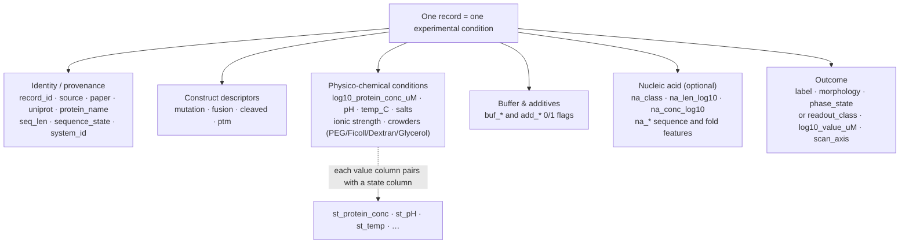
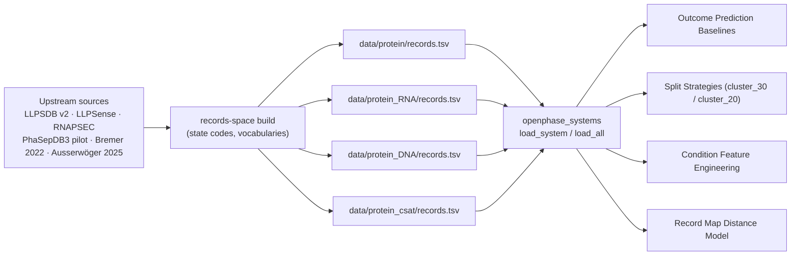

This page is the field-level reference for OpenPhase's core data product: the **condition-level record**. Every benchmark, embedding, and generative model in the repository consumes the same unit of observation — one experimental condition of one phase-separation experiment, stored as one row of `data/<system>/records.tsv`. Here you will learn what a record represents, the exact column groups it contains, how missing values are encoded, how the binary and saturation-concentration schema variants differ, and how the schema materializes as a DataFrame through the `openphase_systems` loader.

## What a "Condition-Level Record" Means

A record is **one experimental condition** of a single-protein phase-separation experiment with its outcome — a binary label (phase separation or not) or, for the saturation-concentration system, a measured concentration value. The granularity decision matters: the same protein appears many times (1,163 sequences span 7,490 records in the protein-only system), and the *condition* is what varies between rows. Conceptually each record decomposes into a protein at the center, an optional nucleic acid treated as a condition, physico-chemical conditions, buffer/additives, plus an outcome and provenance that ride along but are not themselves conditions.

Sources: [data/README.md](data/README.md#L3-L4), [records_space/README.md](records_space/README.md#L3-L4), [rslib.py](records_space/colab/rslib.py#L3)



## The Four Systems and Their Tables

The **system** of a record is defined as the set of its components *without* concentrations — a nucleic acid, if present, is a condition (the `na_*` columns), not a component that defines a new table. Each system lives in its own folder as a tab-separated table, and `data/systems.tsv` carries the same counts broken down per source. The binary pool totals 10,663 records and the csat pool 776, giving the 11,439 records that the records-space explorer visualizes.

| folder | system | records | sequences | UniProt | papers | positive / negative |
|---|---|---:|---:|---:|---:|---|
| `data/protein/` | protein only | 7,490 | 1,163 | 311 | 364 | 4,416 / 3,074 |
| `data/protein_RNA/` | protein + RNA | 2,511 | 241 | 85 | 125 | 1,751 / 760 |
| `data/protein_DNA/` | protein + DNA | 662 | 99 | 42 | 41 | 446 / 216 |
| `data/protein_csat/` | saturation concentration | 776 | 42 | 3 | 2 | no binary label |

Sources: [data/README.md](data/README.md#L6-L13), [data/systems.tsv](data/systems.tsv#L1-L5), [records_space/README.md](records_space/README.md#L3)

The records were merged from upstream sources: LLPSDB v2 (split into `LLPSDB_v2_phase_diagram`, `LLPSDB_v2_site`, and `LLPSDB_v2` in the `source` column), LLPSense, RNAPSEC, the `PhaSepDB3_pilot_LLM` extraction, and — for csat — `Bremer2022` and `Ausserwoger2025`. The archived loaders `zhanglab/db1.py`, `db2.py`, `db3.py` build one dataset per *source*, whereas these tables merge per *system*; notably, the laboratory-notebook records (db2) are deliberately **not** included in the merged tables.

Sources: [data/systems.tsv](data/systems.tsv#L2-L5), [data/README.md](data/README.md#L21-L24), [openphase_systems.py](openphase_systems.py#L10)

## Anatomy of the Schema: Column Groups

Every `records.tsv` shares one header layout; the groups below are the canonical partition documented in `data/README.md` and confirmed by the raw files. Note that `system` appears in identity — but it is **inserted by the loader at read time** (position 1), not stored in the file. Also note the pairing convention: each numeric condition column sits directly next to its `st_<shortname>` state column (e.g., `log10_protein_conc_uM` → `st_protein_conc`, `temp_C` → `st_temp`).

| group | columns | semantics |
|---|---|---|
| identity | `record_id`, `system`*, `source`, `paper`, `uniprot`, `protein_name`, `seq_len`, `sequence_state`, `system_id`, `mutation`, `fusion`, `cleaved`, `ptm` | *who and where*: provenance + construct state |
| outcome | `label`, `morphology`, `phase_state`; csat: `readout_class`, `log10_value_uM`, `scan_axis` | *what happened* |
| split groups | `cluster_30`, `cluster_20` | MMseqs2 clusters at 30 % / 20 % identity, 80 % coverage |
| conditions | `log10_protein_conc_uM`, `pH`, `temp_C`, `MgCl2_mM`, `NaCl_mM`, `KCl_mM`, `ionic_strength_mM`, `PEG1k`, `PEG6k`, `PEG20k`, `Ficoll`, `Dex40`, `Dex70`, `Glycerol` | the experimental condition vector (crowders in per cent as reported) |
| buffer / additives | `buf_*` (8 buffer families), `add_*` (12 additive classes) | 0/1 multi-hot flags |
| missing-value state | `st_*` next to each condition | `obs` / `miss` / `zero` / `rt`; `none` / `other` for buffer & additive |
| nucleic acid | `na_class`, `na_len_log10`, `na_conc_log10`, `na_to_protein_ratio_log10`, `na_charge_ratio_log10`, `na_gc`, `na_purine`, `na_maxrun`, `na_g4`, `na_mfe_per_nt`, `na_paired_frac`, `na_len_source`, `na_homopolymer`, `na_name_*`, `na_has_sequence` | the nucleic-acid condition block |
| link | `binary_record_with_same_protein` | connects csat rows to binary records of the same protein |

\* `system` is injected by `load_system`, not present on disk.

Sources: [data/README.md](data/README.md#L26-L38), [data/protein/records.tsv](data/protein/records.tsv#L1-L3), [rslib.py](records_space/colab/rslib.py#L19-L24), [rs01_build_inputs.py](records_space/scripts/rs01_build_inputs.py#L37)

A concrete row makes the pairing tangible. The first protein-system record (`llpsdb2:PS00000010`, LAF-1) reads: `label=1`, `morphology=liquid`, `readout_class=binary`, then `log10_protein_conc_uM=0.60206` with `st_protein_conc=obs`, `pH=7.4` with `st_pH=obs`, `temp_C=22.0` with `st_temp=rt` (room temperature, not a measured value), `MgCl2_mM=0.0` with `st_MgCl2=zero` (author explicitly reported absence), and a run of `0` flags for unused crowders.

Sources: [data/protein/records.tsv](data/protein/records.tsv#L2-L3)

## The `st_*` Missing-Value Encoding

This is the schema's most important design decision: **an unreported value is empty and flagged in its `st_*` column — never imputed.** The state vocabulary distinguishes four epistemic situations for each condition dimension:

| `st_*` value | meaning | upstream origin |
|---|---|---|
| `obs` | a numeric value was observed and stored | default when a value exists |
| `miss` | not reported anywhere | value is empty |
| `zero` | author explicitly reported the component as absent | `absent_from_reported_*` status codes |
| `rt` | only "room temperature" stated; `temp_C` recorded as 22 | `room_temperature_unspecified` |

Buffer and additive columns use a slightly different pair: `st_buffer` ∈ {`obs`, `other` (free text present but no vocabulary hit), `miss` (no text at all)} and `st_additive` ∈ {`obs`, `none` (buffer text exists but no additives found), `miss`}. The derivation is deterministic — the state mapper converts the upstream status strings (`absent_from_reported_*` → `zero`, `room_temperature_unspecified` → `rt`) into the codes above.

Sources: [data/README.md](data/README.md#L33-L38), [rs01_build_inputs.py](records_space/scripts/rs01_build_inputs.py#L101-L108), [rs01_build_inputs.py](records_space/scripts/rs01_build_inputs.py#L111-L114)

> [!TIP]
> **Missing ≠ not applicable.** For the nucleic-acid block, a record without any nucleic acid is a *legitimate value* (`na_class=none`), not missing data — the `na_len_log10`/`na_conc_log10`/`na_ratio_log10` columns are then "not applicable", which downstream distance computations treat as a full dissimilarity rather than a missingness penalty. Confusing these two emptinesses is the classic integration error with this schema.

Sources: [rslib.py](records_space/colab/rslib.py#L10-L12), [rs01_build_inputs.py](records_space/scripts/rs01_build_inputs.py#L17)

## Outcome Columns: Binary vs Saturation-Concentration Variants

Both variants share one header, but the outcome block reinterprets itself. In the three binary systems, `label` ∈ {0, 1}, `readout_class` is the constant `"binary"`, and `morphology`/`phase_state` describe the observed condensate. In `protein_csat`, `label` is empty, `readout_class` enumerates scan positions — `dilute`, `csat_boundary`, `dilute_linescan`, `cloud_point`, `dense` — and `log10_value_uM` + `scan_axis` (a `temp` or `conc` scan) carry the quantitative readout. The `binary_record_with_same_protein` column then links each csat row back to binary records of the same protein, so the two pools can be joined without fragile name matching.

| column | binary systems | protein_csat |
|---|---|---|
| `label` | 1 = phase separation, 0 = none | empty (no binary label) |
| `readout_class` | `binary` | `dilute`, `csat_boundary`, `dilute_linescan`, `cloud_point`, `dense` |
| `log10_value_uM` | empty | log₁₀ of measured concentration |
| `scan_axis` | empty | `temp` or `conc` (which variable the scan swept) |
| `morphology` / `phase_state` | observed condensate morphology / phase | `n/a` |
| linkage | — | `binary_record_with_same_protein` |

Sources: [data/README.md](data/README.md#L29-L30), [data/protein_csat/records.tsv](data/protein_csat/records.tsv#L2-L3), [data/protein/records.tsv](data/protein/records.tsv#L2), [rs01_build_inputs.py](records_space/scripts/rs01_build_inputs.py#L5-L6)

## Identity and Provenance Design

The schema deliberately **excludes sequence text, language-model embeddings, and free-text source fields**: sequences are identified by `uniprot` + `seq_len` alone, and `sequence_state` records *how* each construct sequence was resolved (e.g., `row_construct_fasta`, `verified_SI_name_conflict`). Provenance is compact and typed: `record_id` follows a `source:row` convention (`llpsdb2:PS00000010`, `bremer_temp:0`), `source` is the controlled vocabulary of the six upstream datasets, and `paper` carries a prefixed identifier (`pmid:29064502`, `doi:10.1038/...`). `system_id` is a hash of the component set — two rows sharing it are the same physical mixture. Finally, `cluster_30`/`cluster_20` precompute sequence-similarity groups so leakage-aware splits are a group-by, not a recomputation. Because the tables are a processed benchmarking view built from source databases with heterogeneous licences, they are not a substitute for the sources themselves.

Sources: [data/README.md](data/README.md#L28-L29), [data/README.md](data/README.md#L40-L43), [data/protein/records.tsv](data/protein/records.tsv#L1-L2), [data/protein_csat/records.tsv](data/protein_csat/records.tsv#L2)

> [!TIP]
> **`system_id` is your join key for mixture identity, `cluster_30`/`cluster_20` for leakage control.** When grouping records by experiment or splitting train/test, never split on `record_id` — it is unique per condition by design, so a naive random split places sister conditions of the same paper and protein on both sides. Group on `system_id` (same mixture) or the cluster columns (same sequence family) instead; the split strategies page covers the corresponding split methods.

Sources: [data/README.md](data/README.md#L30-L31)

## Loading the Schema Programmatically

The `openphase_systems` module is a thin, read-only view over the four tables. `list_systems()` returns `data/systems.tsv` verbatim (counts plus per-source breakdown); `load_system(name)` reads one table and **inserts the `system` column at position 1**; the optional `source` argument filters rows whose `source` string starts with a prefix (e.g., `"RNAPSEC"`); `load_all()` returns a dict of DataFrames for all or a selected subset; unknown system names raise a `ValueError` listing valid choices.

| function | signature | returns / behavior |
|---|---|---|
| `list_systems` | `() -> pd.DataFrame` | one row per system: records, sequences, UniProt, papers, sources, labels |
| `load_system` | `(system, source=None) -> pd.DataFrame` | table rows + injected `system` column; `source` prefix filter; index reset |
| `load_all` | `(systems=None) -> Dict[str, pd.DataFrame]` | dictionary `system name → records DataFrame` |

```python
from openphase_systems import list_systems, load_system, load_all
list_systems()
rna = load_system("protein_RNA")                      # all 2,511 records
rnapsec = load_system("protein_RNA", source="RNAPSEC")  # 1,141 rows only
everything = load_all()                               # {"protein": …, "protein_RNA": …, …}
```

Sources: [openphase_systems.py](openphase_systems.py#L27-L45), [data/README.md](data/README.md#L15-L19)

## How the Schema Flows Through the Repository

The tables are the downstream edge of the records-space build and the upstream edge of everything else: benchmark tasks read `label`/`outcome` columns for prediction baselines, the split machinery consumes `cluster_30`/`cluster_20`, condition feature engineering turns the condition + `na_*` + `buf_*`/`add_*` blocks into model inputs, and the record-map distance model computes inter-record distances directly from the condition, nucleic-acid, and buffer blocks — with `st_*` states deciding whether a dimension contributes an absolute difference, a missingness penalty, or nothing.



Sources: [data/README.md](data/README.md#L45), [rs01_build_inputs.py](records_space/scripts/rs01_build_inputs.py#L16)

**Where to go next.** For a guided walkthrough of the loader in practice, continue to [Loading Records by System](3-loading-records-by-system); for how condition columns become model inputs, see [Condition Feature Engineering](13-condition-feature-engineering); for leakage-aware usage of the cluster columns, see [Split Strategies and Metrics](10-split-strategies-and-metrics); for the label-driven baselines, see [Outcome Prediction Baselines](8-outcome-prediction-baselines); and for the distance semantics over this exact schema, see [Record Map Distance Model](19-record-map-distance-model).