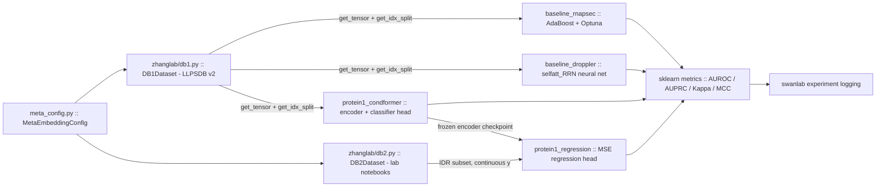
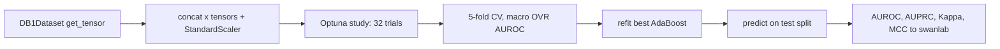
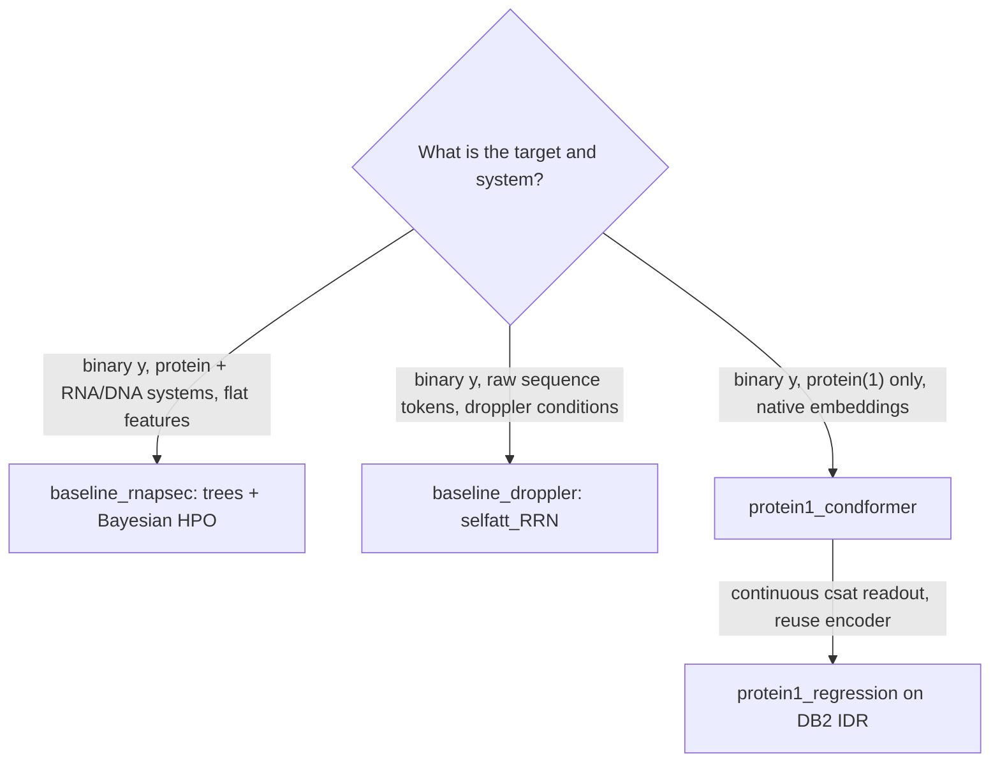

This page documents **Task 1 — Phase Outcome Prediction**, the first of OpenPhase's canonical benchmarks. The goal is to learn a function from a system's *components* (protein, RNA, or DNA sequences, denoted **x**) and its *experimental conditions* (pH, salt, temperature, crowding, concentration, denoted **c**) to a binary phase-separation outcome **y ∈ {0, 1}** — with one regression variant that predicts a continuous saturation readout. All four baseline implementations live in a single orchestration module, `task1.py`, which is the reference script for this task; the sibling `task2.py` belongs to the condition-inference benchmark and is covered separately in [Condition Inference with PhaseCVAE](9-condition-inference-with-phasecvae).

Sources: [README.md](README.md#L56-L62), [README.md](README.md#L119-L125), [task1.py](task1.py#L1-L19)

## The Task Contract

The benchmark is defined in the repository README under *Canonical Tasks*: given components **x** (protein/RNA sequences) and conditions **c** (environmental factors), predict whether the system undergoes liquid–liquid phase separation. The README's *Standardized Benchmarking* section commits each task to three artifacts — standardized train/test splits, baseline models, and evaluation metrics — and names `task1.py` as their documentation entry point. This page describes exactly those three artifacts for the outcome-prediction task.

Sources: [README.md](README.md#L49-L62), [README.md](README.md#L119-L125)

## Architecture: From Archived Loaders to Baselines

The baselines never touch the merged per-system TSV tables (`data/<system>/records.tsv`) exposed by `openphase_systems.py`. Instead they run on the **archived per-source loaders** in `zhanglab/`, which reproduce the original datasets used to train the published models: `DB1Dataset` (LLPSDB v2), `DB2Dataset` (laboratory-notebook phase diagrams), and `DB3Dataset` (RNAPSEC). Each loader follows an identical self-managing lifecycle — download raw archives, parse and filter, embed, and cache everything in an AnnData `.h5ad` file keyed by system and embedding method.

Sources: [openphase_systems.py](openphase_systems.py#L1-L13), [db1.py](zhanglab/db1.py#L27-L50), [db2.py](zhanglab/db2.py#L21-L43), [README.md](README.md#L43-L47)

Two dataset methods form the stable interface every baseline consumes. `get_tensor()` returns the embedded feature tensors, with an **arity that varies by system composition** — `protein(1)` returns `(x, c, y)`, while multi-protein or nucleic-acid systems return extra sequence tensors ahead of `(c, y)`. `get_idx_split(split_method=...)` returns train/test index arrays for one of seven split strategies (80/20 by default). The baselines are written to be composition-agnostic: `baseline_rnapsec` unpacks with `*x, c, y = system_dataset.get_tensor()` and concatenates all sequence tensors along the last axis, so the same code path serves single-protein and complex systems alike.

Sources: [db1.py](zhanglab/db1.py#L504-L572), [db1.py](zhanglab/db1.py#L422-L433), [task1.py](task1.py#L26-L37)

> [!TIP]
> When embedding a system, AnnData keys are written with f-strings (e.g. `f'c_{condition_embedding_model}'` at db1.py#L392) but two read sites construct the condition key as a *plain string* without the `f` prefix (`db1.py#L445`, `db1.py#L521`). In `get_idx_split` that lookup is harmless dead code — `c` is never used after assignment — but in `get_tensor` it is live. If you wire a new condition embedding method into the baselines, verify the actual `obsm` key naming in the cached `.h5ad` first.

The following module-interaction diagram shows the full data flow for the benchmark:



Sources: [meta_config.py](meta_config.py#L38-L40), [db1.py](zhanglab/db1.py#L404-L420), [task1.py](task1.py#L17-L19)

## The Baseline Suite

`task1.py` implements four baselines that form a deliberate difficulty ladder: two classical/external models that treat the problem as a fixed feature-vector task, one native deep model trained end-to-end on OpenPhase's embedding system, and one transfer-learning regression variant that extends the deep model from binary outcomes to a continuous saturation readout.

| Baseline | System scope | Dataset | Model | Protocol | Defining hyperparameters |
|---|---|---|---|---|---|
| `baseline_rnapsec` | Any DB1 system (flat vectors) | `DB1Dataset` | `AdaBoostClassifier` over `DecisionTreeClassifier` stumps | Optuna study, 32 trials, 5-fold CV on macro-OVR AUROC | `max_depth` ∈ {5–10, None}, `learning_rate` ∈ {0.5–2.5}, `random_state=30` |
| `baseline_droppler` | Any DB1 system, condition method must be `droppler` | `DB1Dataset` | External `SA.selfatt_RRN` (20 aa features, 14 condition slots, 10 heads) via `NNwrapper` | 10 epochs, batch 1024 | `lr=3e-3`, `weight_decay=1e-4` |
| `protein1_condformer` | `protein(1)` only (asserted) | `DB1Dataset` | `Protein1SystemEncoder` + `PhaseClassificationHead` | Full-batch BCE, 1000 epochs, best-AUROC checkpointing | `embed_dim=256`, `dropout=0.5`, Adam `lr=7e-4`, `wd=7e-6` |
| `protein1_regression` | `DB2Dataset` IDR subset (continuous csat) | `DB2Dataset` | Frozen CondFormer encoder + `PhaseRegressionHead` | Full-batch MSE, 1000 epochs, best-MSE checkpointing | Adam `lr=3e-4`, `wd=5e-6`, 50/50 split |

Sources: [task1.py](task1.py#L58-L103), [task1.py](task1.py#L142-L226), [task1.py](task1.py#L242-L348), [task1.py](task1.py#L351-L463)

### `baseline_rnapsec` — the Optuna-tuned tree ensemble

The flow is: load tensors → `StandardScaler` on the concatenated `[x, c]` matrix → Optuna search over AdaBoost depth/learning-rate with 5-fold cross-validation scored by macro one-vs-rest AUROC → refit the best configuration → evaluate on the held-out split. All four classification metrics plus the experiment's configuration are pushed to swanlab in a single flat dictionary, making runs directly comparable across embedding and split choices.



Sources: [task1.py](task1.py#L40-L55), [task1.py](task1.py#L58-L103)

### `baseline_droppler` — the sequence-aware neural baseline

This baseline reproduces the Droppler architecture against OpenPhase data. Sequences are converted to integer indices over the 20 canonical amino acids (unknown characters map to 0) and zero-padded to a common length with `pad_sequence`, so the model sees raw token sequences rather than precomputed embeddings. Conditions are carved out of the condition tensor by column position — temperature, concentration, salt, crowding, pH — and scaled with a pickled scaler shipped from the original Droppler codebase (`clip` disabled). The function hard-asserts `condition_embedding == "droppler"` because the 14-column condition layout it slices depends on that encoding.

Sources: [task1.py](task1.py#L105-L139), [task1.py](task1.py#L147-L185), [task1.py](task1.py#L202-L226)

### `protein1_condformer` — the native deep baseline

Restricted to the `protein(1)` system by assertion, this baseline composes a `Protein1SystemEncoder` (which fuses protein and condition embeddings into a 256-dim system representation) with a `PhaseClassificationHead`. Training is deliberately simple — full-batch forward/backward with binary cross-entropy for 1000 epochs — followed by a per-epoch full test evaluation. The best checkpoint by AUROC is saved under a filename that encodes both the system and the split method, `./task1/models/condformer_{system_name}_{split_method}_best.pth`; this naming convention is what the regression driver later exploits for transfer experiments.

Sources: [task1.py](task1.py#L242-L277), [task1.py](task1.py#L280-L336), [task1.py](task1.py#L338-L348)

### `protein1_regression` — transfer to saturation concentration

The regression variant loads the `DB2Dataset` IDR subset, whose labels are continuous phase-separation measurements rather than binary outcomes (the DB2 docstring distinguishes the binary `CoREST`/`RGG` subsets from continuous `IDR`). It rebuilds a `Protein1SystemEncoder`, loads encoder weights from a CondFormer classification checkpoint, **freezes them**, and trains only a `PhaseRegressionHead` under MSE loss on a 50/50 split. Predictions are exported as `pred_vs_true_{model_name}.csv` into `./task1/results/`, and a seaborn jointplot visualizes true-vs-predicted alignment.

Sources: [db2.py](zhanglab/db2.py#L21-L43), [db2.py](zhanglab/db2.py#L107-L109), [task1.py](task1.py#L351-L401), [task1.py](task1.py#L415-L463)

> [!TIP]
> Watch the encoder input-dimension coupling when moving between the two deep baselines: the classification path sizes `protein_dim` as 29 (`rnapsec_protein`) / 1280 (`mtdp`) / **1024** (anything else, i.e. `esmc`) at task1.py#L267-L272, but the regression transfer path uses **1152** for that same fallback branch at task1.py#L384-L389. A checkpoint trained in one path cannot be loaded into the other unless the dimension branch matches its training provenance.

### Choosing a baseline



Sources: [task1.py](task1.py#L120-L126), [task1.py](task1.py#L252-L258)

## Embedding Configuration Coupling

Every baseline receives its feature representation through `create_meta_config(protein=..., dna_rna=..., condition=...)`, a thin factory over the pydantic-validated `MetaEmbeddingConfig`. The allowed value sets are enforced at construction time: protein ∈ {`esmc`, `mtdp`, `rnapsec_protein`, `seq2ind`, `seq2onehot`}, DNA/RNA ∈ {`rnapsec_rna`, `dictionary`}, condition ∈ {`droppler`, `rnapsec_condition`, `rnapsec_condition_class`}. Defaults are `mtdp` / `dictionary` / `droppler`. Because `DB1Dataset` caches one `.h5ad` per system and re-embeds automatically when a requested embedding key is missing, changing a baseline's embedding arguments transparently triggers recomputation on the next run.

| Method argument | Accepted values | Dimension consumed by deep baselines |
|---|---|---|
| `protein` | `esmc`, `mtdp`, `rnapsec_protein`, `seq2ind`, `seq2onehot` | 29 / 1280 / 1024 (classification) or 1152 (regression fallback) |
| `dna_rna` | `rnapsec_rna`, `dictionary` | selected inside `get_tensor` per nucleic-acid system |
| `condition` | `droppler`, `rnapsec_condition`, `rnapsec_condition_class` | 4 (`rnapsec_condition`) or 14 (otherwise) |

Sources: [meta_config.py](meta_config.py#L5-L40), [task1.py](task1.py#L267-L272), [task1.py](task1.py#L384-L389), [db1.py](zhanglab/db1.py#L601-L628)

The full option matrix, per-model engineering details, and cost characteristics are documented in [Embedding Configuration Matrix](11-embedding-configuration-matrix), [Protein and Nucleic Acid Embeddings](12-protein-and-nucleic-acid-embeddings), and [Condition Feature Engineering](13-condition-feature-engineering).

## Splits and Evaluation Protocol

Split behavior is delegated entirely to the dataset layer: `get_idx_split` supports `random`, plus six stratified variants (`phase_label_stratified`, `temperature_stratified`, `component_concentration_stratified`, `ionic_strength_stratified`, `crowding_agent_stratified`, `pH_stratified`), all 80/20, with conditions discretized into bins (quantile bins for concentration and ionic strength, fixed bins for temperature and pH) before stratification. Passing an unknown method raises a `ValueError` that enumerates the full list. The regression driver at the bottom of `task1.py` demonstrates the intended ablation pattern: it sequentially calls `protein1_regression` against all seven CondFormer checkpoints (one per split strategy), producing a transfer matrix over split regimes. A complete treatment of split semantics and metric interpretation belongs to [Split Strategies and Metrics](10-split-strategies-and-metrics).

Sources: [db1.py](zhanglab/db1.py#L422-L502), [task1.py](task1.py#L466-L477)

Metric computation is uniform across the three classification baselines and deliberately redundant — two threshold-free ranking metrics and two discrete-agreement metrics:

| Metric | Measures | Computed via | Uses |
|---|---|---|---|
| AUROC | Ranking quality, macro one-vs-rest | `roc_auc_score` | predicted probabilities |
| AUPRC | Precision–recall trade-off under imbalance | `average_precision_score` | predicted probabilities |
| Cohen's Kappa | Chance-corrected agreement | `cohen_kappa_score` | hard labels (`predict` or `>= 0.5`) |
| MCC | Balanced binary correlation | `matthews_corrcoef` | hard labels (`>= 0.5`) |
| MSE / R² | Regression error and explained variance | `mean_squared_error`, `r2_score` | continuous IDR readout |

Sources: [task1.py](task1.py#L86-L102), [task1.py](task1.py#L205-L226), [task1.py](task1.py#L309-L315), [task1.py](task1.py#L432-L456)

All runs log under a single swanlab project (`ConditionPhase`), initialized once at module scope before the driver invocations, so every baseline's configuration — system, split, and all three embedding methods — is recorded alongside its metrics.

Sources: [task1.py](task1.py#L94-L102), [task1.py](task1.py#L466-L477)

## Running the Baselines

There is no CLI wrapper: `task1.py` is executed as a script whose module-level driver section runs the regression transfer experiments. To run a different baseline, import the function and supply the four configuration arguments — for example `baseline_rnapsec("protein(1)", "random", "rnapsec_protein", "dictionary", "rnapsec_condition")`. Note two environment expectations before executing: the module appends `./scripts` and `./droppler` to `sys.path` at import time (the `model1`, `SA`, and `NNWrappers` modules referenced by the deep baselines resolve from those paths), and GPU usage is auto-selected via `torch.device("cuda" if ...)` inside each deep baseline. First runs will also trigger dataset downloads — LLPSDB v2 archives for DB1, a Google Drive XLSX for DB2 — cached under `./data/DB1` and `./data/DB2`.

```python
from task1 import baseline_rnapsec, protein1_condformer

# Classical ensemble on any system, any embedding configuration
baseline_rnapsec(
    system_name="protein(1) + RNA",
    split_method="phase_label_stratified",
    protein_method="esmc",
    dna_rna_method="dictionary",
    condition_method="rnapsec_condition",
)

# Native deep baseline, protein(1) only
protein1_condformer("protein(1)", "random", "mtdp", "dictionary", "droppler")
```

Sources: [task1.py](task1.py#L17-L19), [task1.py](task1.py#L58-L68), [task1.py](task1.py#L167-L171), [task1.py](task1.py#L254-L258), [task1.py](task1.py#L466-L477), [db1.py](zhanglab/db1.py#L54-L59), [db2.py](zhanglab/db2.py#L111-L120)

If you need the record schema behind the system names passed as `system_name`, see [Condition-Level Record Schema](7-condition-level-record-schema); for building datasets from the loaders themselves, see [Building Source Datasets with Loaders](5-building-source-datasets-with-loaders).

## Summary and Next Steps

The outcome-prediction benchmark gives you a reproducible difficulty ladder: **tree ensembles with Bayesian HPO** as the sanity floor, a **reproduced external neural baseline** for continuity with prior work, a **native CondFormer** as the condition-aware reference model, and a **transfer-learning regression head** that turns classification machinery into a saturation-concentration predictor — all sharing one embedding configuration, one split interface, and one metric/logging protocol. With outcomes covered, the natural continuations are learning the inverse problem in [Condition Inference with PhaseCVAE](9-condition-inference-with-phasecvae), understanding exactly how the split regimes reshape difficulty in [Split Strategies and Metrics](10-split-strategies-and-metrics), and tuning the feature representations these baselines consume via [Embedding Configuration Matrix](11-embedding-configuration-matrix).
