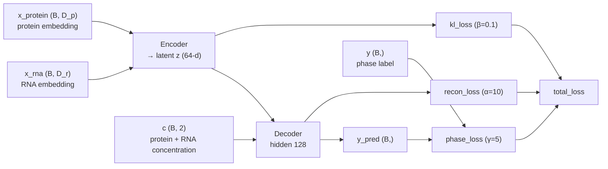
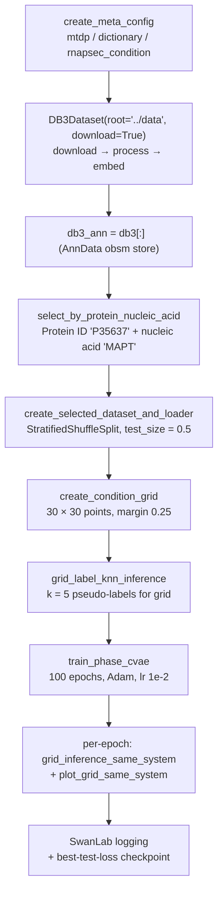

This page documents the second canonical benchmark of OpenPhase: **condition inference**. Where the outcome-prediction baseline (see [Outcome Prediction Baselines](8-outcome-prediction-baselines)) answers *"will this system phase-separate under these conditions?"*, condition inference inverts the question: *"which experimental conditions drive a given protein–RNA system into phase separation?"* The reference implementation is `task2.py`, which trains **PhaseCVAE** — a Conditional Variational Autoencoder — on the DB3 protein–RNA phase-diagram dataset and then sweeps a 2D condition grid (protein concentration × RNA concentration) to reconstruct the phase boundary of a single molecular system.

Sources: [task2.py](task2.py#L1-L4), [README.md](README.md#L56-L67)

## The Inverse Problem: Outcome Prediction vs. Condition Inference

OpenPhase defines three canonical tasks, and task 2 is explicitly the conditional counterpart of task 1: *"Inferring the potential experimental conditions (c) that lead to a specific phase separation outcome, enabling rational experimental design"* ([README.md](README.md#L63-L64)). Instead of using conditions as input features to predict an outcome label, PhaseCVAE treats **conditions as the thing to be inferred** — the model must reconstruct the phase outcome from component embeddings plus a candidate condition vector, and the condition vector itself becomes the search space for inference.

This framing has a concrete consequence for the model design: PhaseCVAE consumes **both** the molecular components (protein and RNA embeddings) **and** a condition vector, and it is trained with a compound objective that couples condition–outcome consistency (a phase-prediction loss) to a variational reconstruction objective (reconstruction + KL terms). The result is a model that behaves as a score function over the condition plane, which is exactly what the grid-based phase-diagram inference exploits later in the pipeline.

Sources: [task2.py](task2.py#L355-L358), [task2.py](task2.py#L186-L192)

## Data Foundation: DB3 and Its AnnData Embedding Store

PhaseCVAE is trained exclusively on **DB3**, the RNAPSEC-derived benchmark. `DB3Dataset` (`zhanglab/db3.py`) self-describes as *"a preprocessed resource derived from RNAPSEC (Chin et al. 2024)... focusing on the phase behavior of protein-RNA systems"* and ships a three-stage lifecycle: **download → process → embed**.

1. **Download**: pulls `rnapsec.xlsx` directly from the upstream `ycu-iil/RNAPSEC` GitHub repository when the raw file is absent.
2. **Process**: parses experimental metadata into a unified schema — phase label, system composition (`protein(1) + RNA`), UniProt ID, protein sequence, component concentration, nucleic acid type/sequence, temperature (with `RT → 25` normalization), ionic strength (unit-normalized to mM), buffer pH, and crowding agent — and saves complete-case tables (`rnapsec_1514.txt`, `rnapsec_no_missing_1298.txt`).
3. **Embed**: maps phase morphology to binary labels (`{"liquid": 1, "solid": 1, "gel": 1, "solute": 0}` — any condensed phase counts as positive) and writes all representations into a single `.h5ad` AnnData store under deterministic `obsm` keys: `y`, `x_{protein_method}`, `x_rna_{dna_rna_method}`, and `c_{condition_method}`.

Sources: [db3.py](zhanglab/db3.py#L17-L38), [db3.py](zhanglab/db3.py#L96-L122), [db3.py](zhanglab/db3.py#L124-L202), [db3.py](zhanglab/db3.py#L204-L248)

The embedding methods are selected through `MetaEmbeddingConfig` (`meta_config.py`), a Pydantic-validated triple `(protein_embedding, dna_rna_embedding, condition_embedding)`. Task 2 instantiates it with `create_meta_config(protein="mtdp", dna_rna="dictionary", condition="rnapsec_condition")` (`task2.py` L466-468). Note the interaction with the downstream code: the condition embedding `c_rnapsec_condition` is a multi-column numeric matrix, and the **last two columns** are treated by task 2 as the *(protein concentration, RNA concentration)* pair — this is the only 2D slice the condition-inference experiment operates on. The full condition-embedding options (including Droppler's 14-dimensional encoding: 10 temperature bins + concentration + ionic strength + crowding + pH) are covered in [Condition Feature Engineering](13-condition-feature-engineering) and [Embedding Configuration Matrix](11-embedding-configuration-matrix).

Sources: [meta_config.py](meta_config.py#L5-L41), [task2.py](task2.py#L52-L112), [meta_embed.py](meta_embed.py#L588-L599), [meta_embed.py](meta_embed.py#L529-L586)

## The PhaseCVAE Contract

The model class itself is imported from `model2` (task 2 appends `./scripts` to `sys.path` at line 8), so what the repository guarantees publicly is the **call contract** — observable through every call site in `task2.py`:

| API element | Signature / behavior | Evidence |
|---|---|---|
| Constructor | `PhaseCVAE(protein_dim, nucleic_dim, condition_dim, latent_dim=64, hidden_dim=128)` | [task2.py](task2.py#L304-L310) |
| Training/inference entry | `compute_loss(x_protein, x_rna, c, y, alpha, beta, gamma) → (loss_dict, y_pred)` | [task2.py](task2.py#L355-L358) |
| Loss dictionary keys | `recon_loss`, `kl_loss`, `phase_loss`, `total_loss` | [task2.py](task2.py#L186-L192) |
| Output | `y_pred` — a continuous score thresholded at 0.5 for binary metrics | [task2.py](task2.py#L399-L405) |
| Dataset wrapper | `SelectedSystemDataset(x_protein, x_rna, c_protein_rna, y, indices)` — tensor tuples of exactly these four arrays | [task2.py](task2.py#L93-L96) |

The loss decomposition makes the "condition inference" objective explicit. Each batch loss is a weighted sum of three verifiable components:

| Component | Key | Weight (default) | Role in the objective |
|---|---|---|---|
| Reconstruction | `recon_loss` | `alpha = 10.0` | Variational reconstruction of the input representation |
| Regularization | `kl_loss` | `beta = 0.1` | KL divergence keeping the 64-dim latent well-behaved for sampling/inference |
| Phase consistency | `phase_loss` | `gamma = 5.0` | Alignment between predicted phase score `y_pred` and the observed label `y` |
| Total | `total_loss` | — | Optimized quantity; also the model-selection criterion |

Sources: [task2.py](task2.py#L355-L371), [task2.py](task2.py#L263-L268)

The dataflow below is reconstructed strictly from this verified contract (constructor dimensions, loss keys, and the `compute_loss` signature) — the internal layer wiring of `model2.py` is not part of the tracked tree in this snapshot:



## End-to-End Pipeline in `task2.py`

The script's `__main__` block chains eight verifiable steps, from dataset construction to a logged, checkpointed phase diagram:



Step-by-step, with the exact verified behavior:

1. **System selection** — `select_by_protein_nucleic_acid` filters the DB3 frame by `Protein ID` and/or `Nucleic acid`; the demo run isolates the Tau protein (`P35637`) with the RNA transcript `MAPT`, producing a single-system cohort whose condition ranges define the inference plane ([task2.py](task2.py#L228-L252), [task2.py](task2.py#L474-L479)).
2. **Data splitting** — `create_selected_dataset_and_loader` performs a `StratifiedShuffleSplit` (test proportion 0.5, seed 42) over the selected samples, wraps both halves in `SelectedSystemDataset` loaders (batch size 1024), and additionally emits `grid_range_dict` (min/max per condition axis) and `phase_diag_dict` (condition–label arrays per split) ([task2.py](task2.py#L52-L112)).
3. **Condition grid** — `create_condition_grid` builds a `num_points × num_points` meshgrid over the observed concentration ranges, extended by a fractional `margin` on each side (0.1 default, 0.25 in the demo run) so the inferred phase boundary can be drawn slightly beyond the data support ([task2.py](task2.py#L115-L145), [task2.py](task2.py#L492)).
4. **Grid pseudo-labels** — `grid_label_knn_inference` labels every grid point by k-nearest-neighbor voting (k=5) over the combined train+test condition–label reference points; these labels let the grid inference evaluate the model's phase loss at arbitrary condition points ([task2.py](task2.py#L203-L225), [task2.py](task2.py#L493-L499)).
5. **Grid inference** — `grid_inference_same_system` runs the trained model over all 900 grid points with the component embeddings held fixed, collecting per-point `y_pred` plus all four loss values — this is what produces the rendered phase diagram and its diagnostic heatmaps ([task2.py](task2.py#L148-L200)).

> [!TIP]
> The phase diagram is a diagram of **one molecular system, many conditions** — not many systems. `grid_inference_same_system` receives a single protein/RNA embedding pair (the first training sample, `x_protein_sample[0]` / `x_rna_sample[0]` at task2.py L502 and L512-513) and sweeps only the 2D concentration plane. To generate a diagram for a different system, change the selection at step 1 — the grid machinery itself is system-agnostic.

Sources: [task2.py](task2.py#L462-L499), [task2.py](task2.py#L148-L200)

## Training Loop, Metrics, and Checkpointing

`train_phase_cvae` is a single-device (CUDA when available) training loop with standard yet precisely pinned engineering choices. Dimensions (`protein_dim`, `nucleic_dim`, `condition_dim`) are read from the first batch rather than hardcoded, so swapping embedding methods only changes what the loaders emit ([task2.py](task2.py#L298-L310)).

| Setting | Value | Mechanism |
|---|---|---|
| Optimizer | `Adam`, initial LR `1e-2` | [task2.py](task2.py#L313) |
| LR schedule | `ReduceLROnPlateau(patience=10, factor=0.5)` stepped on mean **test** total loss | [task2.py](task2.py#L314-L316), [task2.py](task2.py#L441) |
| Gradient clipping | `clip_grad_norm_(max_norm=1.0)` every step | [task2.py](task2.py#L362) |
| Epochs (demo) | 100 | [task2.py](task2.py#L514) |
| Latent / hidden dims | 64 / 128 | [task2.py](task2.py#L304-L310) |
| Model selection | Best mean test `total_loss`; checkpoint saves epoch, model and optimizer state to `./task2/models` | [task2.py](task2.py#L444-L456) |
| Logging | SwanLab project `condition_phase`: per-epoch loss decomposition, accuracy, ROC AUC, ROC/PR curves, and the rendered grid phase diagram | [task2.py](task2.py#L407-L438) |

Quality is measured each epoch on both splits: predictions are binarized at a 0.5 threshold for `accuracy_score`, and raw scores feed `roc_auc_score` — the same evaluation axes used by the other benchmarks (see [Split Strategies and Metrics](10-split-strategies-and-metrics) for the cross-task split/metric protocol). Because the test loss drives both LR scheduling and checkpointing, the split produced in step 2 is not merely an evaluation formality: it is the control signal for the whole run.

Sources: [task2.py](task2.py#L341-L405), [task2.py](task2.py#L407-L459), [task2.py](task2.py#L493-L520)

## Running the Benchmark Yourself

The minimal invocation mirrors the `__main__` block:

```python
from zhanglab.db3 import DB3Dataset
from meta_config import create_meta_config
from model2 import PhaseCVAE, SelectedSystemDataset  # resolved via ./scripts on sys.path

meta_config = create_meta_config(protein="mtdp", dna_rna="dictionary", condition="rnapsec_condition")
db3 = DB3Dataset(root="../data", name="DB3", embedding_config=meta_config, download=True)
```

When adapting the demo, verify these integration points first — they are the ones where the demo's implicit assumptions bite:

| Symptom / risk | Root cause (verified in code) | Fix |
|---|---|---|
| `ModuleNotFoundError: model2` | `task2.py` resolves `model2` and `meta_plot` via `sys.path.append("./scripts")` (L8, L18-19); that directory is outside the tracked top-level tree in this snapshot | Ensure `scripts/model2.py` exists locally before running; the class contract above is the compatibility surface |
| Missing `obsm` keys `x_esmc_normed` / `x_rna_rnapsec_rna_normed` | The demo reads standardized `_normed` copies, while a fresh DB3 build with the `mtdp`/`dictionary` config writes `x_mtdp` / `x_rna_dictionary` (db3.py L225-L227); `_normed` keys are produced by `get_scaled_and_umap(..., save_normed=True)` | Run the scaling step (`get_scaled_and_umap`, task2.py L27-L49) to add `_normed` copies, or point `create_selected_dataset_and_loader` at the raw keys |
| `KeyError` on `c_rnapsec_condition` column slice | The loader takes `obsm[condition_embedding][:, -2:]` — the condition matrix must have ≥ 2 columns ordered so the last two are the component concentrations | Regenerate the condition embedding with the same `rnapsec_condition` method used at embed time |
| Degenerate 2D grid (single point per axis) | The selected system cohort has constant protein or RNA concentration, collapsing `grid_range_dict` ranges | Broaden the `select_by_protein_nucleic_acid` filter or shrink the system constraint |

Sources: [task2.py](task2.py#L6-L24), [task2.py](task2.py#L27-L49), [task2.py](task2.py#L79-L85), [db3.py](zhanglab/db3.py#L223-L228)

## Where This Fits in the Benchmark Suite

Task 2 is the middle rung of OpenPhase's condition-aware ladder. Task 1 (`task1.py`) predicts outcomes from concatenated condition features with classical baselines (AdaBoost with Optuna-tuned depth/learning-rate, plus a Droppler-style self-attention network) — a strictly feed-forward use of `c` ([task1.py](task1.py#L40-L48), [task1.py](task1.py#L58-L103)). Task 2 closes the loop by making the condition vector the object of study through a generative-style latent model. The generative machinery that OpenPhase uses for the third task — designing new sequences rather than new conditions — lives in the diffusion stack and is covered from [Discrete Diffusion Foundations](14-discrete-diffusion-foundations) onward; the record-level schema both tasks consume is documented in [Condition-Level Record Schema](7-condition-level-record-schema), and the broader system architecture in [Architecture Overview](6-architecture-overview).
