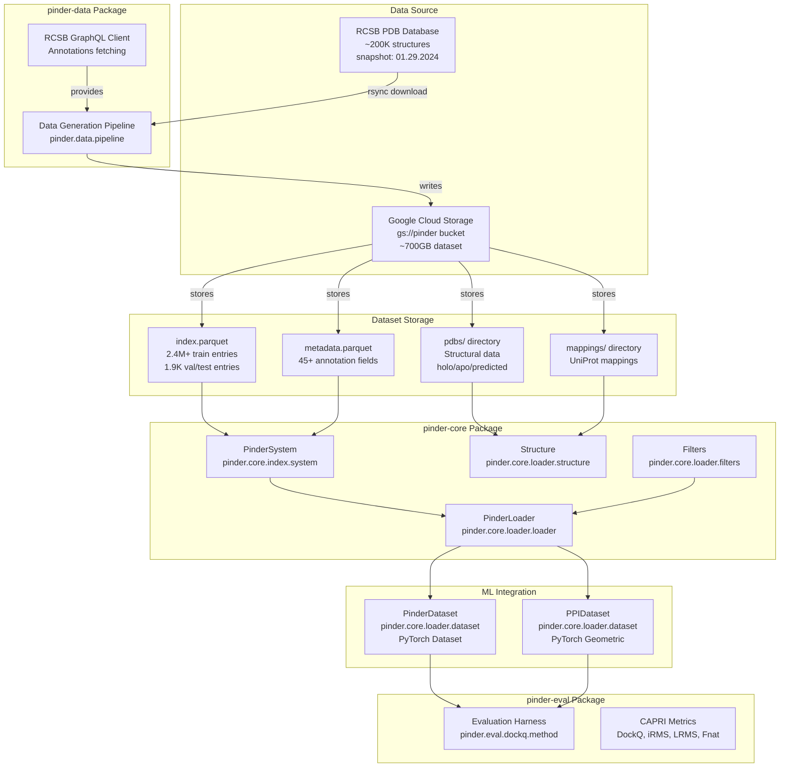
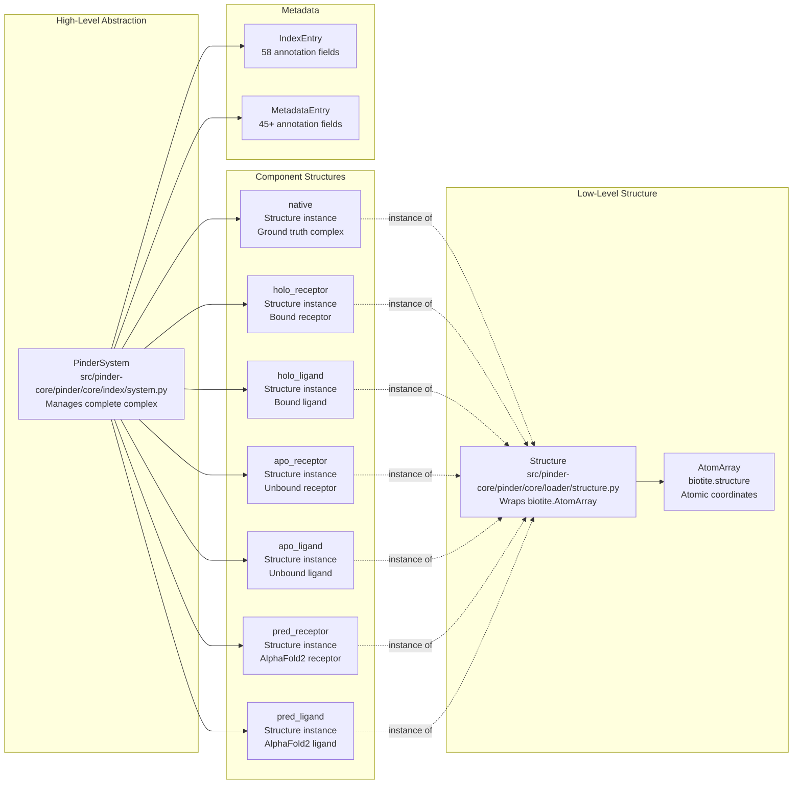
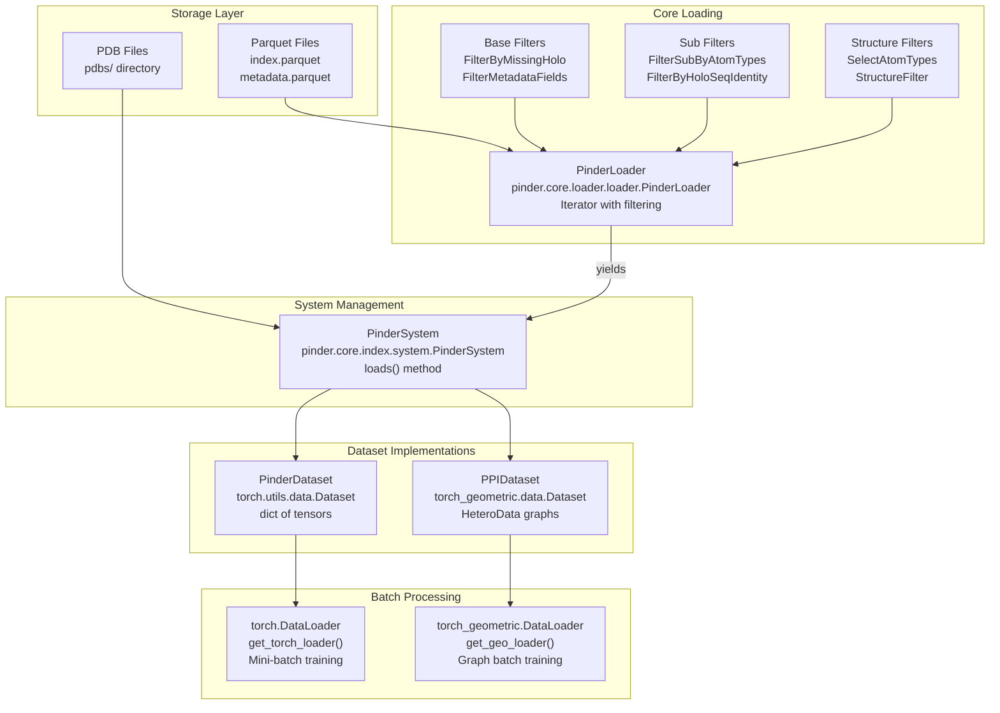

# Overview

Relevant source files

The following files were used as context for generating this wiki page:

- [README.md](README.md)
- [pyproject.toml](pyproject.toml)

This document provides a high-level introduction to PINDER (Protein INteraction Dataset and Evaluation Resource), explaining its purpose, architecture, and key components. PINDER is a comprehensive dataset and evaluation resource for training and evaluating protein-protein docking algorithms, providing approximately 700GB of structural data with 2.4M+ training pairs.

For specific details about the dataset structure, see [Dataset Structure](#1.3). For information about installing PINDER, see [Installation](#1.2). For hands-on tutorials, see [Quick Start Guide](#2).

---

## Purpose and Scope

PINDER addresses the challenge of flexible protein-protein docking by providing the first large-scale dataset that includes paired predicted and apo (unbound) structures alongside holo (bound) structures. The dataset is approximately 500x larger than previous state-of-the-art datasets and enables comprehensive evaluation of both rigid and flexible docking methods.

**Key capabilities:**
- Training machine learning models on 2.4M+ protein-protein interaction pairs
- Evaluating docking methods on multiple benchmark test sets (PINDER-XL, PINDER-S, PINDER-AF2)
- Loading and filtering protein structures with various quality criteria
- Computing standard CAPRI docking evaluation metrics
- Accessing extensive structural annotations and metadata

Sources: [README.md:14-17](), [README.md:245-286]()

---

## System Architecture

The PINDER ecosystem consists of four main packages organized as a namespace package structure:

| Package | Purpose | Key Modules |
|---------|---------|-------------|
| `pinder-core` | Data structures, loading, and dataset access | `pinder.core.index`, `pinder.core.loader`, `pinder.core.structure` |
| `pinder-data` | Dataset generation pipeline from RCSB PDB | `pinder.data.pipeline`, `pinder.data.annotation` |
| `pinder-eval` | Evaluation harness and CAPRI metrics | `pinder.eval.dockq`, `pinder.eval.metrics` |
| `pinder-methods` | Reference docking method implementations | `pinder.methods` |

Sources: [README.md:689-696](), [pyproject.toml:1-158]()

### High-Level Component Diagram

This diagram shows how data flows from RCSB through the generation pipeline to cloud storage, and then how the core package provides access layers that feed into machine learning workflows and evaluation.

Sources: [README.md:163-193](), [README.md:689-696](), [pyproject.toml:38-47]()

---

## Core Data Structures

PINDER provides three primary abstractions for working with protein structures:

### Data Structure Hierarchy

Each `PinderSystem` manages multiple `Structure` instances representing different conformational states (bound/unbound) and sources (experimental/predicted). All structures are backed by `biotite.AtomArray` objects for efficient atomic operations.

Sources: [README.md:395-408](), [README.md:529-623]()

---

## Dataset Scale and Splits

PINDER provides multiple dataset splits optimized for different use cases:

| Split | Size | Clusters | Description |
|-------|------|----------|-------------|
| **PINDER-Train** | 2,456,152 pairs | 42,220 | Training set with holo/apo/predicted variants |
| **PINDER-Val** | 1,958 pairs | 1,958 | Validation set matching test distribution |
| **PINDER-XL** | 1,955 pairs | 1,955 | Full test set, cluster representatives |
| **PINDER-S** | 250 pairs | 250 | Fast evaluation subset with diverse annotations |
| **PINDER-AF2** | 180 pairs | 180 | AlphaFold2-Multimer deleaked test set |

### Structure Type Availability

| Dataset | Holo Pairs | Apo Pairs | AF2 Pairs | At Least One Apo | At Least One AF2 |
|---------|------------|-----------|-----------|------------------|------------------|
| Train | 2,456,152 | 136,498 | 566,171 | 274,194 | 621,276 |
| Val | 1,958 | 342 | 1,789 | 441 | 1,817 |
| XL | 1,955 | 342 | 1,747 | 436 | 1,775 |
| S | 250 | 93 | 250 | 143 | 250 |
| AF2 | 180 | 30 | 127 | - | 131 |

The training set provides up to **25,130,994 unique training examples** when combining different monomer types (holo-receptor + apo-ligand, etc.).

Sources: [README.md:245-286](), [README.md:757-785]()

---

## Data Access Patterns

PINDER provides multiple levels of abstraction for accessing data, from low-level structure manipulation to high-level PyTorch dataloaders:

### Data Loading Pipeline

The `PinderLoader` class ([src/pinder-core/pinder/core/loader/loader.py]()) orchestrates the entire loading pipeline, applying three-tier filtering and yielding `PinderSystem` objects. These can be consumed directly or wrapped in PyTorch dataset classes for training.

Sources: [README.md:410-432](), [README.md:433-514]()

---

## Key Features

### 1. Multi-State Structure Management

Each protein complex in PINDER is represented by up to 7 structures:

- **Native complex**: Ground-truth crystal structure of the complex
- **Holo monomers**: Bound receptor and ligand (extracted from native)
- **Apo monomers**: Unbound receptor and ligand (from separate PDB entries)
- **Predicted monomers**: AlphaFold2-predicted receptor and ligand structures

All monomers follow a consistent chain naming convention: **R** for receptor, **L** for ligand.

Sources: [README.md:395-408]()

### 2. Flexible Filtering System

PINDER implements a three-tier filtering system:

| Tier | Class Hierarchy | Purpose |
|------|----------------|---------|
| **Base Filters** | `PinderFilterBase` | System-level criteria (e.g., missing structures, metadata fields) |
| **Sub Filters** | `PinderFilterSubBase` | Monomer-level criteria (e.g., sequence identity, RMSD, length) |
| **Structure Filters** | `StructureFilter` | Atom/residue-level properties (e.g., atom types, contact counts) |

Sources: [README.md:410-432](), [README.md:517-670]()

### 3. Comprehensive Annotations

Each system includes 58 index fields and 45+ metadata fields covering:

- **Quality metrics**: Resolution, R-free, experimental method
- **Interface properties**: Buried SASA, contact types, planarity
- **Structural features**: Elongation, gaps, number of components
- **Biological context**: Antibody/antigen/enzyme annotations, UniProt IDs
- **Domain annotations**: ECOD, Pfam, SCOP, CATH

Sources: [README.md:529-623]()

### 4. Evaluation Harness

The `pinder-eval` package provides standardized evaluation using CAPRI metrics:

- **DockQ**: Overall quality score combining multiple metrics
- **iRMS**: Interface RMSD (backbone atoms)
- **LRMS**: Ligand RMSD (all atoms)
- **Fnat**: Fraction of native contacts preserved

The `pinder_eval` CLI script ([pyproject.toml:41]()) processes prediction directories and generates leaderboard-ready results.

Sources: [README.md:300-381]()

---

## Package Dependencies

PINDER integrates with the modern Python scientific stack:

### Core Dependencies

| Package | Purpose |
|---------|---------|
| `biotite` | Structure I/O and atomic operations |
| `fastpdb` | Fast PDB parsing |
| `torch` | PyTorch Dataset implementations |
| `torch_geometric` | Graph neural network datasets |
| `pandas` | Index and metadata management |
| `google-cloud-storage` | GCS bucket access |
| `pydantic` | Data validation and schemas |

### Data Generation Dependencies

| Package | Purpose |
|---------|---------|
| `gemmi` | mmCIF file parsing |
| `networkx` | Clustering and graph operations |
| `python-graphql-client` | RCSB GraphQL annotations |
| `foldseek` | Structure alignment for clustering |

Sources: [pyproject.toml:4-24](), [pyproject.toml:96-106]()

---

## Entry Points and CLI Tools

PINDER provides several command-line tools for common operations:

| Command | Module | Purpose |
|---------|--------|---------|
| `pinder_download` | `pinder.core.index.utils` | Download complete dataset from GCS |
| `pinder_update_index` | `pinder.core.index.utils` | Sync index files with latest version |
| `pinder_sync_data` | `pinder.core.index.utils` | Sync modified structure files |
| `pinder_eval` | `pinder.eval.run` | Evaluate docking predictions |
| `pinder_data` | `pinder.data.run` | Run data generation pipeline |
| `pinder_methods` | `pinder.methods.main` | Run reference docking methods |

Sources: [pyproject.toml:38-47](), [README.md:146-239]()

---

## Versioning and Updates

PINDER uses independent versioning for dataset and code:

### Dataset Versioning

- Format: `year-month` (e.g., `2024-02`)
- Current version: `2024-02`
- Location: `~/.local/share/pinder/<version>` by default
- Can be overridden with `PINDER_BASE_DIR` environment variable

### Code Versioning

- Format: Semantic versioning (MAJOR.MINOR.PATCH)
- Managed via `setuptools_scm` ([pyproject.toml:135-136]())
- Git tag-based version generation

**Update types:**
- **Minor**: Index/metadata changes without test set invalidation
- **Major**: Structural changes requiring re-clustering (announced in advance)

Sources: [README.md:788-801](), [README.md:122-144]()

---

## Next Steps

- To understand the dataset contents in detail, see [What is PINDER](#1.1)
- To install PINDER and download the dataset, see [Installation](#1.2)
- To learn about the data organization on disk, see [Dataset Structure](#1.3)
- To explore specific benchmark test sets, see [Dataset Splits and Benchmarks](#1.4)
- For hands-on examples, start with [Quick Start Guide](#2)

Sources: [README.md:1-870]()

---