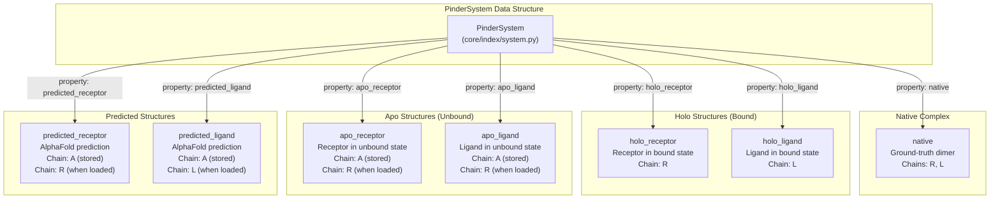
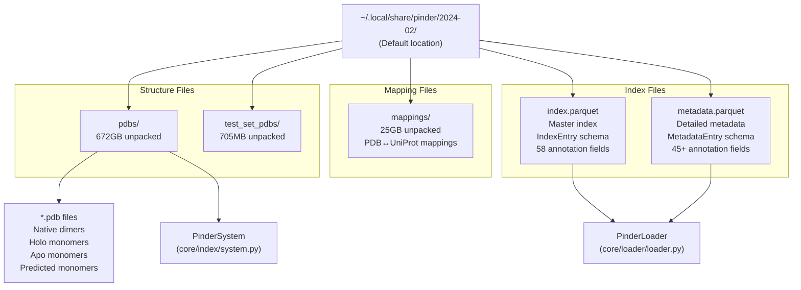
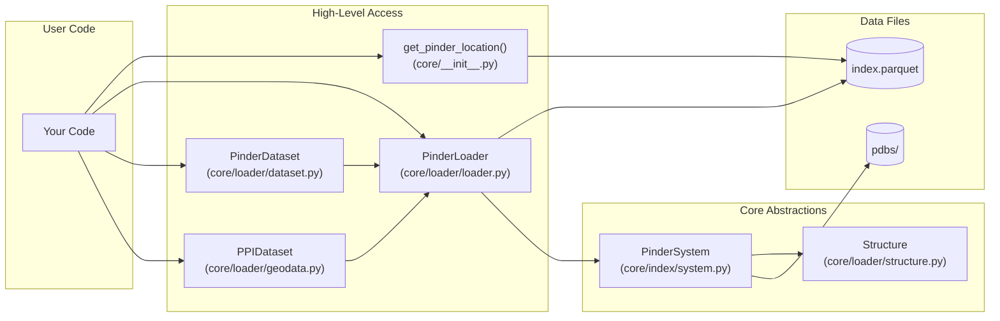

# What is PINDER

Relevant source files

The following files were used as context for generating this wiki page:

- [README.md](README.md)

## Purpose and Scope

This page provides an overview of the PINDER dataset - its composition, scale, structure types, and organization. For installation instructions, see [Installation](#1.2). For details on dataset splits and benchmarks, see [Dataset Splits and Benchmarks](#1.4). For information on how to load and work with PINDER data programmatically, see [Core Data Structures](#3).

---

## Dataset Overview

**PINDER** (Protein INteraction Dataset and Evaluation Resource) is a large-scale protein-protein interaction dataset designed for training and evaluating flexible docking methods. It is approximately 500x larger than previous state-of-the-art datasets and is the first to systematically pair holo (bound) structures with both apo (unbound) and predicted structures from AlphaFold for flexible docking scenarios.

The dataset contains **2,456,152 training pairs** derived from **62,706 PDB entries** organized into **42,220 interface clusters**. Test and validation sets provide carefully deleaked benchmarks with **1,955**, **250**, and **180** systems in the PINDER-XL, PINDER-S, and PINDER-AF2 test sets respectively.

The complete dataset is approximately **700GB** and is hosted on Google Cloud Storage at `gs://pinder/2024-02/`.

Sources: [README.md:14-18](), [README.md:242-286]()

---

## Dataset Composition

The PINDER dataset consists of multiple carefully curated splits designed for different training and evaluation purposes:

| Dataset | # PDB IDs | # Clusters | # Holo Pairs | # Apo Pairs | # AF2 Pairs | Description |
|---------|-----------|------------|--------------|-------------|-------------|-------------|
| **PINDER-Train** | 62,706 | 42,220 | 2,456,152 | 136,498 | 566,171 | Training set with extensive examples including paired apo and predicted structures |
| **PINDER-Val** | 1,958 | 1,958 | 1,958 | 342 | 1,789 | Validation holdout set for monitoring training performance |
| **PINDER-XL** | 1,955 | 1,955 | 1,955 | 342 | 1,747 | Full test set with cluster representatives |
| **PINDER-S** | 250 | 250 | 250 | 93 | 250 | Smaller subset of PINDER-XL for fast evaluation with diverse annotations |
| **PINDER-AF2** | 180 | 180 | 180 | 30 | 127 | Subset deleaked against AF2-Multimer training set using iAlign |

Sources: [README.md:244-278]()

---

## Structure Types in PINDER

PINDER provides multiple structural representations for each protein-protein interaction, enabling flexible docking evaluation. Each system can include up to seven distinct structures organized through the `PinderSystem` abstraction.

### Structure Type Definitions

**Native Complex**: The ground-truth crystal structure showing both proteins in their bound conformation. This serves as the target for docking evaluation.

**Holo Structures**: Monomers extracted from the bound complex. These represent the proteins in their bound conformations and are the easiest case for docking since they are already in the correct conformation.

**Apo Structures**: Unbound monomers matched from other PDB entries with the same UniProt ID. These structures represent the proteins in conformations different from the bound state, requiring conformational sampling during docking. Available for **44,330** unique structures (41,630 receptor and 36,910 ligand monomers).

**Predicted Structures**: AlphaFold2 predictions matched by UniProt ID. These represent computationally predicted structures and are available for **42,827** unique structures (37,095 receptor and 38,801 ligand monomers).

Each structure is represented as a `Structure` object that wraps a biotite `AtomArray` with additional functionality for filtering, alignment, and property access.

Sources: [README.md:398-408](), [README.md:707-709](), [README.md:773-778](), [src/pinder-core/pinder/core/index/system.py]()

---

## Dataset Organization on Disk

PINDER data is organized in a hierarchical directory structure designed for efficient access and storage:

### Directory Contents

**`pdbs/`**: Contains all protein structures including native dimers, holo monomers, apo monomers, and predicted monomers. Individual PDB files follow naming conventions that encode system IDs and chain information.

**`test_set_pdbs/`**: Pre-rotated and translated monomer structures for test sets, ready for direct use in docking evaluation without additional preprocessing.

**`mappings/`**: Contains mapping information between PDB and UniProt coordinate systems, as well as original PDB assembly information used by various utilities.

**`index.parquet`**: The master index containing one row per protein-protein interaction system. Each entry includes 58 annotation fields covering cluster assignments, split membership, structure availability flags, and quality metrics. This file is read by `PinderLoader` to filter and sample systems.

**`metadata.parquet`**: Extended metadata with 45+ additional fields including experimental method, resolution, interface characteristics (planarity, buried SASA, contact types), oligomeric state, and structural quality metrics.

The default location is `~/.local/share/pinder/<release_version>` on Mac and Linux. This can be customized by setting the `PINDER_BASE_DIR` environment variable.

Sources: [README.md:162-208](), [README.md:529-624]()

---

## Data Access Through Code

PINDER provides a Python API for accessing the dataset through several key abstractions:

**`get_pinder_location()`**: Returns the current dataset location on disk. Used to verify where PINDER data is stored.

**`PinderLoader`**: Iterator-based loader that provides filtered access to `PinderSystem` objects. Supports multi-stage filtering (base, sub, structure), monomer selection strategies, and transforms.

**`PinderDataset`**: PyTorch `Dataset` implementation that converts `PinderSystem` objects into dictionaries of tensors for standard neural networks.

**`PPIDataset`**: PyTorch Geometric `Dataset` implementation that converts `PinderSystem` objects into `HeteroData` graph representations for graph neural networks.

**`PinderSystem`**: Core abstraction representing a single protein-protein interaction with all associated structures (native, holo, apo, predicted).

**`Structure`**: Wraps biotite's `AtomArray` with additional methods for filtering, alignment, sequence operations, and coordinate manipulation.

Sources: [README.md:137-140](), [README.md:392-427](), [README.md:437-514]()

---

## Use Cases for Flexible Docking

PINDER enables multiple docking scenarios by providing different structural starting points:

| Docking Scenario | Input Structures | Difficulty | Training Examples |
|-----------------|------------------|------------|-------------------|
| **Bound Docking** | Holo receptor + Holo ligand | Easiest | 2,456,152 in train |
| **Unbound Docking** | Apo receptor + Apo ligand | Hard | 136,498 pairs in train |
| **Predicted Docking** | Predicted receptor + Predicted ligand | Moderate-Hard | 566,171 pairs in train |
| **Mixed Docking** | Combinations (e.g., Holo + Apo) | Variable | 25,130,994 theoretical combinations |

The `PinderLoader` supports different **monomer selection strategies** to construct these scenarios:

- `monomer_priority="holo"`: Use bound structures only
- `monomer_priority="apo"`: Prefer unbound structures when available
- `monomer_priority="pred"`: Prefer predicted structures when available  
- `monomer_priority="random"`: Randomly select from available structure types
- `monomer_priority="random_mixed"`: Randomly mix structure types between receptor and ligand

These strategies are implemented in [src/pinder-core/pinder/core/loader/loader.py]() and allow training methods that can handle conformational flexibility.

Sources: [README.md:14-18](), [README.md:266-282](), [README.md:444-462]()

---

## Dataset Download and Location

The dataset is automatically downloaded on first use when accessed through the Python API. Manual download is also supported through the `pinder_download` command-line tool.

The complete dataset requires approximately **700GB** of disk space unpacked:

| Component | Compressed Size | Unpacked Size |
|-----------|----------------|---------------|
| `pdbs.zip` | 144GB | 672GB |
| `test_set_pdbs.zip` | 149MB | 705MB |
| `mappings.zip` | 6.8GB | 25GB |
| `index.parquet` | N/A | ~100MB |
| `metadata.parquet` | N/A | ~200MB |

The dataset is hosted on Google Cloud Storage at `gs://pinder/2024-02/` and is accessed automatically by the Python API through authenticated requests. No manual GCS setup is required.

Sources: [README.md:122-208]()

---

## Key Features

PINDER provides several unique capabilities:

1. **Scale**: ~500x larger than previous datasets with 2.4M+ training pairs
2. **Flexibility**: First dataset with paired apo and predicted structures for flexible docking
3. **Quality**: Rigorous filtering, clustering, and deleaking ensures test set integrity
4. **Diversity**: 44,330 apo structures and 42,827 predicted structures provide conformational diversity
5. **Annotations**: 58 index fields and 45+ metadata fields for fine-grained data selection
6. **Integration**: Native PyTorch and PyTorch Geometric support with filtering and transforms
7. **Evaluation**: Complete evaluation harness with CAPRI metrics (DockQ, iRMS, LRMS, Fnat)
8. **Benchmarks**: Multiple test sets (XL/S/AF2) for comprehensive method comparison

For details on working with these features programmatically, see [Loading Your First System](#2.1) and [Working with Filters](#2.3).

Sources: [README.md:14-18](), [README.md:392-432](), [README.md:517-624]()

---