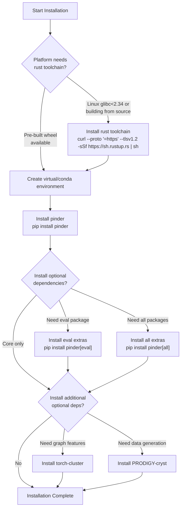
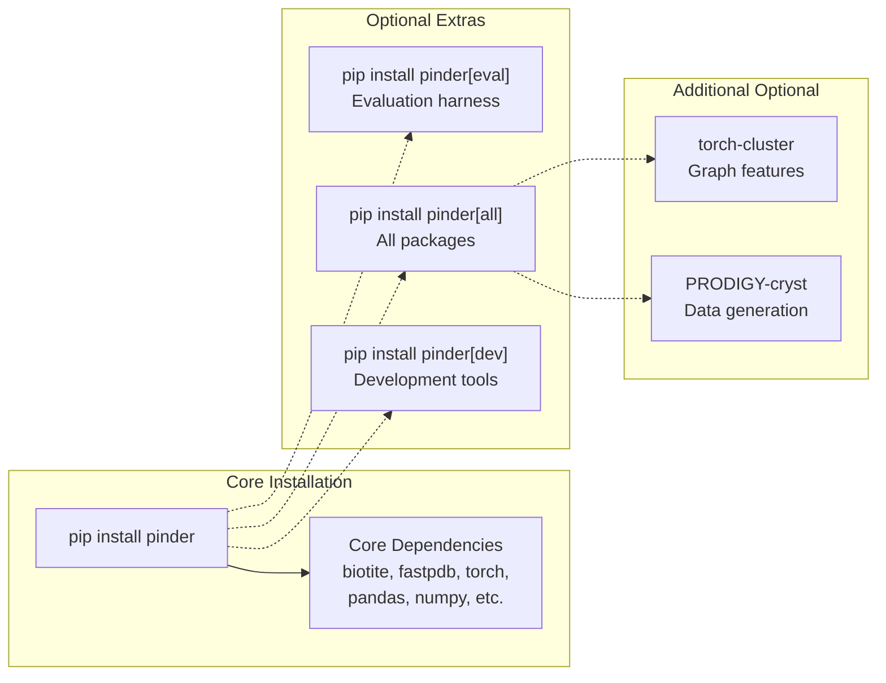
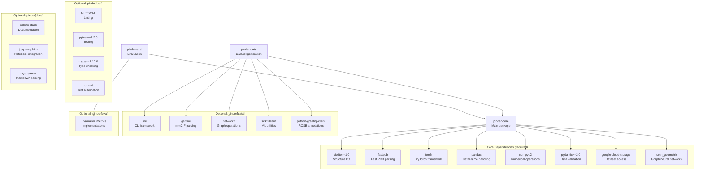
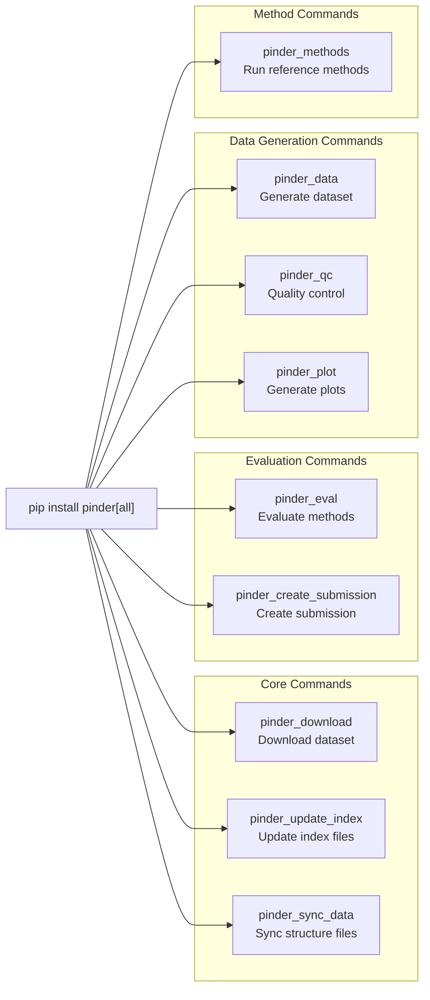
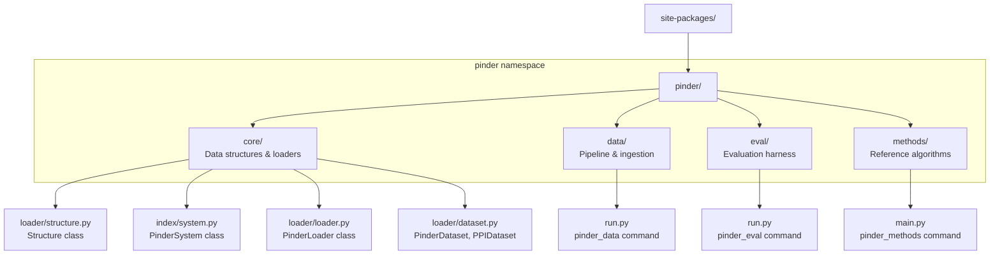

# Installation

<details>
<summary>Relevant source files</summary>

The following files were used as context for generating this wiki page:

- [README.md](README.md)
- [pyproject.toml](pyproject.toml)

</details>


This page provides comprehensive instructions for installing PINDER and its dependencies. PINDER consists of multiple packages that can be installed together or separately depending on your use case. For information about downloading the dataset itself, see [Dataset Structure](#1.3).

## System Requirements

PINDER requires Python 3.10 or higher. The package has been tested on the following platforms:

| Platform | Python Versions | Notes |
|----------|----------------|-------|
| Linux (glibc≥2.34) | 3.10, 3.11, 3.12 | Debian 12, Ubuntu 22.04, RHEL 9, etc. |
| macOS (≥10.12) | 3.10, 3.11, 3.12 | Pre-built wheels available |
| Windows | 3.10, 3.11, 3.12 | Pre-built wheels available |

Sources: [README.md:22-42]()

## Installation Workflow



**Installation Flow Diagram**: Shows the decision tree for installing PINDER based on platform requirements and desired features.

Sources: [README.md:22-119]()

## Prerequisites

### fastpdb Dependency

PINDER uses `fastpdb` to accelerate PDB I/O operations. Pre-built wheels are available for most platforms, but some systems require building from source.

**Platforms with pre-built wheels:**
- Linux with `glibc>=2.34` (Debian 12, Ubuntu 22.04, RHEL 9, etc.)
- macOS Sierra (10.12) or newer
- Windows

**Building from source:**

If your platform doesn't match these conditions, install the rust toolchain before installing PINDER:

```bash
curl --proto '=https' --tlsv1.2 -sSf https://sh.rustup.rs | sh
```

Sources: [README.md:24-42]()

## Setting Up Environment

### Option 1: Using Conda/Mamba

```bash
mamba create --name pinder python=3.11
mamba activate pinder
```

You can substitute `conda` for `mamba` if preferred.

### Option 2: Using Python venv

```bash
python3 -m venv venv
source venv/bin/activate
```

Sources: [README.md:46-66]()

## Installing PINDER Packages



**Package Installation Options**: Shows the relationship between different installation commands and the packages they include.

Sources: [README.md:101-119](), [pyproject.toml:1-158]()

### Minimal Installation (pinder-core only)

For basic dataset loading and interaction:

```bash
pip install pinder
```

This installs the `pinder-core` package with minimal dependencies needed to use `PinderSystem`, `PinderLoader`, `Structure`, and basic data loading functionality.

### With Evaluation Package

To include the evaluation harness (`pinder-eval`):

```bash
pip install pinder[eval]
```

### All Extras

To install all optional packages:

```bash
pip install pinder[all]
```

Sources: [README.md:101-118]()

## Package Dependencies



**Dependency Graph**: Shows the core and optional dependencies for each PINDER package.

Sources: [pyproject.toml:4-158]()

## Optional Dependencies

### torch-cluster

The `torch-cluster` package is required for certain graph-based features but is not automatically installed. Installation varies by platform:

**From wheel (Linux/Windows):**

```bash
pip install torch-cluster -f https://data.pyg.org/whl/torch-${TORCH}+${CUDA}.html
```

Replace `${TORCH}` with your PyTorch version (e.g., `2.0.0`) and `${CUDA}` with either `cpu`, `cu118`, or `cu121` depending on your CUDA installation.

**From source (all platforms):**

```bash
pip install torch  # Ensure PyTorch is installed first
pip install torch-cluster
```

**Note:** On Apple Silicon macOS machines, installation from source is required.

Sources: [README.md:70-91]()

### PRODIGY-cryst

PRODIGY-cryst is used in the data ingestion pipeline to predict interface biological relevance. It's an optional dependency of `pinder-data`:

```bash
pip install git+https://github.com/yusuf1759/prodigy-cryst.git
```

Sources: [README.md:93-99]()

## Development Installation

For contributing to PINDER or running tests:

### Clone the Repository

**Using HTTPS:**
```bash
git clone https://github.com/pinder-org/pinder.git
cd pinder
```

**Using SSH:**
```bash
git clone git@github.com:pinder-org/pinder.git
cd pinder
```

### Install in Development Mode

```bash
mamba create --name pinder python=3.11
mamba activate pinder
pip install -e '.[dev]'
```

The `dev` extra includes:
- `lint`: ruff linter and pre-commit hooks
- `test`: pytest, tox, codecov
- `type`: mypy for type checking
- `leaderboard`: Tools for leaderboard generation
- `data`: Dependencies for dataset generation

### Install Pre-commit Hooks

```bash
pre-commit install
```

This ensures code passes linting before being committed.

Sources: [README.md:820-853]()

## Available Optional Extras

| Extra | Command | Includes |
|-------|---------|----------|
| `eval` | `pip install pinder[eval]` | Evaluation harness and metrics |
| `all` | `pip install pinder[all]` | All optional packages |
| `dev` | `pip install -e '.[dev]'` | Development tools (lint, test, type, leaderboard, data) |
| `lint` | `pip install pinder[lint]` | ruff==0.4.9, pre-commit==3.6.0 |
| `test` | `pip install pinder[test]` | tox>=4, pytest==7.2.0, pytest-cov==4.0.0 |
| `type` | `pip install pinder[type]` | mypy==1.10.0 and type stubs |
| `docs` | `pip install pinder[docs]` | Sphinx documentation tools |
| `leaderboard` | `pip install pinder[leaderboard]` | Quarto, matplotlib, seaborn |
| `data` | `pip install pinder[data]` | Dataset generation tools |
| `datapy312` | `pip install pinder[datapy312]` | Data tools for Python 3.12 |

Sources: [pyproject.toml:49-124]()

## Command-Line Tools

After installation, PINDER provides several command-line tools:



**Command-Line Interface**: Shows the CLI tools installed by PINDER packages.

| Command | Module | Description |
|---------|--------|-------------|
| `pinder_download` | `pinder.core.index.utils:download_pinder_cmd` | Download complete dataset |
| `pinder_update_index` | `pinder.core.index.utils:update_index_cmd` | Update index/metadata files |
| `pinder_sync_data` | `pinder.core.index.utils:sync_pinder_structure_data` | Sync missing structure files |
| `pinder_eval` | `pinder.eval.run:main` | Run evaluation harness |
| `pinder_create_submission` | `pinder.eval.create_submission:main` | Create leaderboard submission |
| `pinder_data` | `pinder.data.run:main` | Run data generation pipeline |
| `pinder_qc` | `pinder.data.qc.run:main` | Quality control checks |
| `pinder_plot` | `pinder.data.plot.run:main` | Generate plots |
| `pinder_methods` | `pinder.methods.main:main` | Run reference methods |

Sources: [pyproject.toml:38-47]()

## Verification

After installation, verify that PINDER is correctly installed:

```python
import pinder
from pinder.core import PinderSystem, get_pinder_location

# Check installation location
print(get_pinder_location())

# Verify core functionality
print(f"PINDER version: {pinder.__version__}")
```

For a complete quick start guide on loading your first system, see [Loading Your First System](#2.1).

Sources: [README.md:137-140]()

## Package Structure on Disk

After installing from PyPI, PINDER follows a namespace package structure:



**Installed Package Structure**: Shows how PINDER packages are organized in the installation directory.

Sources: [pyproject.toml:138-147](), [README.md:689-696]()

## Troubleshooting

### fastpdb Build Failures

If `fastpdb` fails to build on Linux systems:

1. Check glibc version: `ldd --version`
2. If glibc < 2.34, install rust toolchain as described in [Prerequisites](#prerequisites)
3. Retry installation

### torch-cluster Installation Issues

On Apple Silicon macOS:
- Pre-built wheels are not available
- Ensure PyTorch is installed before attempting torch-cluster installation
- Build from source using: `pip install torch-cluster`

### Import Errors

If you encounter import errors:

1. Verify environment activation: `which python`
2. Check installed packages: `pip list | grep pinder`
3. Ensure dependencies are installed: `pip install --upgrade pinder[all]`

### Dataset Download Issues

For dataset download problems, see [Dataset Structure](#1.3) for detailed download instructions and troubleshooting.

Sources: [README.md:22-42](), [README.md:70-91]()

---