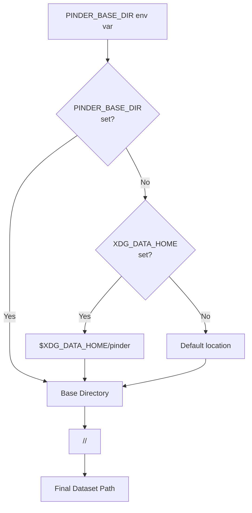
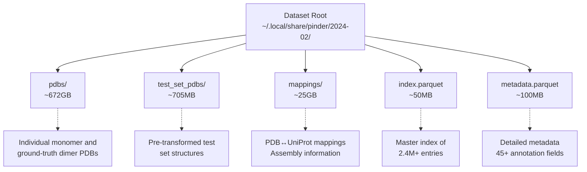
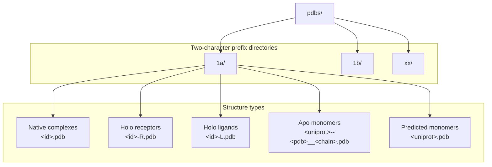
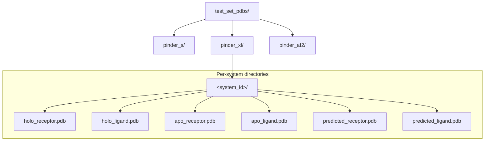
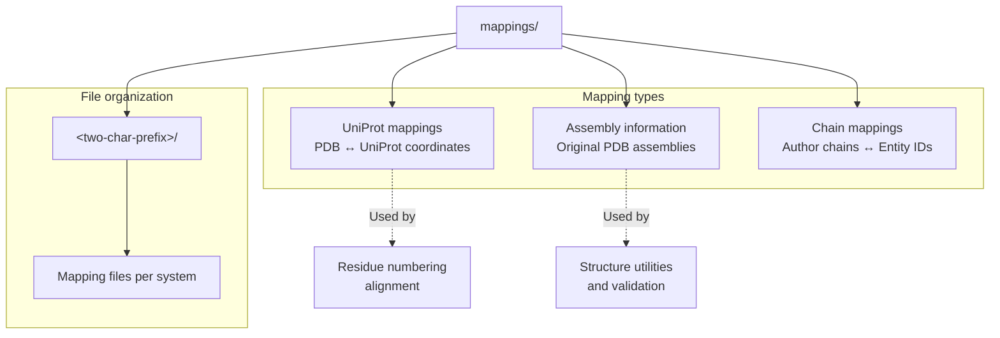
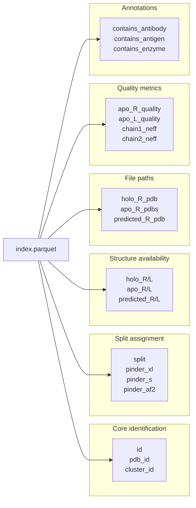
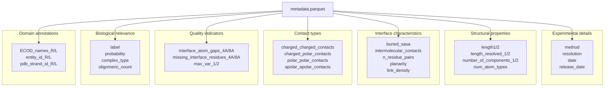
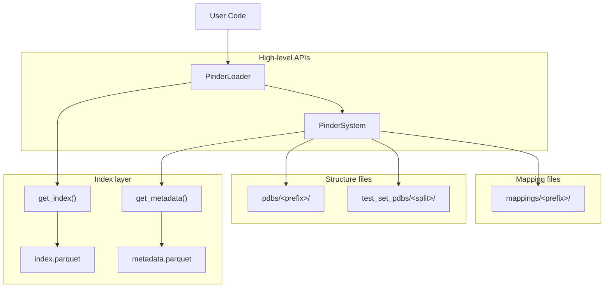

# Dataset Structure

Relevant source files

The following files were used as context for generating this wiki page:

- [README.md](README.md)

This page describes the physical organization of the PINDER dataset on disk, including directory layout, file naming conventions, and storage requirements. For information about how to load and access this data programmatically, see [Loading Your First System](#2.1). For details on the dataset splits and benchmarks, see [Dataset Splits and Benchmarks](#1.4).

## Dataset Location

The PINDER dataset is stored in a version-specific directory determined by the following hierarchy:

1. `PINDER_BASE_DIR` environment variable (if set)
2. `$XDG_DATA_HOME/pinder` (typically `~/.local/share/pinder` on Mac and Linux)
3. Default fallback location

The complete path follows the pattern: `<base_dir>/<release_version>/`, where `<release_version>` is in `YYYY-MM` format (e.g., `2024-02`).

**Diagram: Dataset location resolution logic**

The current location can be queried programmatically using `get_pinder_location()` from [src/pinder-core/pinder/core/utils/paths.py]().

Sources: [README.md:122-145]()

## Root Directory Structure

The dataset root contains five main components organized as follows:

**Diagram: Root directory structure and component sizes**

Sources: [README.md:162-177](), [README.md:198-208]()

## Storage Requirements

| Component | Compressed | Unpacked | Description |
|-----------|-----------|----------|-------------|
| `pdbs.zip` | 144 GB | 672 GB | Structural data files |
| `test_set_pdbs.zip` | 149 MB | 705 MB | Test set structures |
| `mappings.zip` | 6.8 GB | 25 GB | Mapping files |
| `index.parquet` | - | ~50 MB | Master index |
| `metadata.parquet` | - | ~100 MB | Detailed annotations |
| **Total** | **~151 GB** | **~698 GB** | Complete dataset |

Sources: [README.md:198-208]()

## pdbs/ Directory

The `pdbs/` directory contains individual PDB files for monomers and native complexes. Files are organized by two-character PDB ID prefixes:

**Diagram: pdbs/ directory organization**

### File Naming Conventions

The `pdbs/` directory uses specific naming patterns for different structure types:

| Structure Type | Naming Pattern | Example | Chain ID |
|---------------|----------------|---------|----------|
| Native complex | `<pdb_id>.pdb` | `1a2k.pdb` | Multiple chains |
| Holo receptor | `<pdb_id>-R.pdb` | `1a2k-R.pdb` | R |
| Holo ligand | `<pdb_id>-L.pdb` | `1a2k-L.pdb` | L |
| Apo monomer | `<uniprot>--<pdb_id>__<chain>_<uniprot>.pdb` | `P12345--2xyz__A1_P12345.pdb` | A |
| Predicted monomer | `<uniprot>.pdb` | `P12345.pdb` | A |

**Note:** Apo and predicted monomers are stored with chain ID `A` to reduce duplication when the same structure maps to both receptor and ligand roles across multiple systems. The `PinderSystem` class automatically re-chains these to `R` or `L` as needed.

Sources: [README.md:173-176](), [README.md:404-405]()

## test_set_pdbs/ Directory

The `test_set_pdbs/` directory contains pre-rotated and pre-translated monomer structures for test sets, ready for immediate use in evaluation:

**Diagram: test_set_pdbs/ directory structure for benchmark evaluation**

Each test set subdirectory (`pinder_s/`, `pinder_xl/`, `pinder_af2/`) contains system-specific folders with all available structure variants pre-transformed for direct use.

Sources: [README.md:162-177](), [README.md:244-252]()

## mappings/ Directory

The `mappings/` directory stores alignment and mapping information between different coordinate systems and databases:

**Diagram: mappings/ directory contents and usage**

These mappings enable:
- Conversion between PDB residue numbering and UniProt canonical sequences
- Tracking of biological assembly transformations
- Resolution of author chain IDs to structural entities

Sources: [README.md:173-176]()

## index.parquet File

The `index.parquet` file is the master index containing one row per PINDER entry. It defines which structures are available for each system and their dataset split assignment.

### Index Schema Overview

The index contains 58 fields organized into several categories:

**Diagram: index.parquet field categories**

### Key Index Fields

| Field | Type | Description |
|-------|------|-------------|
| `id` | string | Unique system identifier: `<receptor_spec>--<ligand_spec>` |
| `pdb_id` | string | Source PDB entry identifier |
| `split` | string | Dataset split: `train`, `val`, `test`, `invalid` |
| `cluster_id` | string | Interface cluster identifier for redundancy control |
| `holo_R` / `holo_L` | boolean | Availability of holo receptor/ligand structures |
| `apo_R` / `apo_L` | boolean | Availability of apo receptor/ligand structures |
| `predicted_R` / `predicted_L` | boolean | Availability of AlphaFold2 predicted structures |
| `apo_R_pdbs` / `apo_L_pdbs` | string | Pipe-delimited list of alternate apo structure IDs |
| `apo_R_quality` / `apo_L_quality` | string | Apo pairing quality: `high`, `low`, or empty string |

The index is accessed via the `PinderLoader` class and `get_index()` function from [src/pinder-core/pinder/core/index/utils.py]().

Sources: [README.md:173-176](), [README.md:529-567]()

## metadata.parquet File

The `metadata.parquet` file provides detailed structural and biophysical annotations with 45+ fields per entry:

**Diagram: metadata.parquet field categories and relationships**

### Critical Metadata Fields

| Field | Type | Description |
|-------|------|-------------|
| `resolution` | float | Experimental resolution in Ångströms |
| `method` | string | Structure determination method (X-RAY, CRYO-EM, NMR) |
| `label` | string | PRODIGY-cryst classification: biological vs crystal contact |
| `probability` | float | Probability of being a true biological complex |
| `buried_sasa` | float | Buried solvent-accessible surface area (Ų) |
| `intermolecular_contacts` | int | Number of inter-chain contacts (≤5Å cutoff) |
| `interface_atom_gaps_4A` | int | Interface atoms within 4Å of structural gaps |
| `num_atom_types` | int | Number of distinct atom types (detects CA-only structures) |
| `planarity` | float | Interface shape complementarity measure |

The metadata is accessed via `system.metadata` on any `PinderSystem` instance or directly through `get_metadata()` from [src/pinder-core/pinder/core/index/utils.py]().

Sources: [README.md:173-177](), [README.md:569-624]()

## Data Flow and Access Patterns

The following diagram illustrates how the different dataset components are accessed during typical usage:

**Diagram: Data access patterns through the PINDER API**

Sources: [src/pinder-core/pinder/core/loader/loader.py](), [src/pinder-core/pinder/core/index/system.py](), [src/pinder-core/pinder/core/index/utils.py]()

## Download and Synchronization

The dataset can be downloaded using command-line utilities:

| Command | Purpose | Options |
|---------|---------|---------|
| `pinder_download` | Download complete dataset | `--pinder_base_dir`, `--pinder_release`, `--skip_inflation` |
| `pinder_update_index` | Sync index/metadata only | `--pinder_base_dir`, `--pinder_release` |
| `pinder_sync_data` | Sync changed structure files | `--pinder_base_dir`, `--pinder_release` |

These utilities handle downloading from Google Cloud Storage (`gs://pinder` bucket) and automatic decompression.

Sources: [README.md:146-240]()

---