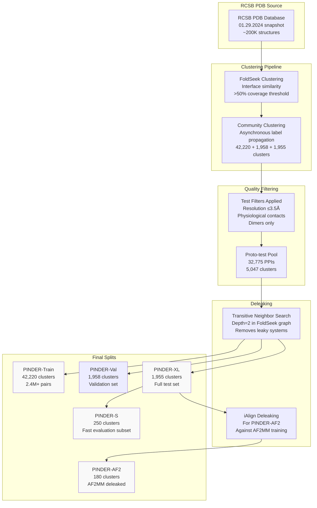
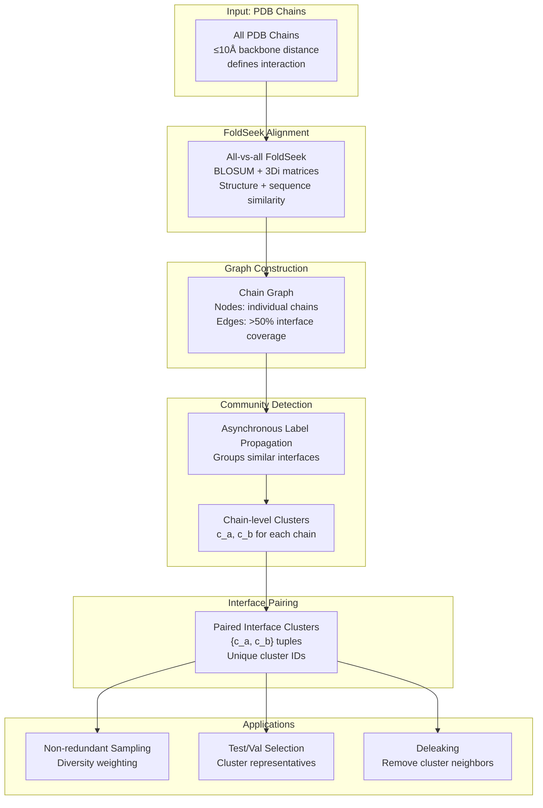
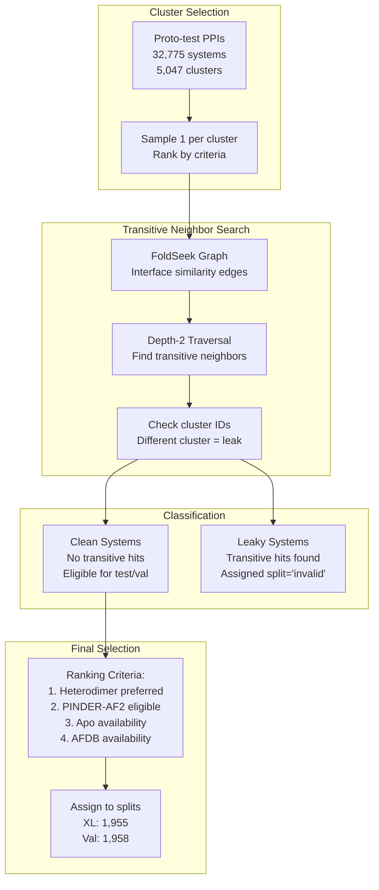
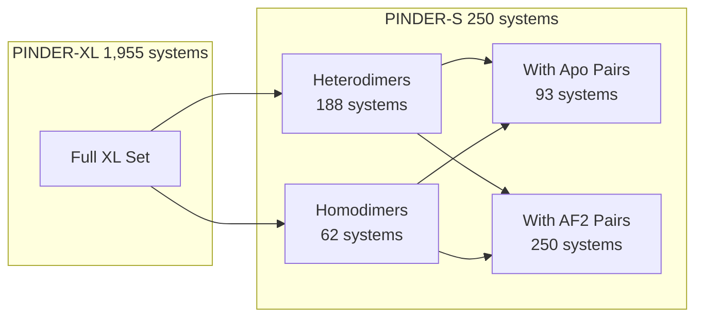
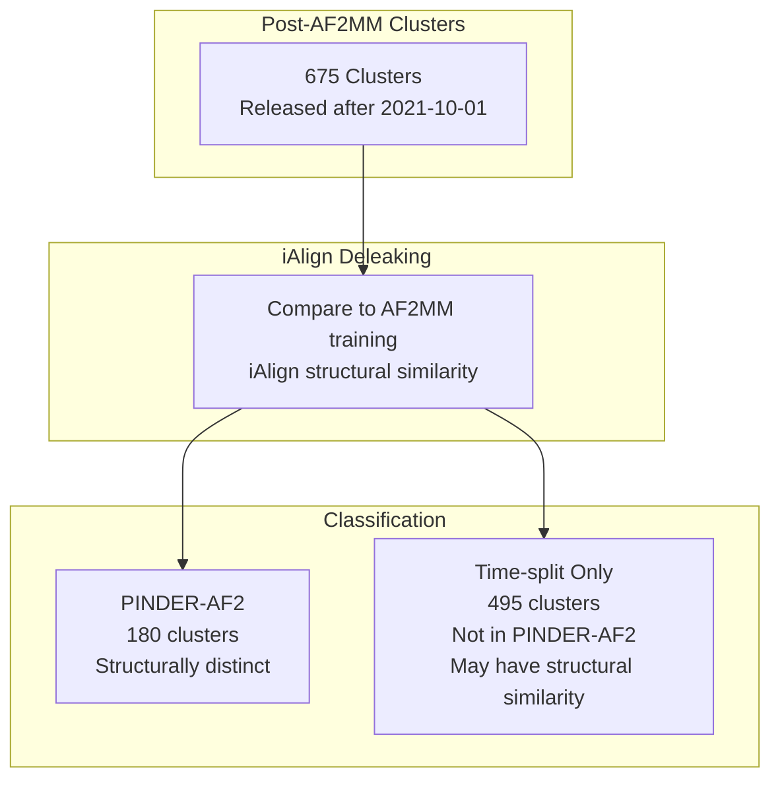
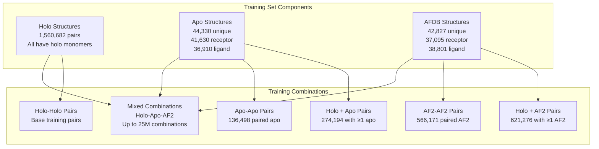
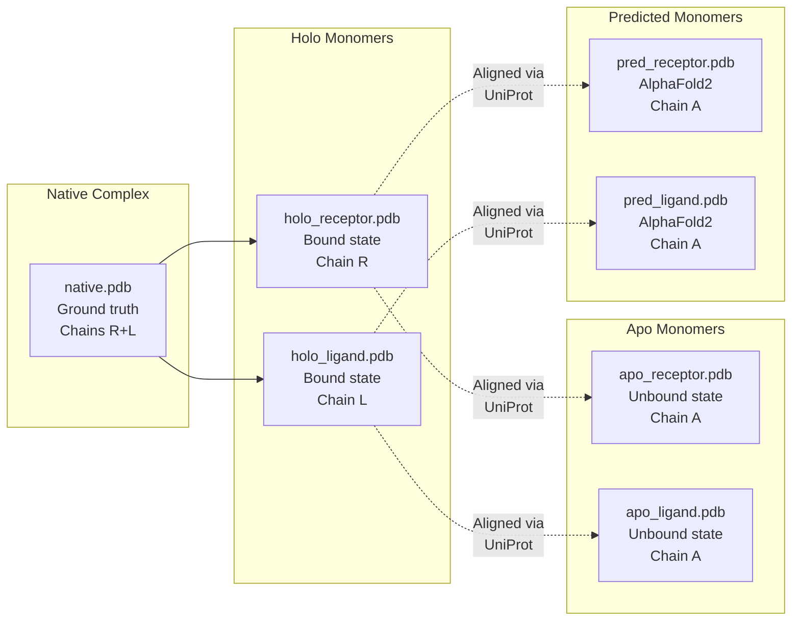

# Dataset Splits and Benchmarks

<details>
<summary>Relevant source files</summary>

The following files were used as context for generating this wiki page:

- [README.md](README.md)

</details>


This page documents the PINDER dataset splits and benchmark test sets, including the clustering methodology, deleaking procedures, and quality filters used to create train/validation/test splits. For information about loading and filtering these splits programmatically, see [Data Loading System](#4).

## Overview

The PINDER dataset is organized into multiple splits designed for training and comprehensive evaluation of protein-protein docking methods. The dataset uses interface-based clustering via FoldSeek to create non-redundant splits and employs rigorous deleaking procedures to prevent information leakage between training and test sets.

All splits are stored in the `index.parquet` file with the following key fields: `split`, `pinder_xl`, `pinder_s`, and `pinder_af2` boolean flags.

## Dataset Splits Summary

| Split | # PDB IDs | # Clusters | # Total Pairs | # Holo Pairs | # Apo Pairs | # AF2 Pairs |
|:---|---:|---:|---:|---:|---:|---:|
| **PINDER-Train** | 62,706 | 42,220 | 2,456,152<sup>1</sup> | 1,560,682 | 136,498 | 566,171 |
| **PINDER-Val** | 1,958 | 1,958 | 1,958 | 1,958 | 342 | 1,789 |
| **PINDER-XL** | 1,955 | 1,955 | 1,955 | 1,955 | 342 | 1,747 |
| **PINDER-S** | 250 | 250 | 250 | 250 | 93 | 250 |
| **PINDER-AF2** | 180 | 180 | 180 | 180 | 30 | 127 |

<sup>1</sup> Training size includes 274,194 pairs with at least one apo monomer and 621,276 pairs with at least one AF2 monomer. Theoretical size considering all monomer combinations is 25,130,994.

**Sources:** [README.md:244-283]()

## Split Organization Diagram



**Sources:** [README.md:698-786]()

## Clustering Methodology

The PINDER clustering approach groups protein-protein interfaces by structural and sequence similarity using FoldSeek. This ensures that similar interfaces are kept together, enabling non-redundant sampling and rigorous train/test splits.

### Clustering Process



**Implementation Details:**

1. **Interface Definition**: Chains with any residues within 10Å backbone atom distance
2. **Alignment Coverage**: Edge added if >50% of interface residues covered by FoldSeek alignment
3. **Similarity Metrics**: FoldSeek uses both sequence (BLOSUM) and structure (3Di) matrices
4. **Cluster Assignment**: Each PPI assigned paired-interface cluster ID `{cluster_id_R, cluster_id_L}`

**Sources:** [README.md:732-744]()

## Test Set Quality Filters

Test and validation sets are filtered to ensure high-quality, biologically relevant protein complexes suitable for benchmarking.

### Filter Criteria Table

| Filter | Threshold | Purpose |
|:---|:---|:---|
| Contact Type | Physiological (PRODIGY-cryst) | Exclude crystal contacts |
| Oligomeric State | Dimers only | Ensure complete bioassembly |
| Experimental Method | X-RAY DIFFRACTION | Consistent structure quality |
| Resolution | ≤ 3.5Å | High structural accuracy |
| Chain Length | ≥ 40 residues | Exclude small peptides |
| Atom Types | ≥ 3 distinct elements | Exclude Cα-only structures |
| Interface Gaps (4Å) | = 0 atoms | Complete interface |
| Max Variance | ≤ 0.98 | Exclude elongated stacks |
| Components | Single component | Exclude detached domains |

**Proto-test Pool**: These filters produce 32,775 PPIs across 5,047 clusters, from which final test/validation sets are sampled.

**Sources:** [README.md:746-760]()

### Code Implementation

The filter criteria are implemented in the `PinderFilterBase` and `FilterMetadataFields` classes:

```python
# Example filter configuration
base_filters = [
    filters.FilterByMissingHolo(),
    filters.FilterSubByContacts(min_contacts=5, radius=10.0, calpha_only=True),
    filters.FilterByHoloElongation(max_var_contribution=0.92),
    filters.FilterDetachedHolo(radius=12, max_components=2),
    filters.FilterMetadataFields(
        resolution=('<=', 3.5),
        method=('==', 'X-RAY DIFFRACTION'),
    ),
]
```

**Sources:** [README.md:627-667](), [src/pinder-core/pinder/core/loader/filters.py]()

## Deleaking Procedures

PINDER employs two deleaking strategies to prevent information leakage from training into test sets.

### Standard Deleaking (PINDER-XL, PINDER-Val)



**Sources:** [README.md:762-763]()

### AF2MM-Specific Deleaking (PINDER-AF2)

The PINDER-AF2 subset undergoes additional deleaking to ensure compatibility with AlphaFold2-Multimer evaluation:

1. **Time-based Filter**: Only structures released after 2021-10-01 (AF2MM cutoff date) are considered
2. **Initial Pool**: 675 clusters meeting the time criteria  
3. **iAlign Deleaking**: Remove systems with similar interfaces to AF2MM training set using iAlign structural alignment
4. **Final Set**: 180 clusters guaranteed structurally distinct from AF2MM 2.3 training data

**Sources:** [README.md:783-786]()

## PINDER-XL: Full Test Set

PINDER-XL is the primary benchmark containing 1,955 cluster representatives selected for maximum diversity and quality.

### Characteristics

- **Size**: 1,955 systems from 1,955 unique clusters
- **Structure Types**: All have holo pairs, 342 with apo pairs, 1,747 with AF2 predicted pairs
- **Quality**: All systems pass strict quality filters
- **Diversity**: One representative per cluster ensures interface diversity
- **Deleaking**: Depth-2 transitive neighbor removal

### Usage in Code

```python
from pinder.core import PinderLoader

# Load PINDER-XL test set
xl_loader = PinderLoader(
    split="test",
    subset="pinder_xl"
)

for system in xl_loader:
    # system.entry.pinder_xl == True
    # system has native, holo_receptor, holo_ligand
    # may have apo_receptor, apo_ligand
    # may have pred_receptor, pred_ligand
    pass
```

**Sources:** [README.md:247-251]()

## PINDER-S: Fast Evaluation Subset

PINDER-S is a carefully curated 250-system subset of PINDER-XL designed for rapid method evaluation.

### Selection Criteria

- **Diversity Sampling**: 188 heterodimers, 62 homodimers
- **Annotation Coverage**: Diverse UniProt and PFAM annotations
- **Apo Structures**: 93 systems with paired apo structures (143 with at least one apo monomer)
- **AF2 Coverage**: All 250 systems have paired AFDB structures
- **Use Case**: Methods where full PINDER-XL evaluation is too computationally expensive

### Subset Composition



### Usage in Code

```python
from pinder.core import PinderLoader

# Load PINDER-S subset
s_loader = PinderLoader(
    split="test",
    subset="pinder_s"
)

# All systems have system.entry.pinder_s == True
print(f"PINDER-S size: {len(s_loader)}")  # 250
```

**Sources:** [README.md:250-251](), [README.md:781]()

## PINDER-AF2: AlphaFold2-Deleaked Test Set

PINDER-AF2 contains 180 systems rigorously deleaked against the AlphaFold2-Multimer training set.

### Deleaking Strategy

1. **Time Filter**: Structures released after 2021-10-01
2. **Structural Deleaking**: iAlign used to detect similar interfaces
3. **Training Set**: Deleaked against AF2MM 2.3 training data
4. **Guarantee**: No structural similarity to AF2MM training examples

### Test Set Characteristics

- **Size**: 180 systems from 180 clusters
- **Apo Pairs**: 30 systems with paired apo structures
- **AF2 Pairs**: 127 systems with paired AFDB structures
- **Primary Use**: Fair comparison with AlphaFold2-Multimer and methods trained on AF2 data

### Time-split vs Structure-deleaked



### Usage in Code

```python
from pinder.core import PinderLoader

# Load PINDER-AF2 for AF2MM comparison
af2_loader = PinderLoader(
    split="test",
    subset="pinder_af2"
)

for system in af2_loader:
    assert system.entry.pinder_af2 == True
    # Guaranteed no AF2MM training leakage
```

**Sources:** [README.md:251](), [README.md:783-786]()

## PINDER-Val: Validation Set

The validation set provides 1,958 systems for monitoring training performance.

### Design Principles

- **Size**: 1,958 systems from 1,958 clusters (one per cluster)
- **Distribution**: Identical preparation and quality filters as test set
- **Apo Structures**: 342 systems with paired apo structures  
- **AF2 Structures**: 1,789 systems with paired AFDB structures
- **Purpose**: Representative validation during training

### Usage in Code

```python
from pinder.core import PinderDataset

# Create validation dataset
val_dataset = PinderDataset(
    split="val",
    monomer_priority="holo"
)

# Use with PyTorch DataLoader
from pinder.core import get_torch_loader
val_loader = get_torch_loader(val_dataset, batch_size=4, shuffle=False)
```

**Sources:** [README.md:257-261](), [README.md:388]()

## PINDER-Train: Training Set

The training set provides extensive protein-protein interaction examples for model training.

### Scale and Composition

| Metric | Count |
|:---|---:|
| Total Clusters | 42,220 |
| Unique PDB IDs | 62,706 |
| Holo Pairs | 1,560,682 |
| Pairs with ≥1 Apo Monomer | 274,194 |
| Pairs with ≥1 AF2 Monomer | 621,276 |
| Paired Apo Structures | 136,498 |
| Paired AF2 Structures | 566,171 |
| **Total Training Pairs** | **2,456,152** |
| **Theoretical Max Combinations** | **25,130,994** |

### Structure Type Availability



### Diversity Sampling

The training set uses cluster IDs for non-redundant sampling:

```python
from pinder.core import PinderLoader

# Load training set with diversity sampling
train_loader = PinderLoader(
    split="train",
    # Sample inversely proportional to cluster size
    sample_by_cluster=True,
    monomer_priority="random_mixed"  # Mix holo/apo/pred
)

# Each iteration samples different monomer combinations
for system in train_loader:
    # system.entry.cluster_id used for weighting
    # Ensures diverse interface coverage
    pass
```

**Sources:** [README.md:264-282](), [README.md:383-389](), [README.md:773-779]()

## Monomer Structure Types Across Splits

All splits provide multiple structure types for flexible docking evaluation.

### Structure Type Mapping



### Availability by Split

| Split | Holo Receptor | Holo Ligand | Apo Receptor | Apo Ligand | Pred Receptor | Pred Ligand |
|:---|:---:|:---:|:---:|:---:|:---:|:---:|
| Train | 100% | 100% | 17.5% | 15.8% | 39.8% | 36.2% |
| Val | 100% | 100% | 17.5% | 17.5% | 91.3% | 91.3% |
| PINDER-XL | 100% | 100% | 17.5% | 17.5% | 89.4% | 89.4% |
| PINDER-S | 100% | 100% | 37.2% | 37.2% | 100% | 100% |
| PINDER-AF2 | 100% | 100% | 16.7% | 16.7% | 70.6% | 70.6% |

**Note**: Apo and predicted monomers use chain ID 'A' in PDB files to avoid duplication across systems. When accessed via `PinderSystem`, chains are automatically renamed to 'R' or 'L' as appropriate.

**Sources:** [README.md:398-406]()

## Accessing Splits in Code

### Using Index Flags

The `index.parquet` file contains boolean flags for split membership:

```python
import pandas as pd
from pinder.core import get_index

# Load index with split information
index = get_index()

# Filter by split
train_df = index[index['split'] == 'train']
test_xl_df = index[index['pinder_xl'] == True]
test_s_df = index[index['pinder_s'] == True]
test_af2_df = index[index['pinder_af2'] == True]

# Count systems per split
print(f"Train: {len(train_df)}")          # 2,456,152
print(f"Val: {len(index[index['split'] == 'val'])}")  # 1,958
print(f"PINDER-XL: {len(test_xl_df)}")    # 1,955
print(f"PINDER-S: {len(test_s_df)}")      # 250
print(f"PINDER-AF2: {len(test_af2_df)}")  # 180
```

### Using PinderLoader

The `PinderLoader` provides a high-level interface for iterating over splits:

```python
from pinder.core import PinderLoader

# Load specific split and subset
loader = PinderLoader(
    split="test",           # 'train', 'val', 'test'
    subset="pinder_xl"      # 'pinder_xl', 'pinder_s', 'pinder_af2', None
)

# Access split information from each system
for system in loader:
    entry = system.entry
    print(f"System ID: {entry.id}")
    print(f"Split: {entry.split}")
    print(f"In XL: {entry.pinder_xl}")
    print(f"In S: {entry.pinder_s}")
    print(f"In AF2: {entry.pinder_af2}")
    print(f"Cluster: {entry.cluster_id}")
```

### Using PinderDataset for Training

```python
from pinder.core import PinderDataset, get_torch_loader

# Training dataset
train_dataset = PinderDataset(
    split="train",
    monomer_priority="random_mixed",  # Mix holo/apo/pred
    limit_by=10000  # Optionally limit size
)

# Validation dataset
val_dataset = PinderDataset(
    split="val",
    monomer_priority="holo"  # Use only holo for validation
)

# Test dataset
test_dataset = PinderDataset(
    split="test",
    subset="pinder_s",  # Use fast subset
    monomer_priority="apo"  # Evaluate on apo structures
)

# Create dataloaders
train_loader = get_torch_loader(train_dataset, batch_size=32, shuffle=True)
val_loader = get_torch_loader(val_dataset, batch_size=32, shuffle=False)
test_loader = get_torch_loader(test_dataset, batch_size=1, shuffle=False)
```

**Sources:** [README.md:443-463](), [src/pinder-core/pinder/core/loader/loader.py](), [src/pinder-core/pinder/core/loader/dataset.py]()

## IndexEntry Fields for Splits

The `IndexEntry` class defines the schema for split-related fields in the index:

| Field | Type | Description |
|:---|:---|:---|
| `split` | string | Split assignment: 'train', 'val', 'test', or 'invalid' |
| `cluster_id` | string | Paired-interface cluster identifier |
| `cluster_id_R` | string | Receptor chain cluster identifier |
| `cluster_id_L` | string | Ligand chain cluster identifier |
| `pinder_xl` | boolean | Member of PINDER-XL test set |
| `pinder_s` | boolean | Member of PINDER-S subset |
| `pinder_af2` | boolean | Member of PINDER-AF2 subset |

**Sources:** [README.md:529-567](), [src/pinder-core/pinder/core/index/utils.py]()

## Split Versioning and Updates

Dataset splits are versioned independently from the codebase using `YYYY-MM` format.

### Update Types

**Minor Updates** (do not invalidate leaderboard):
- Index field corrections
- Metadata additions
- Structure additions to training set only
- No re-clustering required

**Major Updates** (invalidate leaderboard):
- Re-clustering with new threshold parameters
- Test/validation set changes
- Deleaking procedure modifications
- Require method re-evaluation

### Current Version

- **Release**: `2024-02`
- **Snapshot Date**: 2024-01-29
- **Location**: `gs://pinder/2024-02/`

### Checking Dataset Version

```python
from pinder.core import get_pinder_location

# Returns path including version
location = get_pinder_location()
print(location)  # ~/.local/share/pinder/2024-02
```

**Sources:** [README.md:788-801](), [README.md:142-144]()

---