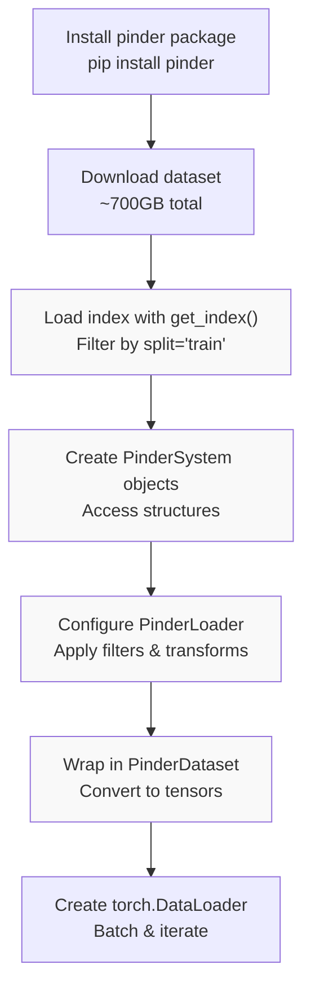
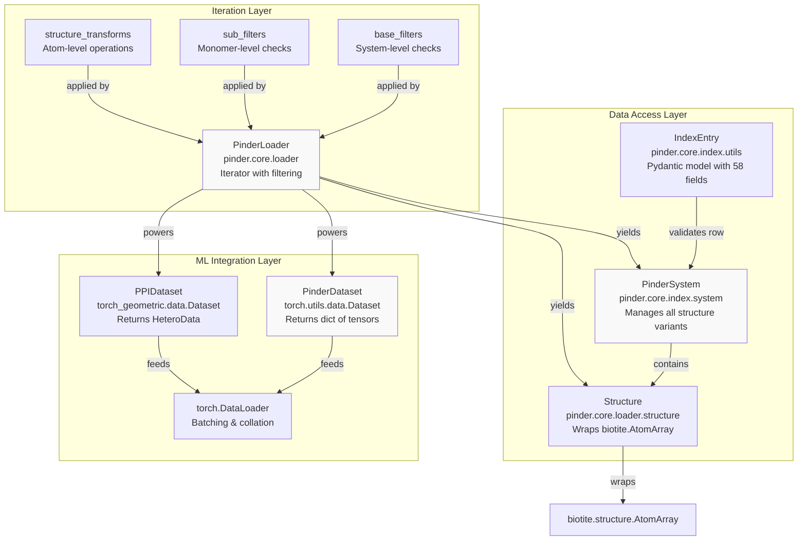
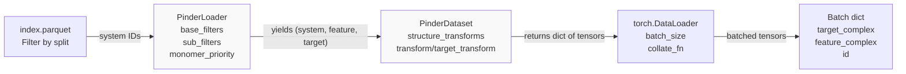
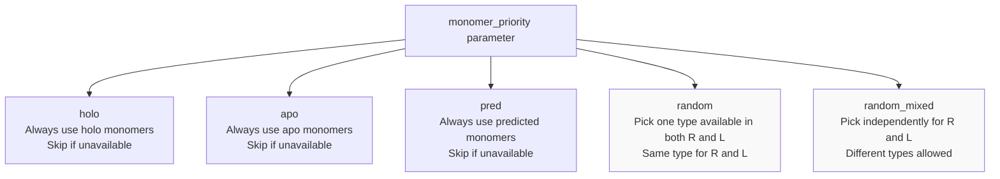

# Quick Start Guide

<details>
<summary>Relevant source files</summary>

The following files were used as context for generating this wiki page:

- [examples/pinder-loader.ipynb](examples/pinder-loader.ipynb)
- [examples/pinder-mlsb.ipynb](examples/pinder-mlsb.ipynb)

</details>


This guide provides hands-on tutorials for new users to quickly start working with PINDER data. It walks through the essential workflow from loading your first protein system to creating production-ready dataloaders for machine learning.

This guide covers basic data access patterns and loader setup. For comprehensive coverage of specific topics, see:
- For detailed system structure and properties, see [PinderSystem](#3.1)
- For advanced filtering strategies, see [Filtering System](#4.4)
- For data generation pipeline details, see [Dataset Generation Pipeline](#5)
- For MLSB challenge-specific requirements, see [MLSB Challenge Tutorial](#2.4)

## Overview of the Quick Start Workflow

The typical workflow for working with PINDER involves five main steps, progressing from raw data access to ML-ready batches:



**Workflow: From Installation to Training-Ready Batches**

Sources: [examples/pinder-mlsb.ipynb:105-118]()

## Key Components and Their Relationships

The PINDER API is organized around three layers of abstraction, each building on the previous:



**Architecture: Three-Layer API Design**

Sources: [examples/pinder-mlsb.ipynb:876-922](), [examples/pinder-mlsb.ipynb:1036-1071]()

## Essential Code Patterns

### Loading the Index and Filtering by Split

The index is the entry point to all PINDER data. It contains metadata for all systems and their available structure types:

```python
from pinder.core import get_index

# Load the full index (2.4M+ entries)
index = get_index()

# Filter to training split only
train = index.query('split == "train"').reset_index(drop=True)
val = index.query('split == "val"').reset_index(drop=True)

# Check what structure types are available
systems_with_apo = train.query('apo_R and apo_L')
systems_with_pred = train.query('predicted_R and predicted_L')
```

The index provides boolean columns (`holo_R`, `holo_L`, `apo_R`, `apo_L`, `predicted_R`, `predicted_L`) that indicate which structure types are available for each system.

Sources: [examples/pinder-mlsb.ipynb:134-197]()

### Creating a PinderSystem

A `PinderSystem` object provides access to all structural variants of a protein complex:

```python
from pinder.core import PinderSystem

# Load a system by ID
system = PinderSystem("8phr__X4_UNDEFINED--8phr__W4_UNDEFINED")

# Access different structure types
native = system.native              # Ground-truth complex
holo_receptor = system.holo_receptor    # Receptor from complex
holo_ligand = system.holo_ligand       # Ligand from complex
apo_receptor = system.apo_receptor     # Unbound receptor (may be None)
apo_ligand = system.apo_ligand         # Unbound ligand (may be None)
pred_receptor = system.pred_receptor   # AF2 prediction (may be None)
pred_ligand = system.pred_ligand       # AF2 prediction (may be None)
```

Each of these properties returns a `Structure` object (or `None` if unavailable), which provides access to coordinates, sequences, and atomic properties.

Sources: [examples/pinder-mlsb.ipynb:518-707](), [examples/pinder-mlsb.ipynb:736-773]()

### Working with Structure Objects

The `Structure` class wraps biotite's `AtomArray` with convenient property accessors:

```python
# Access atomic properties
coords = holo_receptor.coords           # numpy array of xyz coordinates
sequence = holo_receptor.sequence       # amino acid sequence string
fasta = holo_receptor.fasta            # FASTA format with header
atom_array = holo_receptor.atom_array  # biotite.AtomArray

# Filter structures by chain
receptor = native.filter("chain_id", ["R"])
ligand = native.filter("chain_id", ["L"])

# Write to PDB file
receptor.to_pdb("receptor.pdb")
```

Sources: [examples/pinder-mlsb.ipynb:391-473](), [examples/pinder-mlsb.ipynb:779-869]()

## Creating Training-Ready DataLoaders

The most common use case is creating a PyTorch DataLoader for model training. The following diagram shows the data flow:



**Data Flow: From Index to Batched Tensors**

### Quick Start with Defaults

The simplest way to get started:

```python
from pinder.core.loader.dataset import PinderDataset, get_torch_loader

# Create dataset with defaults (holo monomers only)
train_dataset = PinderDataset(split="train")
val_dataset = PinderDataset(split="val")

# Wrap in DataLoader
train_loader = get_torch_loader(train_dataset, batch_size=2, shuffle=True)
val_loader = get_torch_loader(val_dataset, batch_size=2)

# Iterate over batches
for batch in train_loader:
    target = batch["target_complex"]["atom_coordinates"]  # Shape: (B, N, 3)
    feature = batch["feature_complex"]["atom_coordinates"]
    # ... train model
```

Sources: [examples/pinder-mlsb.ipynb:112-115]()

### With Filters and Transforms

For production use, apply quality filters and data augmentation:

```python
from pinder.core.loader import filters, transforms
from pinder.core.loader.dataset import PinderDataset

# Define system-level filters
base_filters = [
    filters.FilterDetachedHolo(radius=12, max_components=2),
    filters.FilterByResidueCount(min_residue_count=10, max_residue_count=2000),
]

# Define monomer-level filters
sub_filters = [
    filters.FilterSubByAtomTypes(min_atom_types=4),
    filters.FilterByHoloSeqIdentity(min_sequence_identity=0.8),
]

# Define structure transformations
target_transforms = [
    transforms.SelectAtomTypes(atom_types=["CA", "N", "C", "O"]),
]

feature_transforms = [
    transforms.SelectAtomTypes(atom_types=["CA", "N", "C", "O"]),
    transforms.RandomLigandTransform(max_translation=10.0),
]

# Create dataset with all configurations
train_dataset = PinderDataset(
    split="train",
    monomer_priority="random_mixed",  # Sample from holo/apo/pred
    base_filters=base_filters,
    sub_filters=sub_filters,
    structure_transforms_target=target_transforms,
    structure_transforms_feature=feature_transforms,
)
```

Sources: [examples/pinder-mlsb.ipynb:1036-1071]()

## Understanding Batch Structure

Each batch returned by `PinderDataset` contains:

| Key | Type | Description |
|-----|------|-------------|
| `target_complex` | `dict` | Ground-truth structure properties as tensors |
| `feature_complex` | `dict` | Input structure properties as tensors |
| `id` | `str` or `list[str]` | System ID(s) |
| `target_id` | `str` or `list[str]` | Monomer IDs used in target |
| `sample_id` | `str` or `list[str]` | Monomer IDs used in feature |

Each `*_complex` dictionary contains:

| Key | Shape | Description |
|-----|-------|-------------|
| `atom_coordinates` | `(batch, atoms, 3)` | XYZ coordinates |
| `atom_types` | `(batch, atoms, 1)` | Atom type indices |
| `element_types` | `(batch, atoms, 1)` | Element type indices |
| `residue_types` | `(batch, atoms, 1)` | Residue type indices |
| `residue_coordinates` | `(batch, residues, 3)` | Per-residue coordinates |
| `residue_ids` | `(batch, atoms)` | Residue numbering |
| `chain_ids` | `(batch, atoms)` | Chain identifiers |

Padding values of `-100.0` (coordinates) and `-1` (indices) are used for variable-length sequences in batches.

Sources: [examples/pinder-mlsb.ipynb:1074-1099](), [examples/pinder-mlsb.ipynb:1838-1887]()

## Monomer Selection Strategies

The `monomer_priority` parameter controls which structure types are selected as input features:



**Monomer Selection Strategies**

The `random_mixed` strategy is recommended for training to expose models to all structure types:

```python
train_dataset = PinderDataset(
    split="train",
    monomer_priority="random_mixed",  # Maximum diversity
)
```

Sources: [examples/pinder-mlsb.ipynb:931-945]()

## File Path-Based Access

For custom workflows that don't use `PinderLoader`, you can directly construct file paths from the index:

```python
from pathlib import Path
from pinder.core import get_pinder_location
from pinder.core.loader.structure import Structure

# Get base directory
pinder_dir = get_pinder_location()  # ~/.local/share/pinder/2024-02/

# Construct paths from index row
row = train.sample(1).squeeze()
native_path = pinder_dir / "pdbs" / f"{row.id}.pdb"
holo_R_path = pinder_dir / "pdbs" / row.holo_R_pdb
holo_L_path = pinder_dir / "pdbs" / row.holo_L_pdb

# Load structures directly
receptor = Structure(holo_R_path)
coords = receptor.coords
sequence = receptor.sequence
```

Sources: [examples/pinder-mlsb.ipynb:204-350]()

## Next Steps

This guide covered the essential patterns for loading and working with PINDER data. For more detailed information:

- **[Loading Your First System](#2.1)**: Deep dive into `PinderSystem` and `Structure` objects
- **[Creating DataLoaders](#2.2)**: Advanced DataLoader configurations and custom collation
- **[Working with Filters](#2.3)**: Comprehensive guide to filtering systems and structures
- **[MLSB Challenge Tutorial](#2.4)**: Competition-specific rules and submission requirements

For API reference documentation, see [Package Reference](#9).

Sources: [examples/pinder-mlsb.ipynb:1-2107]()

---