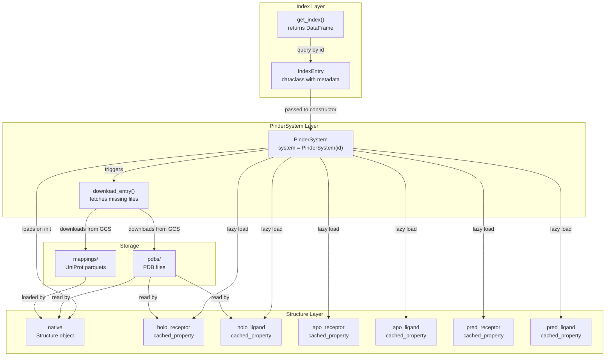
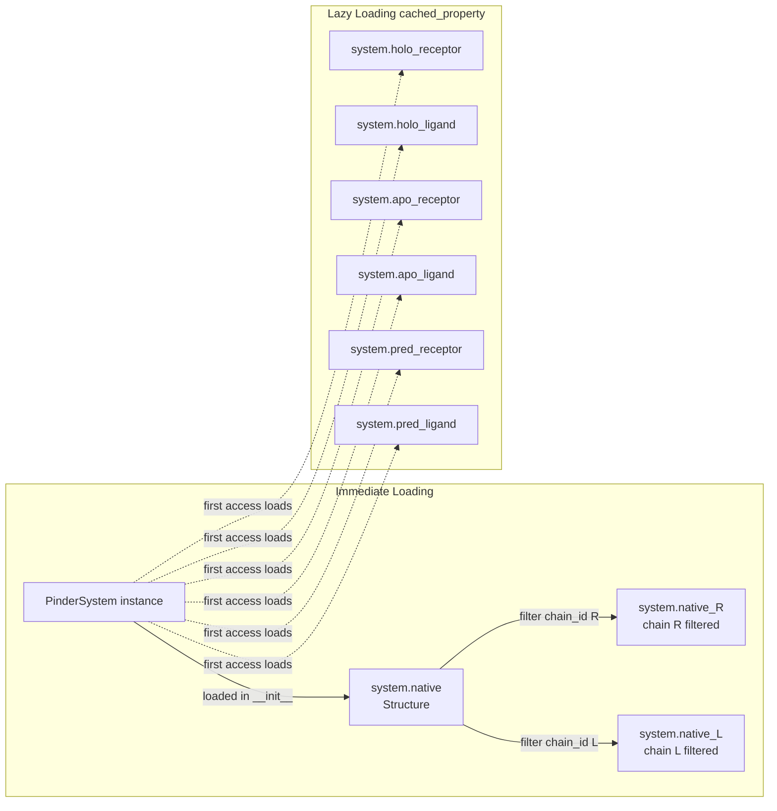
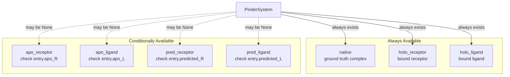
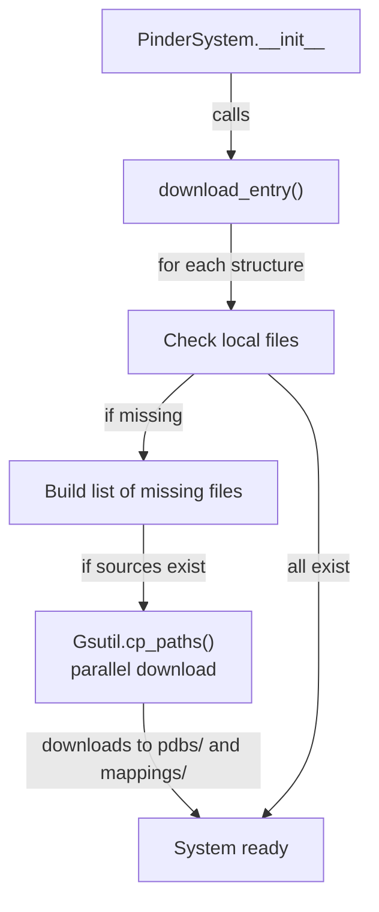

# Loading Your First System

<details>
<summary>Relevant source files</summary>

The following files were used as context for generating this wiki page:

- [examples/pinder-loader.ipynb](examples/pinder-loader.ipynb)
- [src/pinder-core/pinder/core/index/system.py](src/pinder-core/pinder/core/index/system.py)

</details>


This page walks through the fundamental task of loading and inspecting protein-protein interaction systems in PINDER using the `PinderSystem` class. It covers instantiating a system, accessing its various structural forms (native complex, holo monomers, apo monomers, and predicted monomers), and performing basic structural inspection.

For information about creating PyTorch dataloaders and integrating PINDER into ML pipelines, see [Creating DataLoaders](#2.2). For filtering systems based on quality criteria, see [Working with Filters](#2.3).

## Overview: The PinderSystem Class

The `PinderSystem` class is the primary interface for working with protein complex data in PINDER. Each system represents a single protein-protein interaction with multiple structural variants:

- **Native complex**: The ground-truth bound dimer structure
- **Holo monomers**: Receptor and ligand chains extracted from the native complex
- **Apo monomers**: Unbound structures of the same proteins (when available)
- **Predicted monomers**: AlphaFold2-predicted structures (when available)

All structural data is represented using the `Structure` class, which wraps biotite's `AtomArray` with additional PINDER-specific functionality.

**Sources**: [src/pinder-core/pinder/core/index/system.py:89-108]()

## System Loading Architecture



**Diagram: PinderSystem loading flow from index to structures**

**Sources**: [src/pinder-core/pinder/core/index/system.py:110-161](), [src/pinder-core/pinder/core/index/system.py:614-645]()

## Loading Your First System

### Step 1: Get the Dataset Index

The PINDER index is a pandas DataFrame containing metadata for all systems. Use `get_index()` to retrieve it:

```python
from pinder.core import get_index

index = get_index()
```

The index contains columns like `id`, `split`, `pdb_id`, `holo_R`, `holo_L`, `apo_R`, `apo_L`, `predicted_R`, `predicted_L`, and many others that describe each system's properties.

**Sources**: [examples/pinder-loader.ipynb:230-242](), [src/pinder-core/pinder/core/index/system.py:15-16]()

### Step 2: Select a System ID

Each system has a unique identifier in the format `{pdb_id}__{chain1}_{uniprot1}--{pdb_id}__{chain2}_{uniprot2}`. You can select a system by querying the index:

```python
# Get a system from the training set
train_systems = index[index.split == "train"]
system_id = train_systems.id.iloc[0]
# Example: "8phr__X4_UNDEFINED--8phr__W4_UNDEFINED"
```

**Sources**: [examples/pinder-loader.ipynb:238-241]()

### Step 3: Instantiate PinderSystem

Create a `PinderSystem` object by passing either a system ID string or an `IndexEntry` object:

```python
from pinder.core import PinderSystem

# Load by ID string
system = PinderSystem(system_id)

# Or pass IndexEntry directly
entry = train_systems.iloc[0]
system = PinderSystem(entry)
```

Upon instantiation, `PinderSystem` will:
1. Load or construct the `IndexEntry` metadata
2. Check for required files locally
3. Download missing PDB and mapping files from Google Cloud Storage
4. Load the native (ground-truth) complex structure immediately
5. Set up lazy-loaded properties for all monomer structures

**Sources**: [src/pinder-core/pinder/core/index/system.py:110-161](), [examples/pinder-loader.ipynb:234-242]()

## Structure Access Patterns



**Diagram: Structure loading strategy - immediate vs lazy loading**

**Sources**: [src/pinder-core/pinder/core/index/system.py:143-156](), [src/pinder-core/pinder/core/index/system.py:163-261]()

## Accessing Structures

### Native Complex

The native (ground-truth) complex is loaded immediately during initialization:

```python
# Access the full native complex
native_structure = system.native
# Returns: Structure object with both R and L chains

# Access pre-filtered chains
receptor_chain = system.native_R  # Chain R only
ligand_chain = system.native_L    # Chain L only
```

**Sources**: [src/pinder-core/pinder/core/index/system.py:144-156]()

### Holo Monomers

Holo monomers are the individual receptor and ligand chains extracted from the bound complex. These are loaded lazily (only when first accessed):

```python
# Access holo receptor
holo_receptor = system.holo_receptor
# Returns: Structure object or None

# Access holo ligand
holo_ligand = system.holo_ligand
# Returns: Structure object or None
```

**Sources**: [src/pinder-core/pinder/core/index/system.py:163-177](), [examples/pinder-loader.ipynb:250-268]()

### Apo Monomers

Apo monomers are unbound structures of the same proteins. Not all systems have apo structures available. Check the index columns `apo_R` and `apo_L` to determine availability:

```python
# Check if apo structures are available
has_apo_R = system.entry.apo_R  # Boolean
has_apo_L = system.entry.apo_L  # Boolean

# Access apo structures (returns None if unavailable)
apo_receptor = system.apo_receptor
apo_ligand = system.apo_ligand
```

By default, the canonical apo structure is loaded. You can specify alternative apo structures by passing PDB codes:

```python
system = PinderSystem(
    system_id,
    apo_receptor_pdb_code="6ucr",
    apo_ligand_pdb_code="3wdb"
)
```

**Sources**: [src/pinder-core/pinder/core/index/system.py:199-241](), [examples/pinder-loader.ipynb:269-308]()

### Predicted Monomers

Predicted monomers are AlphaFold2-generated structures. Check the index columns `predicted_R` and `predicted_L` for availability:

```python
# Check if predicted structures are available
has_pred_R = system.entry.predicted_R  # Boolean
has_pred_L = system.entry.predicted_L  # Boolean

# Access predicted structures (returns None if unavailable)
pred_receptor = system.pred_receptor
pred_ligand = system.pred_ligand
```

**Sources**: [src/pinder-core/pinder/core/index/system.py:243-261]()

## Monomer Availability Pattern



**Diagram: Structure availability in PinderSystem**

**Sources**: [examples/pinder-loader.ipynb:262-268]()

## Inspecting Structure Properties

The `Structure` class provides convenient access to structural properties:

| Property | Type | Description |
|----------|------|-------------|
| `coords` | `np.ndarray` | Atomic coordinates, shape `(n_atoms, 3)` |
| `sequence` | `str` | Amino acid sequence |
| `atom_array` | `biotite.structure.AtomArray` | Underlying biotite structure |
| `pinder_id` | `str` | PINDER identifier for this structure |
| `filepath` | `Path` | Path to the PDB file |
| `uniprot_map` | `Path | None` | Path to UniProt mapping file |

### Accessing Coordinates

```python
receptor = system.holo_receptor

# Get all atomic coordinates
coords = receptor.coords
# Returns: numpy array of shape (n_atoms, 3)

# Example: first 5 atoms
coords[0:5]
# array([[-12.982, -17.271, -11.271],
#        [-14.36 , -17.069, -11.749],
#        ...])
```

**Sources**: [examples/pinder-loader.ipynb:360-362]()

### Accessing Sequence

```python
# Get amino acid sequence as string
sequence = receptor.sequence
# Returns: "PLGSMFERFTDRARRVVVLAQEEARML..."
```

**Sources**: [examples/pinder-loader.ipynb:336-337]()

### Accessing Biotite AtomArray

For advanced manipulation, access the underlying biotite `AtomArray`:

```python
atom_array = receptor.atom_array

# AtomArray provides rich annotations
print(atom_array[0:5])
# Array of Atom objects with:
# - coordinates
# - chain_id
# - res_id (residue ID)
# - res_name (residue name)
# - atom_name
# - element
# - b_factor
```

**Sources**: [examples/pinder-loader.ipynb:373-397]()

## Data Download and File Organization

When you create a `PinderSystem`, the `download_entry()` method automatically handles data retrieval:

### File Structure

```
{PINDER_BASE_DIR}/
├── pdbs/
│   ├── {system_id}.pdb                    # Native complex
│   ├── {system_id}__R{chain}_{uniprot}-R.pdb  # Holo receptor
│   ├── {system_id}__L{chain}_{uniprot}-L.pdb  # Holo ligand
│   ├── {apo_id}__R{chain}_{uniprot}.pdb      # Apo receptor (if available)
│   ├── {apo_id}__L{chain}_{uniprot}.pdb      # Apo ligand (if available)
│   ├── af__{uniprot}-R.pdb                    # Predicted receptor (if available)
│   └── af__{uniprot}-L.pdb                    # Predicted ligand (if available)
├── test_set_pdbs/
│   ├── {test_system_holo_R}.pdb              # Test set holo receptors
│   └── {test_system_holo_L}.pdb              # Test set holo ligands
└── mappings/
    ├── {structure_id}.parquet                # UniProt mappings
    └── ...
```

### Download Process



**Diagram: Automatic file download workflow**

The download process:
1. Checks if each required PDB and mapping file exists locally
2. Builds a list of missing files from Google Cloud Storage
3. Downloads missing files in parallel using `Gsutil.cp_paths()`
4. Places files in the appropriate subdirectories

The base directory defaults to `~/.local/share/pinder/{version}/` but can be customized via the `PINDER_BASE_DIR` environment variable or the `dataset_path` parameter.

**Sources**: [src/pinder-core/pinder/core/index/system.py:614-645]()

## Checking Structure Availability

Before accessing apo or predicted structures, check their availability using the `IndexEntry`:

```python
# Check what structures are available
print(f"Apo receptor available: {system.entry.apo_R}")
print(f"Apo ligand available: {system.entry.apo_L}")
print(f"Predicted receptor available: {system.entry.predicted_R}")
print(f"Predicted ligand available: {system.entry.predicted_L}")

# Filter index for systems with both apo structures
systems_with_apo = index.query('apo_R and apo_L')

# Filter for systems with predicted structures
systems_with_pred = index.query('predicted_R and predicted_L')
```

**Sources**: [examples/pinder-loader.ipynb:262-268](), [examples/pinder-loader.ipynb:303]()

## Structure Loading Method

The `load_structure()` static method is used internally to create `Structure` objects from PDB files:

```python
# Internal usage (called by PinderSystem properties)
structure = PinderSystem.load_structure(
    pdb_file=Path("/path/to/structure.pdb"),
    chain_id="R",  # Optional: assign specific chain ID
    pdb_engine="fastpdb"  # Parser engine: "fastpdb" or "biotite"
)
```

This method:
1. Validates the PDB file exists and has `.pdb` extension
2. Locates the corresponding UniProt mapping file (if available)
3. Creates a `Structure` object using the specified parser engine
4. Optionally sets all atoms to a specific chain ID

**Sources**: [src/pinder-core/pinder/core/index/system.py:764-788]()

## Summary

Loading a PINDER system involves three main steps:

1. **Get the index**: `index = get_index()` provides metadata for all systems
2. **Select a system**: Query the index for a system ID
3. **Instantiate PinderSystem**: `system = PinderSystem(system_id)` loads the system

Key properties to access structures:
- `system.native` - Ground-truth complex (loaded immediately)
- `system.holo_receptor`, `system.holo_ligand` - Bound monomers (lazy loaded)
- `system.apo_receptor`, `system.apo_ligand` - Unbound monomers (lazy loaded, may be None)
- `system.pred_receptor`, `system.pred_ligand` - Predicted monomers (lazy loaded, may be None)

Each structure is a `Structure` object providing access to coordinates, sequences, and biotite `AtomArray` for detailed manipulation.

**Sources**: [examples/pinder-loader.ipynb:230-397](), [src/pinder-core/pinder/core/index/system.py:89-806]()

---