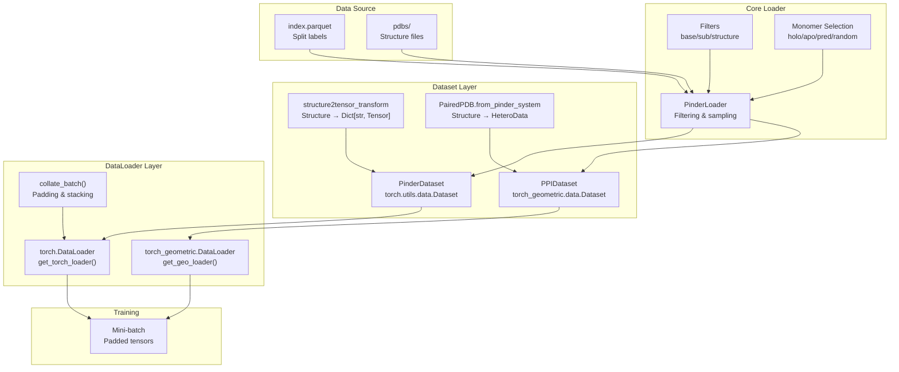
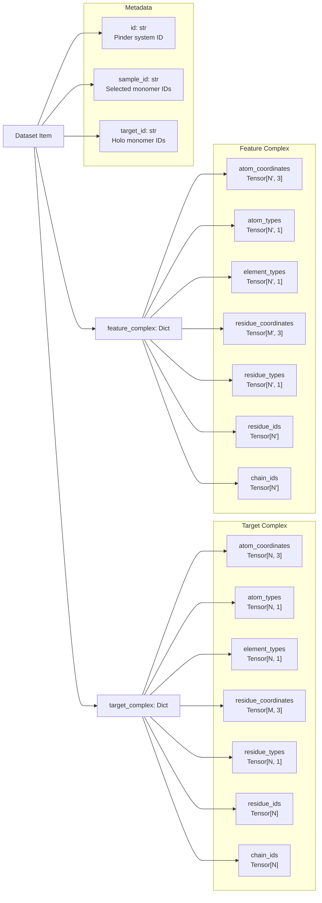
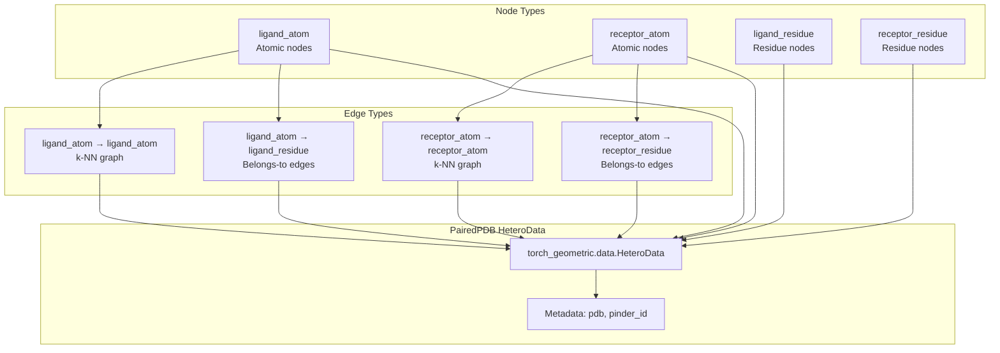
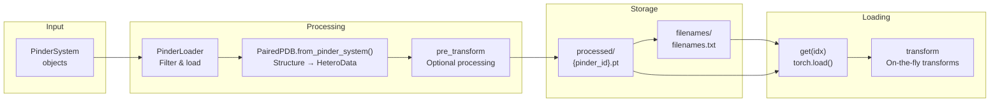
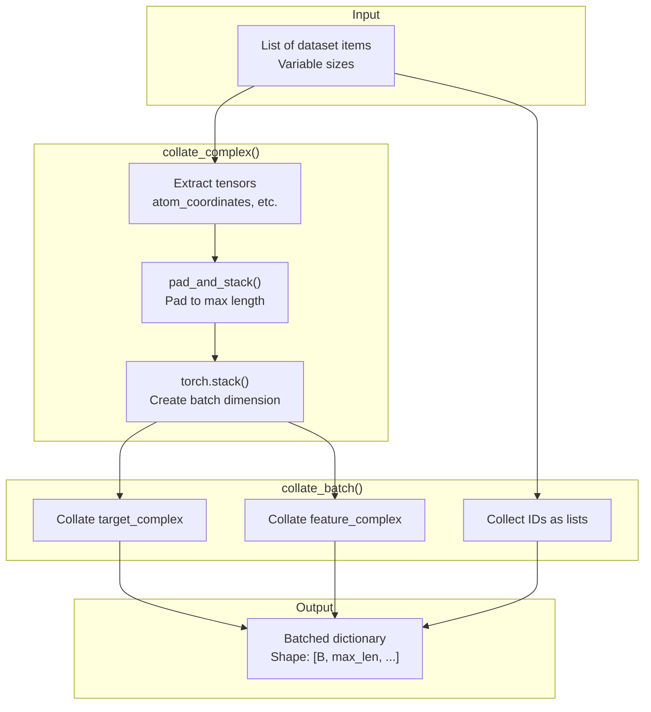
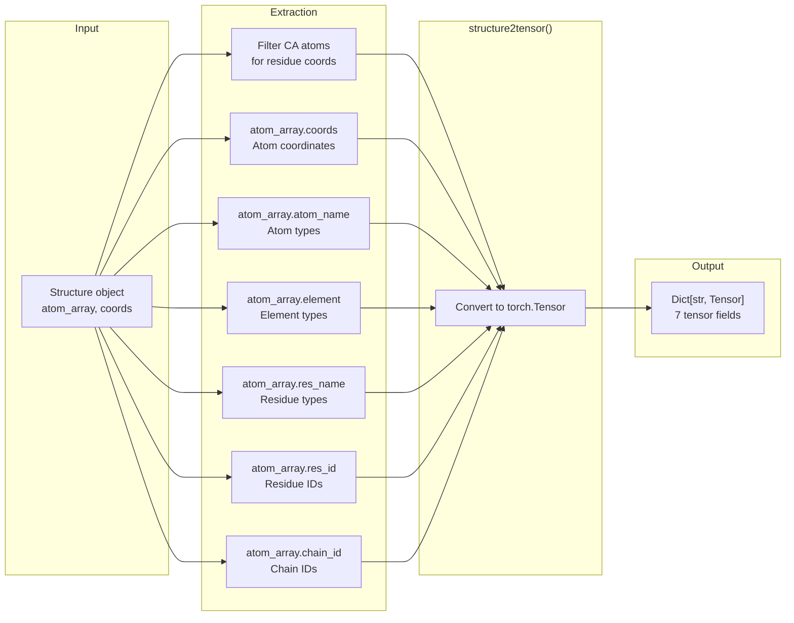

# Creating DataLoaders

<details>
<summary>Relevant source files</summary>

The following files were used as context for generating this wiki page:

- [examples/pinder-mlsb.ipynb](examples/pinder-mlsb.ipynb)
- [src/pinder-core/pinder/core/loader/dataset.py](src/pinder-core/pinder/core/loader/dataset.py)

</details>


This page demonstrates how to create PyTorch and PyTorch Geometric dataloaders for training machine learning models on PINDER data. It covers the two main dataset implementations provided by PINDER and shows how to configure them with filters, transforms, and monomer selection strategies.

For information about the underlying `PinderLoader` abstraction and filtering system, see [Data Loading System](#4). For details on transforms and augmentation, see [Transforms and Augmentation](#4.5).

## Overview

PINDER provides two dataset implementations that integrate with standard PyTorch training pipelines:

| Dataset Class | Output Format | Use Case | DataLoader Function |
|--------------|---------------|----------|---------------------|
| `PinderDataset` | Dictionary of tensors | Standard neural networks | `get_torch_loader()` |
| `PPIDataset` | `HeteroData` graphs | Graph neural networks | `get_geo_loader()` |

Both datasets wrap `PinderLoader` and apply transformations to convert `Structure` objects into ML-ready tensor formats.

**Data Flow Architecture**



Sources: [src/pinder-core/pinder/core/loader/dataset.py:1-655](), [examples/pinder-mlsb.ipynb:876-1071]()

## Quick Start

The simplest way to create dataloaders for training:

**Standard PyTorch**
```python
from pinder.core.loader.dataset import PinderDataset, get_torch_loader

train_dataset = PinderDataset(split="train")
train_loader = get_torch_loader(train_dataset, batch_size=2, shuffle=True)

for batch in train_loader:
    target = batch["target_complex"]  # Ground truth
    features = batch["feature_complex"]  # Input features
    # Train your model...
```

**PyTorch Geometric**
```python
from pinder.core.loader.dataset import PPIDataset, get_geo_loader

train_dataset = PPIDataset(
    node_types={"atom", "residue"}, 
    split="train"
)
train_loader = get_geo_loader(train_dataset, batch_size=2)

for batch in train_loader:
    # batch is a HeteroData object with ligand/receptor nodes
    # Train your GNN model...
```

Sources: [examples/pinder-mlsb.ipynb:112-116](), [src/pinder-core/pinder/core/loader/dataset.py:637-654]()

## PinderDataset

`PinderDataset` extends `torch.utils.data.Dataset` and returns dictionary-based tensor representations suitable for standard neural networks.

### Data Item Structure

Each item from `PinderDataset.__getitem__()` is a dictionary with the following structure:



Sources: [src/pinder-core/pinder/core/loader/dataset.py:299-318](), [examples/pinder-mlsb.ipynb:1074-1099]()

### Configuration Parameters

The `PinderDataset` class accepts the following key parameters:

| Parameter | Type | Default | Description |
|-----------|------|---------|-------------|
| `split` | `str \| None` | `None` | Dataset split: "train", "val", "test" |
| `index` | `pd.DataFrame \| None` | `None` | Custom index DataFrame |
| `metadata` | `pd.DataFrame \| None` | `None` | Custom metadata DataFrame |
| `monomer_priority` | `str` | `"holo"` | Monomer selection: "holo", "apo", "pred", "random", "random_mixed" |
| `base_filters` | `list[PinderFilterBase]` | `[]` | System-level filters |
| `sub_filters` | `list[PinderFilterSubBase]` | `[]` | Monomer-level filters |
| `structure_filters` | `list[StructureFilter]` | `[]` | Atom/residue-level filters |
| `structure_transforms_target` | `list[StructureTransform]` | `[]` | Transforms for ground truth |
| `structure_transforms_feature` | `list[StructureTransform]` | `[]` | Transforms for input features |
| `transform` | `Callable` | `structure2tensor_transform` | Final transform function |
| `target_transform` | `Callable` | `structure2tensor_transform` | Final target transform |
| `fallback_to_holo` | `bool` | `True` | Use holo if selected monomer unavailable |
| `crop_equal_monomer_shapes` | `bool` | `True` | Crop to common atoms |

Sources: [src/pinder-core/pinder/core/loader/dataset.py:246-295]()

### Example with Filters and Transforms

```python
from pinder.core.loader import filters, transforms
from pinder.core.loader.dataset import PinderDataset, get_torch_loader

# System-level filters
base_filters = [
    filters.FilterDetachedHolo(radius=12, max_components=2),
    filters.FilterByResidueCount(min_residue_count=10, max_residue_count=2000),
]

# Monomer-level filters
sub_filters = [
    filters.FilterSubByAtomTypes(min_atom_types=4),
    filters.FilterByHoloSeqIdentity(min_sequence_identity=0.8),
]

# Structure transforms
target_transforms = [
    transforms.SelectAtomTypes(atom_types=["CA", "N", "C", "O"]),
]

feature_transforms = [
    transforms.SelectAtomTypes(atom_types=["CA", "N", "C", "O"]),
    transforms.RandomLigandTransform(max_translation=10.0),
]

train_dataset = PinderDataset(
    split="train",
    monomer_priority="random_mixed",
    base_filters=base_filters,
    sub_filters=sub_filters,
    structure_transforms_target=target_transforms,
    structure_transforms_feature=feature_transforms,
)

train_loader = get_torch_loader(
    train_dataset,
    batch_size=2,
    shuffle=True,
    num_workers=4,
)
```

Sources: [examples/pinder-mlsb.ipynb:1036-1071](), [src/pinder-core/pinder/core/loader/dataset.py:637-654]()

## PPIDataset

`PPIDataset` extends `torch_geometric.data.Dataset` and creates heterogeneous graph representations via `HeteroData` objects, suitable for graph neural networks.

### Graph Structure

`PPIDataset` converts protein structures into heterogeneous graphs with multiple node and edge types:



Sources: [src/pinder-core/pinder/core/loader/dataset.py:320-404](), [src/pinder-core/pinder/core/loader/geodata.py]()

### Configuration Parameters

| Parameter | Type | Default | Description |
|-----------|------|---------|-------------|
| `node_types` | `set[NodeRepresentation]` | Required | Node representations: "atom", "residue", or both |
| `split` | `str` | `"train"` | Dataset split |
| `monomer1` | `str` | `"holo_receptor"` | Receptor monomer selection |
| `monomer2` | `str` | `"holo_ligand"` | Ligand monomer selection |
| `add_edges` | `bool` | `True` | Add k-NN edges |
| `k` | `int` | `10` | Number of nearest neighbors |
| `base_filters` | `list[PinderFilterBase]` | `[]` | System-level filters |
| `sub_filters` | `list[PinderFilterSubBase]` | `[]` | Monomer-level filters |
| `structure_filters` | `list[StructureFilter]` | `[]` | Atom/residue-level filters |
| `parallel` | `bool` | `False` | Enable parallel processing |
| `max_workers` | `int \| None` | `None` | Number of worker processes |
| `use_cache` | `bool` | `False` | Use cached processed files |
| `force_reload` | `bool` | `False` | Reprocess all files |

Sources: [src/pinder-core/pinder/core/loader/dataset.py:320-404]()

### Processing Pipeline

`PPIDataset` pre-processes structures into `.pt` files stored in a `processed/` directory:



Sources: [src/pinder-core/pinder/core/loader/dataset.py:543-595](), [src/pinder-core/pinder/core/loader/dataset.py:417-509]()

### Example Usage

```python
from pinder.core.loader.dataset import PPIDataset, get_geo_loader
from pinder.core.loader.geodata import NodeRepresentation

# Create dataset with atom and residue nodes
train_dataset = PPIDataset(
    node_types={NodeRepresentation.ATOM, NodeRepresentation.RESIDUE},
    split="train",
    monomer1="apo_receptor",
    monomer2="apo_ligand",
    add_edges=True,
    k=10,  # 10 nearest neighbors
    parallel=True,
    max_workers=8,
)

# Create dataloader
train_loader = get_geo_loader(
    train_dataset,
    batch_size=2,
    num_workers=1,
)

# Iterate over batches
for batch in train_loader:
    # batch is a Batch object containing multiple HeteroData graphs
    ligand_atom_coords = batch["ligand_atom"].x
    receptor_atom_coords = batch["receptor_atom"].x
    # Train your GNN...
```

Sources: [src/pinder-core/pinder/core/loader/dataset.py:625-634](), [examples/pinder-mlsb.ipynb:320-404]()

## Collation and Batching

### Padding Strategy

`PinderDataset` uses `collate_batch()` to handle variable-sized protein structures by padding to the maximum length in each batch:

**Padding Values**
| Tensor Type | Pad Value | Constant |
|-------------|-----------|----------|
| Coordinates | `-100` | `COORDS_PAD_VALUE` |
| Atom types | `-1` | `ATOM_TYPE_PAD_VALUE` |
| Element types | `-1` | `ELEMENT_TYPE_PAD_VALUE` |
| Chain IDs | `-1` | `CHAIN_ID_PAD_VALUE` |
| Residue IDs | `-99` | `RES_IDX_PAD_VALUE` |

Sources: [src/pinder-core/pinder/core/loader/dataset.py:46-50](), [src/pinder-core/pinder/core/loader/dataset.py:165-203]()

### Collation Functions



The `pad_and_stack()` function pads tensors along specified dimensions:

**Padding Algorithm**
1. Find maximum length along each dimension across all items
2. Pad each tensor to maximum length with specified pad value
3. Stack tensors along new batch dimension (dim=0)

Sources: [src/pinder-core/pinder/core/loader/dataset.py:122-162](), [src/pinder-core/pinder/core/loader/dataset.py:205-243]()

### Custom Collation

You can provide custom collation functions to `get_torch_loader()`:

```python
def custom_collate(batch):
    # Custom collation logic
    # batch is a list of items from PinderDataset.__getitem__()
    return collated_batch

train_loader = get_torch_loader(
    train_dataset,
    batch_size=2,
    collate_fn=custom_collate,
)
```

Sources: [src/pinder-core/pinder/core/loader/dataset.py:637-654]()

## DataLoader Helper Functions

PINDER provides two convenience functions for creating dataloaders:

### get_torch_loader()

Creates a `torch.utils.data.DataLoader` for `PinderDataset`:

**Function Signature**
```python
def get_torch_loader(
    dataset: PinderDataset,
    batch_size: int = 2,
    shuffle: bool = True,
    sampler: Sampler[PinderDataset] | None = None,
    num_workers: int = 1,
    collate_fn: Callable = collate_batch,
    **kwargs: Any,
) -> DataLoader[PinderDataset]
```

**Parameters**
- `dataset`: `PinderDataset` instance
- `batch_size`: Number of samples per batch
- `shuffle`: Shuffle data at every epoch
- `sampler`: Custom sampling strategy (mutually exclusive with `shuffle`)
- `num_workers`: Number of subprocesses for data loading
- `collate_fn`: Function to merge samples into a batch
- `**kwargs`: Additional arguments passed to `DataLoader`

Sources: [src/pinder-core/pinder/core/loader/dataset.py:637-654]()

### get_geo_loader()

Creates a `torch_geometric.loader.DataLoader` for `PPIDataset`:

**Function Signature**
```python
def get_geo_loader(
    dataset: PPIDataset,
    batch_size: int = 2,
    num_workers: int = 1,
) -> TorchGeoDataLoader
```

**Parameters**
- `dataset`: `PPIDataset` instance
- `batch_size`: Number of graphs per batch
- `num_workers`: Number of subprocesses for data loading

The returned dataloader automatically handles graph batching via PyTorch Geometric's batching utilities.

Sources: [src/pinder-core/pinder/core/loader/dataset.py:625-634]()

## Transform Functions

### Default Transform: structure2tensor_transform

The default transform converts `Structure` objects to dictionaries of tensors:



**Output Fields**
- `atom_coordinates`: `Tensor[N, 3]` - XYZ coordinates
- `atom_types`: `Tensor[N, 1]` - Atom type indices
- `element_types`: `Tensor[N, 1]` - Element indices
- `residue_coordinates`: `Tensor[M, 3]` - CA coordinates
- `residue_types`: `Tensor[N, 1]` - Residue type indices
- `residue_ids`: `Tensor[N]` - Residue numbering
- `chain_ids`: `Tensor[N]` - Chain identifiers

Sources: [src/pinder-core/pinder/core/loader/dataset.py:55-66](), [src/pinder-core/pinder/core/loader/geodata.py:structure2tensor]()

### Custom Transforms

You can provide custom transform functions that accept a `Structure` and return any tensor format:

```python
def my_transform(structure: Structure) -> dict[str, torch.Tensor]:
    # Custom transformation logic
    return {
        "custom_feature": torch.tensor(...),
        # ... more features
    }

dataset = PinderDataset(
    split="train",
    transform=my_transform,
    target_transform=my_transform,  # Can be different
)
```

Sources: [src/pinder-core/pinder/core/loader/dataset.py:258-264]()

## Best Practices

**Performance Optimization**
- Use `num_workers > 0` in dataloaders for parallel data loading
- For `PPIDataset`, enable `parallel=True` and set `max_workers` for faster preprocessing
- Set `use_cache=True` for `PPIDataset` after initial processing to skip regeneration

**Memory Management**
- Large batch sizes may cause OOM errors due to padding; monitor memory usage
- Consider using structure-level filters to limit maximum structure sizes
- Use `SelectAtomTypes` transform to reduce the number of atoms

**Monomer Selection**
- Use `monomer_priority="holo"` for testing rigid-body docking
- Use `monomer_priority="random_mixed"` for training to sample diverse conformations
- Set `fallback_to_holo=True` to handle missing apo/predicted structures gracefully

**Filtering Strategy**
- Apply `base_filters` first to remove problematic systems
- Use `sub_filters` to ensure monomer quality (sequence identity, atom coverage)
- Apply `structure_filters` last for fine-grained control

Sources: [src/pinder-core/pinder/core/loader/dataset.py:1-655](), [examples/pinder-mlsb.ipynb:876-1071]()

---