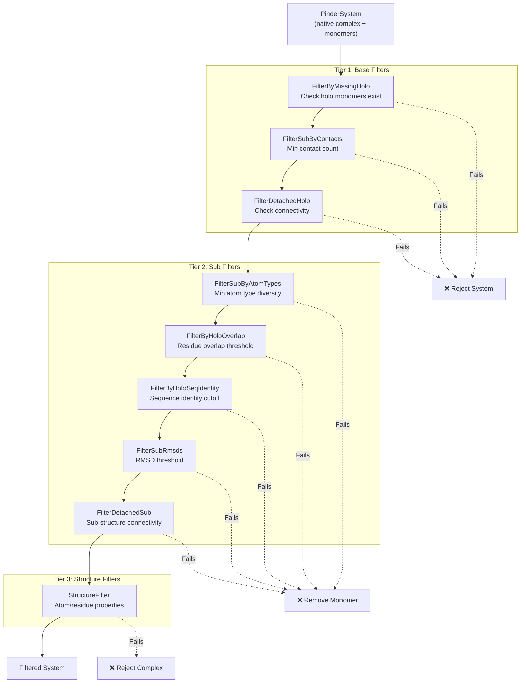
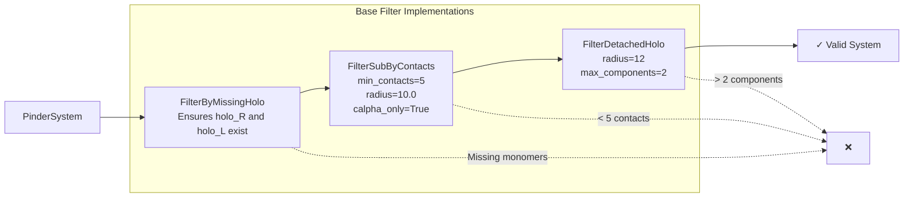
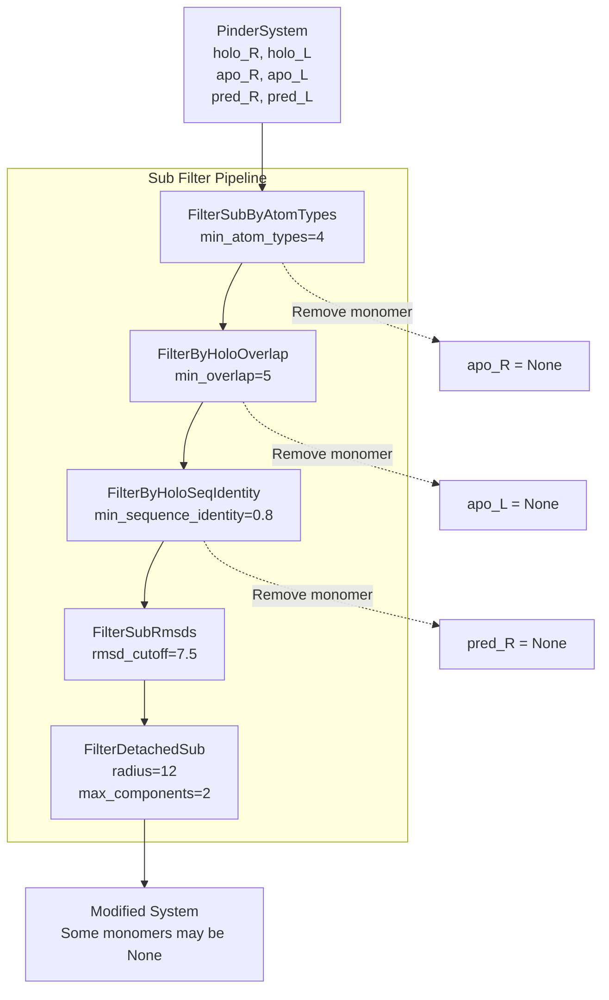
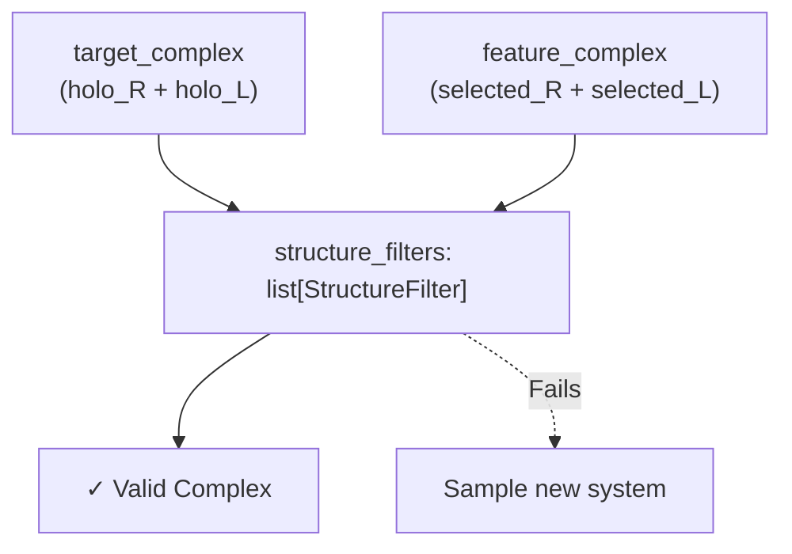
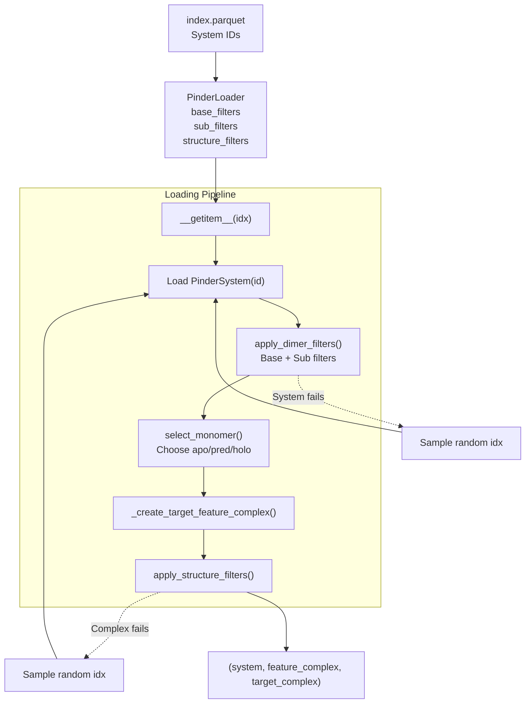
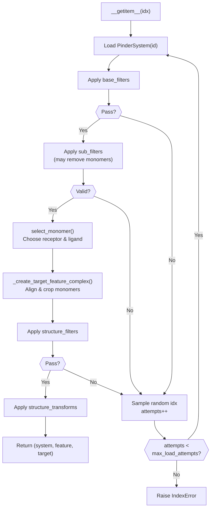
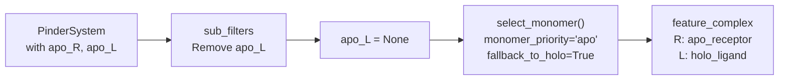

# Working with Filters

<details>
<summary>Relevant source files</summary>

The following files were used as context for generating this wiki page:

- [examples/pinder-loader.ipynb](examples/pinder-loader.ipynb)
- [src/pinder-core/pinder/core/loader/loader.py](src/pinder-core/pinder/core/loader/loader.py)
- [src/pinder-core/pinder/core/utils/timer.py](src/pinder-core/pinder/core/utils/timer.py)

</details>


This page demonstrates how to apply filters to PINDER systems to ensure data quality during training and evaluation. Filters enable you to exclude systems that don't meet specific criteria, such as missing structures, insufficient contacts, or detached components.

For comprehensive documentation of all available filter implementations, see [Filtering System](#4.4). For information on loading systems without filters, see [Loading Your First System](#2.1). For guidance on integrating filters into data loaders, see [Creating DataLoaders](#2.2).

## The Three-Tier Filtering System

PINDER implements a hierarchical filtering architecture with three distinct tiers, each operating at a different level of granularity:



**Sources:** [src/pinder-core/pinder/core/loader/loader.py:415-435](), [examples/pinder-loader.ipynb:458-481]()

| Filter Tier | Class Hierarchy | Operating Level | Effect on Failure |
|-------------|----------------|-----------------|-------------------|
| Base Filters | `PinderFilterBase` | Entire `PinderSystem` | System excluded from dataset |
| Sub Filters | `PinderFilterSubBase` | Individual monomers (apo/pred) | Monomer removed, system retained |
| Structure Filters | `StructureFilter` | Final `Structure` complexes | Complex rejected, new system sampled |

## Base Filters: System-Level Quality Control

Base filters evaluate the entire `PinderSystem` and determine whether it should be included in the dataset. These filters operate before any monomer selection or complex formation.

### Common Base Filter Examples



**Example Usage:**

From [examples/pinder-loader.ipynb:458-462]():
```python
from pinder.core.loader import filters

base_filters = [
    filters.FilterByMissingHolo(),
    filters.FilterSubByContacts(min_contacts=5, radius=10.0, calpha_only=True),
    filters.FilterDetachedHolo(radius=12, max_components=2),
]
```

**Sources:** [examples/pinder-loader.ipynb:458-462](), [src/pinder-core/pinder/core/loader/loader.py:200-201]()

## Sub Filters: Monomer-Level Quality Control

Sub filters operate on individual monomers (apo, predicted) within a `PinderSystem`. When a monomer fails a sub filter, it is removed from the system (set to `None`), but the system itself remains in the dataset. This allows fallback to holo monomers when alternative structures don't meet quality criteria.

### Common Sub Filter Examples



**Example Usage:**

From [examples/pinder-loader.ipynb:463-469]():
```python
sub_filters = [
    filters.FilterSubByAtomTypes(min_atom_types=4),
    filters.FilterByHoloOverlap(min_overlap=5),
    filters.FilterByHoloSeqIdentity(min_sequence_identity=0.8),
    filters.FilterSubRmsds(rmsd_cutoff=7.5),
    filters.FilterDetachedSub(radius=12, max_components=2),
]
```

**Sources:** [examples/pinder-loader.ipynb:463-469](), [src/pinder-core/pinder/core/loader/loader.py:202-203](), [src/pinder-core/pinder/core/loader/loader.py:421-430]()

## Structure Filters: Complex-Level Validation

Structure filters operate on the final `Structure` complexes created from selected monomers. These filters validate the target or feature complex after monomer selection and alignment.



**Sources:** [src/pinder-core/pinder/core/loader/loader.py:204-205](), [src/pinder-core/pinder/core/loader/loader.py:407-413]()

## Integration with PinderLoader

The `PinderLoader` class orchestrates the application of all three filter tiers during data loading. Filters are applied in sequence, with each tier having the opportunity to reject or modify the system.



**Sources:** [src/pinder-core/pinder/core/loader/loader.py:357-405](), [src/pinder-core/pinder/core/loader/loader.py:415-435]()

## Practical Example: Filtering Training Data

The following example demonstrates how to configure filters for a training dataset, ensuring high-quality protein complexes with sufficient structural information:

From [examples/pinder-loader.ipynb:458-480]():
```python
from pinder.core import PinderLoader
from pinder.core.loader import filters

# Define system-level filters
base_filters = [
    filters.FilterByMissingHolo(),
    filters.FilterSubByContacts(min_contacts=5, radius=10.0, calpha_only=True),
    filters.FilterDetachedHolo(radius=12, max_components=2),
]

# Define monomer-level filters
sub_filters = [
    filters.FilterSubByAtomTypes(min_atom_types=4),
    filters.FilterByHoloOverlap(min_overlap=5),
    filters.FilterByHoloSeqIdentity(min_sequence_identity=0.8),
    filters.FilterSubRmsds(rmsd_cutoff=7.5),
    filters.FilterDetachedSub(radius=12, max_components=2),
]

# Create loader with filters
loader = PinderLoader(
    split="test", 
    subset="pinder_af2",
    monomer_priority="holo",
    base_filters=base_filters,
    sub_filters=sub_filters
)
```

**Filter Behavior:**

From [examples/pinder-loader.ipynb:584-600]():
```python
systems = [
    "1df0__A1_Q07009--1df0__B1_Q64537",
    "117e__A1_P00817--117e__B1_P00817",
]

loader = PinderLoader(
    ids=systems,
    monomer_priority="holo",
    base_filters=base_filters,
    sub_filters=sub_filters
)

passing_ids = []
for item in loader:
    passing_ids.append(item[0].entry.id)

systems_removed_by_filters = set(systems) - set(passing_ids)
# Returns set() - both systems pass all filters
```

**Sources:** [examples/pinder-loader.ipynb:458-480](), [examples/pinder-loader.ipynb:584-600]()

## Filter Application Flow

The following diagram illustrates how filters are applied during item retrieval, including the retry mechanism when systems fail validation:



**Sources:** [src/pinder-core/pinder/core/loader/loader.py:357-405]()

## Filter Parameters and Customization

Each filter class accepts parameters that control its behavior. Common parameters include:

| Parameter | Description | Example Filters |
|-----------|-------------|-----------------|
| `min_contacts` | Minimum number of inter-chain contacts | `FilterSubByContacts` |
| `radius` | Distance threshold for contact/connectivity | `FilterSubByContacts`, `FilterDetachedHolo` |
| `calpha_only` | Use only Cα atoms for calculations | `FilterSubByContacts` |
| `max_components` | Maximum connected components allowed | `FilterDetachedHolo`, `FilterDetachedSub` |
| `min_atom_types` | Minimum unique atom types required | `FilterSubByAtomTypes` |
| `min_overlap` | Minimum overlapping residues | `FilterByHoloOverlap` |
| `min_sequence_identity` | Minimum sequence identity threshold | `FilterByHoloSeqIdentity` |
| `rmsd_cutoff` | Maximum RMSD allowed | `FilterSubRmsds` |

**Sources:** [examples/pinder-loader.ipynb:458-469]()

## Fallback Behavior with Sub Filters

When sub filters remove alternative monomers (apo/predicted), the `PinderLoader` can fall back to holo monomers if `fallback_to_holo=True` (default). This ensures systems remain in the dataset even when alternative structures don't meet quality criteria.



**Sources:** [src/pinder-core/pinder/core/loader/loader.py:172-177](), [src/pinder-core/pinder/core/loader/loader.py:209-210]()

## Max Load Attempts

The `max_load_attempts` parameter (default: 10) controls how many times the loader will attempt to find a valid system before raising an `IndexError`. When a system fails filters, a new random index is sampled.

From [src/pinder-core/pinder/core/loader/loader.py:357-398]():
```python
def __getitem__(self, idx: int) -> tuple[PinderSystem, Structure, Structure]:
    valid_idx = False
    attempts = 0
    while not valid_idx and attempts < self.max_load_attempts:
        attempts += 1
        row = self.index.iloc[idx]
        system = PinderSystem(row.id)
        system = self.apply_dimer_filters(
            system, self.base_filters, self.sub_filters
        )
        if not isinstance(system, PinderSystem):
            # Select a new random system, previous one failed filters
            idx = random.choice(list(range(len(self))))
            continue
        # ... rest of filtering logic
```

**Sources:** [src/pinder-core/pinder/core/loader/loader.py:212](), [src/pinder-core/pinder/core/loader/loader.py:357-398]()

---