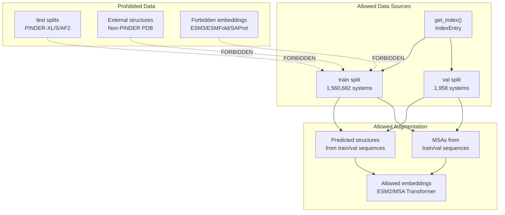
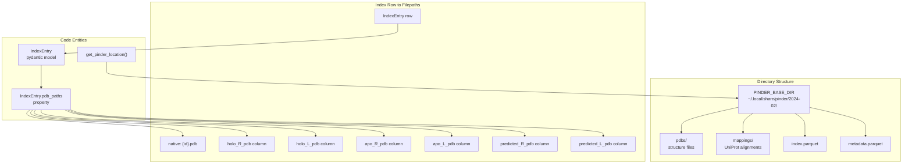
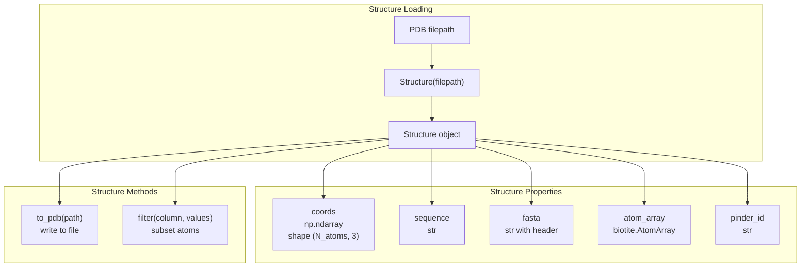
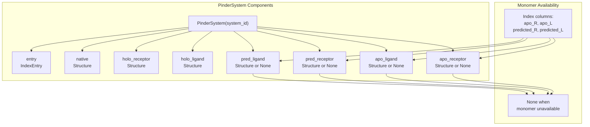
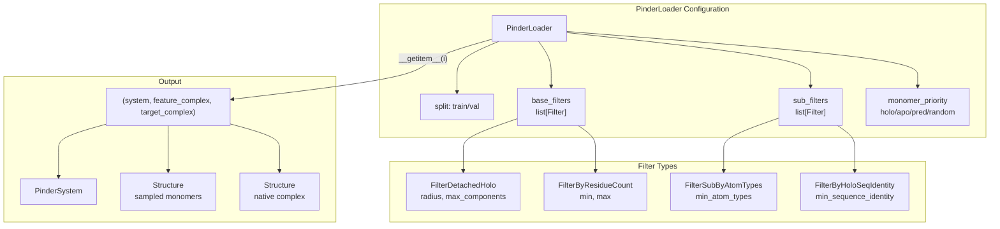
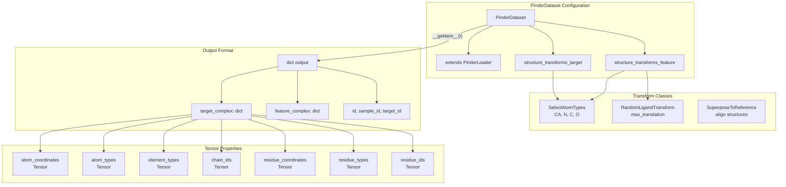
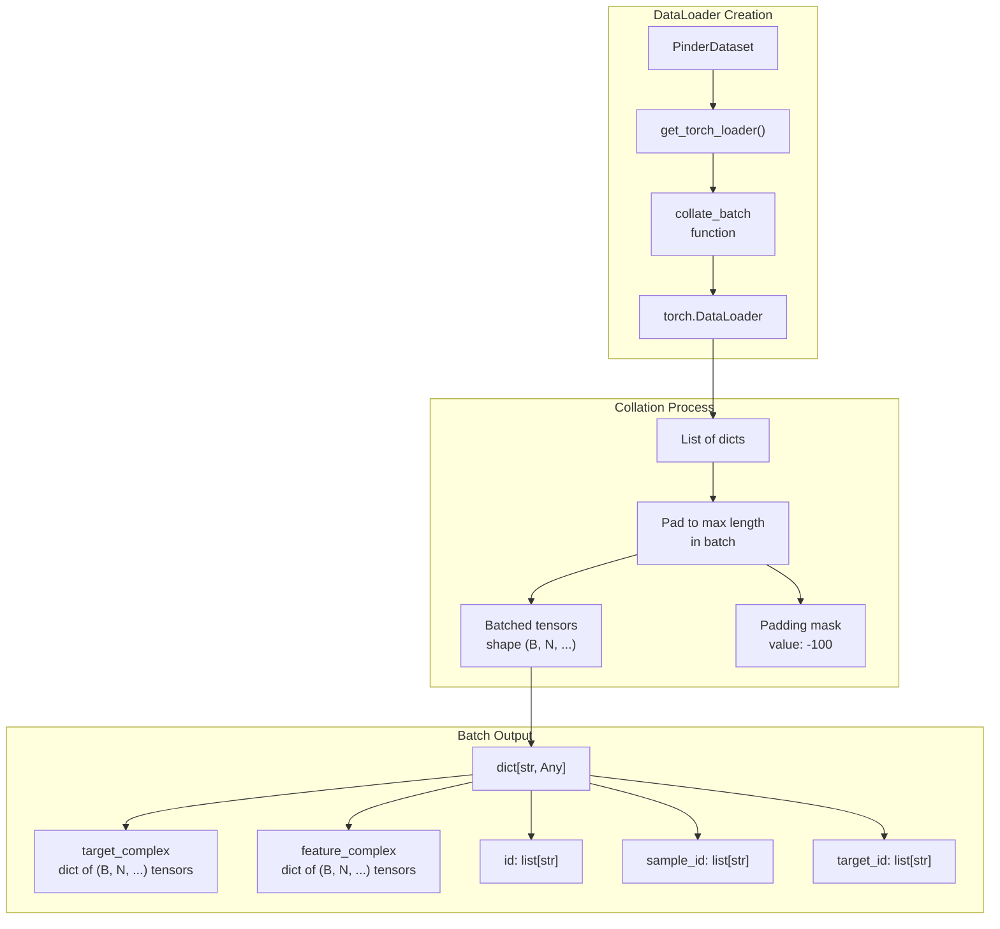

# MLSB Challenge Tutorial

<details>
<summary>Relevant source files</summary>

The following files were used as context for generating this wiki page:

- [examples/pinder-mlsb.ipynb](examples/pinder-mlsb.ipynb)

</details>


This page provides specific guidance for participants in the MLSB PINDER Challenge track. It covers competition rules, dataset access patterns, and practical examples for training models using PINDER data. For general information about PINDER, see [Overview](#1). For detailed documentation on data loading systems, see [Data Loading System](#4).

## Challenge Overview

The MLSB PINDER Challenge evaluates flexible protein-protein docking methods on a curated test set. Participants must train models using only PINDER training and validation data, then submit predictions through a standardized inference interface hosted on Hugging Face Spaces.

## Training Rules

Participants must adhere to strict data usage constraints to ensure fair evaluation and prevent test set leakage:

**Allowed Training Data:**
- PINDER train split (`split == "train"` in index): 2.4M+ systems
- PINDER val split (`split == "val"` in index): 1,958 systems
- Sequences and structures from these splits only
- MSAs derived from these sequences (e.g., using MSA Transformer)

**Data Augmentation Restrictions:**
- No external protein structures or sequences beyond PINDER train/val
- Predicted structures may be generated from train/val sequences only (e.g., using AlphaFold2)
- PINDER and PLINDER datasets must be used independently (no cross-dataset augmentation)
- Embeddings must come from models trained on allowed data (ESM2, MSA Transformer ✅; ESM3, ESMFold, SAProt, UniMol ❌)

**Model Selection:**
- Hyperparameter tuning and model selection must use only the validation split
- No test split systems may be accessed during training or model selection



**Diagram: MLSB Challenge Data Usage Rules**

Sources: [examples/pinder-mlsb.ipynb:41-56]()

## Inference Rules

Submissions must follow a standardized format using Hugging Face Spaces:

**Submission Requirements:**

1. **Documentation:** Provide an MLSB submission ID or link to preprint/paper describing the methodology
2. **Space Template:** Duplicate the official [inference template](https://huggingface.co/spaces/MLSB/pinder_inference_template)
3. **Required Files:**
   - `inference_app.py`: Contains `predict()` function for inference
   - `train.py`: Documents training procedure and hyperparameters
   - `requirements.txt`: All dependencies
   - `LICENSE`: Permissive license (MIT or Apache2)
   - `Dockerfile`: Modified as needed for dependencies

4. **Leaderboard Submission:** Submit via the [designated form](https://huggingface.co/spaces/MLSB/leaderboard2024)

**Inference Inputs:**

For PINDER track, the `predict()` function receives:
- Monomer protein structure 1 (PDB file)
- Monomer protein structure 2 (PDB file)
- FASTA 1 (sequence)
- FASTA 2 (sequence)
- Optional: MSA 1, MSA 2

No alternative templates, sequences, or structures are permitted during inference.

Sources: [examples/pinder-mlsb.ipynb:59-78]()

## Evaluation Dataset

The evaluation set composition and characteristics:

**Dataset Properties:**
- **Size:** 150-200 structures sampled from PINDER test splits
- **Leaderboards:** Separate leaderboards for PINDER and PLINDER tracks
- **Input Standardization:** Each sample contains predefined monomer structures (not participant-selected)
- **Monomer Types:** Balanced mixture of apo and predicted structures
- **Stratification:** Systems stratified by conformational flexibility level
- **Focus:** Exclusively flexible docking/co-folding scenarios

**Input Format:**
```
(monomer_structure_R, monomer_structure_L, fasta_R, fasta_L, msa_R, msa_L)
```

The exact composition will be disclosed closer to evaluation time. Participants should prepare methods that handle both apo (unbound) and predicted monomer structures with varying degrees of conformational flexibility.

Sources: [examples/pinder-mlsb.ipynb:81-98]()

## Accessing Training Data

### Loading the Index

The PINDER index contains metadata for all systems and their train/val/test split assignments. Access it using `get_index()`:

```mermaid
graph LR
    subgraph "Index Access"
        FUNC["get_index()"]
        INDEX["pd.DataFrame<br/>2.4M+ rows<br/>34 columns"]
        TRAIN_DF["train DataFrame<br/>1,560,682 rows"]
        VAL_DF["val DataFrame<br/>1,958 rows"]
    end
    
    subgraph "Index Columns"
        ID["id: system identifier"]
        SPLIT["split: train/val/test"]
        HOLO_FLAGS["holo_R, holo_L<br/>bool flags"]
        APO_FLAGS["apo_R, apo_L<br/>bool flags"]
        PRED_FLAGS["predicted_R, predicted_L<br/>bool flags"]
        PDB_COLS["*_pdb columns<br/>relative paths"]
    end
    
    FUNC --> INDEX
    INDEX -->|"query('split == \"train\"')"| TRAIN_DF
    INDEX -->|"query('split == \"val\"')"| VAL_DF
    
    INDEX --> ID
    INDEX --> SPLIT
    INDEX --> HOLO_FLAGS
    INDEX --> APO_FLAGS
    INDEX --> PRED_FLAGS
    INDEX --> PDB_COLS
```

**Diagram: Index Loading and Split Selection**

**Method 1: Using pinder package:**

```python
from pinder.core import get_index

index = get_index()
train = index.query('split == "train"').reset_index(drop=True)
val = index.query('split == "val"').reset_index(drop=True)
```

**Method 2: Without pinder package:**

```python
import gcsfs
import pandas as pd

index_uri = "gs://pinder/2024-02/index.parquet"
fs = gcsfs.GCSFileSystem(token="anon")
with fs.open(index_uri, "rb") as f:
    index = pd.read_parquet(f)

train = index.query('split == "train"').reset_index(drop=True)
val = index.query('split == "val"').reset_index(drop=True)
```

Sources: [examples/pinder-mlsb.ipynb:125-197]()

### Filepath Construction

PINDER data is organized in `PINDER_BASE_DIR` (default: `~/.local/share/pinder/2024-02/`). PDB files are stored in the `pdbs/` subdirectory.



**Diagram: PINDER Directory Structure and Filepath Construction**

**Using IndexEntry:**

The `IndexEntry` class provides a convenient `pdb_paths` property that constructs relative paths from index columns:

```python
from pinder.core import get_pinder_location
from pinder.core.index.utils import IndexEntry

pinder_dir = get_pinder_location()
row = train.sample(1).squeeze()
entry = IndexEntry(**row.to_dict())

# Get relative paths
relative_paths = entry.pdb_paths
# Returns: {'native': 'pdbs/{id}.pdb', 'holo_R': 'pdbs/{holo_R_pdb}', ...}

# Convert to absolute paths
absolute_paths = {}
for structure_type, rel_path in relative_paths.items():
    if isinstance(rel_path, list):  # apo_R_alt, apo_L_alt
        absolute_paths[structure_type] = [pinder_dir / p for p in rel_path if p]
    elif rel_path:
        absolute_paths[structure_type] = pinder_dir / rel_path
    else:
        absolute_paths[structure_type] = ""
```

**Manual construction:**

```python
from pathlib import Path

pinder_dir = get_pinder_location()
row = train.sample(1).squeeze()

absolute_paths = {
    "native": pinder_dir / "pdbs" / f"{row.id}.pdb",
    "holo_R_pdb": pinder_dir / "pdbs" / row.holo_R_pdb if row.holo_R_pdb else "",
    "holo_L_pdb": pinder_dir / "pdbs" / row.holo_L_pdb if row.holo_L_pdb else "",
    "predicted_R_pdb": pinder_dir / "pdbs" / row.predicted_R_pdb if row.predicted_R_pdb else "",
    "predicted_L_pdb": pinder_dir / "pdbs" / row.predicted_L_pdb if row.predicted_L_pdb else "",
    "apo_R_pdb": pinder_dir / "pdbs" / row.apo_R_pdb if row.apo_R_pdb else "",
    "apo_L_pdb": pinder_dir / "pdbs" / row.apo_L_pdb if row.apo_L_pdb else "",
}
```

Sources: [examples/pinder-mlsb.ipynb:204-350]()

### Loading Structures

The `Structure` class provides the minimal interface for loading PDB files and accessing atomic properties:



**Diagram: Structure Class Interface**

**Basic usage:**

```python
from pinder.core.loader.structure import Structure

receptor = Structure(absolute_paths["holo_R_pdb"])

# Access coordinates
coords = receptor.coords  # shape: (N_atoms, 3)

# Access sequence
sequence = receptor.sequence  # str

# Access FASTA format
fasta = receptor.fasta  # ">pinder_id\nSEQUENCE"

# Access underlying biotite AtomArray
atom_array = receptor.atom_array  # biotite.structure.AtomArray

# Write to file
receptor.to_pdb(Path("output.pdb"))
```

Sources: [examples/pinder-mlsb.ipynb:357-488]()

### Using PinderSystem

`PinderSystem` provides a unified interface to all structural variants of a protein-protein complex:



**Diagram: PinderSystem Structure Organization**

**Key properties:**

| Property | Type | Description | Always Available |
|----------|------|-------------|-----------------|
| `entry` | `IndexEntry` | Metadata from index | Yes |
| `native` | `Structure` | Ground-truth complex | Yes |
| `holo_receptor` | `Structure` | Receptor from complex | Yes |
| `holo_ligand` | `Structure` | Ligand from complex | Yes |
| `apo_receptor` | `Structure \| None` | Unbound receptor | No |
| `apo_ligand` | `Structure \| None` | Unbound ligand | No |
| `pred_receptor` | `Structure \| None` | Predicted receptor | No |
| `pred_ligand` | `Structure \| None` | Predicted ligand | No |

**Loading systems:**

```python
from pinder.core import PinderSystem

# Load system by ID
system = PinderSystem(train.id.iloc[0])

# Check monomer availability
has_apo_R = system.entry.apo_R  # bool from index
has_apo_L = system.entry.apo_L  # bool from index

# Access available structures
if system.apo_receptor is not None:
    apo_receptor = system.apo_receptor
    sequence = apo_receptor.sequence
    coords = apo_receptor.coords
```

**Filtering by monomer availability:**

```python
# Get only systems with both apo monomers
apo_systems = train.query('apo_R and apo_L')
system_id = apo_systems.id.iloc[0]
system = PinderSystem(system_id)

# Both apo structures guaranteed to exist
receptor = system.apo_receptor
ligand = system.apo_ligand
```

Sources: [examples/pinder-mlsb.ipynb:496-869]()

## Using PinderLoader

`PinderLoader` provides an iterator interface with filtering and monomer selection capabilities:



**Diagram: PinderLoader Architecture**

**Configuration:**

```python
from pinder.core import PinderLoader
from pinder.core.loader import filters

base_filters = [
    filters.FilterDetachedHolo(radius=12, max_components=2),
    filters.FilterByResidueCount(min_residue_count=10, max_residue_count=2000),
]

sub_filters = [
    filters.FilterSubByAtomTypes(min_atom_types=4),
    filters.FilterByHoloSeqIdentity(min_sequence_identity=0.8),
]

loader = PinderLoader(
    split="val",
    base_filters=base_filters,
    sub_filters=sub_filters,
    monomer_priority="random_mixed"  # holo/apo/pred/random/random_mixed
)
```

**Monomer Priority Strategies:**

| Strategy | Description | Use Case |
|----------|-------------|----------|
| `holo` | Use bound monomers | Baseline bound docking |
| `apo` | Use unbound monomers | True unbound docking |
| `pred` | Use predicted monomers | AF2-based docking |
| `random` | Random from available in both | Varied training |
| `random_mixed` | Random independently | Maximum variety |

**Iteration:**

```python
# Access by index
system, feature_complex, target_complex = loader[0]

# Iterate
for system, feature_complex, target_complex in loader:
    # Extract receptor and ligand from target
    receptor = target_complex.filter("chain_id", ["R"])
    ligand = target_complex.filter("chain_id", ["L"])
    
    # Write FASTA files
    with open(f"receptor_{receptor.pinder_id}.fasta", "w") as f:
        f.write(receptor.fasta)
```

Sources: [examples/pinder-mlsb.ipynb:876-996]()

## Using PinderDataset

`PinderDataset` is a PyTorch `Dataset` that converts `Structure` objects to tensors:



**Diagram: PinderDataset Output Structure**

**Configuration with transforms:**

```python
from pinder.core.loader import filters, transforms
from pinder.core.loader.dataset import PinderDataset

base_filters = [
    filters.FilterDetachedHolo(radius=12, max_components=2),
    filters.FilterByResidueCount(min_residue_count=10, max_residue_count=2000),
]

sub_filters = [
    filters.FilterSubByAtomTypes(min_atom_types=4),
    filters.FilterByHoloSeqIdentity(min_sequence_identity=0.8),
]

# Structure-level transforms
target_transforms = [
    transforms.SelectAtomTypes(atom_types=["CA", "N", "C", "O"]),
]

feature_transforms = [
    transforms.SelectAtomTypes(atom_types=["CA", "N", "C", "O"]),
    transforms.RandomLigandTransform(max_translation=10.0),
]

train_dataset = PinderDataset(
    split="train",
    monomer_priority="random_mixed",
    base_filters=base_filters,
    sub_filters=sub_filters,
    structure_transforms_target=target_transforms,
    structure_transforms_feature=feature_transforms,
)
```

**Output structure:**

```python
item = train_dataset[0]

# item is a dict with keys:
# - 'target_complex': dict of tensors
# - 'feature_complex': dict of tensors  
# - 'id': str (system ID)
# - 'sample_id': str (selected monomers)
# - 'target_id': str (holo monomers)

# Each complex dict contains:
target_dict = item['target_complex']
# Keys: atom_coordinates, atom_types, element_types, chain_ids,
#       residue_coordinates, residue_types, residue_ids

atom_coords = target_dict['atom_coordinates']  # shape: (N_atoms, 3)
atom_types = target_dict['atom_types']         # shape: (N_atoms, 1)
chain_ids = target_dict['chain_ids']           # shape: (N_atoms,)
```

Sources: [examples/pinder-mlsb.ipynb:1019-1072](), [examples/pinder-mlsb.ipynb:1074-1099]()

## Creating PyTorch DataLoader

The `get_torch_loader` function creates batched dataloaders with proper collation:



**Diagram: DataLoader Batching and Collation**

**Creating dataloader:**

```python
from pinder.core.loader.dataset import collate_batch, get_torch_loader

batch_size = 2
train_dataloader = get_torch_loader(
    train_dataset,
    batch_size=batch_size,
    shuffle=True,
    collate_fn=collate_batch,
    num_workers=0,
)

# Iterate over batches
for batch in train_dataloader:
    # batch keys: target_complex, feature_complex, id, sample_id, target_id
    target_coords = batch["target_complex"]["atom_coordinates"]
    # shape: (batch_size, max_atoms_in_batch, 3)
    
    feature_coords = batch["feature_complex"]["atom_coordinates"]
    # shape: (batch_size, max_atoms_in_batch, 3)
    
    system_ids = batch["id"]  # list of strings
```

**Padding behavior:**

The `collate_batch` function pads variable-length structures to the maximum length in the batch:
- Coordinate padding: `-100.0`
- Type/ID padding: `-1` or `-99`
- All tensors have shape `(batch_size, max_length, ...)`

**Handling padding in training:**

```python
# Create mask for valid atoms
atom_coords = batch["feature_complex"]["atom_coordinates"]
padding_mask = (atom_coords[:, :, 0] != -100.0)  # shape: (B, N)

# Apply mask to loss computation
valid_coords = atom_coords[padding_mask]
# ... compute loss on valid_coords only
```

Sources: [examples/pinder-mlsb.ipynb:1843-1887](), [examples/pinder-mlsb.ipynb:1889-2071]()

## Custom Dataset Implementation

For advanced use cases, implement a custom `Dataset` class. See [Custom Datasets](#8.2) for detailed guidance on extending `PinderLoader` with custom transforms and collation logic.

The key pattern:
1. Inherit from `torch.utils.data.Dataset`
2. Use `PinderLoader` internally for system access
3. Implement custom `__getitem__` returning your data format
4. Implement custom collation function for batching

Sources: [examples/pinder-mlsb.ipynb:2074-2083]()

## Summary

The MLSB Challenge requires careful adherence to data usage rules while providing flexibility in model architecture and training procedures. Key points:

1. **Data Access:** Use only train/val splits via `get_index()` and filter for `split == "train"` or `split == "val"`
2. **Loading Patterns:** Choose between direct filepath access, `PinderSystem`, `PinderLoader`, or `PinderDataset` based on needs
3. **Transforms:** Apply structure-level transforms using classes in `pinder.core.loader.transforms`
4. **Batching:** Use `collate_batch` for proper padding and masking of variable-length structures
5. **Submission:** Follow Hugging Face Spaces template with required files and permissive licensing

For questions or issues, engage via GitHub issues at the [PINDER repository](https://github.com/pinder-org/pinder).

Sources: [examples/pinder-mlsb.ipynb:1-2107]()

---