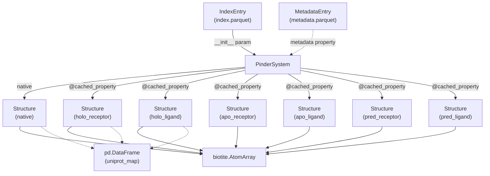
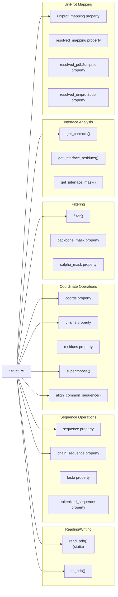
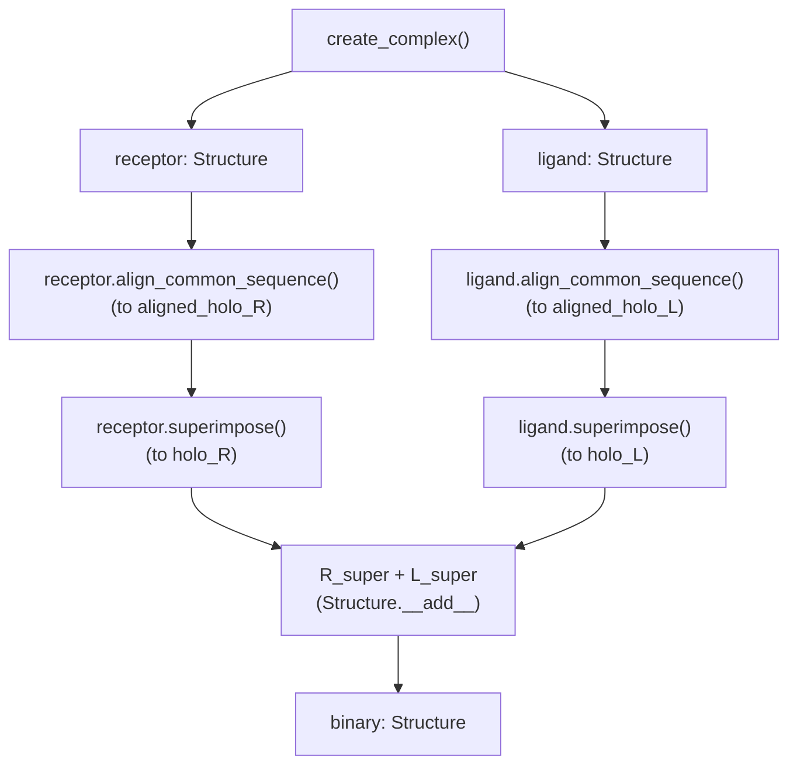
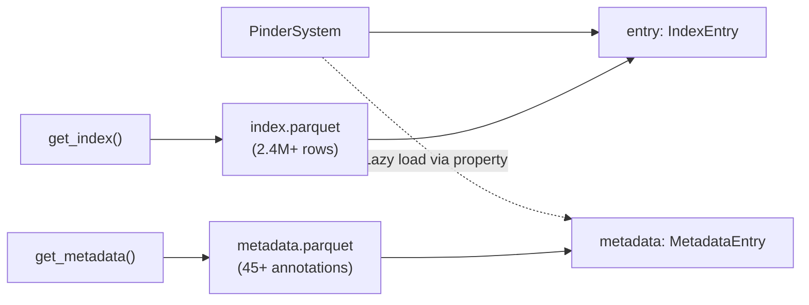
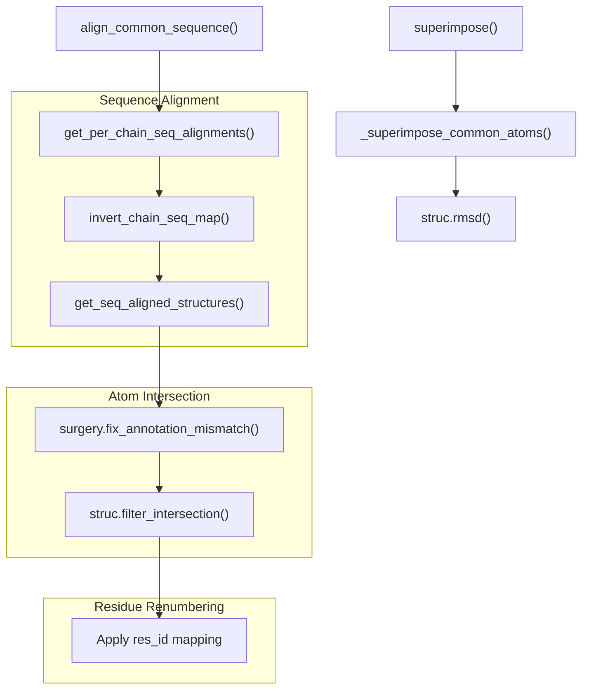
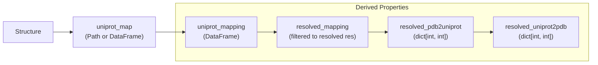
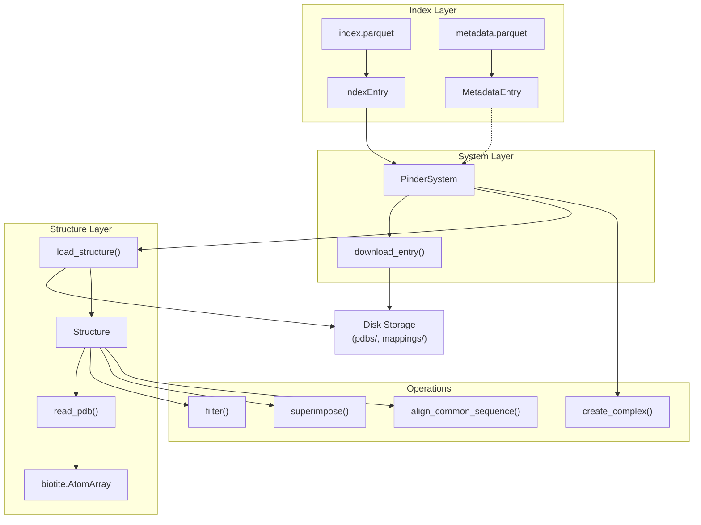

# Core Data Structures

Relevant source files

The following files were used as context for generating this wiki page:

- [src/pinder-core/pinder/core/index/system.py](src/pinder-core/pinder/core/index/system.py)
- [src/pinder-core/pinder/core/loader/structure.py](src/pinder-core/pinder/core/loader/structure.py)

This document describes the fundamental data structures used throughout PINDER to represent protein systems, individual structures, and associated metadata. These classes form the foundation for all data loading, manipulation, and analysis operations in the codebase.

For information about how these structures are used in data loading pipelines, see [Data Loading System](#4). For details on atomic-level manipulation functions, see [Atomic Operations](#3.3).

## Overview

PINDER organizes protein interaction data using a hierarchical set of data structures:

- **`PinderSystem`**: High-level container managing all structural variants of a protein complex
- **`Structure`**: Wrapper around biotite's `AtomArray` with additional functionality
- **`IndexEntry`**: Metadata schema defining available files and properties for each system
- **`MetadataEntry`**: Extended annotation schema with 45+ biological and structural properties

**Sources:** [src/pinder-core/pinder/core/index/system.py:89-162](), [src/pinder-core/pinder/core/loader/structure.py:42-49]()

## Structure Class Hierarchy

The `Structure` class is a pydantic dataclass that wraps biotite's `AtomArray` to provide domain-specific functionality for protein structure manipulation.

### Core Attributes

| Attribute | Type | Description |
|-----------|------|-------------|
| `filepath` | `Path` | Path to PDB file on disk |
| `atom_array` | `AtomArray` | Biotite structure containing atomic coordinates and annotations |
| `uniprot_map` | `Path \| pd.DataFrame \| None` | UniProt residue mapping for coordinate system conversion |
| `pinder_id` | `str \| None` | Unique identifier within PINDER dataset |
| `pdb_engine` | `str` | Parser engine ("fastpdb" or "biotite") |

**Sources:** [src/pinder-core/pinder/core/loader/structure.py:42-49]()

### Key Properties and Methods

**Sources:** [src/pinder-core/pinder/core/loader/structure.py:50-512]()

## PinderSystem Architecture

`PinderSystem` is the primary interface for working with protein complexes in PINDER. It manages all structural variants of a protein-protein interaction and provides methods for complex creation, alignment, and difficulty assessment.

### Initialization and Data Access

```mermaid
graph TB
    Init["PinderSystem.__init__()"]
    Entry["entry: IndexEntry"]
    DatasetPath["dataset_path: Path"]
    
    subgraph "Directory Structure"
        PDBsPath["pdbs_path"]
        TestPDBsPath["test_pdbs_path"]
        MappingsPath["mappings_path"]
    end
    
    subgraph "Eager Loading"
        Native["native: Structure"]
        NativeR["native_R: Structure"]
        NativeL["native_L: Structure"]
    end
    
    subgraph "Lazy Loading (@cached_property)"
        HoloR["holo_receptor: Structure"]
        HoloL["holo_ligand: Structure"]
        AlignedHoloR["aligned_holo_R: Structure"]
        AlignedHoloL["aligned_holo_L: Structure"]
        ApoR["apo_receptor: Structure"]
        ApoL["apo_ligand: Structure"]
        PredR["pred_receptor: Structure"]
        PredL["pred_ligand: Structure"]
    end
    
    Init --> Entry
    Init --> DatasetPath
    Init --> PDBsPath
    Init --> TestPDBsPath
    Init --> MappingsPath
    
    Init --> Native
    Native --> NativeR
    Native --> NativeL
    
    PinderSystem -->|"First access triggers load"| HoloR
    PinderSystem -->|"First access triggers load"| HoloL
    PinderSystem -->|"Computed from holo_receptor"| AlignedHoloR
    PinderSystem -->|"Computed from holo_ligand"| AlignedHoloL
    PinderSystem -->|"First access triggers load"| ApoR
    PinderSystem -->|"First access triggers load"| ApoL
    PinderSystem -->|"First access triggers load"| PredR
    PinderSystem -->|"First access triggers load"| PredL
```

**Sources:** [src/pinder-core/pinder/core/index/system.py:110-162](), [src/pinder-core/pinder/core/index/system.py:163-261]()

### Structure Loading Pattern

The `PinderSystem` uses Python's `@cached_property` decorator to implement lazy loading:

1. **Eager loading** (during `__init__`): Only the native complex is loaded immediately
2. **Lazy loading**: Individual monomers are loaded on first access and cached thereafter
3. **Alignment**: `aligned_holo_R` and `aligned_holo_L` are superimposed to native coordinates

This pattern minimizes memory usage and I/O operations when only a subset of structures is needed.

**Sources:** [src/pinder-core/pinder/core/index/system.py:163-261]()

## Complex Creation Methods

`PinderSystem` provides three methods for creating dimer complexes from monomers:

| Method | Purpose | Key Parameters |
|--------|---------|----------------|
| `create_complex()` | Generic complex assembly from any receptor/ligand pair | `receptor`, `ligand`, `remove_differing_atoms`, `renumber_residues` |
| `create_apo_complex()` | Assemble apo monomers (fallback to holo if unavailable) | `remove_differing_atoms`, `renumber_residues` |
| `create_pred_complex()` | Assemble predicted monomers (fallback to holo if unavailable) | `remove_differing_atoms`, `renumber_residues` |
| `create_masked_bound_unbound_complexes()` | Create equal-shaped holo/apo/pred complexes via pairwise masking | `monomer_types`, `remove_differing_atoms`, `renumber_residues` |

### Complex Creation Workflow

**Sources:** [src/pinder-core/pinder/core/index/system.py:376-422](), [src/pinder-core/pinder/core/index/system.py:424-488]()

## IndexEntry and MetadataEntry

These dataclasses define the schema for PINDER's index and metadata files stored as Parquet tables.

### IndexEntry Schema

`IndexEntry` contains 58 fields organized into categories:

| Category | Example Fields | Description |
|----------|---------------|-------------|
| Identifiers | `id`, `pdb_id`, `entry_id` | Unique system identifiers |
| File paths | `pinder_pdb`, `holo_R_pdb`, `apo_L_pdb`, `predicted_R_pdb` | Relative paths to structure files |
| Splits | `split`, `cluster_id`, `cluster_id_R`, `cluster_id_L` | Dataset split assignments |
| Availability | `apo_R`, `apo_L`, `predicted_R`, `predicted_L` | Boolean flags for structure availability |
| Quality | `resolution`, `method`, `date` | Crystallographic metadata |

### Property Access Pattern

**Sources:** [src/pinder-core/pinder/core/index/system.py:12-18](), [src/pinder-core/pinder/core/index/system.py:675-693]()

## Structure Operations

The `Structure` class provides several categories of operations:

### Sequence Alignment and Superposition

**Sources:** [src/pinder-core/pinder/core/loader/structure.py:156-209](), [src/pinder-core/pinder/core/loader/structure.py:296-326](), [src/pinder-core/pinder/core/loader/structure.py:636-674]()

### Interface Analysis

The `Structure` class provides methods to identify and analyze protein-protein interfaces:

| Method | Return Type | Description |
|--------|-------------|-------------|
| `get_contacts()` | `set[tuple[str, str, int, int]]` | Pairs of contacting residues within radius |
| `get_interface_residues()` | `dict[str, list[int]]` | Residue IDs at interface per chain |
| `get_interface_mask()` | `NDArray[np.bool_]` | Boolean mask for interface atoms |

**Sources:** [src/pinder-core/pinder/core/loader/structure.py:211-294]()

## UniProt Coordinate Mapping

PINDER maintains mappings between PDB residue numbering and UniProt canonical numbering to enable cross-structure comparisons.

### Mapping Properties

The `mask_common_uniprot()` function uses these mappings to crop structures to their common residue sets:

1. Load UniProt mappings for both structures
2. Find intersection of UniProt residue IDs
3. Map back to PDB residue IDs for each structure
4. Filter `AtomArray` to keep only common residues

**Sources:** [src/pinder-core/pinder/core/loader/structure.py:329-371](), [src/pinder-core/pinder/core/loader/structure.py:532-606]()

## Data Flow Summary

**Sources:** [src/pinder-core/pinder/core/index/system.py:1-806](), [src/pinder-core/pinder/core/loader/structure.py:1-675]()

---