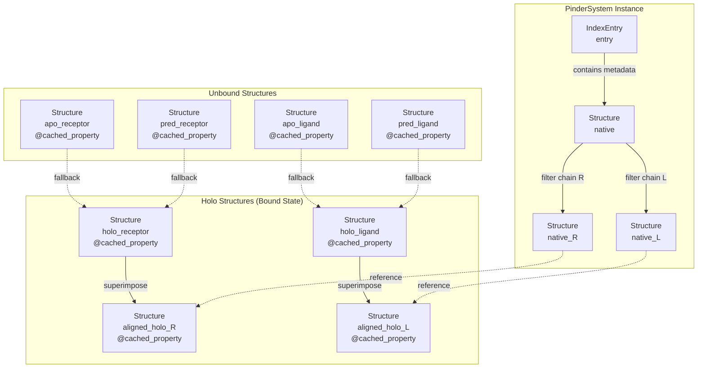
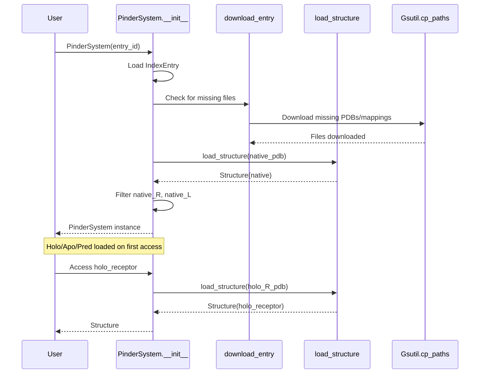
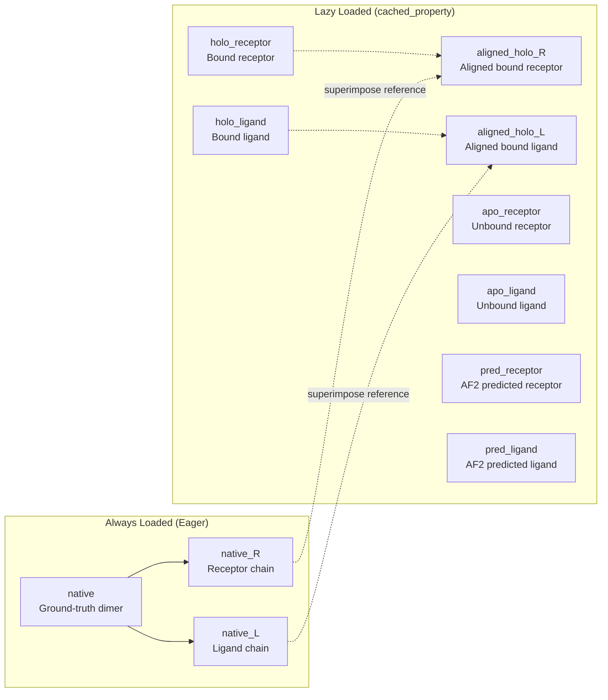
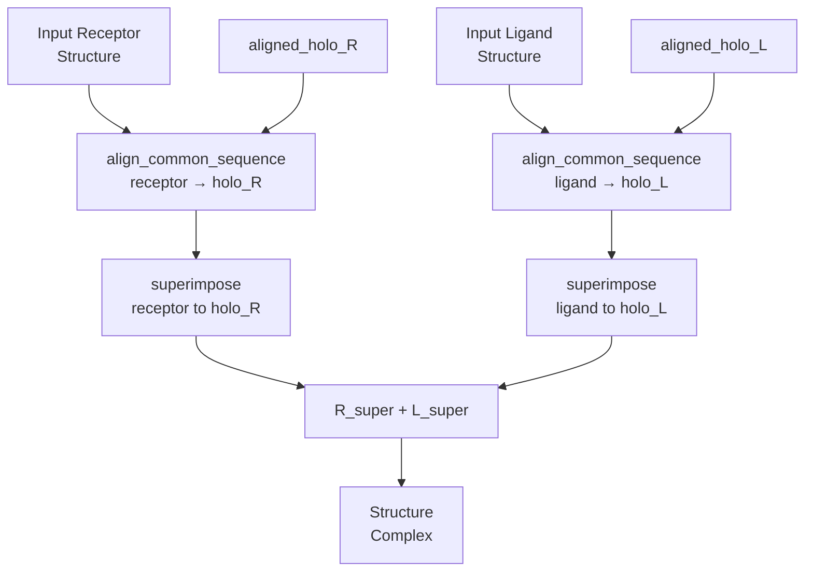
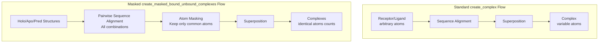
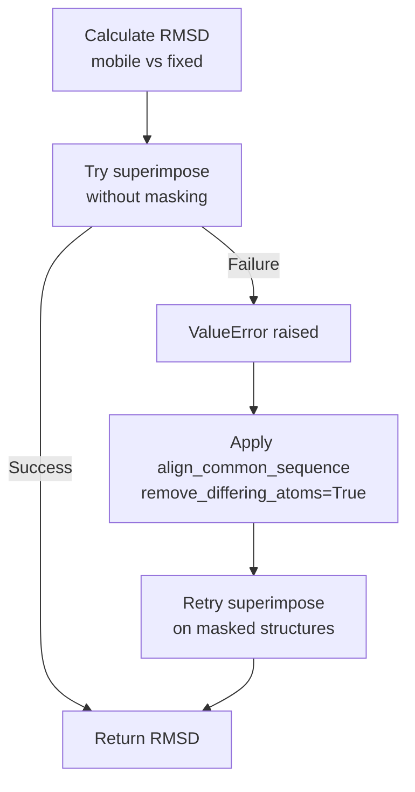
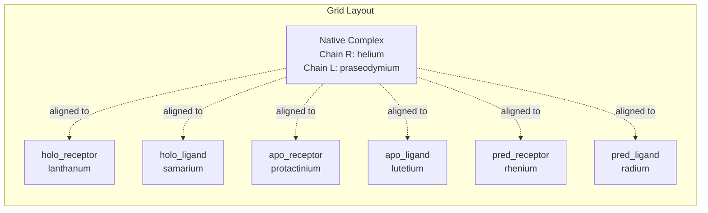
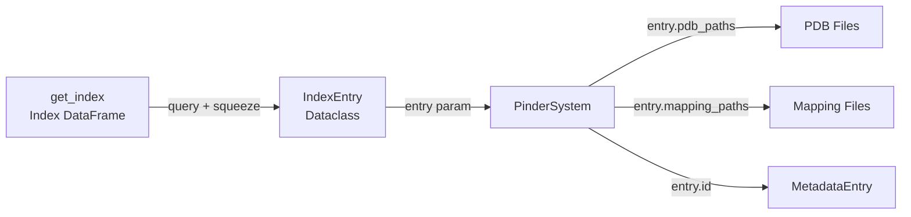
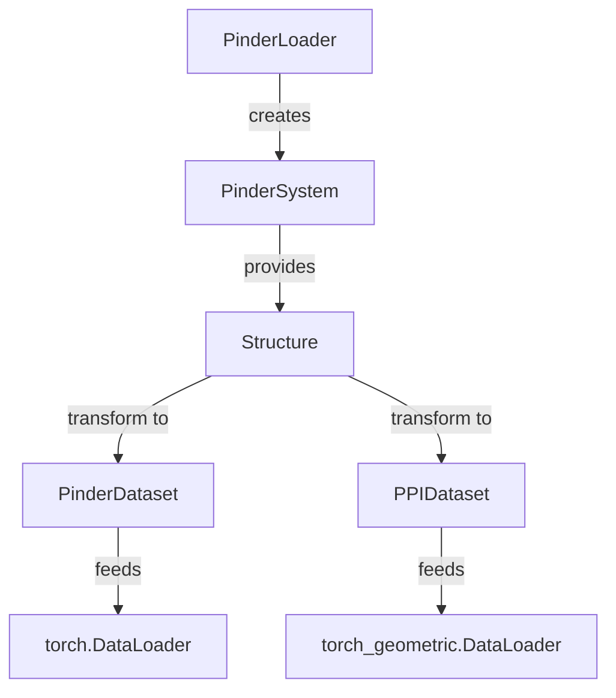
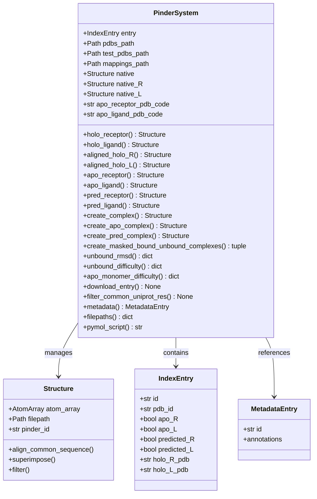

# PinderSystem

<details>
<summary>Relevant source files</summary>

The following files were used as context for generating this wiki page:

- [examples/pinder-loader.ipynb](examples/pinder-loader.ipynb)
- [src/pinder-core/pinder/core/index/system.py](src/pinder-core/pinder/core/index/system.py)

</details>


## Purpose and Scope

`PinderSystem` is the primary data structure for working with individual protein-protein interaction (PPI) systems in PINDER. It provides a unified interface to access all structural variants of a protein complex: the native (ground-truth) dimer, holo (bound) monomers, apo (unbound) monomers, and predicted monomers. 

This class handles lazy loading of structures, automatic downloading of required files, and provides methods for creating complexes, calculating RMSD, and assessing docking difficulty. For information about loading multiple systems with filtering and transformations, see [PinderLoader](#4.1). For low-level structure manipulation, see [Structure Class](#3.2).

Sources: [src/pinder-core/pinder/core/index/system.py:89-108]()

## Core Architecture

The `PinderSystem` class manages a complete protein-protein interaction system by organizing seven distinct structural representations. Each structure is loaded on-demand using Python's `cached_property` decorator to optimize memory usage.



**Structure Loading Pattern**: The PinderSystem Constructor Sequence



Sources: 
- [src/pinder-core/pinder/core/index/system.py:110-161]()
- [src/pinder-core/pinder/core/index/system.py:163-262]()
- [src/pinder-core/pinder/core/index/system.py:614-645]()

## Initialization and File Management

### Constructor Parameters

The `PinderSystem.__init__()` method accepts the following parameters:

| Parameter | Type | Default | Description |
|-----------|------|---------|-------------|
| `entry` | `str \| IndexEntry` | required | PINDER system ID or IndexEntry object |
| `apo_receptor_pdb_code` | `str` | `""` | Specific apo receptor PDB code (for alternate apo) |
| `apo_ligand_pdb_code` | `str` | `""` | Specific apo ligand PDB code (for alternate apo) |
| `metadata` | `MetadataEntry \| None` | `None` | Pre-loaded metadata entry |
| `dataset_path` | `Path \| None` | `None` | Custom dataset root path |
| `pdb_engine` | `str` | `"fastpdb"` | PDB parsing engine (fastpdb or biotite) |

### Automatic File Download

The `download_entry()` method automatically downloads missing PDB files and UniProt mapping files from Google Cloud Storage to the local dataset directory. The download is performed only for files that don't already exist locally.

**File Organization**:
- PDB files: `{pinder_root}/pdbs/` or `{pinder_root}/test_set_pdbs/` (for test systems)
- Mapping files: `{pinder_root}/mappings/`
- Downloaded via: `Gsutil.cp_paths()` with batch processing

Sources:
- [src/pinder-core/pinder/core/index/system.py:110-161]()
- [src/pinder-core/pinder/core/index/system.py:614-645]()

## Structure Types and Properties

### Structure Property Reference



### Property Access Patterns

Each structure property returns either a `Structure` object or `None` if the structure is not available:

**Holo Structures (always available)**:
- `holo_receptor`: Loaded from `entry.holo_R_pdb`
- `holo_ligand`: Loaded from `entry.holo_L_pdb`
- `aligned_holo_R`: `holo_receptor` superimposed to `native_R`
- `aligned_holo_L`: `holo_ligand` superimposed to `native_L`

**Apo Structures (optional)**:
- `apo_receptor`: Loaded from `entry.apo_R_pdb` if `entry.apo_R == True`
- `apo_ligand`: Loaded from `entry.apo_L_pdb` if `entry.apo_L == True`

**Predicted Structures (optional)**:
- `pred_receptor`: Loaded from `entry.predicted_R_pdb` if `entry.predicted_R == True`
- `pred_ligand`: Loaded from `entry.predicted_L_pdb` if `entry.predicted_L == True`

Sources:
- [src/pinder-core/pinder/core/index/system.py:163-198]()
- [src/pinder-core/pinder/core/index/system.py:199-262]()

## Creating Complexes

### The `create_complex()` Method

The primary method for combining receptor and ligand structures into a complex. This method:

1. Aligns each monomer to its respective holo form using sequence-based alignment
2. Superimposes monomers to holo coordinates
3. Combines aligned monomers into a single Structure



**Method Signature**:
```python
def create_complex(
    self,
    receptor: Structure,
    ligand: Structure,
    remove_differing_atoms: bool = True,
    renumber_residues: bool = False,
    remove_differing_annotations: bool = False,
) -> Structure
```

**Parameters**:
- `remove_differing_atoms`: Remove non-overlapping atoms after sequence alignment
- `renumber_residues`: Renumber residues to match holo numbering
- `remove_differing_annotations`: Strip non-matching annotation categories

Sources: [src/pinder-core/pinder/core/index/system.py:376-422]()

### Specialized Complex Creation Methods

**Apo Complex** (`create_apo_complex()`):
- Creates complex from `apo_receptor` and `apo_ligand`
- Falls back to holo structures if apo not available
- Returns `Structure` with aligned unbound monomers

**Predicted Complex** (`create_pred_complex()`):
- Creates complex from `pred_receptor` and `pred_ligand`
- Falls back to holo structures if predicted not available
- Returns `Structure` with aligned predicted monomers

**Masked Bound-Unbound Complexes** (`create_masked_bound_unbound_complexes()`):
- Creates holo, apo, and predicted complexes with equal atom counts
- Crops all structures to common sequence and atoms
- Useful when training models that require identical input shapes
- Warning: Can significantly distort structures if sequences differ greatly



Sources:
- [src/pinder-core/pinder/core/index/system.py:424-455]()
- [src/pinder-core/pinder/core/index/system.py:457-488]()
- [src/pinder-core/pinder/core/index/system.py:281-374]()

## Alignment and Superposition

### Alignment Strategy

PinderSystem uses a two-step alignment process for creating complexes:

1. **Sequence-based alignment** via `Structure.align_common_sequence()`:
   - Identifies common residues based on UniProt mappings or sequence identity
   - Optionally removes differing atoms and renumbers residues
   - Returns cropped structures with matching sequence coverage

2. **Spatial superposition** via `Structure.superimpose()`:
   - Performs rigid-body alignment (rotation + translation)
   - Minimizes RMSD between corresponding atoms
   - Uses Kabsch algorithm for optimal superposition

### RMSD Calculation with Masking Fallback

The `unbound_rmsd_with_mask_fallback()` function implements a robust RMSD calculation strategy:



This fallback mechanism handles cases where:
- Structures have different atom counts
- Residue numbering doesn't match
- Atoms are ordered differently

Sources:
- [src/pinder-core/pinder/core/index/system.py:37-51]()
- [src/pinder-core/pinder/core/index/system.py:54-86]()

## Quality Metrics and Difficulty Assessment

### Unbound RMSD Calculation

The `unbound_rmsd()` method calculates RMSD between unbound (apo or predicted) monomers and their holo forms:

**Method Signature**:
```python
def unbound_rmsd(self, monomer_name: MonomerName) -> dict[str, float]
```

**Returns**:
```python
{
    "monomer_name": "apo" | "predicted",
    "receptor_rmsd": float,  # RMSD for receptor
    "ligand_rmsd": float,    # RMSD for ligand
}
```

**Process**:
1. Load unbound receptor/ligand based on `monomer_name` ("apo" or "predicted")
2. Fall back to holo if unbound not available
3. Calculate RMSD for receptor: `unbound_R` → `aligned_holo_R`
4. Calculate RMSD for ligand: `unbound_L` → `aligned_holo_L`
5. Use mask fallback if initial superposition fails

### Docking Difficulty Metrics

**Unbound Difficulty** (`unbound_difficulty()`):
- Calculates fraction of native contacts (Fnat) preserved in unbound state
- Assesses interface similarity between bound and unbound forms
- Returns difficulty classification and metrics

**Apo Monomer Difficulty** (`apo_monomer_difficulty()`):
- Evaluates difficulty for a single monomer (receptor or ligand)
- Considers interface contacts for specified body
- Useful for assessing asymmetric docking challenges

**Metrics Returned**:

| Metric | Type | Description |
|--------|------|-------------|
| `monomer_name` | `str` | "apo" or "predicted" |
| `fnat` | `float` | Fraction of native contacts preserved |
| `difficulty` | `str` | Classification (e.g., "easy", "medium", "hard") |
| `contact_rad` | `float` | Contact radius used (default 5.0 Å) |

Sources:
- [src/pinder-core/pinder/core/index/system.py:490-521]()
- [src/pinder-core/pinder/core/index/system.py:523-556]()
- [src/pinder-core/pinder/core/index/system.py:558-592]()

## Data Access and Properties

### Metadata Access

The `metadata` property provides on-demand access to extended annotations from the metadata index:

```python
@property
def metadata(self) -> MetadataEntry | None:
    # Lazy loads from get_metadata() if not provided at init
    # Caches result in self._metadata
```

Returns `MetadataEntry` with 45+ annotation fields including:
- Pfam domains
- ECOD/SCOP/CATH classifications
- Oligomeric state
- Method/resolution details
- Taxonomic information

### File Path Access

The `filepaths` property returns a dictionary mapping structure types to their local file paths:

```python
{
    "holo_receptor": Path | None,
    "holo_ligand": Path | None,
    "apo_receptor": Path | None,
    "apo_ligand": Path | None,
    "pred_receptor": Path | None,
    "pred_ligand": Path | None,
}
```

Useful for:
- Determining which structures are available
- Accessing raw PDB files
- Debugging file locations

Sources:
- [src/pinder-core/pinder/core/index/system.py:674-693]()
- [src/pinder-core/pinder/core/index/system.py:647-672]()

## Visualization with PyMOL

### PyMOL Script Generation

The `pymol_script` property generates a PyMOL script for visualizing all available structures in a grid layout:



**Generated Script Features**:
- Loads native complex as reference
- Loads all available monomers
- Assigns distinct colors to each structure type
- Aligns monomers to respective chains in native
- Arranges structures in grid mode for comparison
- Uses chain reassignment to separate receptor/ligand views

**Usage Example**:
```python
system = PinderSystem("8phr__X4_UNDEFINED--8phr__W4_UNDEFINED")
script = system.pymol_script
# Copy script to PyMOL command line or save to .pml file
```

Sources: [src/pinder-core/pinder/core/index/system.py:695-733]()

## Advanced Features

### Alternate Apo Structure Selection

The `load_alt_apo_structure()` method enables loading non-canonical apo structures when multiple unbound forms are available:

**Process**:
1. Check if requested PDB code differs from canonical apo
2. Search alternate apo list (`entry.apo_R_alt` or `entry.apo_L_alt`)
3. Load matching structure if found
4. Return `None` if not found or code matches canonical

**Usage**:
```python
# Load specific alternate apo receptor
system = PinderSystem(
    entry_id,
    apo_receptor_pdb_code="3wdb",  # Non-canonical apo
    apo_ligand_pdb_code="6ucr"     # Non-canonical apo
)
```

### UniProt Residue Filtering

The `filter_common_uniprot_res()` method ensures structural comparisons use only residues with valid UniProt mappings:

**Filtered Pairs**:
- `holo_ligand` ↔ `apo_ligand`
- `holo_ligand` ↔ `pred_ligand`
- `holo_receptor` ↔ `apo_receptor`
- `holo_receptor` ↔ `pred_receptor`

This filtering:
- Removes residues without UniProt annotations
- Ensures fair RMSD calculations
- Handles cases with partial UniProt coverage

**Warning**: Modifies structure properties in-place. Call before RMSD calculations if needed.

Sources:
- [src/pinder-core/pinder/core/index/system.py:735-762]()
- [src/pinder-core/pinder/core/index/system.py:263-279]()

## Integration with Other Components

### Relationship to IndexEntry



### Usage in Data Loading Pipeline

PinderSystem serves as the foundation for higher-level data loading:



Sources:
- [src/pinder-core/pinder/core/index/system.py:110-133]()
- [examples/pinder-loader.ipynb:229-242]()

## Common Usage Patterns

### Basic System Loading

```python
from pinder.core import PinderSystem

# Load by ID
system = PinderSystem("8phr__X4_UNDEFINED--8phr__W4_UNDEFINED")

# Access structures (lazy loaded)
native = system.native              # Always available
holo_R = system.holo_receptor       # Always available
holo_L = system.holo_ligand         # Always available
apo_R = system.apo_receptor         # May be None
apo_L = system.apo_ligand           # May be None
pred_R = system.pred_receptor       # May be None
pred_L = system.pred_ligand         # May be None
```

### Creating Complexes for Docking

```python
# Create apo complex (unbound state)
apo_complex = system.create_apo_complex(
    remove_differing_atoms=True,
    renumber_residues=False
)

# Create predicted complex
pred_complex = system.create_pred_complex(
    remove_differing_atoms=True
)

# Get ground-truth for evaluation
ground_truth = system.native
```

### RMSD and Difficulty Assessment

```python
from pinder.core.structure.models import MonomerName

# Calculate apo RMSD
apo_rmsd = system.unbound_rmsd(MonomerName.APO)
# Returns: {"monomer_name": "apo", "receptor_rmsd": float, "ligand_rmsd": float}

# Assess docking difficulty
difficulty = system.unbound_difficulty(MonomerName.APO, contact_rad=5.0)
# Returns: {"monomer_name": "apo", "fnat": float, "difficulty": str, ...}
```

### Checking Structure Availability

```python
from pinder.core import get_index

# Query index for systems with apo structures
index = get_index()
apo_systems = index.query("apo_R and apo_L")

# Load system and verify
system = PinderSystem(apo_systems.id.iloc[0])
assert system.apo_receptor is not None
assert system.apo_ligand is not None
```

Sources: [examples/pinder-loader.ipynb:229-308]()

## Implementation Details

### Class Hierarchy



### Key Dependencies

| Module | Purpose |
|--------|---------|
| `pinder.core.loader.structure.Structure` | Structure manipulation and I/O |
| `pinder.core.index.utils.IndexEntry` | System metadata container |
| `pinder.core.index.utils.MetadataEntry` | Extended annotations |
| `pinder.core.utils.cloud.Gsutil` | GCS file download |
| `biotite.structure.AtomArray` | Underlying atomic data structure |

Sources: [src/pinder-core/pinder/core/index/system.py:1-27]()

---