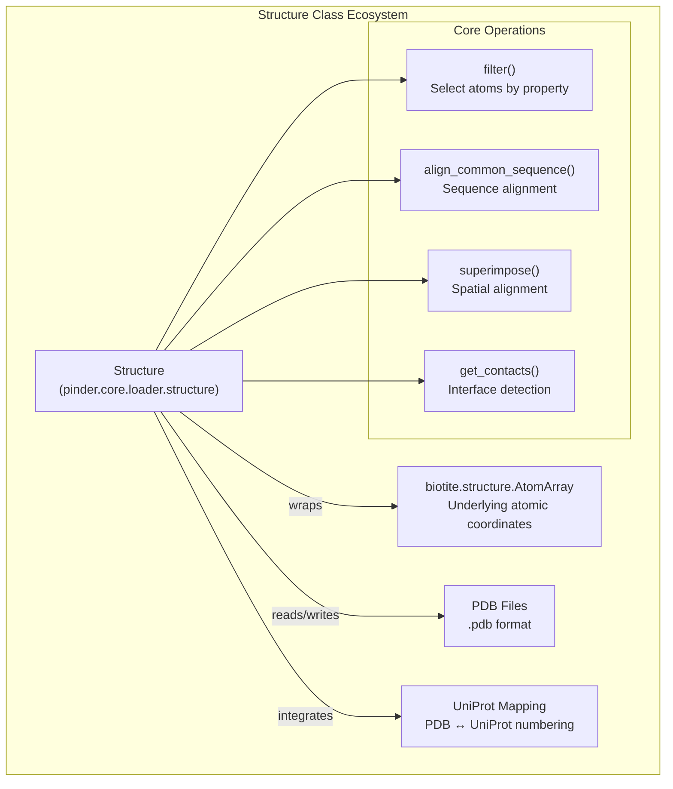
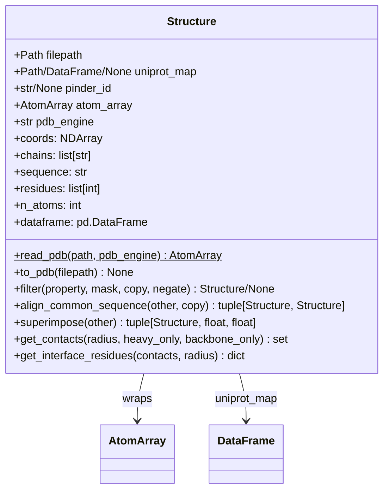
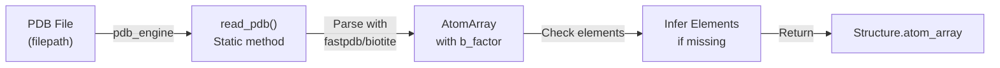
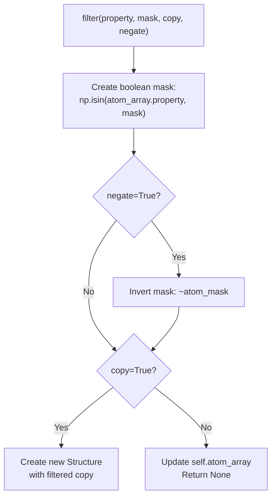
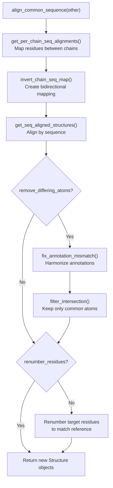
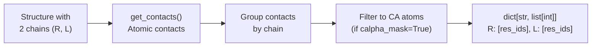
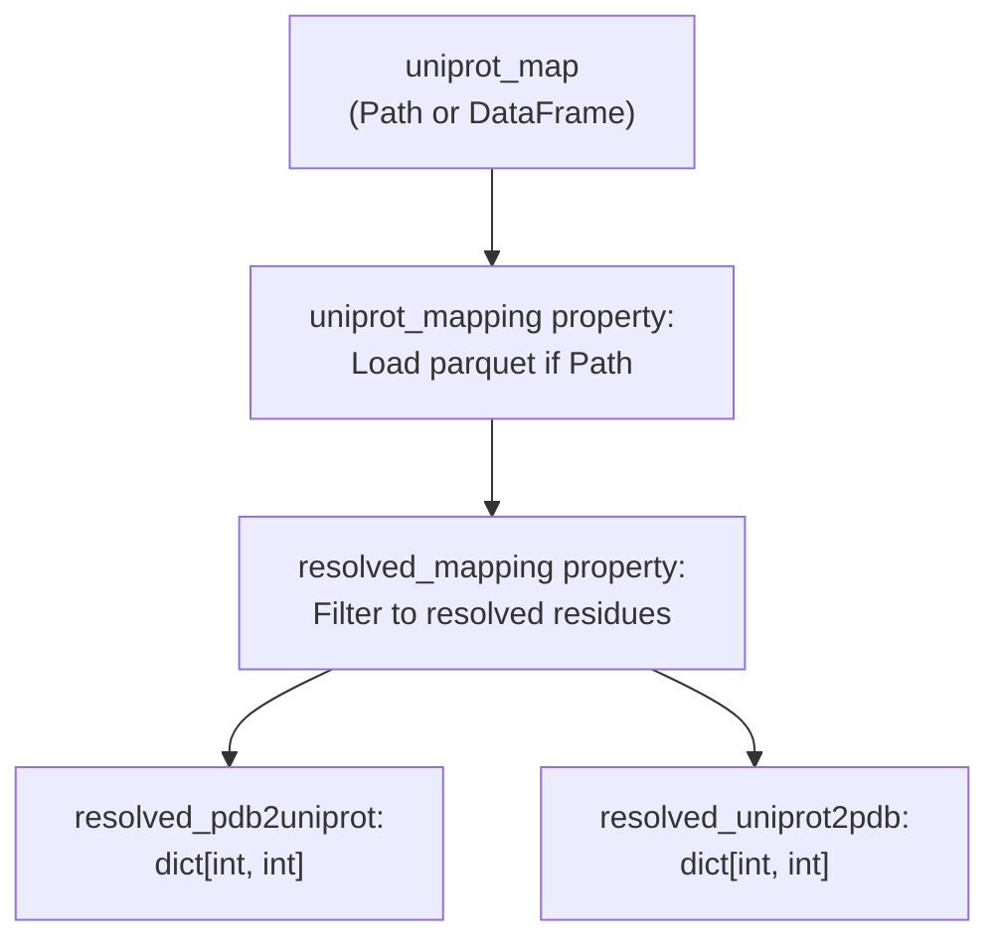
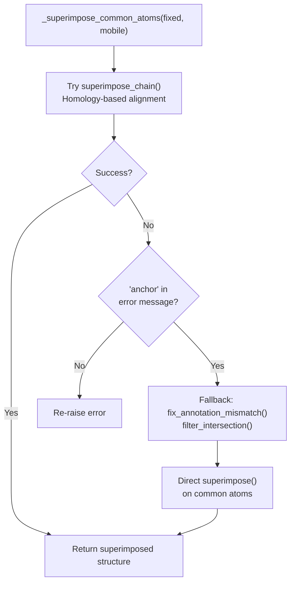

# Structure Class

<details>
<summary>Relevant source files</summary>

The following files were used as context for generating this wiki page:

- [codecov.yml](codecov.yml)
- [docs/pinder.rst](docs/pinder.rst)
- [examples/superposition.ipynb](examples/superposition.ipynb)
- [src/pinder-core/pinder/core/loader/structure.py](src/pinder-core/pinder/core/loader/structure.py)

</details>


The `Structure` class is a fundamental data structure in PINDER that wraps biotite's `AtomArray` to provide enhanced functionality for protein structure manipulation, analysis, and filtering. This page documents the class attributes, methods, and common usage patterns for working with individual protein structures.

For information about managing complete protein complexes with multiple structural variants (native, holo, apo, predicted), see [PinderSystem](#3.1). For low-level atomic operations and utilities, see [Atomic Operations](#3.3).

## Overview

The `Structure` class serves as the primary interface for working with protein structure data in PINDER. It combines biotite's efficient atomic array representation with additional capabilities including:

- PDB file reading and writing
- Atom filtering by property (chain, residue, atom type)
- Sequence-based alignment between structures
- Structure superposition with RMSD calculation
- Contact and interface residue identification
- UniProt coordinate mapping integration
- Conversion to various data formats (DataFrame, tensor, FASTA)



**Sources:** [src/pinder-core/pinder/core/loader/structure.py:42-512]()

## Class Definition and Attributes

The `Structure` class is implemented as a Pydantic dataclass with validation support. It contains five core attributes that define the structure's identity and data.

| Attribute | Type | Description | Default |
|-----------|------|-------------|---------|
| `filepath` | `Path` | Path to the PDB file | Required |
| `uniprot_map` | `Path \| pd.DataFrame \| None` | UniProt mapping data (parquet path or DataFrame) | `None` |
| `pinder_id` | `str \| None` | PINDER identifier for the structure | `None` |
| `atom_array` | `biotite.structure.AtomArray` | Underlying atomic coordinate array | Lazy-loaded |
| `pdb_engine` | `str` | PDB parsing engine (`"fastpdb"` or `"biotite"`) | `"fastpdb"` |



**Sources:** [src/pinder-core/pinder/core/loader/structure.py:42-48](), [src/pinder-core/pinder/core/loader/structure.py:506-512]()

## File I/O Operations

### Reading PDB Files

The `Structure` class automatically loads PDB files on initialization through the `__post_init__` method. The static method `read_pdb` handles the actual parsing.



The reading process includes:
1. Parse PDB file using specified engine (`fastpdb` by default)
2. Attempt to extract `b_factor` annotation field
3. Fall back to parsing without `b_factor` if it fails
4. Infer missing element types using biotite's inference
5. Store result in `atom_array` attribute

**Sources:** [src/pinder-core/pinder/core/loader/structure.py:50-64](), [src/pinder-core/pinder/core/loader/structure.py:506-512]()

### Writing PDB Files

The `to_pdb` method writes the structure's `AtomArray` to a PDB file.

| Parameter | Type | Description |
|-----------|------|-------------|
| `filepath` | `Path \| None` | Output path (defaults to `self.filepath` if not provided) |

**Warning:** If `filepath` is not specified, this method will overwrite the source file.

**Sources:** [src/pinder-core/pinder/core/loader/structure.py:66-84]()

## Filtering and Selection

### Filter Method

The `filter` method selects atoms based on property values, supporting both in-place and copy operations.



**Parameters:**
- `property`: Attribute name on `AtomArray` (e.g., `"chain_id"`, `"res_id"`, `"atom_name"`)
- `mask`: Values to include (or exclude if `negate=True`)
- `copy`: Whether to return a new `Structure` (True) or modify in-place (False)
- `negate`: Whether to invert the selection

**Sources:** [src/pinder-core/pinder/core/loader/structure.py:122-143]()

### Set Chain Method

The `set_chain` method assigns a new chain ID to all atoms in the structure.

**Sources:** [src/pinder-core/pinder/core/loader/structure.py:144-146]()

## Sequence Alignment and Superposition

### Sequence Alignment

The `align_common_sequence` method aligns two structures based on sequence homology, optionally cropping to common residues and atoms.

| Parameter | Type | Default | Description |
|-----------|------|---------|-------------|
| `other` | `Structure` | Required | Reference structure to align against |
| `copy` | `bool` | `True` | Return new structures vs. modify in-place |
| `remove_differing_atoms` | `bool` | `True` | Remove atoms not present in both structures |
| `renumber_residues` | `bool` | `False` | Renumber residues to match reference |
| `remove_differing_annotations` | `bool` | `False` | Remove annotation categories that differ |

**Returns:** Tuple of `(aligned_self, aligned_other)` structures



**Sources:** [src/pinder-core/pinder/core/loader/structure.py:156-210]()

### Structure Superposition

The `superimpose` method spatially aligns this structure onto another, computing RMSD metrics.

**Returns:** Tuple of `(superimposed_structure, raw_rmsd, refined_rmsd)`

The method performs two superposition passes:
1. **Raw RMSD**: Single iteration without outlier removal (`max_iterations=1`)
2. **Refined RMSD**: Iterative refinement with outlier removal (default iterations)

**Sources:** [src/pinder-core/pinder/core/loader/structure.py:296-327]()

## Contact and Interface Analysis

### Contact Detection

The `get_contacts` method identifies inter-chain atomic contacts based on distance cutoffs.

| Parameter | Type | Default | Description |
|-----------|------|---------|-------------|
| `radius` | `float` | `5.0` | Distance cutoff in Ångströms |
| `heavy_only` | `bool` | `False` | Exclude hydrogen atoms |
| `backbone_only` | `bool` | `False` | Only consider backbone atoms |

**Returns:** Set of tuples `(chain1, chain2, res_id1, res_id2)` representing contacting residue pairs.

**Requirements:** Structure must have exactly two chains (receptor "R" and ligand "L").

**Sources:** [src/pinder-core/pinder/core/loader/structure.py:211-232]()

### Interface Residue Identification

The `get_interface_residues` method identifies residues participating in the interface.



**Returns:** Dictionary mapping chain IDs (`"R"` and `"L"`) to lists of interface residue IDs.

**Sources:** [src/pinder-core/pinder/core/loader/structure.py:255-295]()

### Interface Mask Creation

The `get_interface_mask` method creates a boolean mask for interface atoms.

| Parameter | Type | Default | Description |
|-----------|------|---------|-------------|
| `interface_residues` | `dict[str, list[int]]` | Required | Residue IDs per chain |
| `calpha_only` | `bool` | `True` | Restrict to CA atoms |
| `remove_hetero` | `bool` | `False` | Exclude hetero residues |

**Sources:** [src/pinder-core/pinder/core/loader/structure.py:233-254]()

## Properties and Accessors

The `Structure` class provides numerous properties for convenient access to structural data without modifying the underlying `AtomArray`.

### Coordinate and Atomic Properties

| Property | Return Type | Description |
|----------|-------------|-------------|
| `coords` | `NDArray[np.double]` | 3D coordinates of all atoms |
| `n_atoms` | `int` | Total number of atoms |
| `chains` | `list[str]` | Unique chain identifiers |
| `residues` | `list[int]` | Unique residue IDs |
| `residue_names` | `list[str]` | Unique residue names (3-letter codes) |
| `atom_names` | `list[str]` | Unique atom names |
| `b_factor` | `list[float]` | B-factor values for all atoms |

**Sources:** [src/pinder-core/pinder/core/loader/structure.py:374-494]()

### Sequence Properties

| Property | Return Type | Description |
|----------|-------------|-------------|
| `sequence` | `str` | Single-letter amino acid sequence |
| `fasta` | `str` | FASTA-formatted sequence with header |
| `chain_sequence` | `dict[str, list[str]]` | Per-chain residue sequences |
| `tokenized_sequence` | `torch.Tensor` | Integer-encoded sequence for ML |

**Sources:** [src/pinder-core/pinder/core/loader/structure.py:429-462]()

### Mask Properties

| Property | Return Type | Description |
|----------|-------------|-------------|
| `backbone_mask` | `NDArray[np.bool_]` | Mask for backbone atoms (N, CA, C, O) |
| `calpha_mask` | `NDArray[np.bool_]` | Mask for alpha carbon atoms |

**Sources:** [src/pinder-core/pinder/core/loader/structure.py:404-414]()

### DataFrame Conversion

The `dataframe` property converts the structure to a pandas DataFrame with one row per atom.

**Columns:** `chain_id`, `res_name`, `res_code`, `res_id`, `atom_name`, `b_factor`, `ins_code`, `hetero`, `element`, `x`, `y`, `z`

**Sources:** [src/pinder-core/pinder/core/loader/structure.py:380-402]()

## UniProt Mapping Integration

The `Structure` class integrates UniProt coordinate mappings to translate between PDB and UniProt numbering systems.



### Mapping Properties

| Property | Return Type | Description |
|----------|-------------|-------------|
| `uniprot_mapping` | `pd.DataFrame \| None` | Full UniProt mapping table |
| `resolved_mapping` | `pd.DataFrame \| None` | Mapping filtered to resolved residues only |
| `resolved_pdb2uniprot` | `dict[int, int]` | PDB residue ID → UniProt residue number |
| `resolved_uniprot2pdb` | `dict[int, int]` | UniProt residue number → PDB residue ID |

The mapping DataFrame contains columns: `resi` (PDB numbering), `resi_uniprot` (UniProt numbering), `uniprot_acc` (accession).

**Sources:** [src/pinder-core/pinder/core/loader/structure.py:329-372]()

## Structure Combination

The `__add__` operator combines two structures into a single structure with concatenated atom arrays.

```python
combined = structure1 + structure2
```

The operation:
1. Concatenates the `AtomArray` objects
2. Merges UniProt mappings (if both exist)
3. Creates a combined filepath name
4. Returns a new `Structure` object

**Note:** UniProt mapping DataFrames must have compatible dtypes for concatenation.

**Sources:** [src/pinder-core/pinder/core/loader/structure.py:89-121]()

## Helper Functions

### mask_common_uniprot

Crops two structures to their common UniProt-mapped residues, handling cases where structures may have different numbering systems or one structure is predicted (already in UniProt numbering).

**Function signature:** `mask_common_uniprot(mono_A: Structure, mono_B: Structure) -> tuple[Structure, Structure]`

**Use cases:**
- Both structures have UniProt mappings: Find intersection of mapped residues
- Only one structure has mapping: The other is assumed to be in UniProt numbering
- No mappings: Return structures unchanged

**Sources:** [src/pinder-core/pinder/core/loader/structure.py:532-607]()

### find_potential_interchain_bonded_atoms

Identifies atoms at the interface that may form inter-chain bonds (e.g., disulfide bridges).

**Parameters:**
- `structure`: Structure with two chains
- `interface_res`: Optional pre-computed interface residues
- `radius`: Distance cutoff (default 2.3Å for bond detection)

**Returns:** `AtomArray` of atoms within bonding distance across chains.

**Sources:** [src/pinder-core/pinder/core/loader/structure.py:514-530]()

### canonical_atom_type_mask

Cached function that generates a boolean mask indicating which atom types are canonical for each of the 21 amino acid types (20 standard + missing/unknown).

**Returns:** `torch.Tensor` of shape `(21, len(atom_types))`

**Sources:** [src/pinder-core/pinder/core/loader/structure.py:609-624]()

### backbone_atom_tensor

Cached function that returns indices of backbone atoms (N, CA, C, O) within a given atom type tuple.

**Returns:** `torch.Tensor` of backbone atom indices.

**Sources:** [src/pinder-core/pinder/core/loader/structure.py:626-634]()

## Superposition Implementation Details

The internal `_superimpose_common_atoms` function provides robust superposition with fallback mechanisms.



This handles edge cases like very short peptides where homology-based superposition may fail due to insufficient anchors.

**Sources:** [src/pinder-core/pinder/core/loader/structure.py:636-675]()

---