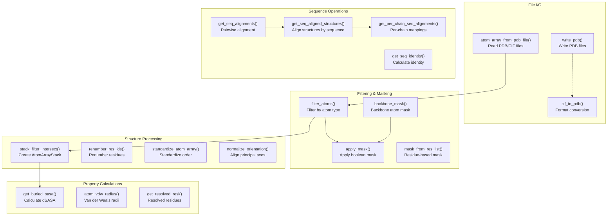
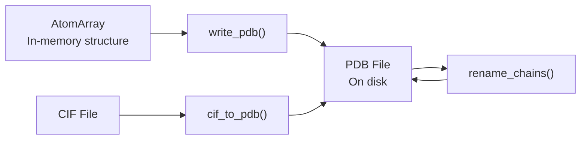
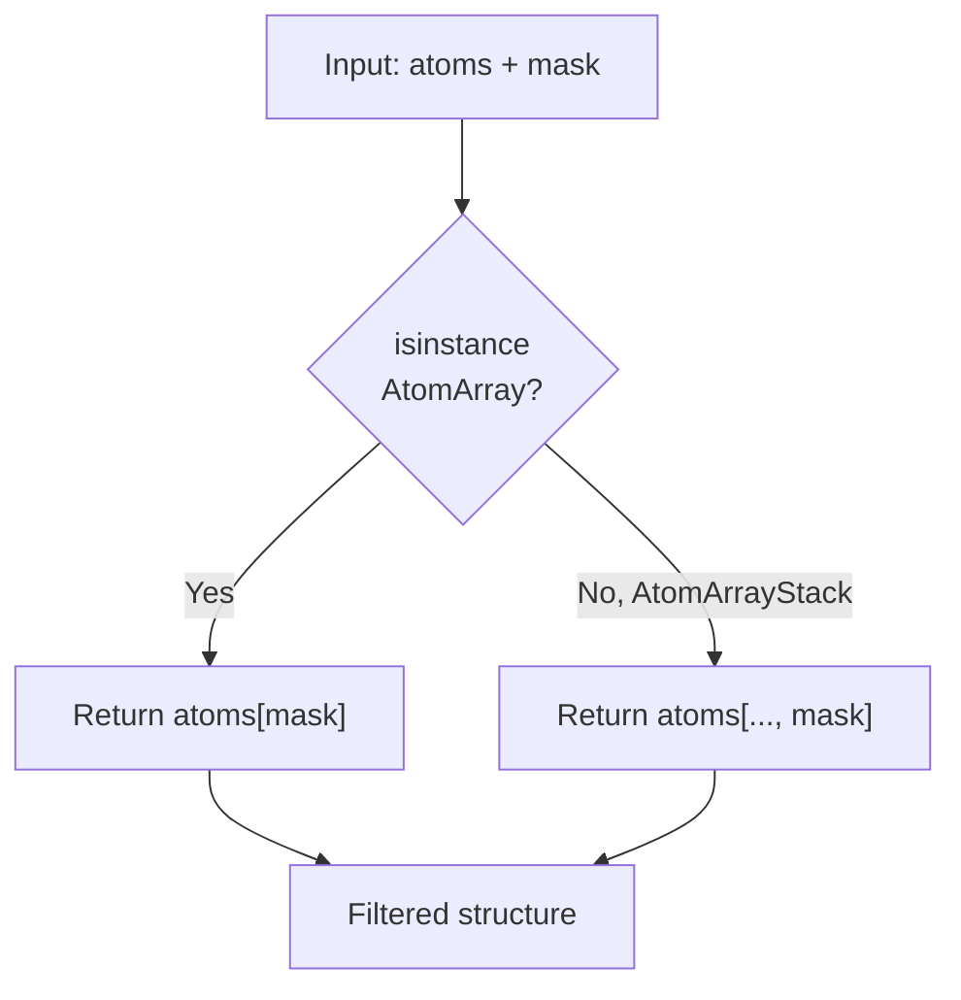
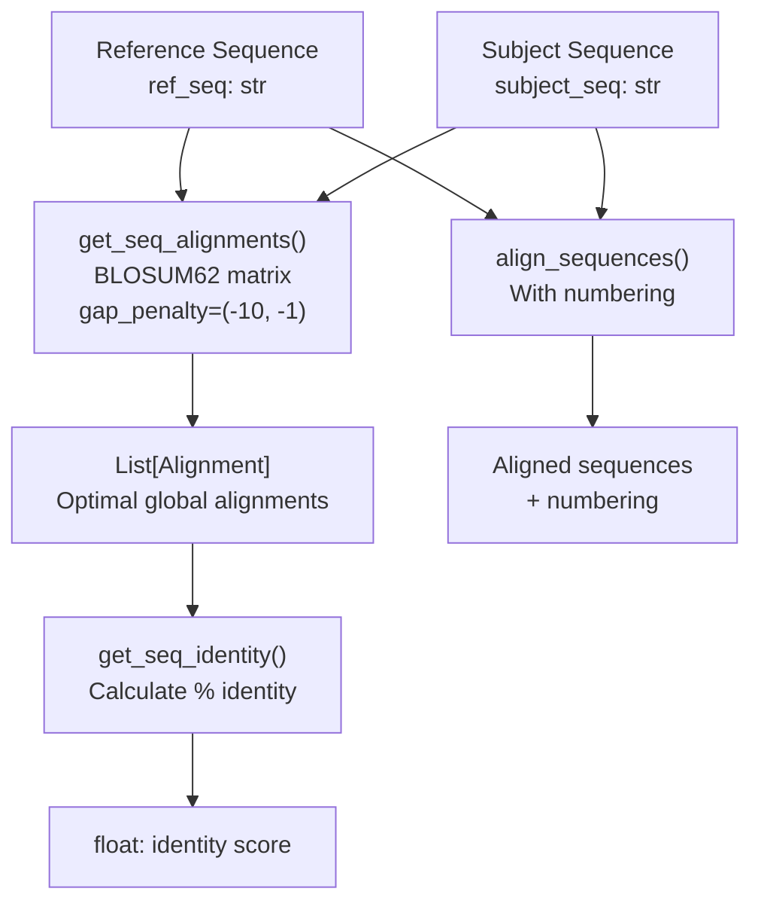
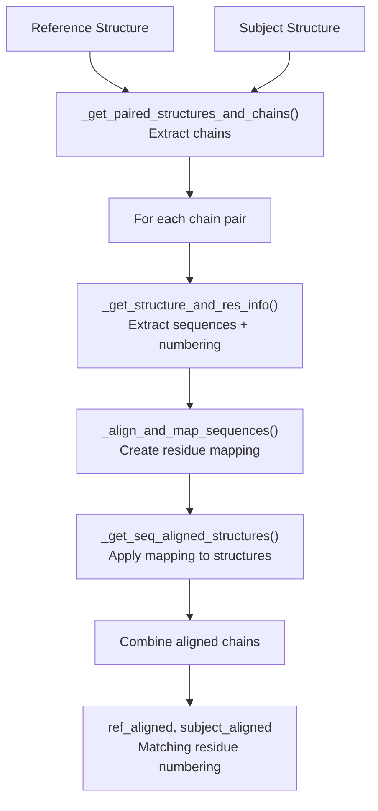
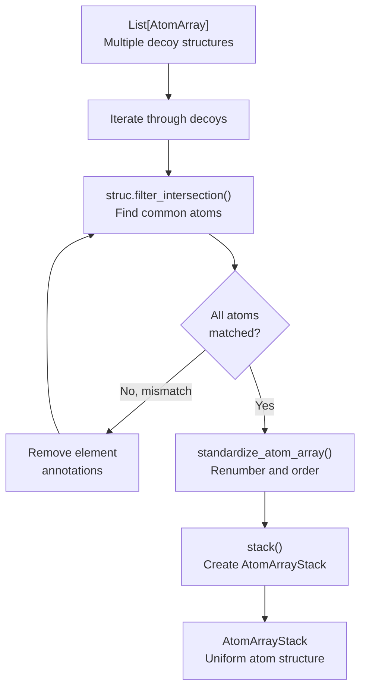
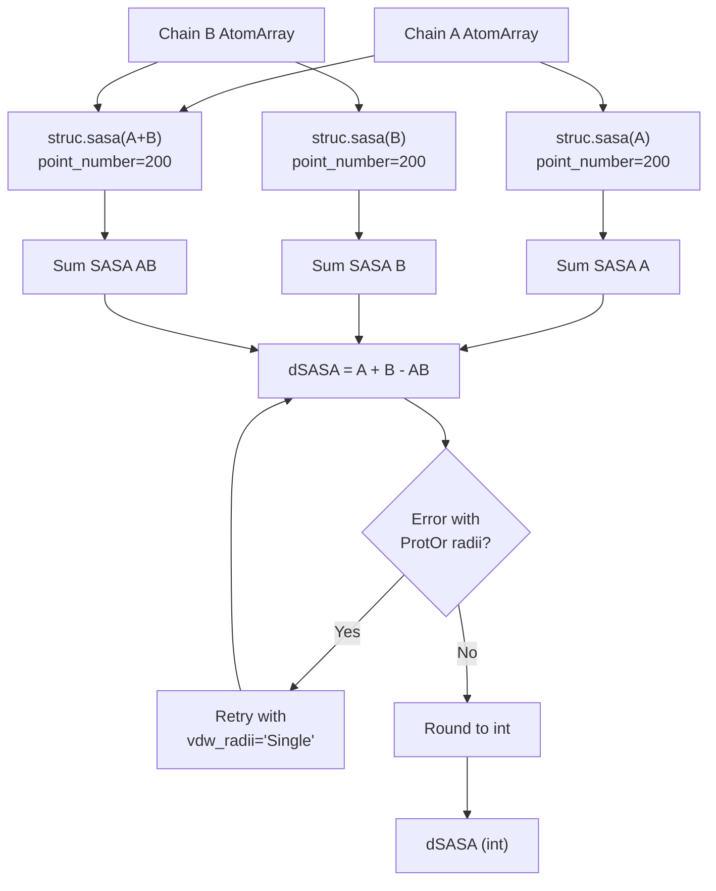
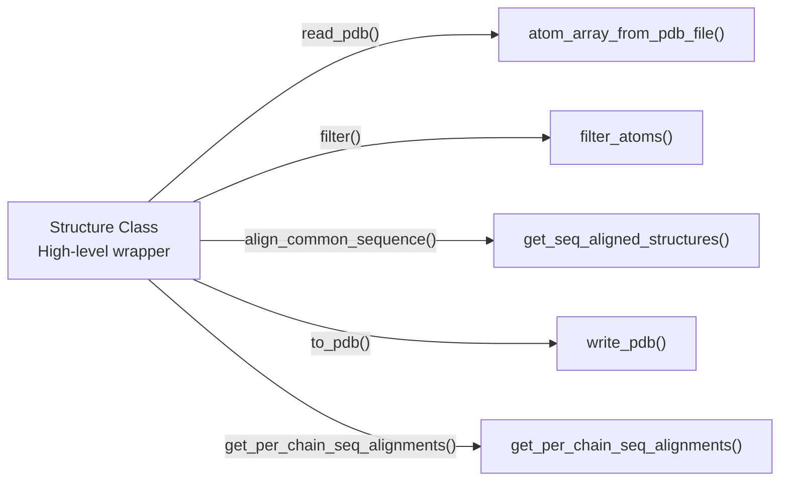

# Atomic Operations

<details>
<summary>Relevant source files</summary>

The following files were used as context for generating this wiki page:

- [src/pinder-core/pinder/core/loader/structure.py](src/pinder-core/pinder/core/loader/structure.py)
- [src/pinder-core/pinder/core/structure/atoms.py](src/pinder-core/pinder/core/structure/atoms.py)

</details>


## Purpose and Scope

This page documents the low-level atomic manipulation functions that form the foundation of PINDER's structural operations. These functions operate directly on biotite's `AtomArray` and `AtomArrayStack` objects, providing capabilities for file I/O, filtering, alignment, and property calculations.

For higher-level structure manipulation through the `Structure` class wrapper, see [Structure Class](#3.2). For system-level operations that combine multiple structures, see [PinderSystem](#3.1).

## Overview of Atomic Operations

The atomic operations module provides a comprehensive toolkit for manipulating protein structures at the atomic level. These operations are organized into several functional categories:



**Diagram: Atomic Operations Function Categories**

Sources: [src/pinder-core/pinder/core/structure/atoms.py:1-1010]()

## File I/O Operations

### Reading Structure Files

The primary entry point for reading protein structures is `atom_array_from_pdb_file()`, which supports multiple parsing backends:

| Function | Purpose | Backend Options |
|----------|---------|----------------|
| `atom_array_from_pdb_file()` | Read PDB files into AtomArray | `fastpdb` (default), `biotite` |
| `biotite_pdbfile()` | Get biotite PDB parser | biotite native |
| `rust_pdbfile()` | Get fastpdb parser (Rust-based) | fastpdb with fallback |
| `biotite_pdbxfile()` | Get CIF/mmCIF parser | biotite native |

**Example Usage Pattern:**
```python
# Fast parsing with fastpdb (default)
structure = atom_array_from_pdb_file(pdb_path, backend="fastpdb")

# Parse with additional fields
structure = atom_array_from_pdb_file(
    pdb_path, 
    backend="fastpdb",
    extra_fields=["b_factor"]
)
```

The function automatically handles path resolution and can accept either `Path` objects or `AtomArray` objects (pass-through). When using the `fastpdb` backend, parsing is significantly faster due to Rust implementation, but falls back to biotite if fastpdb is not installed.

Sources: [src/pinder-core/pinder/core/structure/atoms.py:53-71](), [src/pinder-core/pinder/core/structure/atoms.py:27-51]()

### Writing Structure Files

Writing structures back to disk is handled by `write_pdb()` and related functions:



**Diagram: File Writing Operations Flow**

The `write_pdb()` function automatically creates parent directories if they don't exist and uses biotite's `strucio.save_structure()` internally. For format conversion, `cif_to_pdb()` provides CIF to PDB conversion with optional chain filtering and renaming.

Sources: [src/pinder-core/pinder/core/structure/atoms.py:890-909](), [src/pinder-core/pinder/core/structure/atoms.py:946-982](), [src/pinder-core/pinder/core/structure/atoms.py:911-944]()

## Atom Filtering and Masking

### Creating Boolean Masks

Masks are boolean arrays that specify which atoms to keep or filter. PINDER provides several mask creation functions:

| Function | Description | Returns |
|----------|-------------|---------|
| `backbone_mask()` | Creates mask for backbone atoms | `NDArray[np.bool_]` |
| `mask_from_res_list()` | Creates mask for specific residues | `NDArray[np.bool_]` |
| CA atom selection | Via `atom_array.atom_name == "CA"` | `NDArray[np.bool_]` |
| Heavy atom selection | Via `atom_array.element != "H"` | `NDArray[np.bool_]` |

The `backbone_mask()` function supports two backbone definitions:

```python
# DockQ backbone (C, CA, N, O)
mask = backbone_mask(atoms, backbone_definition="dockq")

# Standard peptide backbone (via biotite)
mask = backbone_mask(atoms, backbone_definition="standard")
```

Sources: [src/pinder-core/pinder/core/structure/atoms.py:87-94](), [src/pinder-core/pinder/core/structure/atoms.py:97-101](), [src/pinder-core/pinder/core/structure/atoms.py:21-21]()

### Applying Masks

The `apply_mask()` function handles both `AtomArray` and `AtomArrayStack` objects:



**Diagram: Mask Application Logic**

The function correctly handles the different indexing semantics for single structures versus stacks of structures (e.g., multiple decoy models).

Sources: [src/pinder-core/pinder/core/structure/atoms.py:104-124]()

### High-Level Filtering

The `filter_atoms()` function provides a convenient interface for common filtering operations:

```python
# Filter to only C-alpha atoms
ca_only = filter_atoms(atoms, calpha_only=True)

# Filter to backbone atoms (no side chains)
backbone = filter_atoms(
    atoms, 
    backbone_only=True,
    backbone_definition="dockq"
)

# Filter to heavy atoms (no hydrogen)
heavy = filter_atoms(atoms, heavy_only=True)

# Combine multiple filters
ca_heavy = filter_atoms(
    atoms,
    calpha_only=True,
    heavy_only=True
)
```

Sources: [src/pinder-core/pinder/core/structure/atoms.py:127-141]()

## Sequence Alignment Operations

### Pairwise Sequence Alignment

Sequence alignment is performed using biotite's BLOSUM62 matrix with configurable gap penalties:



**Diagram: Sequence Alignment Functions**

The `get_seq_alignments()` function returns optimal global alignments, while `get_seq_identity()` calculates the percentage identity based on the shortest sequence. For aligning with residue numbering, `align_sequences()` preserves both sequence and numbering information.

Sources: [src/pinder-core/pinder/core/structure/atoms.py:301-341](), [src/pinder-core/pinder/core/structure/atoms.py:344-368](), [src/pinder-core/pinder/core/structure/atoms.py:402-469]()

### Structure-Level Sequence Alignment

The `get_seq_aligned_structures()` function aligns two structures based on their sequences and renumbers residues to match:

```python
# Align two structures
ref_aligned, subject_aligned = get_seq_aligned_structures(
    ref=ref_structure,
    subject=subject_structure,
    pdb_engine="fastpdb"
)

# After alignment, residue numbers match for common sequence
assert ref_aligned.res_id[0] == subject_aligned.res_id[0]
```

**Processing Flow:**



**Diagram: Structure Alignment Processing Pipeline**

The function processes each chain independently, aligns their sequences, creates residue mappings, and then reconstructs the multi-chain structure with consistent numbering.

Sources: [src/pinder-core/pinder/core/structure/atoms.py:598-668](), [src/pinder-core/pinder/core/structure/atoms.py:538-567](), [src/pinder-core/pinder/core/structure/atoms.py:570-595]()

### Per-Chain Residue Mappings

For cases where you need residue number mappings without modifying structures, use `get_per_chain_seq_alignments()`:

```python
# Get residue mappings for each chain
mappings = get_per_chain_seq_alignments(
    ref=ref_structure,
    subject=subject_structure
)

# mappings = {
#     'A': {7: 8, 8: 9, 9: 10, ...},  # subject res -> ref res
#     'B': {15: 20, 16: 21, ...}
# }
```

The returned dictionary maps chain IDs to residue number mappings, where keys are subject residue IDs and values are reference residue IDs. This is particularly useful for transferring annotations or identifying corresponding residues between structures.

To invert these mappings (ref -> subject instead of subject -> ref), use `invert_chain_seq_map()`:

```python
# Invert mappings
ref_to_subject = invert_chain_seq_map(mappings)
```

Sources: [src/pinder-core/pinder/core/structure/atoms.py:671-731](), [src/pinder-core/pinder/core/structure/atoms.py:734-750]()

## Structure Processing and Standardization

### Creating Atom Array Stacks

When working with multiple models (e.g., docking decoys), `stack_filter_intersect()` creates an `AtomArrayStack` by ensuring all structures have matching atoms:



**Diagram: Stack Creation with Intersection Filtering**

The function iteratively applies `filter_intersection` to ensure all structures have the same atoms in the same order. If mismatches occur, it progressively removes problematic annotations (like element types) and can renumber/reorder atoms to achieve consistency.

Sources: [src/pinder-core/pinder/core/structure/atoms.py:201-298]()

### Standardization Operations

| Function | Purpose | Key Operation |
|----------|---------|---------------|
| `standardize_atom_array()` | Standardize atom order and numbering | `struc.info.standardize_order()` + `renumber_res_ids()` |
| `renumber_res_ids()` | Create continuous residue numbering | `struc.create_continuous_res_ids()` |
| `normalize_orientation()` | Align structure to principal axes | `struc.orient_principal_components()` |

These functions ensure structures are in a consistent state for downstream operations:

```python
# Standardize a structure
standardized = standardize_atom_array(arr, standardize=True)

# Renumber residues starting from 1
renumbered = renumber_res_ids(arr)

# Orient structure along principal components
normalized = normalize_orientation(arr)
```

Sources: [src/pinder-core/pinder/core/structure/atoms.py:190-198](), [src/pinder-core/pinder/core/structure/atoms.py:180-187](), [src/pinder-core/pinder/core/structure/atoms.py:984-1010]()

## SASA and Property Calculations

### Buried Surface Area

The `get_buried_sasa()` function calculates the change in solvent-accessible surface area (dSASA) upon complex formation:

**Calculation Formula:**
```
dSASA = SASA(A) + SASA(B) - SASA(A+B)
```

Where:
- `SASA(A)` = surface area of chain A in isolation
- `SASA(B)` = surface area of chain B in isolation  
- `SASA(A+B)` = surface area of the complex

**Implementation Details:**



**Diagram: Buried SASA Calculation with Error Handling**

The function has built-in error handling for cases where ProtOr van der Waals radii fail, automatically falling back to single-element radii. It also handles NaN values and returns the rounded integer value.

Sources: [src/pinder-core/pinder/core/structure/atoms.py:753-844]()

### Van der Waals Radii

The `atom_vdw_radius()` function retrieves appropriate van der Waals radii for atoms:

```python
# Get VDW radius for an atom
radius = atom_vdw_radius(atom)

# Logic:
# 1. If hetero atom -> use element-based radius
# 2. If standard residue -> use ProtOr residue/atom-specific radius
# 3. If ProtOr fails -> fall back to element-based radius
# 4. If all fails -> use nitrogen radius as default
```

Sources: [src/pinder-core/pinder/core/structure/atoms.py:73-84]()

### Resolved Residues

Two functions provide information about which residues are resolved in a structure:

```python
# From file path
resolved = get_resolved_resi(pdb_path)
# Returns: {'A': [1, 2, 3, ...], 'B': [1, 2, 3, ...]}

# From AtomArray
resolved = get_resolved_resi_from_atom_array(atom_array)
# Returns: same format, dict of chain -> list of residue IDs
```

Both functions check for the presence of C-alpha atoms to determine resolution, returning a per-chain dictionary of resolved residue IDs.

Sources: [src/pinder-core/pinder/core/structure/atoms.py:847-887]()

## Utility Functions

### Sequence Conversion

The `resn2seq()` function converts three-letter residue codes to one-letter amino acid codes:

```python
# Convert residue names to sequence
residue_names = ["ALA", "CYS", "ASP", "GLU"]
sequence = resn2seq(residue_names)
# Returns: "ACDE"
```

The function handles non-canonical amino acids by mapping them to 'X' and includes special handling for selenocysteine (U->C) and pyrrolysine (O->K).

Sources: [src/pinder-core/pinder/core/structure/atoms.py:521-535]()

### Receptor/Ligand Assignment

The `assign_receptor_ligand()` function automatically assigns chains based on size:

```python
chains = ["A", "B", "C"]
receptor_chains, ligand_chains = assign_receptor_ligand(arr, chains)

# Logic: 
# - Receptor = all but smallest chain
# - Ligand = smallest chain
```

This is particularly useful for asymmetric complexes where the binding partner needs to be identified based on size.

Sources: [src/pinder-core/pinder/core/structure/atoms.py:163-177]()

### Chain Manipulation

Two functions handle chain naming operations:

| Function | Purpose | Usage |
|----------|---------|-------|
| `rename_chains()` | Rename chains in PDB file | `rename_chains(pdb_path, {"A": "R", "B": "L"})` |
| `cif_to_pdb()` | Convert CIF with chain filtering | `cif_to_pdb(cif_path, pdb_path, chains={"A": "R"})` |

Both functions can accept either a string (to rename all chains) or a dictionary mapping for selective renaming.

Sources: [src/pinder-core/pinder/core/structure/atoms.py:911-944](), [src/pinder-core/pinder/core/structure/atoms.py:946-982]()

## Integration with Structure Class

The atomic operations described here are heavily used by the `Structure` class ([Structure Class](#3.2)). Key integration points include:



**Diagram: Structure Class Using Atomic Operations**

The `Structure` class (defined in [src/pinder-core/pinder/core/loader/structure.py]()) wraps these atomic operations with additional functionality like UniProt mapping, contact calculation, and property access methods.

Sources: [src/pinder-core/pinder/core/loader/structure.py:50-64](), [src/pinder-core/pinder/core/loader/structure.py:122-142](), [src/pinder-core/pinder/core/loader/structure.py:156-209](), [src/pinder-core/pinder/core/loader/structure.py:66-83](), [src/pinder-core/pinder/core/loader/structure.py:147-154]()

## Backend Performance Considerations

### FastPDB vs Biotite

PINDER supports two parsing backends with different performance characteristics:

| Backend | Implementation | Speed | Fallback Behavior |
|---------|---------------|-------|-------------------|
| `fastpdb` | Rust-based (external dependency) | Fast (10-100x faster) | Falls back to biotite if not installed |
| `biotite` | Pure Python | Slower | Always available |

The default is `fastpdb` for performance, but the system gracefully degrades to biotite when fastpdb is unavailable. This is particularly important for large-scale dataset loading operations.

Sources: [src/pinder-core/pinder/core/structure/atoms.py:39-50](), [src/pinder-core/pinder/core/loader/structure.py:48-48]()

## Common Usage Patterns

### Reading and Filtering a Structure

```python
from pinder.core.structure.atoms import (
    atom_array_from_pdb_file,
    filter_atoms,
    write_pdb
)

# Read structure
atoms = atom_array_from_pdb_file(pdb_path, backend="fastpdb")

# Filter to backbone heavy atoms
backbone = filter_atoms(
    atoms,
    backbone_only=True,
    heavy_only=True,
    backbone_definition="dockq"
)

# Write filtered structure
write_pdb(backbone, output_path)
```

### Aligning Two Structures

```python
from pinder.core.structure.atoms import get_seq_aligned_structures

# Align structures based on sequence
ref_aligned, mobile_aligned = get_seq_aligned_structures(
    ref=reference_pdb,
    subject=mobile_pdb
)

# Structures now have matching residue numbering
# for aligned sequence segments
```

### Calculating Interface Properties

```python
from pinder.core.structure.atoms import (
    get_buried_sasa,
    filter_atoms
)

# Get chains
chain_a = atoms[atoms.chain_id == "A"]
chain_b = atoms[atoms.chain_id == "B"]

# Calculate buried surface area
dsasa = get_buried_sasa(chain_a, chain_b, point_number=200)
print(f"Buried SASA: {dsasa} Ų")
```

Sources: [src/pinder-core/pinder/core/structure/atoms.py]()

---