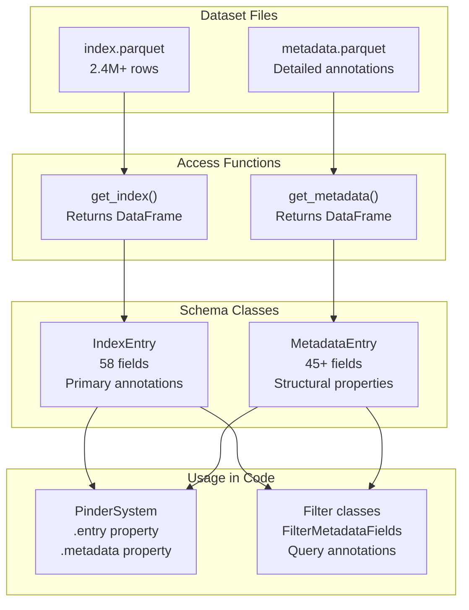
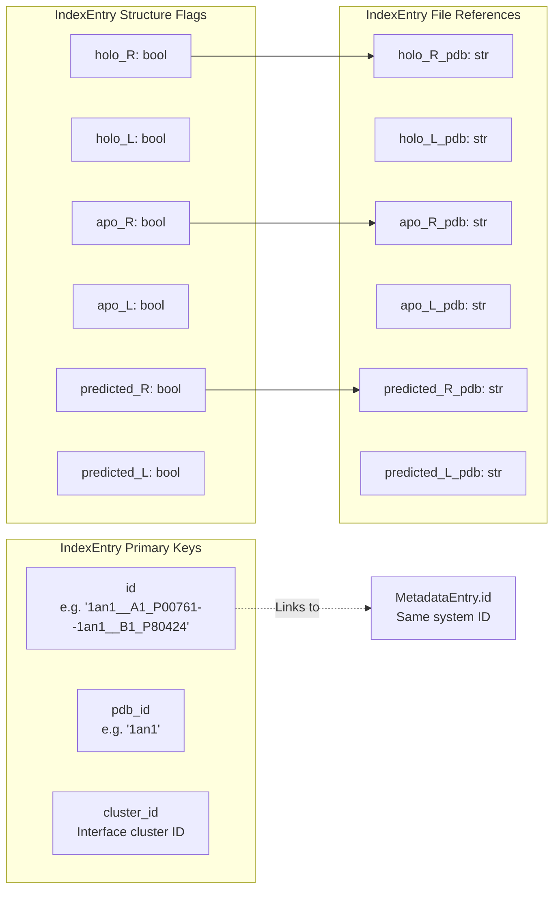
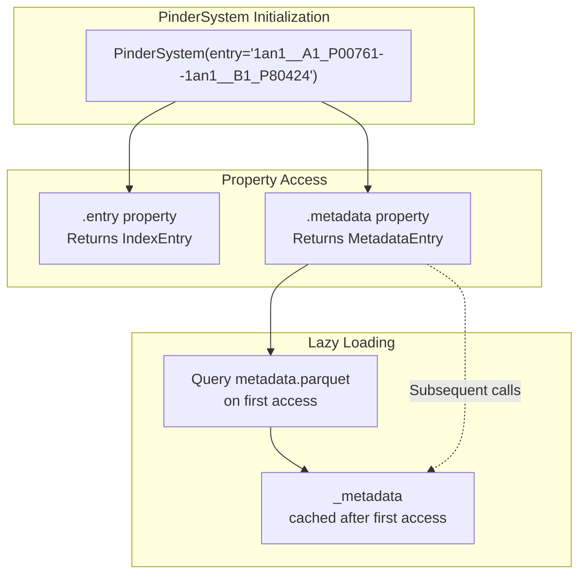
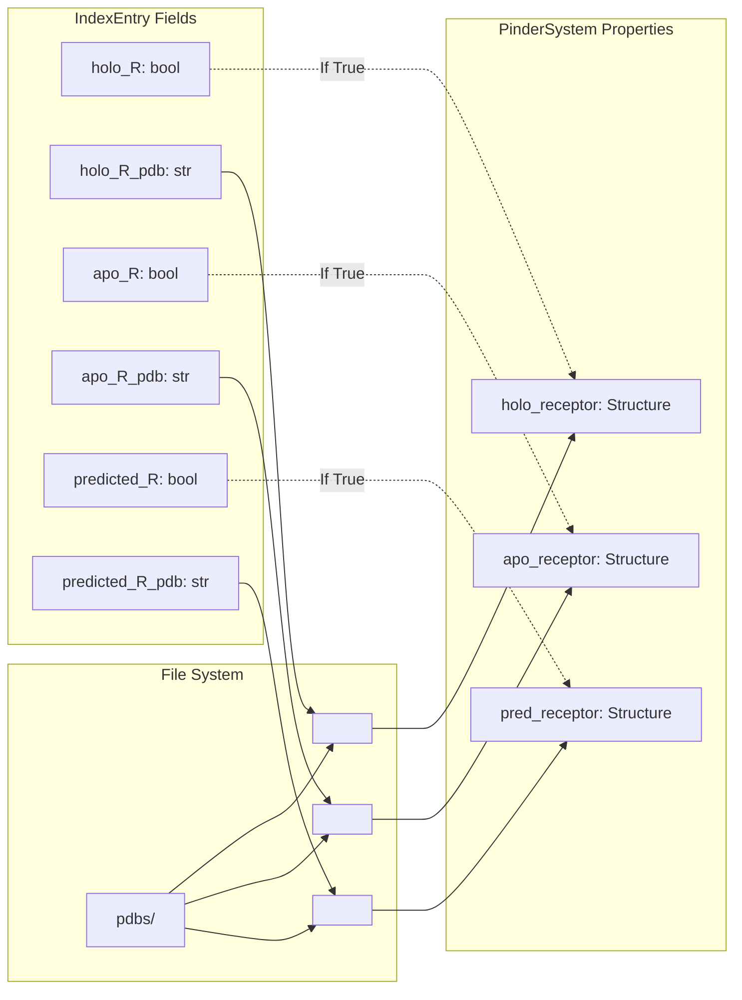

# Index and Metadata

<details>
<summary>Relevant source files</summary>

The following files were used as context for generating this wiki page:

- [README.md](README.md)
- [src/pinder-core/pinder/core/index/system.py](src/pinder-core/pinder/core/index/system.py)

</details>


This page documents the `IndexEntry` and `MetadataEntry` data schemas that form the annotation layer of the PINDER dataset. These schemas define the 58 primary fields in `index.parquet` and 45+ detailed fields in `metadata.parquet`, providing comprehensive structural and biological annotations for each protein-protein interaction system.

For information about how these entries are used within the data loading pipeline, see [PinderLoader](#4.1). For details on the actual protein structures represented by these entries, see [PinderSystem](#3.1).

## Overview

The PINDER dataset maintains two complementary annotation files:

- **index.parquet**: Contains the master index with essential metadata for all 2.4M+ training pairs and test systems
- **metadata.parquet**: Provides detailed structural and biophysical properties for each system

These files are the foundation of the dataset filtering and sampling system, exposing annotations through the `IndexEntry` and `MetadataEntry` dataclasses.



**Sources:** [src/pinder-core/pinder/core/index/system.py:1-26](), [README.md:163-176]()

## Data Structure Relationship

The index and metadata files maintain a one-to-one relationship through the shared `id` field, which uniquely identifies each protein-protein interaction system.



**Sources:** [README.md:529-567](), [src/pinder-core/pinder/core/index/system.py:110-161]()

## IndexEntry Schema

The `IndexEntry` dataclass contains 58 fields organized into several functional categories. Each row in `index.parquet` represents a single protein-protein interaction system with its associated structural variants and annotations.

### Primary Identifiers

| Field | Type | Description |
|:------|:-----|:------------|
| `id` | string | Unique identifier following format `<pdb_id>__<chain_R>_<uniprot_R>--<pdb_id>__<chain_L>_<uniprot_L>` |
| `pdb_id` | string | PDB identifier for the entry |
| `cluster_id` | string | Interface cluster identifier from FoldSeek clustering |
| `cluster_id_R` | string | Cluster ID for receptor dimer body |
| `cluster_id_L` | string | Cluster ID for ligand dimer body |

### Split Assignments

| Field | Type | Description |
|:------|:-----|:------------|
| `split` | string | Dataset split: 'train', 'val', 'test', or 'invalid' |
| `pinder_s` | boolean | True if system is in PINDER-S test subset (250 diverse systems) |
| `pinder_xl` | boolean | True if system is in PINDER-XL test set (1,955 systems) |
| `pinder_af2` | boolean | True if system is in PINDER-AF2 test set (180 AF2MM-deleaked systems) |

### UniProt Identifiers

| Field | Type | Description |
|:------|:-----|:------------|
| `uniprot_R` | string | UniProt accession for receptor protein |
| `uniprot_L` | string | UniProt accession for ligand protein |

### Structure Availability Flags

| Field | Type | Description |
|:------|:-----|:------------|
| `holo_R` | boolean | True if holo (bound) receptor structure is available |
| `holo_L` | boolean | True if holo (bound) ligand structure is available |
| `apo_R` | boolean | True if apo (unbound) receptor structure is available |
| `apo_L` | boolean | True if apo (unbound) ligand structure is available |
| `predicted_R` | boolean | True if predicted receptor structure (AlphaFold2) is available |
| `predicted_L` | boolean | True if predicted ligand structure (AlphaFold2) is available |

### Structure File References

| Field | Type | Description |
|:------|:-----|:------------|
| `holo_R_pdb` | string | Filename for holo receptor PDB |
| `holo_L_pdb` | string | Filename for holo ligand PDB |
| `apo_R_pdb` | string | Filename for canonical apo receptor PDB |
| `apo_L_pdb` | string | Filename for canonical apo ligand PDB |
| `predicted_R_pdb` | string | Filename for predicted receptor PDB |
| `predicted_L_pdb` | string | Filename for predicted ligand PDB |
| `apo_R_pdbs` | string | Comma-delimited list of all alternative apo receptor PDBs |
| `apo_L_pdbs` | string | Comma-delimited list of all alternative apo ligand PDBs |

### Apo Pairing Quality

| Field | Type | Description |
|:------|:-----|:------------|
| `apo_R_quality` | string | Classification: 'high', 'low', or '' (empty). Test/val are 'high', train split includes both based on pairing confidence |
| `apo_L_quality` | string | Classification: 'high', 'low', or '' (empty). Test/val are 'high', train split includes both based on pairing confidence |

### Evolutionary Information

| Field | Type | Description |
|:------|:-----|:------------|
| `chain1_neff` | number | Effective number of sequences (Neff) for first chain, indicating MSA depth |
| `chain2_neff` | number | Effective number of sequences (Neff) for second chain, indicating MSA depth |

### Chain Identifiers

| Field | Type | Description |
|:------|:-----|:------------|
| `chain_R` | string | Chain identifier for receptor in native structure |
| `chain_L` | string | Chain identifier for ligand in native structure |

### Biological Annotations

| Field | Type | Description |
|:------|:-----|:------------|
| `contains_antibody` | boolean | True if complex contains antibody (from SAbDab annotation) |
| `contains_antigen` | boolean | True if complex contains antigen (from SAbDab annotation) |
| `contains_enzyme` | boolean | True if complex contains enzyme (from EC number annotation) |

**Sources:** [README.md:529-567](), [src/pinder-core/pinder/core/index/system.py:132-133]()

## MetadataEntry Schema

The `MetadataEntry` dataclass contains 45+ fields providing detailed structural and biophysical properties for each system. This data is derived from RCSB PDB annotations, PRODIGY-cryst predictions, and computational analyses.

### Core Identifiers

| Field | Type | Description |
|:------|:-----|:------------|
| `id` | string | Unique PINDER system identifier (matches IndexEntry.id) |
| `entry_id` | string | RCSB PDB entry identifier |
| `chain1_id` | string | Receptor chain ID (always 'R' in processed structures) |
| `chain2_id` | string | Ligand chain ID (always 'L' in processed structures) |

### Experimental Details

| Field | Type | Description |
|:------|:-----|:------------|
| `method` | string | Structure determination method (X-RAY DIFFRACTION, CRYO-EM, NMR, etc.) |
| `date` | string | Deposition date in RCSB PDB |
| `release_date` | string | Initial public release date |
| `resolution` | number | Experimental resolution in Ångströms |

### Biological Assembly

| Field | Type | Description |
|:------|:-----|:------------|
| `assembly` | integer | Bioassembly number (1, 2, 3, etc.) used to derive structure |
| `assembly_details` | string | Source of bioassembly information (author-defined vs other) |
| `oligomeric_details` | string | Description of oligomeric state |
| `oligomeric_count` | integer | Number of chains in the oligomer |
| `biol_details` | string | Biological assembly details |
| `complex_type` | string | 'homomer' or 'heteromer' |

### Chain Mapping

| Field | Type | Description |
|:------|:-----|:------------|
| `chain_1` | string | Post-bioassembly chain ID for receptor |
| `asym_id_1` | string | Author chain ID (original asymmetric unit) for receptor |
| `chain_2` | string | Post-bioassembly chain ID for ligand |
| `asym_id_2` | string | Author chain ID (original asymmetric unit) for ligand |

### Sequence Properties

| Field | Type | Description |
|:------|:-----|:------------|
| `length1` | integer | Total amino acid length of receptor chain |
| `length2` | integer | Total amino acid length of ligand chain |
| `length_resolved_1` | integer | Structurally resolved (Cα) residues in receptor |
| `length_resolved_2` | integer | Structurally resolved (Cα) residues in ligand |
| `number_of_components_1` | integer | Number of connected structural fragments in receptor |
| `number_of_components_2` | integer | Number of connected structural fragments in ligand |

### Interface Characterization (PRODIGY-cryst)

| Field | Type | Description |
|:------|:-----|:------------|
| `label` | string | Classification as biological interaction or crystal contact |
| `probability` | number | Probability that the complex is a true biological interaction |
| `link_density` | number | Interfacial contact density (contacts / max possible contacts) |
| `planarity` | number | Deviation of interface Cα atoms from fitted plane (shape complementarity) |

### Structural Quality Metrics

| Field | Type | Description |
|:------|:-----|:------------|
| `max_var_1` | number | Maximum variance on principal component (detects elongation) for receptor |
| `max_var_2` | number | Maximum variance on principal component (detects elongation) for ligand |
| `num_atom_types` | integer | Number of unique atom types (detects Cα-only or backbone-only structures) |

### Interface Properties

| Field | Type | Description |
|:------|:-----|:------------|
| `n_residue_pairs` | integer | Number of residue pairs at the interface |
| `n_residues` | integer | Total number of residues at the interface |
| `buried_sasa` | number | Buried solvent-accessible surface area upon complex formation (Ų) |
| `intermolecular_contacts` | integer | Total intermolecular contacts (residue pairs within 5Å) |

### Contact Type Classification

| Field | Type | Description |
|:------|:-----|:------------|
| `charged_charged_contacts` | integer | Contacts between charged residues (E, D, H, K, R) |
| `charged_polar_contacts` | integer | Contacts between charged (E, D, H, K, R) and polar (N, Q, S, T) |
| `charged_apolar_contacts` | integer | Contacts between charged and apolar (A, C, G, F, I, M, L, P, W, V, Y) |
| `polar_polar_contacts` | integer | Contacts between polar residues (N, Q, S, T) |
| `apolar_polar_contacts` | integer | Contacts between apolar and polar residues |
| `apolar_apolar_contacts` | integer | Contacts between apolar residues |

### Structural Gaps

| Field | Type | Description |
|:------|:-----|:------------|
| `interface_atom_gaps_4A` | integer | Interface atoms within 4Å of a residue gap |
| `missing_interface_residues_4A` | integer | Interface residues within 4Å of a gap |
| `interface_atom_gaps_8A` | integer | Interface atoms within 8Å of a residue gap |
| `missing_interface_residues_8A` | integer | Interface residues within 8Å of a gap |

### Entity and Domain Annotations

| Field | Type | Description |
|:------|:-----|:------------|
| `entity_id_R` | integer | RCSB entity_id for receptor chain |
| `entity_id_L` | integer | RCSB entity_id for ligand chain |
| `pdb_strand_id_R` | string | RCSB pdb_strand_id (author chain) for receptor |
| `pdb_strand_id_L` | string | RCSB pdb_strand_id (author chain) for ligand |
| `ECOD_names_R` | string | ECOD domain family names for receptor (comma-delimited if multiple) |
| `ECOD_names_L` | string | ECOD domain family names for ligand (comma-delimited if multiple) |

**Sources:** [README.md:569-624](), [src/pinder-core/pinder/core/index/system.py:675-693]()

## Accessing Index and Metadata

### Loading the Complete DataFrames

The dataset provides utility functions to load the complete index and metadata as pandas DataFrames:

```python
from pinder.core.index.utils import get_index, get_metadata

# Load complete index (2.4M+ rows)
index_df = get_index()

# Load complete metadata 
metadata_df = get_metadata()

# Query for specific systems
system_ids = ['1an1__A1_P00761--1an1__B1_P80424']
system_index = index_df.query('id in @system_ids')
system_metadata = metadata_df.query('id in @system_ids')
```

**Sources:** [src/pinder-core/pinder/core/index/system.py:15-16](), [README.md:137-140]()

### Accessing via PinderSystem

The `PinderSystem` class provides convenient property accessors for the entry and metadata:



```python
from pinder.core import PinderSystem

# Initialize system
system = PinderSystem(entry='1an1__A1_P00761--1an1__B1_P80424')

# Access IndexEntry
entry = system.entry
print(f"PDB ID: {entry.pdb_id}")
print(f"Split: {entry.split}")
print(f"Has apo receptor: {entry.apo_R}")
print(f"Cluster: {entry.cluster_id}")

# Access MetadataEntry (lazy-loaded on first access)
metadata = system.metadata
print(f"Resolution: {metadata.resolution}Å")
print(f"Method: {metadata.method}")
print(f"Interface contacts: {metadata.intermolecular_contacts}")
print(f"Buried SASA: {metadata.buried_sasa}Ų")
```

**Sources:** [src/pinder-core/pinder/core/index/system.py:110-161](), [src/pinder-core/pinder/core/index/system.py:675-693]()

## Usage in Filtering

### System-Level Filtering

The `FilterMetadataFields` filter class enables filtering based on any field in `MetadataEntry`:

```python
from pinder.core import PinderLoader
from pinder.core.loader import filters

# Create filters using metadata fields
base_filters = [
    # Filter antibody-containing systems
    filters.FilterMetadataFields(contains_antibody=('', False)),
    
    # Filter by resolution
    filters.FilterMetadataFields(resolution=('<=', 3.5)),
    
    # Filter by experimental method
    filters.FilterMetadataFields(method=('==', 'X-RAY DIFFRACTION')),
    
    # Combine multiple criteria
    filters.FilterMetadataFields(
        contains_enzyme=('is not', True),
        num_atom_types=('>=', 4),
        intermolecular_contacts=('>=', 10),
    ),
]

# Use in loader
loader = PinderLoader(
    split='train',
    base_filters=base_filters,
)
```

### Query Operations

Direct DataFrame queries provide flexible filtering:

```python
from pinder.core.index.utils import get_index, get_metadata

index = get_index()
metadata = get_metadata()

# Find high-resolution heterodimers
high_res_systems = metadata.query(
    'resolution <= 2.0 and complex_type == "heteromer"'
)

# Find systems with apo structures
apo_systems = index.query('apo_R == True and apo_L == True')

# Find test systems with good interface quality
good_interfaces = metadata.query(
    'probability > 0.8 and planarity < 5.0 and buried_sasa > 1000'
)

# Join for combined queries
joined = index.merge(metadata, on='id')
filtered = joined.query(
    'split == "test" and resolution <= 3.0 and apo_R == True'
)
```

**Sources:** [README.md:625-669](), [src/pinder-core/pinder/core/index/system.py:686-687]()

## Field Categories and Use Cases

```mermaid
graph TB
    subgraph "IndexEntry Categories"
        IDENTITY["Identity Fields<br/>id, pdb_id, cluster_id"]
        SPLITS["Split Assignments<br/>split, pinder_s, pinder_xl, pinder_af2"]
        AVAILABILITY["Structure Availability<br/>holo_R/L, apo_R/L, predicted_R/L"]
        REFERENCES["File References<br/>*_pdb fields"]
        QUALITY["Quality Annotations<br/>apo_R/L_quality"]
    end
    
    subgraph "MetadataEntry Categories"
        EXPERIMENTAL["Experimental Context<br/>method, resolution, date"]
        ASSEMBLY["Assembly Details<br/>assembly, oligomeric_count"]
        INTERFACE["Interface Properties<br/>contacts, buried_sasa"]
        STRUCTURAL["Structural Quality<br/>gaps, planarity, elongation"]
        BIOLOGICAL["Biological Context<br/>label, probability"]
    end
    
    subgraph "Common Use Cases"
        SYSTEM_SELECT["System Selection<br/>Which systems to load?"]
        MONOMER_SELECT["Monomer Selection<br/>Which structures are available?"]
        QUALITY_FILTER["Quality Filtering<br/>Is this a good system?"]
        DIFFICULTY["Difficulty Assessment<br/>How challenging is docking?"]
    end
    
    IDENTITY --> SYSTEM_SELECT
    SPLITS --> SYSTEM_SELECT
    AVAILABILITY --> MONOMER_SELECT
    REFERENCES --> MONOMER_SELECT
    
    QUALITY --> QUALITY_FILTER
    EXPERIMENTAL --> QUALITY_FILTER
    STRUCTURAL --> QUALITY_FILTER
    
    INTERFACE --> DIFFICULTY
    BIOLOGICAL --> DIFFICULTY
```



**Sources:** [README.md:529-624]()

## Relationship to PinderSystem Properties

The annotations in `IndexEntry` directly map to file paths and structure availability in `PinderSystem`:



**Sources:** [src/pinder-core/pinder/core/index/system.py:163-261](), [src/pinder-core/pinder/core/index/system.py:647-672]()

## File Locations and Storage

The index and metadata files are stored at the root of the PINDER dataset directory:

```
<PINDER_BASE_DIR>/<release_version>/
├── index.parquet          # Master index (2.4M+ rows, 58 fields)
├── metadata.parquet       # Detailed metadata (45+ fields)
├── pdbs/                  # Structure files referenced by *_pdb fields
├── test_set_pdbs/        # Test set holo structures
└── mappings/             # UniProt mapping files
```

The default location is `~/.local/share/pinder/2024-02/` but can be customized via the `PINDER_BASE_DIR` environment variable.

**Sources:** [README.md:163-176](), [README.md:125-144]()

## Special Fields and Conventions

### System ID Format

The `id` field follows a strict naming convention:
```
<pdb_id>__<chain_R>_<uniprot_R>--<pdb_id>__<chain_L>_<uniprot_L>
```

Example: `1an1__A1_P00761--1an1__B1_P80424`

This format encodes:
- PDB ID: `1an1`
- Receptor chain: `A1`
- Receptor UniProt: `P00761`
- Ligand chain: `B1`
- Ligand UniProt: `P80424`

### Alternative Apo Structures

The `apo_R_pdbs` and `apo_L_pdbs` fields contain comma-delimited lists of alternative apo structures beyond the canonical pairing specified in `apo_R_pdb` and `apo_L_pdb`. These alternatives can be loaded using the `apo_receptor_pdb_code` and `apo_ligand_pdb_code` parameters when initializing `PinderSystem`.

### Test System Flag

The `test_system` property (derived from the `split` field) determines whether holo structures are loaded from `pdbs/` or `test_set_pdbs/`:

```python
# In PinderSystem.__init__
holo_pdb_path = (
    self.test_pdbs_path if self.entry.test_system else self.pdbs_path
)
```

**Sources:** [src/pinder-core/pinder/core/index/system.py:132-153](), [src/pinder-core/pinder/core/index/system.py:200-241](), [README.md:573]()

---