# Data Loading System

<details>
<summary>Relevant source files</summary>

The following files were used as context for generating this wiki page:

- [src/pinder-core/pinder/core/loader/dataset.py](src/pinder-core/pinder/core/loader/dataset.py)
- [src/pinder-core/pinder/core/loader/loader.py](src/pinder-core/pinder/core/loader/loader.py)
- [src/pinder-core/pinder/core/utils/timer.py](src/pinder-core/pinder/core/utils/timer.py)

</details>


The Data Loading System provides the infrastructure for loading PINDER protein systems and converting them into ML-ready data structures. This system bridges the gap between raw PDB files stored in the PINDER dataset and batched tensors or graphs consumable by PyTorch and PyTorch Geometric models.

The system is organized around three core components: **PinderLoader** for system iteration and filtering, **PinderDataset** for tensor-based workflows, and **PPIDataset** for graph neural network workflows. All three leverage a common filtering and transformation pipeline.

For details on the underlying data structures, see [Core Data Structures](#3). For information on specific filter implementations, see [Filtering System](#4.4). For evaluation workflows, see [Evaluation](#6).

## System Architecture

The data loading pipeline consists of multiple layers that progressively transform raw structural data into ML-ready batches:

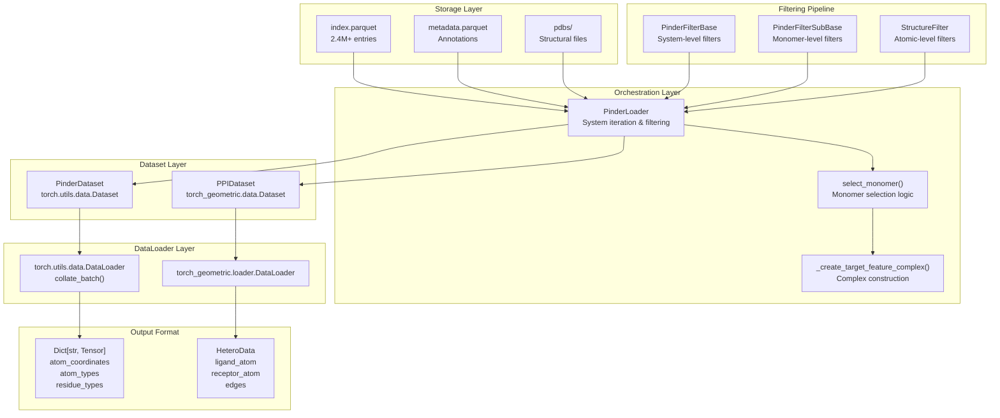

**Sources:** [src/pinder-core/pinder/core/loader/dataset.py:1-655](), [src/pinder-core/pinder/core/loader/loader.py:1-439]()

## Data Flow Pipeline

The following diagram illustrates how a single system progresses through the loading pipeline, from index entry to batched output:

```mermaid
graph LR
    subgraph Input["Input"]
        ROW["pd.Series<br/>Index row"]
    end
    
    subgraph PinderLoader["PinderLoader.__getitem__()"]
        LOAD_SYS["PinderSystem(row.id)"]
        APPLY_DIMER["apply_dimer_filters()<br/>base_filters + sub_filters"]
        SELECT["select_monomer()<br/>Choose apo/holo/pred"]
        CREATE["_create_target_feature_complex()<br/>Build complexes"]
        APPLY_STRUCT["apply_structure_filters()<br/>structure_filters"]
        TRANSFORM["Apply transforms<br/>structure_transforms_*"]
    end
    
    subgraph Output["Output"]
        TUPLE["(PinderSystem,<br/>Structure feature,<br/>Structure target)"]
    end
    
    ROW --> LOAD_SYS
    LOAD_SYS --> APPLY_DIMER
    APPLY_DIMER --> SELECT
    SELECT --> CREATE
    CREATE --> APPLY_STRUCT
    APPLY_STRUCT --> TRANSFORM
    TRANSFORM --> TUPLE
```

**Sources:** [src/pinder-core/pinder/core/loader/loader.py:357-405]()

### Pipeline Stages

The loading pipeline executes the following stages for each system:

| Stage | Component | Purpose | Can Filter? |
|-------|-----------|---------|-------------|
| **System Loading** | `PinderSystem(row.id)` | Load system from disk | No |
| **Dimer Filtering** | `apply_dimer_filters()` | Apply base and sub filters | Yes |
| **Monomer Selection** | `select_monomer()` | Choose monomer types (apo/holo/pred) | No |
| **Complex Creation** | `_create_target_feature_complex()` | Build target and feature complexes | No |
| **Structure Filtering** | `apply_structure_filters()` | Apply structure-level filters | Yes |
| **Transformation** | `structure_transforms_*` | Apply augmentations | No |

**Sources:** [src/pinder-core/pinder/core/loader/loader.py:357-405]()

## Core Components

### PinderLoader

The `PinderLoader` class is the central orchestrator of the loading pipeline. It implements the iterator protocol and provides indexed access to filtered and transformed systems.

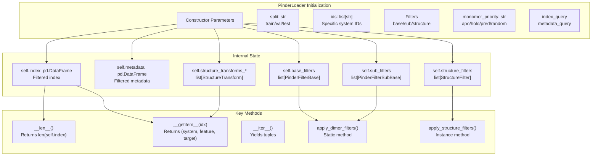

**Key Parameters:**

- `split` (str): Dataset split to load (train/val/test)
- `monomer_priority` (str): Strategy for selecting monomers (holo/apo/pred/random/random_mixed)
- `base_filters` (list[PinderFilterBase]): System-level filters
- `sub_filters` (list[PinderFilterSubBase]): Monomer-level filters  
- `structure_filters` (list[StructureFilter]): Structure-level filters
- `crop_equal_monomer_shapes` (bool): Whether to crop target and feature to same shape
- `fallback_to_holo` (bool): Whether to fall back to holo when preferred monomer unavailable
- `max_load_attempts` (int): Maximum retries when system fails filters (default: 10)

**Sources:** [src/pinder-core/pinder/core/loader/loader.py:192-265]()

### Monomer Selection Logic

The `select_monomer()` function determines which monomer type (holo/apo/pred) to use for receptor and ligand based on availability and priority:

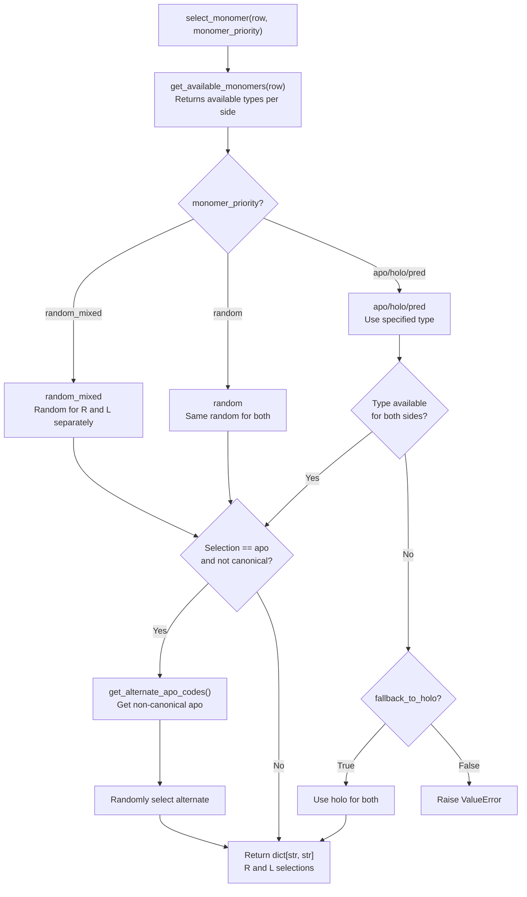

**Monomer Priority Modes:**

| Mode | Behavior | Use Case |
|------|----------|----------|
| `holo` | Always use bound structures | Baseline performance, fastest loading |
| `apo` | Use unbound structures when available | Realistic docking scenario |
| `pred` | Use AlphaFold predictions when available | Evaluate prediction quality |
| `random` | Randomly select same type for R and L | Diverse training with consistent pairs |
| `random_mixed` | Randomly select types independently | Maximum diversity |

**Sources:** [src/pinder-core/pinder/core/loader/loader.py:81-149](), [src/pinder-core/pinder/core/loader/loader.py:23]()

## Dataset Implementations

### PinderDataset

`PinderDataset` is a PyTorch `Dataset` implementation that yields dictionary-based tensor structures suitable for standard neural networks:

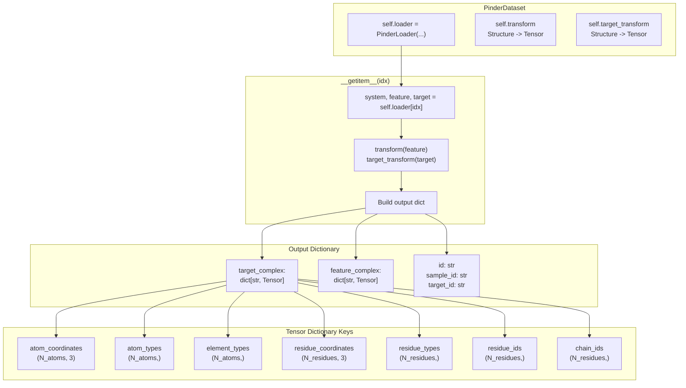

**Default Transform:** The `structure2tensor_transform()` function converts a `Structure` object into a dictionary of tensors using `structure2tensor()` from the geodata module.

**Sources:** [src/pinder-core/pinder/core/loader/dataset.py:246-318](), [src/pinder-core/pinder/core/loader/dataset.py:55-66]()

### PPIDataset

`PPIDataset` is a PyTorch Geometric `Dataset` that creates heterogeneous graph representations (`HeteroData`) suitable for graph neural networks:

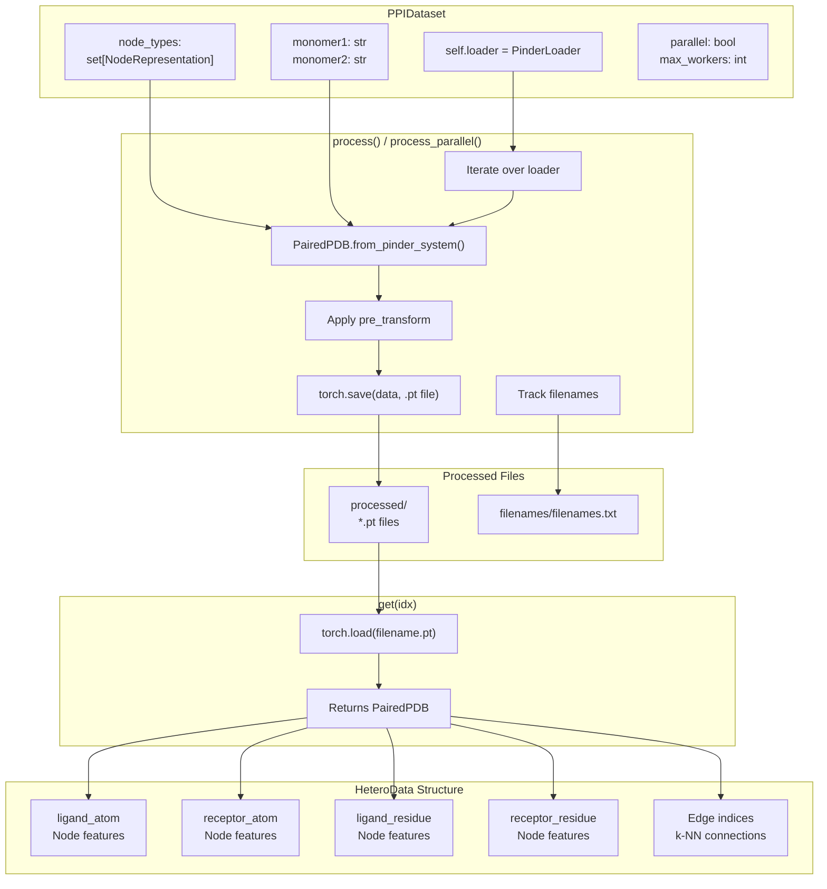

**Key Features:**

- **Preprocessing:** Converts all systems to `.pt` files during initialization
- **Caching:** Reuses processed files across runs when `use_cache=True`
- **Parallel Processing:** Supports multiprocessing via `parallel=True`
- **Node Types:** Supports atom-level and residue-level representations
- **Edges:** Automatically adds k-NN edges between nodes when `add_edges=True`

**Sources:** [src/pinder-core/pinder/core/loader/dataset.py:320-623]()

## Filtering Architecture

The filtering system operates at three distinct levels:

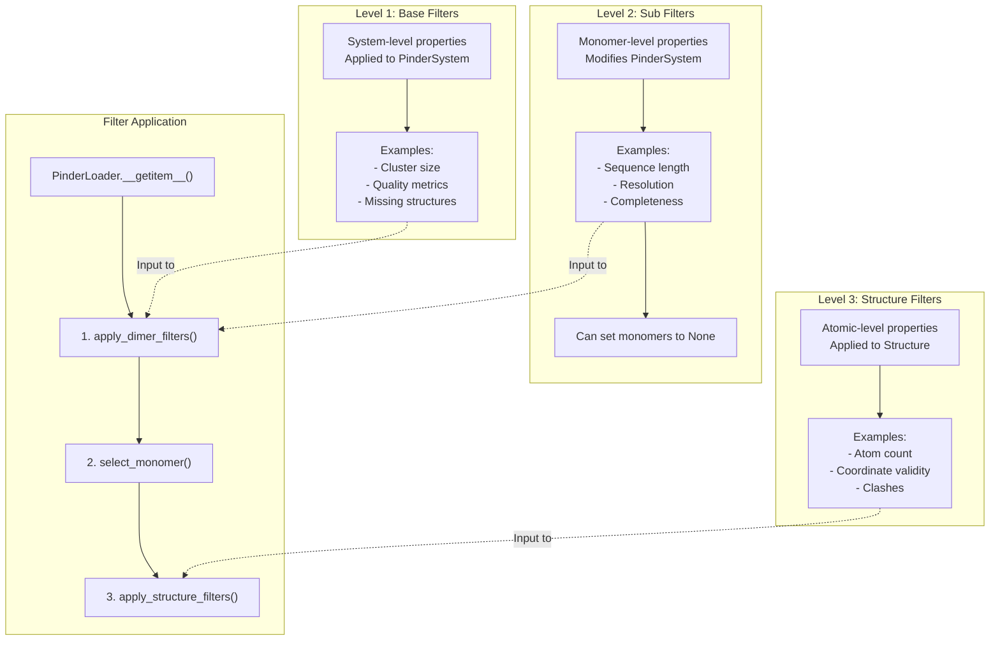

**Filter Behavior:**

| Filter Type | Input | Output | Modifies System? |
|-------------|-------|--------|------------------|
| `PinderFilterBase` | `PinderSystem` | `bool` | No |
| `PinderFilterSubBase` | `PinderSystem` | `PinderSystem` | Yes (can set monomers to None) |
| `StructureFilter` | `Structure` | `bool` | No |

**Sources:** [src/pinder-core/pinder/core/loader/loader.py:415-435](), [src/pinder-core/pinder/core/loader/loader.py:407-413]()

## Complex Construction

The `_create_target_feature_complex()` function builds the target (ground truth holo) and feature (potentially apo/pred) complexes:

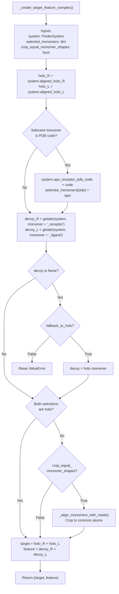

**Shape Alignment:** When `crop_equal_monomer_shapes=True`, the function uses `_align_monomers_with_mask()` to crop holo and decoy structures to matching atom sets based on sequence alignment. This ensures the target and feature complexes have identical shapes, which is required by many loss functions.

**Sources:** [src/pinder-core/pinder/core/loader/loader.py:152-189]()

## Batching and Collation

### Padding Strategy

Variable-sized protein structures are padded to a uniform size within each batch using the `pad_and_stack()` and `collate_complex()` functions:

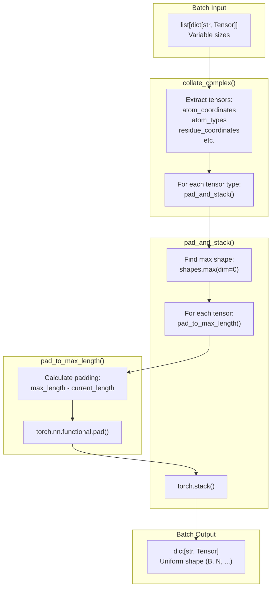

**Padding Values:**

| Tensor Type | Padding Value | Purpose |
|-------------|---------------|---------|
| `atom_coordinates` | -100 | Distinguishable from valid coordinates |
| `residue_coordinates` | -100 | Distinguishable from valid coordinates |
| `atom_types` | -1 | Invalid atom type index |
| `element_types` | -1 | Invalid element type index |
| `residue_types` | -1 | Invalid residue type index |
| `residue_ids` | -99 | Invalid residue ID |
| `chain_ids` | -1 | Invalid chain ID |

**Sources:** [src/pinder-core/pinder/core/loader/dataset.py:69-163](), [src/pinder-core/pinder/core/loader/dataset.py:165-202](), [src/pinder-core/pinder/core/loader/dataset.py:205-243]()

### Collation Functions

The `collate_batch()` function merges a list of dataset items into a single batch:

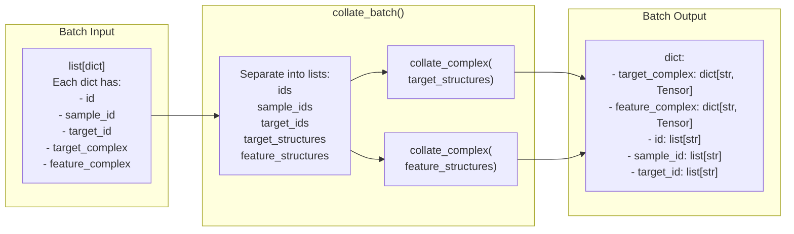

**Sources:** [src/pinder-core/pinder/core/loader/dataset.py:205-243]()

## DataLoader Construction

### PyTorch DataLoader

The `get_torch_loader()` function creates a standard PyTorch `DataLoader` for `PinderDataset`:

```python
def get_torch_loader(
    dataset: PinderDataset,
    batch_size: int = 2,
    shuffle: bool = True,
    sampler: Sampler | None = None,
    num_workers: int = 1,
    collate_fn: Callable = collate_batch,
    **kwargs
) -> DataLoader[PinderDataset]:
    return DataLoader(
        dataset,
        batch_size=batch_size,
        shuffle=shuffle,
        num_workers=num_workers,
        sampler=sampler,
        collate_fn=collate_fn,
        **kwargs,
    )
```

**Key Parameters:**
- `collate_fn`: Defaults to `collate_batch()` which handles variable-sized structures
- `sampler`: Can provide custom sampling logic (e.g., diversity sampling)
- `num_workers`: Number of subprocesses for data loading

**Sources:** [src/pinder-core/pinder/core/loader/dataset.py:637-655]()

### PyTorch Geometric DataLoader

The `get_geo_loader()` function creates a PyTorch Geometric `DataLoader` for `PPIDataset`:

```python
def get_geo_loader(
    dataset: PPIDataset,
    batch_size: int = 2,
    num_workers: int = 1
) -> TorchGeoDataLoader:
    return TorchGeoDataLoader(
        dataset,
        batch_size=batch_size,
        shuffle=True,
        drop_last=True,
        num_workers=num_workers,
    )
```

**Graph Batching:** PyTorch Geometric's `DataLoader` automatically handles batching of `HeteroData` objects by concatenating node features and adjusting edge indices with offsets.

**Sources:** [src/pinder-core/pinder/core/loader/dataset.py:625-634]()

## Usage Patterns

### Basic PinderDataset Example

```python
from pinder.core.loader.dataset import PinderDataset, get_torch_loader

# Create dataset
dataset = PinderDataset(
    split="train",
    monomer_priority="apo",
    fallback_to_holo=True,
)

# Create dataloader
loader = get_torch_loader(
    dataset,
    batch_size=4,
    shuffle=True,
    num_workers=2
)

# Iterate
for batch in loader:
    target = batch["target_complex"]  # Ground truth
    feature = batch["feature_complex"]  # Apo structures
    ids = batch["id"]  # System IDs
    # Train model...
```

### Basic PPIDataset Example

```python
from pinder.core.loader.dataset import PPIDataset, get_geo_loader
from pinder.core.loader.geodata import NodeRepresentation

# Create dataset
dataset = PPIDataset(
    node_types={NodeRepresentation.ATOM},
    split="train",
    monomer1="apo_receptor",
    monomer2="apo_ligand",
    add_edges=True,
    k=10,  # 10-NN edges
)

# Create dataloader
loader = get_geo_loader(dataset, batch_size=4, num_workers=2)

# Iterate
for batch in loader:
    receptor_feats = batch["receptor_atom"]
    ligand_feats = batch["ligand_atom"]
    # Train GNN model...
```

### Advanced: Custom Filtering and Transforms

```python
from pinder.core.loader.dataset import PinderDataset
from pinder.core.loader.filters import PinderFilterBase, StructureFilter
from pinder.core.loader.transforms import SelectAtomTypes

# Define custom filters
class MinAtomFilter(StructureFilter):
    def __init__(self, min_atoms: int):
        self.min_atoms = min_atoms
    
    def __call__(self, structure: Structure) -> bool:
        return len(structure.atom_array) >= self.min_atoms

# Create dataset with filters and transforms
dataset = PinderDataset(
    split="train",
    structure_filters=[MinAtomFilter(min_atoms=100)],
    structure_transforms_feature=[
        SelectAtomTypes(atom_types=["CA"])  # Use only alpha carbons
    ],
    monomer_priority="random_mixed",
    crop_equal_monomer_shapes=True,
)
```

## Retry Logic and Error Handling

When a system fails filters or cannot be loaded, `PinderLoader` automatically retries with a random index:

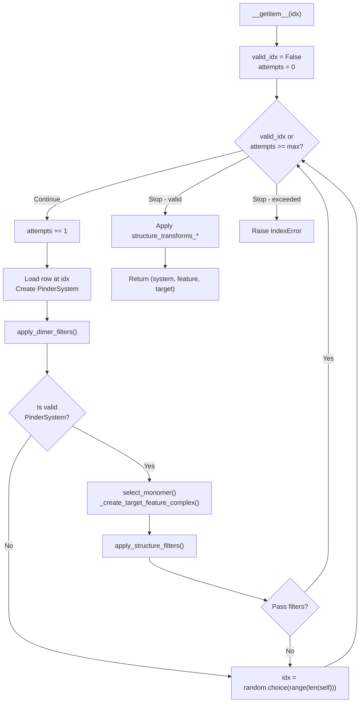

**Configurable Retry:** The `max_load_attempts` parameter (default: 10) controls how many times the loader will retry before raising an `IndexError`.

**Sources:** [src/pinder-core/pinder/core/loader/loader.py:357-405]()

## Performance Considerations

### Caching Strategies

| Strategy | Dataset | Benefit | Cost |
|----------|---------|---------|------|
| **Index Filtering** | Both | Pre-filter index to reduce iteration | Higher memory for large filters |
| **Processed Files** | PPIDataset | Avoid repeated graph construction | Disk space (~1-2 MB per system) |
| **Multiprocessing** | PPIDataset | Parallel preprocessing | CPU and memory overhead |
| **DataLoader Workers** | Both | Parallel batch preparation | Memory per worker |

### Memory Optimization

**PinderDataset:**
- Loads structures on-demand (no caching)
- Memory scales with batch size and number of workers
- Use `num_workers=0` for low-memory environments

**PPIDataset:**
- Preprocesses all systems to disk once
- Memory usage during iteration is low
- Set `use_cache=True` to skip reprocessing

### Parallel Processing

`PPIDataset` supports parallel preprocessing via multiprocessing:

```python
dataset = PPIDataset(
    ...,
    parallel=True,
    max_workers=8,  # Number of parallel workers
    force_reload=False,  # Skip existing processed files
)
```

**Sources:** [src/pinder-core/pinder/core/loader/dataset.py:511-541]()

## Integration with Training Loops

The data loading system integrates seamlessly with standard PyTorch training patterns:

```python
# Standard PyTorch training loop
model = MyModel()
optimizer = torch.optim.Adam(model.parameters())

for epoch in range(num_epochs):
    for batch in train_loader:
        target = batch["target_complex"]
        feature = batch["feature_complex"]
        
        # Forward pass
        pred = model(feature)
        loss = criterion(pred, target)
        
        # Backward pass
        optimizer.zero_grad()
        loss.backward()
        optimizer.step()
```

**Batch Structure:** Both `PinderDataset` and `PPIDataset` return batches with consistent keys, making it easy to switch between tensor-based and graph-based models with minimal code changes.

**Sources:** [src/pinder-core/pinder/core/loader/dataset.py:1-19]()

---