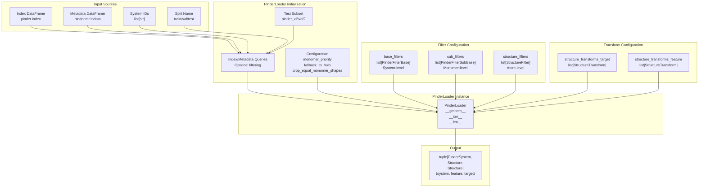
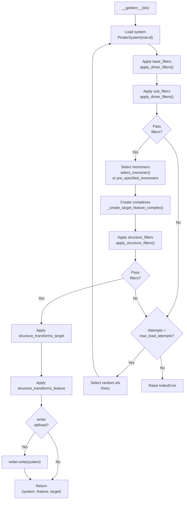
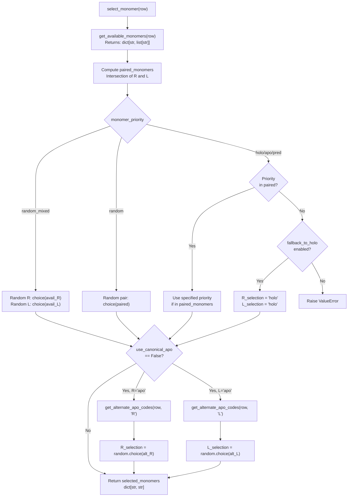
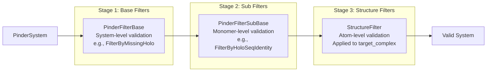
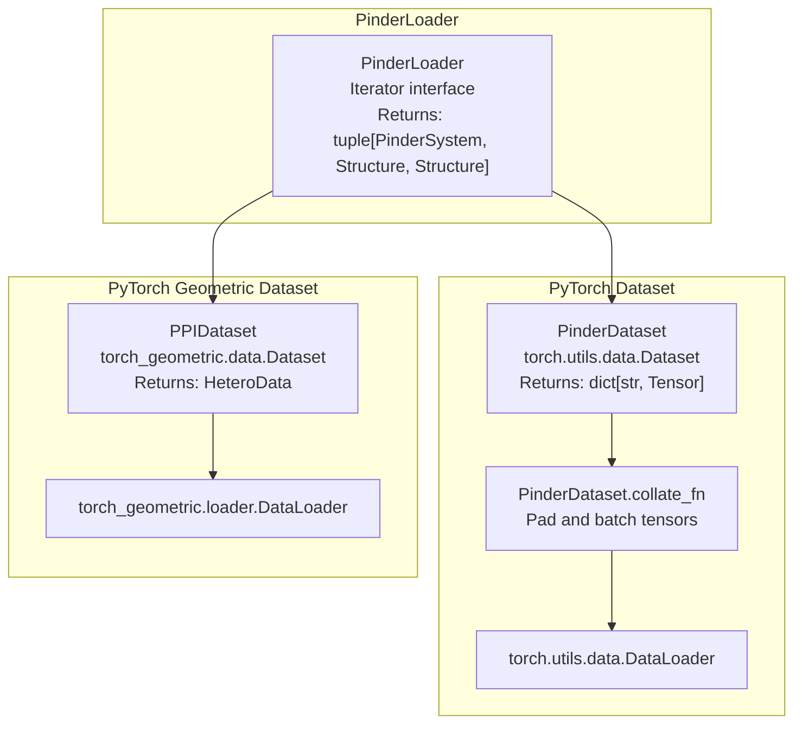

# PinderLoader

<details>
<summary>Relevant source files</summary>

The following files were used as context for generating this wiki page:

- [examples/pinder-loader.ipynb](examples/pinder-loader.ipynb)
- [src/pinder-core/pinder/core/loader/loader.py](src/pinder-core/pinder/core/loader/loader.py)
- [src/pinder-core/pinder/core/utils/timer.py](src/pinder-core/pinder/core/utils/timer.py)

</details>


`PinderLoader` is the core iterator class in PINDER that orchestrates loading, filtering, and transforming protein systems for machine learning workflows. It serves as the central orchestration layer between the raw PINDER dataset and downstream dataset implementations.

For information about the downstream PyTorch-compatible datasets that use PinderLoader, see [PinderDataset](#4.2) and [PPIDataset](#4.3). For details on the filtering system, see [Filtering System](#4.4). For information about structure transformations, see [Transforms and Augmentation](#4.5).

## Overview

`PinderLoader` provides an iterable interface that:
- Loads `PinderSystem` objects from the PINDER index
- Applies multi-stage filtering (base, sub, structure)
- Selects monomers according to configurable priority strategies
- Creates target and feature complexes with optional cropping and alignment
- Applies structure-level transformations
- Optionally writes processed structures to disk

The loader returns tuples of `(PinderSystem, Structure, Structure)` representing the original system metadata, the feature complex (potentially with apo/predicted monomers), and the target complex (ground truth).

**Sources:** [src/pinder-core/pinder/core/loader/loader.py:192-439]()

## Architecture

### High-Level Data Flow



**Sources:** [src/pinder-core/pinder/core/loader/loader.py:192-346]()

### Item Retrieval Flow



**Sources:** [src/pinder-core/pinder/core/loader/loader.py:357-405]()

## Initialization Parameters

The `PinderLoader.__init__` method accepts the following parameter groups:

### Data Selection Parameters

| Parameter | Type | Default | Description |
|-----------|------|---------|-------------|
| `split` | `str \| None` | `None` | Dataset split: `"train"`, `"val"`, or `"test"` |
| `ids` | `list[str] \| None` | `None` | Explicit list of PINDER system IDs to load |
| `index` | `pd.DataFrame \| None` | `None` | Custom index DataFrame (retrieved via `get_index()` if not provided) |
| `metadata` | `pd.DataFrame \| None` | `None` | Custom metadata DataFrame (retrieved via `get_metadata()` if not provided) |
| `subset` | `DatasetName \| None` | `None` | Test subset: `"pinder_xl"`, `"pinder_s"`, or `"pinder_af2"` |
| `index_query` | `str \| None` | `None` | Pandas query string to filter index |
| `metadata_query` | `str \| None` | `None` | Pandas query string to filter metadata |

### Filtering Parameters

| Parameter | Type | Default | Description |
|-----------|------|---------|-------------|
| `base_filters` | `list[PinderFilterBase]` | `[]` | System-level filters (e.g., `FilterByMissingHolo`) |
| `sub_filters` | `list[PinderFilterSubBase]` | `[]` | Monomer-level filters (e.g., `FilterByHoloSeqIdentity`) |
| `structure_filters` | `list[StructureFilter]` | `[]` | Atom-level filters applied to complexes |

### Transformation Parameters

| Parameter | Type | Default | Description |
|-----------|------|---------|-------------|
| `structure_transforms_target` | `list[StructureTransform]` | `[]` | Transforms applied to target complex |
| `structure_transforms_feature` | `list[StructureTransform]` | `[]` | Transforms applied to feature complex |

### Monomer Selection Parameters

| Parameter | Type | Default | Description |
|-----------|------|---------|-------------|
| `monomer_priority` | `str` | `"holo"` | Priority strategy: `"holo"`, `"apo"`, `"pred"`, `"random"`, `"random_mixed"` |
| `fallback_to_holo` | `bool` | `True` | Fallback to holo when requested monomer unavailable |
| `use_canonical_apo` | `bool` | `True` | Use canonical apo monomer (vs. alternates) |
| `pre_specified_monomers` | `dict \| pd.DataFrame \| None` | `None` | Explicit monomer selection per system |

### Other Parameters

| Parameter | Type | Default | Description |
|-----------|------|---------|-------------|
| `crop_equal_monomer_shapes` | `bool` | `True` | Crop holo/decoy complexes to common shape |
| `max_load_attempts` | `int` | `10` | Max retries before raising `IndexError` |
| `writer` | `PinderWriterBase \| None` | `None` | Optional writer for persisting structures |

**Sources:** [src/pinder-core/pinder/core/loader/loader.py:193-264]()

## Monomer Selection

### Selection Strategies

The `monomer_priority` parameter controls which monomer types are used to construct the feature complex:

| Strategy | Behavior |
|----------|----------|
| `"holo"` | Use bound (holo) monomers for both receptor and ligand |
| `"apo"` | Use unbound (apo) monomers for both receptor and ligand |
| `"pred"` | Use predicted (AlphaFold2) monomers for both receptor and ligand |
| `"random"` | Randomly select from available types, same for both R and L |
| `"random_mixed"` | Independently random selection for receptor and ligand |

### Monomer Selection Process



**Sources:** [src/pinder-core/pinder/core/loader/loader.py:81-149](), [src/pinder-core/pinder/core/loader/loader.py:37-78]()

### Creating Target and Feature Complexes

The `_create_target_feature_complex` function constructs the two Structure objects returned by the loader:

```mermaid
graph TB
    START["_create_target_feature_complex()"]
    
    GET_HOLO["Get aligned holos<br/>holo_R = system.aligned_holo_R<br/>holo_L = system.aligned_holo_L"]
    
    CHECK_ALT_R{"selected_R not in<br/>[holo, apo, pred]?"}
    CHECK_ALT_L{"selected_L not in<br/>[holo, apo, pred]?"}
    
    SET_ALT_R["system.apo_receptor_pdb_code = selected_R<br/>selected_R = 'apo'"]
    SET_ALT_L["system.apo_ligand_pdb_code = selected_L<br/>selected_L = 'apo'"]
    
    GET_DECOY["Get selected monomers<br/>decoy_R = getattr(system, selected_R + '_receptor')<br/>decoy_L = getattr(system, selected_L + '_ligand')"]
    
    CHECK_NONE_R{"decoy_R<br/>is None?"}
    CHECK_NONE_L{"decoy_L<br/>is None?"}
    
    FALLBACK_R["Fallback if enabled<br/>decoy_R = holo_receptor"]
    FALLBACK_L["Fallback if enabled<br/>decoy_L = holo_ligand"]
    
    VALIDATE{"decoy_R and decoy_L<br/>both valid?"}
    
    ERROR["Raise ValueError"]
    
    CHECK_BOTH_HOLO{"Both selected<br/>monomers == 'holo'?"}
    
    CROP{"crop_equal_monomer_shapes<br/>enabled?"}
    
    ALIGN["Crop and align<br/>holo_R, decoy_R = _align_monomers_with_mask()<br/>holo_L, decoy_L = _align_monomers_with_mask()"]
    
    CREATE["Create complexes<br/>target_complex = holo_R + holo_L<br/>feature_complex = decoy_R + decoy_L"]
    
    RETURN["Return<br/>(target_complex, feature_complex)"]
    
    START --> GET_HOLO
    GET_HOLO --> CHECK_ALT_R
    
    CHECK_ALT_R -->|Yes| SET_ALT_R
    CHECK_ALT_R -->|No| CHECK_ALT_L
    SET_ALT_R --> CHECK_ALT_L
    
    CHECK_ALT_L -->|Yes| SET_ALT_L
    CHECK_ALT_L -->|No| GET_DECOY
    SET_ALT_L --> GET_DECOY
    
    GET_DECOY --> CHECK_NONE_R
    
    CHECK_NONE_R -->|Yes| FALLBACK_R
    CHECK_NONE_R -->|No| CHECK_NONE_L
    FALLBACK_R --> CHECK_NONE_L
    
    CHECK_NONE_L -->|Yes| FALLBACK_L
    CHECK_NONE_L -->|No| VALIDATE
    FALLBACK_L --> VALIDATE
    
    VALIDATE -->|No| ERROR
    VALIDATE -->|Yes| CHECK_BOTH_HOLO
    
    CHECK_BOTH_HOLO -->|Yes| CREATE
    CHECK_BOTH_HOLO -->|No| CROP
    
    CROP -->|Yes| ALIGN
    CROP -->|No| CREATE
    ALIGN --> CREATE
    
    CREATE --> RETURN
```



**Sources:** [src/pinder-core/pinder/core/loader/loader.py:152-189]()

## Filtering System

`PinderLoader` applies filters in three stages, each operating at a different granularity:

### Filter Stages



**Sources:** [src/pinder-core/pinder/core/loader/loader.py:415-435](), [src/pinder-core/pinder/core/loader/loader.py:407-413]()

### Filter Application

The `apply_dimer_filters` static method handles base and sub filter stages:

```python
# From loader.py:415-435
@staticmethod
def apply_dimer_filters(
    dimer: PinderSystem,
    base_filters: list[PinderFilterBase] | list[None] = [],
    sub_filters: list[PinderFilterSubBase] | list[None] = [],
) -> PinderSystem | bool:
    for sub_filter in sub_filters:
        if isinstance(sub_filter, PinderFilterSubBase):
            try:
                dimer = sub_filter(dimer)
            except Exception as e:
                log.error(f"Failed to apply sub_filter={sub_filter} on {dimer.entry.id}: {e}")
                return False
    for base_filter in base_filters:
        if isinstance(base_filter, PinderFilterBase):
            if not base_filter(dimer):
                return False
    return dimer
```

Note that sub filters can modify the `PinderSystem` object (e.g., setting monomer attributes to `None`), while base filters return boolean values without modification.

**Sources:** [src/pinder-core/pinder/core/loader/loader.py:415-435]()

## Usage Examples

### Basic Usage with Split

```python
from pinder.core import PinderLoader

# Load training set with holo monomers
train_loader = PinderLoader(split="train", monomer_priority="holo")

# Iterate over systems
for system, feature_complex, target_complex in train_loader:
    # system: PinderSystem with metadata
    # feature_complex: Structure with selected monomers
    # target_complex: Structure with ground truth holo dimer
    print(f"System ID: {system.entry.id}")
    print(f"Feature atoms: {len(feature_complex.coords)}")
    print(f"Target atoms: {len(target_complex.coords)}")
```

**Sources:** [examples/pinder-loader.ipynb:438-480]()

### Usage with Filters

```python
from pinder.core import PinderLoader
from pinder.core.loader import filters

base_filters = [
    filters.FilterByMissingHolo(),
    filters.FilterSubByContacts(min_contacts=5, radius=10.0, calpha_only=True),
    filters.FilterDetachedHolo(radius=12, max_components=2),
]
sub_filters = [
    filters.FilterSubByAtomTypes(min_atom_types=4),
    filters.FilterByHoloOverlap(min_overlap=5),
    filters.FilterByHoloSeqIdentity(min_sequence_identity=0.8),
    filters.FilterSubRmsds(rmsd_cutoff=7.5),
    filters.FilterDetachedSub(radius=12, max_components=2),
]

loader = PinderLoader(
    split="test",
    subset="pinder_af2",
    monomer_priority="holo",
    base_filters=base_filters,
    sub_filters=sub_filters,
)

print(f"Systems after filtering: {len(loader)}")
```

**Sources:** [examples/pinder-loader.ipynb:438-480]()

### Usage with Specific System IDs

```python
from pinder.core import PinderLoader

systems = [
    "1df0__A1_Q07009--1df0__B1_Q64537",
    "117e__A1_P00817--117e__B1_P00817",
]

loader = PinderLoader(
    ids=systems,
    monomer_priority="pred",  # Use AlphaFold2 predictions
    fallback_to_holo=True,
)

# Access by index
system, feature, target = loader[0]
```

**Sources:** [examples/pinder-loader.ipynb:584-600]()

### Usage with Transforms

```python
from pinder.core import PinderLoader
from pinder.core.loader import transforms

structure_transforms = [
    transforms.SelectAtomTypes(atom_types=["CA", "N", "C", "O"])
]

loader = PinderLoader(
    split="train",
    monomer_priority="random_mixed",
    structure_transforms_target=structure_transforms,
    structure_transforms_feature=structure_transforms,
)

# Transforms are applied before returning structures
system, feature, target = loader[0]
# feature and target now only contain CA, N, C, O atoms
```

**Sources:** [examples/pinder-loader.ipynb:766-803]()

### Usage with Writer

```python
from pinder.core import PinderLoader
from pinder.core.loader.writer import PinderDefaultWriter
from pathlib import Path

output_dir = Path("/path/to/output")
writer = PinderDefaultWriter(output_dir)

loader = PinderLoader(
    ids=systems,
    monomer_priority="pred",
    writer=writer,
)

# Structures are written to disk during iteration
for system, feature, target in loader:
    system_dir = writer.output_path / system.entry.id
    # PDB files written to system_dir
```

**Sources:** [examples/pinder-loader.ipynb:640-673]()

### Usage with Pre-Specified Monomers

```python
from pinder.core import PinderLoader

# Specify exact monomer types for each system
pre_specified = {
    "1df0__A1_Q07009--1df0__B1_Q64537": "apo",
    "117e__A1_P00817--117e__B1_P00817": "pred",
}

loader = PinderLoader(
    ids=list(pre_specified.keys()),
    pre_specified_monomers=pre_specified,
)

# Each system uses its pre-specified monomer type
```

**Sources:** [src/pinder-core/pinder/core/loader/loader.py:327-346]()

## Integration with Datasets

`PinderLoader` serves as the foundation for higher-level dataset implementations:



`PinderDataset` and `PPIDataset` both internally use `PinderLoader` to handle system loading, filtering, and monomer selection, while adding their own transformation logic to produce ML-ready data structures.

**Sources:** [src/pinder-core/pinder/core/loader/loader.py:1-439]()

## Iterator Protocol

`PinderLoader` implements the standard Python iterator protocol:

| Method | Return Type | Description |
|--------|-------------|-------------|
| `__len__()` | `int` | Number of systems in filtered index |
| `__iter__()` | `Generator` | Yields items by calling `__getitem__` for each index |
| `__getitem__(idx)` | `tuple[PinderSystem, Structure, Structure]` | Loads, filters, and returns system at index |

The `__getitem__` method includes retry logic controlled by `max_load_attempts`. If a system fails filters, a random index is selected and retried up to `max_load_attempts` times before raising an `IndexError`.

**Sources:** [src/pinder-core/pinder/core/loader/loader.py:348-405]()

## Key Functions Reference

### Helper Functions

| Function | Location | Purpose |
|----------|----------|---------|
| `get_systems` | [loader.py:27-34]() | Generator that yields `PinderSystem` objects from ID list |
| `get_available_monomers` | [loader.py:37-53]() | Returns available monomer types for receptor and ligand |
| `get_alternate_apo_codes` | [loader.py:56-78]() | Gets list of alternate apo PDB codes for a dimer side |
| `select_monomer` | [loader.py:81-149]() | Selects monomer types based on priority strategy |
| `_create_target_feature_complex` | [loader.py:152-189]() | Creates target and feature Structure complexes |

### Class Methods

| Method | Location | Purpose |
|--------|----------|---------|
| `__init__` | [loader.py:193-346]() | Initialize loader with configuration |
| `__len__` | [loader.py:348-349]() | Return number of systems |
| `__iter__` | [loader.py:351-355]() | Iterator protocol implementation |
| `__getitem__` | [loader.py:357-405]() | Load system by index with filtering |
| `apply_structure_filters` | [loader.py:407-413]() | Apply structure-level filters |
| `apply_dimer_filters` | [loader.py:415-435]() | Static method for base/sub filtering |

**Sources:** [src/pinder-core/pinder/core/loader/loader.py:1-439]()

---