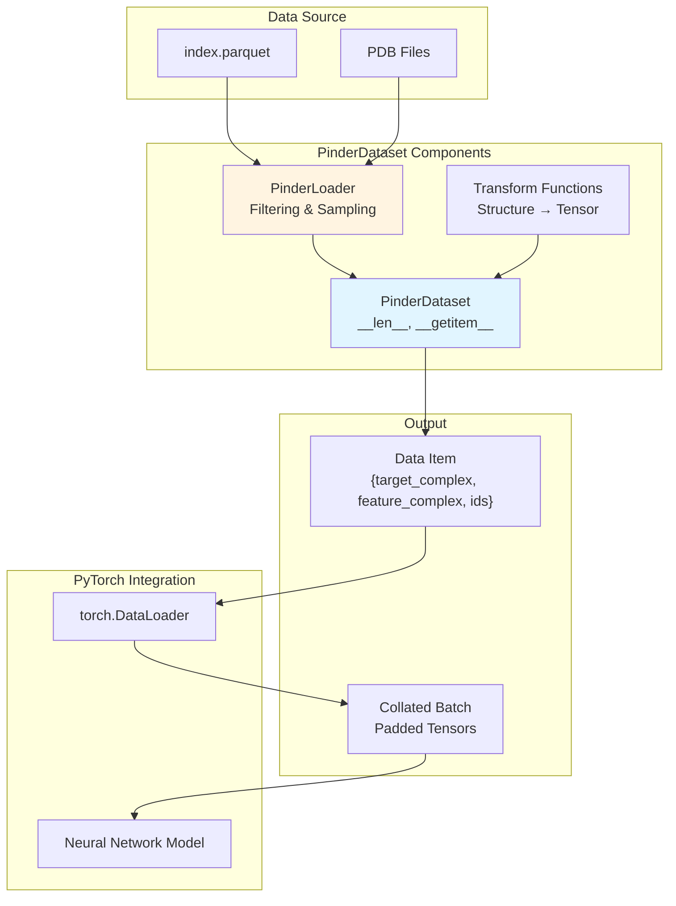
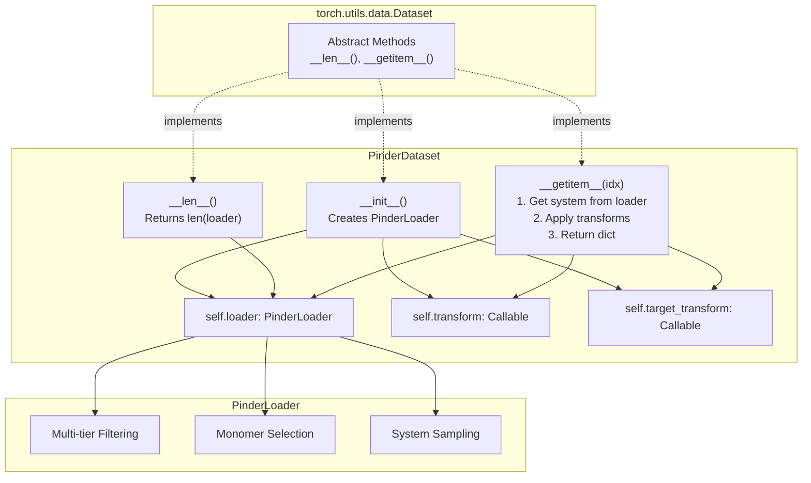
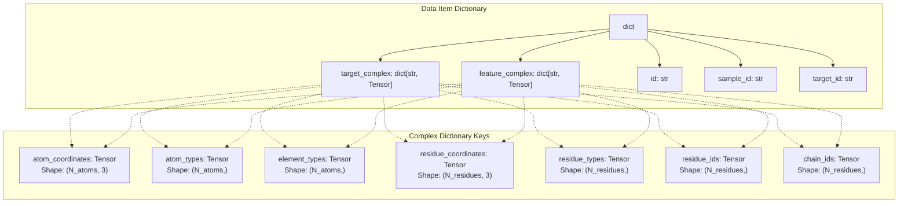
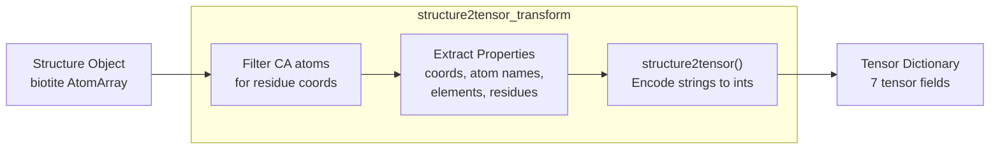
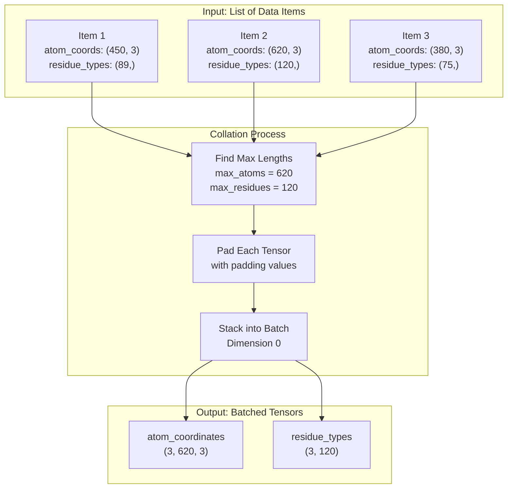
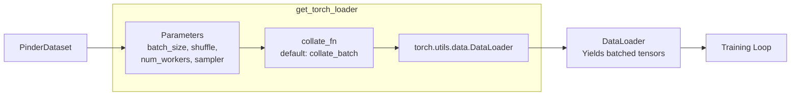
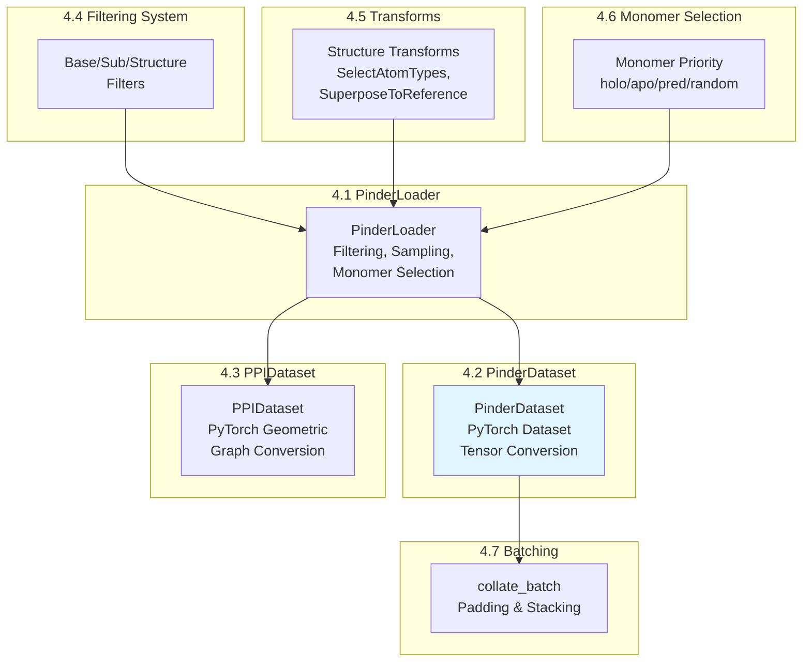

# PinderDataset

<details>
<summary>Relevant source files</summary>

The following files were used as context for generating this wiki page:

- [src/pinder-core/pinder/core/loader/dataset.py](src/pinder-core/pinder/core/loader/dataset.py)
- [tests/core/loader/test_dataset.py](tests/core/loader/test_dataset.py)

</details>


**PinderDataset** is a PyTorch `Dataset` implementation that converts PINDER protein systems into dictionary-based tensor structures suitable for training standard neural networks. This class provides a bridge between the `PinderLoader` filtering and sampling system and PyTorch's data loading infrastructure.

**Scope**: This page covers the `PinderDataset` class, its tensor output format, transformation pipeline, and batching/collation mechanisms. For graph neural network datasets, see [PPIDataset](#4.3). For the underlying filtering and monomer selection system, see [PinderLoader](#4.1).

## Overview

`PinderDataset` wraps `PinderLoader` to provide a PyTorch-compatible interface for PINDER data. It handles the conversion from `Structure` objects to tensors and manages the complexity of working with multiple structural variants (holo/apo/predicted) per system.



**Sources**: [src/pinder-core/pinder/core/loader/dataset.py:1-19](), [src/pinder-core/pinder/core/loader/dataset.py:246-318]()

## Class Structure

The `PinderDataset` class inherits from `torch.utils.data.Dataset` and delegates most of the heavy lifting to `PinderLoader`:



**Sources**: [src/pinder-core/pinder/core/loader/dataset.py:246-318](), [src/pinder-core/pinder/core/loader/dataset.py:296-297]()

## Initialization Parameters

The `PinderDataset.__init__` method accepts parameters that control filtering, sampling, and transformation:

| Parameter Category | Parameters | Description |
|-------------------|------------|-------------|
| **Data Selection** | `split`, `index`, `metadata`, `ids` | Control which systems to include |
| **Filtering** | `base_filters`, `sub_filters`, `structure_filters` | Three-tier filtering system (see [Filtering System](#4.4)) |
| **Monomer Selection** | `monomer_priority`, `fallback_to_holo`, `use_canonical_apo`, `pre_specified_monomers` | Control which structural variant to use (see [Monomer Selection](#4.6)) |
| **Structure Processing** | `structure_transforms_target`, `structure_transforms_feature`, `crop_equal_monomer_shapes` | Applied to `Structure` objects before tensor conversion |
| **Tensor Transforms** | `transform`, `target_transform` | Convert `Structure` to tensors (default: `structure2tensor_transform`) |
| **Queries** | `index_query`, `metadata_query` | Pandas query strings for additional filtering |

**Sources**: [src/pinder-core/pinder/core/loader/dataset.py:246-295]()

### Key Parameter Details

**Monomer Priority**: Determines which structural variant to use for feature complex (target is always holo):

```python
# Use bound structures
dataset = PinderDataset(split="train", monomer_priority="holo")

# Use unbound structures when available
dataset = PinderDataset(split="train", monomer_priority="apo")

# Use AlphaFold2 predictions
dataset = PinderDataset(split="train", monomer_priority="pred")

# Randomly mix holo/apo/pred
dataset = PinderDataset(split="train", monomer_priority="random_mixed")
```

**Transform Functions**: Control tensor conversion:

```python
def custom_transform(structure: Structure) -> dict[str, torch.Tensor]:
    # Custom conversion logic
    return {
        "coords": torch.tensor(structure.coords),
        "seq": torch.tensor(structure.atom_array.res_name)
    }

dataset = PinderDataset(
    split="train",
    transform=custom_transform,
    target_transform=custom_transform
)
```

**Sources**: [src/pinder-core/pinder/core/loader/dataset.py:252-253](), [src/pinder-core/pinder/core/loader/dataset.py:258-263](), [tests/core/loader/test_dataset.py:158-190]()

## Data Item Structure

The `__getitem__` method returns a dictionary with the following structure:



**Sources**: [src/pinder-core/pinder/core/loader/dataset.py:299-318](), [tests/core/loader/test_dataset.py:21-29](), [tests/core/loader/test_dataset.py:176-189]()

### Field Descriptions

| Field | Type | Description |
|-------|------|-------------|
| `target_complex` | `dict[str, Tensor]` | Ground truth holo complex with receptor and ligand bound |
| `feature_complex` | `dict[str, Tensor]` | Input complex (holo/apo/pred based on `monomer_priority`) |
| `id` | `str` | Original PINDER system ID (e.g., `"3s9d__B1_P48551--3s9d__A1_P01563"`) |
| `sample_id` | `str` | Pinder ID of the sampled feature complex |
| `target_id` | `str` | Pinder ID of the target complex |

Each complex dictionary contains:

| Key | Shape | Data Type | Description |
|-----|-------|-----------|-------------|
| `atom_coordinates` | `(N_atoms, 3)` | `float32` | XYZ coordinates in Ångströms |
| `atom_types` | `(N_atoms,)` | Encoded strings | Atom names (CA, CB, N, etc.) |
| `element_types` | `(N_atoms,)` | Encoded strings | Element symbols (C, N, O, etc.) |
| `residue_coordinates` | `(N_residues, 3)` | `float32` | C-alpha coordinates |
| `residue_types` | `(N_residues,)` | Encoded strings | Residue names (ALA, GLY, etc.) |
| `residue_ids` | `(N_residues,)` | `int64` | Residue numbers |
| `chain_ids` | `(N_residues,)` | Encoded strings | Chain identifiers |

**Sources**: [src/pinder-core/pinder/core/loader/dataset.py:55-66](), [tests/core/loader/test_dataset.py:176-189]()

## Transform System

The default transform function `structure2tensor_transform` converts `Structure` objects to tensor dictionaries:



**Sources**: [src/pinder-core/pinder/core/loader/dataset.py:55-66]()

### Custom Transforms

Users can provide custom transform functions to modify tensor representations:

```python
from pinder.core.loader.structure import Structure
import torch

def minimal_transform(structure: Structure) -> dict[str, torch.Tensor]:
    """Only return coordinates and residue types."""
    calpha = structure.filter("atom_name", mask=["CA"])
    return {
        "coords": torch.tensor(calpha.coords, dtype=torch.float32),
        "residues": torch.tensor(
            calpha.atom_array.res_name,
            dtype=torch.long
        )
    }

dataset = PinderDataset(
    split="train",
    transform=minimal_transform,
    target_transform=minimal_transform
)
```

**Note**: The `transform` function applies to the feature complex, while `target_transform` applies to the target complex. Both default to `structure2tensor_transform`.

**Sources**: [src/pinder-core/pinder/core/loader/dataset.py:258-263](), [src/pinder-core/pinder/core/loader/dataset.py:305-308]()

## Batching and Collation

Variable-sized protein structures require special handling for mini-batch training. The `collate_batch` function pads tensors to uniform dimensions:



**Sources**: [src/pinder-core/pinder/core/loader/dataset.py:205-243](), [src/pinder-core/pinder/core/loader/dataset.py:122-162]()

### Padding Values

Different tensor types use different padding values to distinguish padding from real data:

| Tensor Type | Padding Value | Constant |
|-------------|---------------|----------|
| Coordinates | `-100` | `COORDS_PAD_VALUE` |
| Atom Types | `-1` | `ATOM_TYPE_PAD_VALUE` |
| Element Types | `-1` | `ELEMENT_TYPE_PAD_VALUE` |
| Residue IDs | `-99` | `RES_IDX_PAD_VALUE` |
| Chain IDs | `-1` | `CHAIN_ID_PAD_VALUE` |

**Sources**: [src/pinder-core/pinder/core/loader/dataset.py:46-51](), [src/pinder-core/pinder/core/loader/dataset.py:165-202]()

### Collation Functions

The module provides three collation utilities:

**`pad_to_max_length`**: Pads a single tensor to specified dimensions
```python
# Example: Pad tensor from (450, 3) to (620, 3)
padded = pad_to_max_length(
    mat=coords_tensor,
    max_length=620,
    dims=[0],
    value=-100
)
```

**`pad_and_stack`**: Pads and stacks a list of tensors
```python
# Example: Batch atom coordinates
batched = pad_and_stack(
    tensors=[coords1, coords2, coords3],
    dim=0,
    dims_to_pad=[0, 1],
    value=-100
)
# Output shape: (3, max_atoms, max_dims)
```

**`collate_batch`**: Main collation function for DataLoader
```python
# Used automatically by DataLoader
loader = get_torch_loader(
    dataset,
    batch_size=4,
    collate_fn=collate_batch  # default
)
```

**Sources**: [src/pinder-core/pinder/core/loader/dataset.py:69-163](), [src/pinder-core/pinder/core/loader/dataset.py:205-243]()

## Creating DataLoaders

The `get_torch_loader` helper function creates PyTorch DataLoaders with appropriate defaults:



**Sources**: [src/pinder-core/pinder/core/loader/dataset.py:637-654]()

### Basic Usage

```python
from pinder.core.loader.dataset import PinderDataset, get_torch_loader

# Create dataset
dataset = PinderDataset(
    split="train",
    monomer_priority="holo"
)

# Create loader
loader = get_torch_loader(
    dataset,
    batch_size=4,
    shuffle=True,
    num_workers=2
)

# Training loop
for batch in loader:
    target = batch["target_complex"]
    features = batch["feature_complex"]
    ids = batch["id"]
    
    # target["atom_coordinates"] has shape (4, N, 3)
    # where N is max atoms in batch
```

**Sources**: [tests/core/loader/test_dataset.py:203-228]()

### Advanced Configuration

```python
from torch.utils.data import WeightedRandomSampler

# Custom sampler for class imbalance
weights = compute_sample_weights(dataset)
sampler = WeightedRandomSampler(weights, len(dataset))

# Custom collation for different output format
def custom_collate(batch):
    # Your custom batching logic
    return collated_output

loader = get_torch_loader(
    dataset,
    batch_size=8,
    sampler=sampler,  # Don't set shuffle=True with sampler
    num_workers=4,
    collate_fn=custom_collate,
    pin_memory=True,  # Additional kwargs passed to DataLoader
    persistent_workers=True
)
```

**Sources**: [src/pinder-core/pinder/core/loader/dataset.py:637-654]()

## Usage Examples

### Example 1: Basic Training Dataset

```python
from pinder.core.loader.dataset import PinderDataset, get_torch_loader

# Create training dataset with holo monomers
train_dataset = PinderDataset(
    split="train",
    monomer_priority="holo"
)

# Create validation dataset
val_dataset = PinderDataset(
    split="val",
    monomer_priority="holo"
)

# Create loaders
train_loader = get_torch_loader(
    train_dataset,
    batch_size=16,
    shuffle=True,
    num_workers=4
)

val_loader = get_torch_loader(
    val_dataset,
    batch_size=32,
    shuffle=False,
    num_workers=4
)

print(f"Training batches: {len(train_loader)}")
print(f"Validation batches: {len(val_loader)}")
```

**Sources**: [tests/core/loader/test_dataset.py:168-190](), [tests/core/loader/test_dataset.py:203-228]()

### Example 2: Filtered Dataset with Custom Transforms

```python
from pinder.core.loader.dataset import PinderDataset, get_torch_loader
from pinder.core.loader.filters import FilterByMissingHolo
from pinder.core.loader.transforms import SelectAtomTypes

# Define filters
filters = [
    FilterByMissingHolo()
]

# Define structure transforms
transforms = [
    SelectAtomTypes(atom_types=["CA"])  # Only C-alpha atoms
]

# Custom tensor transform
def backbone_only_transform(structure):
    from pinder.core.loader.geodata import structure2tensor
    return structure2tensor(
        atom_coordinates=structure.coords,
        atom_types=structure.atom_array.atom_name,
        element_types=structure.atom_array.element,
        residue_coordinates=structure.coords,  # All are C-alpha
        residue_types=structure.atom_array.res_name,
        residue_ids=structure.atom_array.res_id,
        chain_ids=structure.atom_array.chain_id,
    )

dataset = PinderDataset(
    split="train",
    base_filters=filters,
    structure_transforms_feature=transforms,
    structure_transforms_target=transforms,
    transform=backbone_only_transform,
    target_transform=backbone_only_transform,
    monomer_priority="apo"
)

loader = get_torch_loader(dataset, batch_size=8)
```

**Sources**: [src/pinder-core/pinder/core/loader/dataset.py:246-295]()

### Example 3: Specific System IDs

```python
from pinder.core.loader.dataset import PinderDataset

# Train on specific systems
target_ids = [
    "7mbm__I1_P84233--7mbm__J1_P62799",
    "3s9d__B1_P48551--3s9d__A1_P01563"
]

dataset = PinderDataset(
    ids=target_ids,
    monomer_priority="random_mixed"  # Mix holo/apo/pred
)

# Access specific item
item = dataset[0]
print(f"System ID: {item['id']}")
print(f"Sample ID: {item['sample_id']}")
print(f"Atom coordinates shape: {item['feature_complex']['atom_coordinates'].shape}")
```

**Sources**: [tests/core/loader/test_dataset.py:164-190]()

### Example 4: Query-Based Filtering

```python
from pinder.core.loader.dataset import PinderDataset

# Use pandas query syntax for complex filtering
dataset = PinderDataset(
    split="train",
    index_query='length1 < 300 and length2 < 300',  # Small proteins
    metadata_query='chain_1.pfam_id == "PF00001"',  # Specific Pfam domain
    monomer_priority="holo"
)

print(f"Filtered dataset size: {len(dataset)}")
```

**Sources**: [src/pinder-core/pinder/core/loader/dataset.py:268-269]()

## Relationship to Other Components



**Sources**: [src/pinder-core/pinder/core/loader/dataset.py:1-19]()

### Key Differences from PPIDataset

| Aspect | PinderDataset | PPIDataset |
|--------|---------------|------------|
| **Base Class** | `torch.utils.data.Dataset` | `torch_geometric.data.Dataset` |
| **Output Format** | Dictionary of tensors | `HeteroData` graph object |
| **Use Case** | Standard neural networks (CNNs, Transformers) | Graph neural networks |
| **Node Types** | Not applicable | Separate receptor/ligand nodes at atom/residue level |
| **Edges** | Not applicable | K-nearest neighbor edges |
| **Collation** | Custom padding via `collate_batch` | Graph batching via PyTorch Geometric |

For graph-based models, use [PPIDataset](#4.3). For tensor-based models, use `PinderDataset`.

**Sources**: [src/pinder-core/pinder/core/loader/dataset.py:1-19](), [src/pinder-core/pinder/core/loader/dataset.py:246-318]()

---