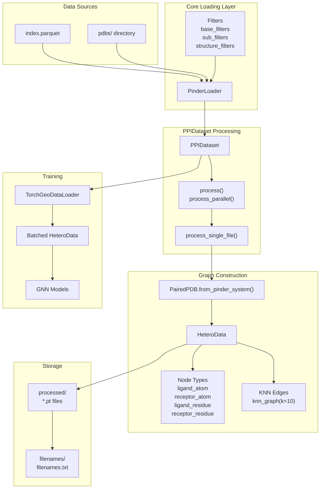
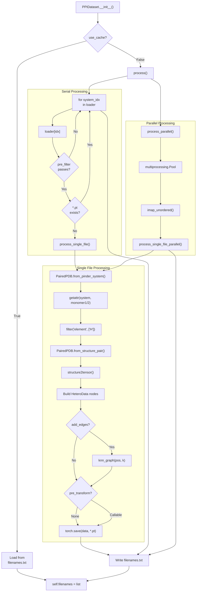
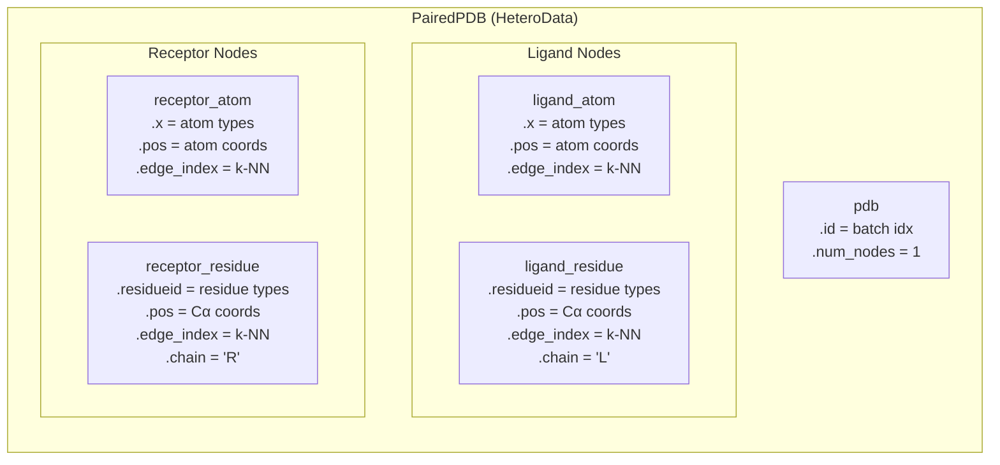

# PPIDataset

<details>
<summary>Relevant source files</summary>

The following files were used as context for generating this wiki page:

- [src/pinder-core/pinder/core/loader/dataset.py](src/pinder-core/pinder/core/loader/dataset.py)
- [src/pinder-core/pinder/core/loader/geodata.py](src/pinder-core/pinder/core/loader/geodata.py)
- [tests/core/loader/test_dataset.py](tests/core/loader/test_dataset.py)

</details>


**PPIDataset** is a PyTorch Geometric `Dataset` implementation that converts protein-protein interaction systems from PINDER into heterogeneous graph representations (`HeteroData`) for use with graph neural networks. It processes `PinderSystem` objects into graph-based structures suitable for training geometric deep learning models.

For tensor-based models using standard PyTorch, see [PinderDataset](#4.2). For the underlying data loading infrastructure, see [PinderLoader](#4.1).

## Purpose and Scope

`PPIDataset` serves as a bridge between the PINDER dataset and PyTorch Geometric's graph neural network ecosystem. It:

- Extends `torch_geometric.data.Dataset` to provide graph-based data loading
- Converts protein structures into `PairedPDB` (a `HeteroData` subclass) with separate node types for receptor/ligand atoms and residues
- Supports preprocessing, caching, and parallel processing of protein complexes
- Enables k-nearest neighbor edge construction for spatial graph connectivity
- Integrates with `torch_geometric.loader.DataLoader` for batched graph training

**Sources:** [src/pinder-core/pinder/core/loader/dataset.py:1-19](), [src/pinder-core/pinder/core/loader/dataset.py:320-346]()

## Architecture Overview

The following diagram shows how `PPIDataset` fits into the data loading architecture:



**Sources:** [src/pinder-core/pinder/core/loader/dataset.py:320-404](), [src/pinder-core/pinder/core/loader/geodata.py:79-177]()

## Initialization and Configuration

### Constructor Parameters

The `PPIDataset` constructor accepts the following key parameters:

| Parameter | Type | Default | Description |
|-----------|------|---------|-------------|
| `node_types` | `set[NodeRepresentation]` | Required | Set of node representations to include (`Atom`, `Residue`, `Surface`) |
| `split` | `str` | `"train"` | Dataset split to load (`"train"`, `"val"`, `"test"`) |
| `monomer1` | `str` | `"holo_receptor"` | Monomer type for receptor (e.g., `"apo_receptor"`, `"pred_receptor"`) |
| `monomer2` | `str` | `"holo_ligand"` | Monomer type for ligand |
| `base_filters` | `list[PinderFilterBase]` | `[]` | System-level filters |
| `sub_filters` | `list[PinderFilterSubBase]` | `[]` | Monomer-level filters |
| `structure_filters` | `list[StructureFilter]` | `[]` | Structure-level filters |
| `root` | `Path` | `get_pinder_location()` | Root directory for dataset storage |
| `k` | `int` | `10` | Number of nearest neighbors for edge construction |
| `add_edges` | `bool` | `True` | Whether to add k-NN edges to graphs |
| `parallel` | `bool` | `False` | Enable parallel processing |
| `max_workers` | `int \| None` | `None` | Number of parallel workers |
| `use_cache` | `bool` | `False` | Use pre-existing processed files |
| `force_reload` | `bool` | `False` | Reprocess all systems even if cached |

The `monomer1` and `monomer2` parameters determine the `monomer_priority` strategy passed to the underlying `PinderLoader`. If both use the same type (e.g., both `"holo_*"`), that type is used as priority. If they differ, `"random_mixed"` priority is used.

**Sources:** [src/pinder-core/pinder/core/loader/dataset.py:321-404](), [src/pinder-core/pinder/core/loader/dataset.py:382-398]()

### Node Representation Types

The `NodeRepresentation` enum defines three possible node types:

```python
class NodeRepresentation(Enum):
    Surface = "surface"
    Atom = "atom"
    Residue = "residue"
```

Each node type creates corresponding graph node groups in the `HeteroData` structure:
- `Atom`: Creates `ligand_atom` and `receptor_atom` node types with atomic coordinates and atom type features
- `Residue`: Creates `ligand_residue` and `receptor_residue` node types with Cα coordinates and residue type features
- `Surface`: Reserved for surface representation (not currently implemented in main processing)

**Sources:** [src/pinder-core/pinder/core/loader/geodata.py:73-77]()

## Data Processing Pipeline

### Processing Flow

The diagram below illustrates the processing pipeline from `PinderSystem` to cached `HeteroData`:



**Sources:** [src/pinder-core/pinder/core/loader/dataset.py:543-595](), [src/pinder-core/pinder/core/loader/dataset.py:417-510]()

### Processing Methods

#### `process()` - Serial Processing

The main processing method iterates through the `PinderLoader` and processes each system:

```python
def process(self) -> None:
    for system_idx in range(len(self.loader)):
        system, _, _ = self.loader[system_idx]
        if self.pre_filter is not None and not self.pre_filter(system):
            continue
        
        pinder_id = system.entry.id
        to_write = Path(self.processed_dir) / f"{pinder_id}.pt"
        if to_write.exists() and not self.force_reload:
            self.filenames.add(pinder_id)
            continue
            
        processed = PPIDataset.process_single_file(...)
        if processed:
            self.filenames.add(pinder_id)
```

**Sources:** [src/pinder-core/pinder/core/loader/dataset.py:543-595]()

#### `process_parallel()` - Parallel Processing

For large-scale processing, parallel mode uses multiprocessing to process systems concurrently:

```python
def process_parallel(self) -> None:
    with multiprocessing.get_context("spawn").Pool(processes=self.max_workers) as p:
        args_gen = (
            (system_index, self.loader, self.node_types, ...)
            for system_index in range(len(self.loader))
        )
        for processed_id in p.imap_unordered(
            PPIDataset.process_single_file_parallel, args_gen
        ):
            if isinstance(processed_id, str):
                processed_ids.add(processed_id)
```

**Sources:** [src/pinder-core/pinder/core/loader/dataset.py:511-542]()

#### `process_single_file()` - Core Conversion

Converts a single `PinderSystem` to a `PairedPDB` graph:

1. Calls `PairedPDB.from_pinder_system()` to create the graph
2. Applies optional `pre_transform` callable
3. Saves the result with `torch.save(data, output_file)`

**Sources:** [src/pinder-core/pinder/core/loader/dataset.py:417-446]()

## Graph Representation (PairedPDB)

### HeteroData Structure

`PairedPDB` is a subclass of `torch_geometric.data.HeteroData` that represents a protein complex as a heterogeneous graph with distinct node types:



**Sources:** [src/pinder-core/pinder/core/loader/geodata.py:79-177]()

### Construction from PinderSystem

The `PairedPDB.from_pinder_system()` class method creates graphs from protein systems:

```python
@classmethod
def from_pinder_system(
    cls,
    system: PinderSystem,
    node_types: set[NodeRepresentation],
    monomer1: str = "holo_receptor",
    monomer2: str = "holo_ligand",
    add_edges: bool = True,
    k: int = 10,
    fallback_to_holo: bool = True,
) -> PairedPDB:
    chain1_struc = getattr(system, monomer1)
    if chain1_struc is None and fallback_to_holo:
        chain1_struc = getattr(system, "holo_receptor")
    chain1_struc.filter("element", mask=["H"], negate=True, copy=False)
    
    # Similar for chain2_struc
    
    return cls.from_structure_pair(
        node_types=node_types,
        ligand=chain2_struc,
        receptor=chain1_struc,
        add_edges=add_edges,
        k=k,
    )
```

Key steps:
1. Extract specified monomers from `PinderSystem` (e.g., `holo_receptor`, `apo_ligand`)
2. Fallback to holo structures if requested monomer is unavailable
3. Filter out hydrogen atoms
4. Delegate to `from_structure_pair()` for graph construction

**Sources:** [src/pinder-core/pinder/core/loader/geodata.py:80-107]()

### Tensor Conversion

The `structure2tensor()` function converts biotite `AtomArray` data to PyTorch tensors:

```python
def structure2tensor(
    atom_coordinates: NDArray[np.double] | None = None,
    atom_types: NDArray[np.str_] | None = None,
    element_types: NDArray[np.str_] | None = None,
    residue_coordinates: NDArray[np.double] | None = None,
    residue_ids: NDArray[np.int_] | None = None,
    residue_types: NDArray[np.str_] | None = None,
    chain_ids: NDArray[np.str_] | None = None,
    dtype: torch.dtype = torch.float32,
) -> dict[str, torch.Tensor]:
```

This function:
- Maps atom names to indices using `pc.ALL_ATOM_POSNS` constants
- Maps element symbols to indices using `pc.ELE2NUM`
- Maps residue names to indices using `pc.AA_TO_INDEX`
- Converts coordinates and IDs to tensors with specified dtype

**Sources:** [src/pinder-core/pinder/core/loader/geodata.py:30-71]()

### Edge Construction

When `add_edges=True` and `torch-cluster` is installed, k-nearest neighbor edges are added:

```python
if NodeRepresentation.Residue in node_types:
    graph["ligand_residue"].residueid = lig_props["residue_types"]
    graph["ligand_residue"].pos = lig_props["residue_coordinates"]
    if add_edges and torch_cluster_installed:
        graph["ligand_residue"].edge_index = knn_graph(
            graph["ligand_residue"].pos, k=k
        )
```

The `knn_graph()` function from `torch_cluster` computes k-NN edges based on spatial distance between node positions.

**Sources:** [src/pinder-core/pinder/core/loader/geodata.py:140-164]()

## Caching and Storage

### Directory Structure

`PPIDataset` uses the following directory layout:

```
{root}/
├── processed/
│   ├── 7mbm__I1_P84233--7mbm__J1_P62799.pt
│   ├── 3s9d__B1_P48551--3s9d__A1_P01563.pt
│   └── ...
└── filenames/
    └── filenames.txt
```

- `processed/`: Contains serialized `.pt` files, one per PINDER system
- `filenames/`: Contains `filenames.txt` listing successfully processed IDs
- Each `.pt` file stores a `PairedPDB` object via `torch.save()`

**Sources:** [src/pinder-core/pinder/core/loader/dataset.py:368-380](), [src/pinder-core/pinder/core/loader/dataset.py:586-587]()

### Cache Management

The `use_cache` and `force_reload` parameters control caching behavior:

| `use_cache` | `force_reload` | Behavior |
|-------------|----------------|----------|
| `False` | `False` | Process missing files, skip existing |
| `False` | `True` | Reprocess all files |
| `True` | `False` | Load from `filenames.txt`, skip processing |
| `True` | `True` | Not typical; `force_reload` takes precedence in processing |

Pre-cached IDs are identified by finding existing `.pt` files:

```python
processed_dir = Path(root) / "processed"
processed_ids = {x.stem for x in Path(processed_dir).glob("*.pt")}
self.ids_to_process = list(set(self.ids) - processed_ids)
```

**Sources:** [src/pinder-core/pinder/core/loader/dataset.py:374-380](), [src/pinder-core/pinder/core/loader/dataset.py:588-594]()

### Data Access Methods

#### `get(idx: int) -> PairedPDB`

Retrieves a graph by index:

```python
def get(self, idx: int) -> PairedPDB:
    filename = self.filenames[idx]
    pt_file = Path(self.processed_dir) / f"{filename}.pt"
    data = self.load_filename(pt_file, idx)
    return data
```

#### `get_filename(filename: str) -> PairedPDB`

Retrieves a graph by PINDER ID:

```python
def get_filename(self, filename: str) -> PairedPDB:
    idx = self.get_filename_idx(filename)
    return self.get(idx)
```

#### `load_filename(filename: Path, idx: int) -> PairedPDB`

Loads and post-processes a saved graph:

```python
@staticmethod
def load_filename(filename: Path, idx: int) -> PairedPDB:
    data = torch.load(filename)
    data["pdb"].id = torch.tensor([idx]).type(torch.int32)
    data["pdb"].num_nodes = 1
    return data
```

**Sources:** [src/pinder-core/pinder/core/loader/dataset.py:599-622]()

## Integration with DataLoader

### Creating a DataLoader

The `get_geo_loader()` helper creates a `TorchGeoDataLoader`:

```python
def get_geo_loader(
    dataset: PPIDataset, 
    batch_size: int = 2, 
    num_workers: int = 1
) -> TorchGeoDataLoader:
    return TorchGeoDataLoader(
        dataset,
        batch_size=batch_size,
        shuffle=True,
        drop_last=True,
        num_workers=num_workers,
    )
```

**Sources:** [src/pinder-core/pinder/core/loader/dataset.py:625-634]()

### Batching Behavior

PyTorch Geometric's `DataLoader` automatically batches `HeteroData` objects by:
1. Concatenating node features along the node dimension
2. Offsetting edge indices to account for batched node indices
3. Adding a `batch` tensor to track which nodes belong to which graph

Example batched structure:

```
Before batching:
  Graph 1: ligand_atom.pos.shape = (100, 3)
  Graph 2: ligand_atom.pos.shape = (120, 3)

After batching (batch_size=2):
  Batch: ligand_atom.pos.shape = (220, 3)
         ligand_atom.batch = [0, 0, ..., 0, 1, 1, ..., 1]
```

**Sources:** [tests/core/loader/test_dataset.py:150-156]()

## Usage Examples

### Basic Usage

```python
from pinder.core.loader.dataset import PPIDataset, get_geo_loader
from pinder.core.loader.geodata import NodeRepresentation

# Create dataset with atom and residue nodes
nodes = {NodeRepresentation.Atom, NodeRepresentation.Residue}
dataset = PPIDataset(
    node_types=nodes,
    split="train",
    monomer1="holo_receptor",
    monomer2="holo_ligand",
    k=10,
    add_edges=True,
)

# Create dataloader
loader = get_geo_loader(dataset, batch_size=4, num_workers=2)

# Iterate
for batch in loader:
    # batch is a batched HeteroData object
    print(batch.num_nodes)  # Total nodes across batch
    print(batch["ligand_atom"].pos.shape)  # Atom coordinates
    print(batch["receptor_residue"].residueid.shape)  # Residue types
```

### Filtering and Custom Monomers

```python
from pinder.core.loader.filters import FilterByMissingHolo

# Use apo structures with filtering
dataset = PPIDataset(
    node_types={NodeRepresentation.Residue},
    split="val",
    monomer1="apo_receptor",
    monomer2="apo_ligand",
    base_filters=[FilterByMissingHolo(max_length=2)],
    fallback_to_holo=True,  # Fallback if apo unavailable
)
```

### Parallel Processing

```python
# Process large training set in parallel
dataset = PPIDataset(
    node_types={NodeRepresentation.Atom},
    split="train",
    parallel=True,
    max_workers=8,
    force_reload=False,  # Use cached when available
)
```

### Accessing Specific Systems

```python
# Get by index
first_graph = dataset[0]

# Get by PINDER ID
specific_graph = dataset.get_filename("7mbm__I1_P84233--7mbm__J1_P62799")
print(specific_graph.num_nodes)
print(specific_graph.node_types)
```

**Sources:** [tests/core/loader/test_dataset.py:87-156]()

## Advanced Topics

### Pre-filtering and Pre-transformation

The `pre_filter` and `pre_transform` callbacks allow custom processing:

```python
def my_pre_filter(system: PinderSystem) -> bool:
    # Only include systems with certain properties
    return system.entry.method == "X-RAY DIFFRACTION"

def my_pre_transform(data: PairedPDB) -> PairedPDB:
    # Normalize coordinates
    data["ligand_atom"].pos = data["ligand_atom"].pos - data["ligand_atom"].pos.mean(0)
    return data

dataset = PPIDataset(
    node_types={NodeRepresentation.Atom},
    split="train",
    pre_filter=my_pre_filter,
    pre_transform=my_pre_transform,
)
```

- `pre_filter`: Applied during processing; systems that return `False` are skipped
- `pre_transform`: Applied after graph construction but before saving

**Sources:** [src/pinder-core/pinder/core/loader/dataset.py:333](), [src/pinder-core/pinder/core/loader/dataset.py:427](), [src/pinder-core/pinder/core/loader/dataset.py:439-440]()

### Repeat Sampling

The `repeat` parameter allows each system to appear multiple times in the dataset:

```python
dataset = PPIDataset(
    node_types={NodeRepresentation.Atom},
    split="train",
    repeat=3,  # Each system appears 3 times
)

# Dataset length is multiplied by repeat factor
print(len(dataset))  # 3x the number of processed systems
```

This is useful for:
- Balancing dataset sizes across epochs
- Applying stochastic augmentations multiple times to the same structure

**Sources:** [src/pinder-core/pinder/core/loader/dataset.py:337](), [src/pinder-core/pinder/core/loader/dataset.py:539](), [src/pinder-core/pinder/core/loader/dataset.py:583-584]()

### Limiting Dataset Size

The `limit_by` parameter restricts processing to a subset:

```python
# Only process first 100 systems (useful for debugging)
dataset = PPIDataset(
    node_types={NodeRepresentation.Atom},
    split="train",
    limit_by=100,
)
```

**Sources:** [src/pinder-core/pinder/core/loader/dataset.py:334](), [src/pinder-core/pinder/core/loader/dataset.py:549-551]()

### Properties and Methods

#### `raw_file_names`

Returns the list of PINDER IDs to process:

```python
@property
def raw_file_names(self) -> list[str]:
    return sorted(self.ids) if self.limit_by is None else self.ids[:self.limit_by]
```

#### `processed_file_names`

Returns paths to successfully processed `.pt` files:

```python
@property
def processed_file_names(self) -> list[Path]:
    processed_files = {x.stem: x for x in Path(self.processed_dir).glob("*.pt")}
    return sorted([processed_files[x] for x in self.filenames if x in processed_files])
```

#### `len()`

Returns the number of graphs in the dataset (accounting for `repeat`):

```python
def len(self) -> int:
    return len(self.processed_file_names)
```

**Sources:** [src/pinder-core/pinder/core/loader/dataset.py:406-416](), [src/pinder-core/pinder/core/loader/dataset.py:596-597]()

---