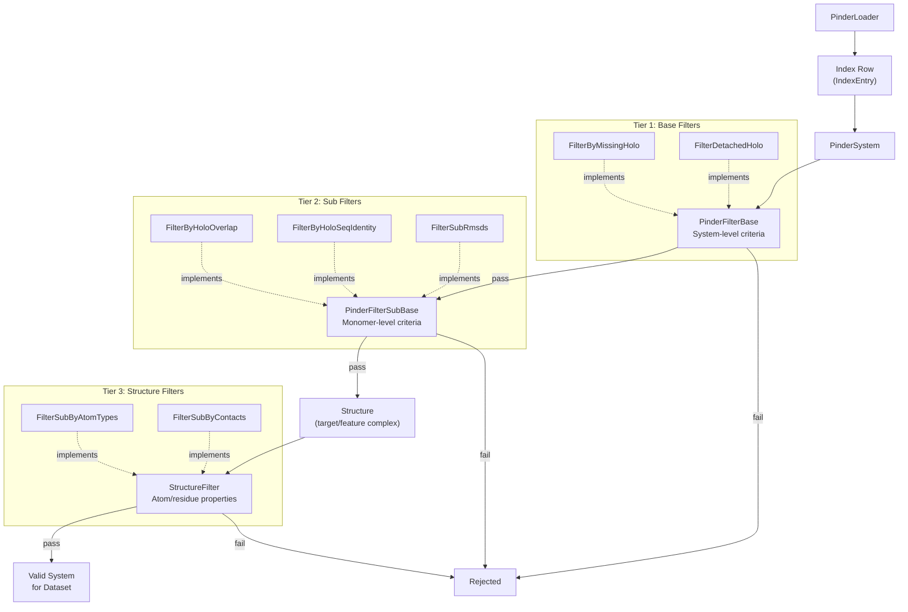
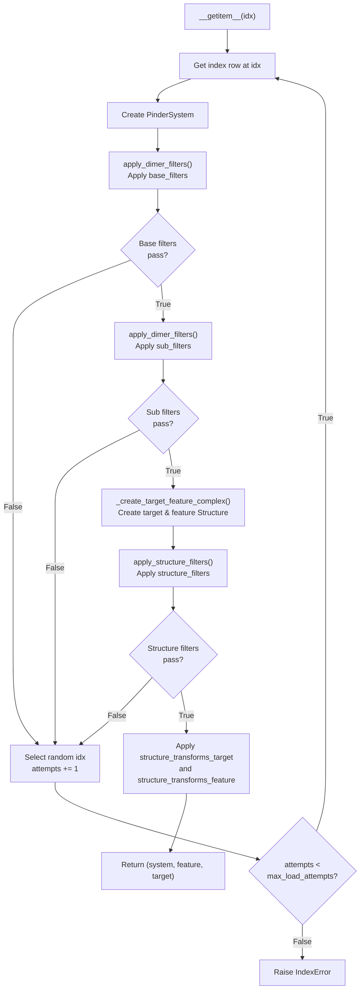
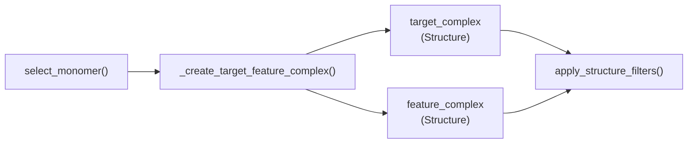
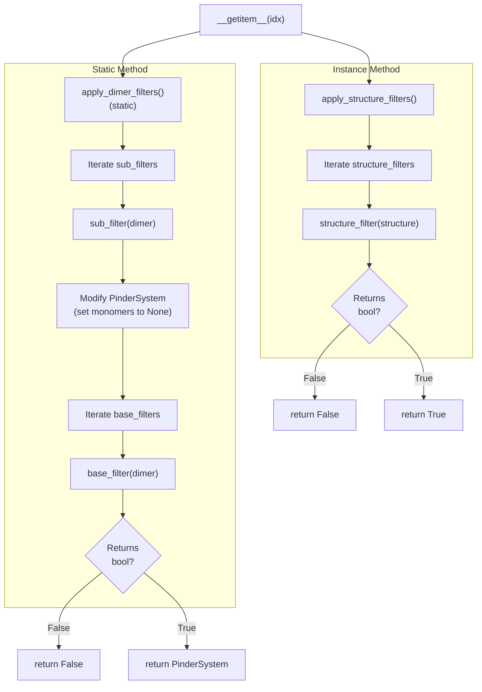

# Filtering System

<details>
<summary>Relevant source files</summary>

The following files were used as context for generating this wiki page:

- [examples/pinder-loader.ipynb](examples/pinder-loader.ipynb)
- [src/pinder-core/pinder/core/loader/loader.py](src/pinder-core/pinder/core/loader/loader.py)
- [src/pinder-core/pinder/core/utils/timer.py](src/pinder-core/pinder/core/utils/timer.py)

</details>


The Filtering System provides a three-tier architecture for quality control and selective processing of protein-protein interaction systems in PINDER. This system enables users to define criteria at the system level (entire PPI complex), monomer level (individual receptor/ligand chains), and structure level (atomic/residue properties) to ensure only high-quality, relevant data is processed by downstream ML pipelines.

For information about how filtered data is loaded and transformed, see [PinderLoader](#4.1). For details on monomer selection strategies that work with filters, see [Monomer Selection Strategies](#4.6).

## Three-Tier Architecture

The filtering system implements three distinct tiers, each operating at a different granularity:



**Sources:** [src/pinder-core/pinder/core/loader/loader.py:200-228](), [examples/pinder-loader.ipynb:458-469]()

## Filter Execution Flow

Filters are applied sequentially during data loading with a retry mechanism to handle filtered-out systems:



**Sources:** [src/pinder-core/pinder/core/loader/loader.py:357-405]()

## Tier 1: Base Filters (System-Level)

Base filters implement the `PinderFilterBase` interface and operate on the entire `PinderSystem` object. They evaluate system-level properties before any monomer selection or complex creation occurs. These filters return a boolean indicating whether the system should be included.

### Base Filter Interface

Base filters must implement a `__call__` method that accepts a `PinderSystem` and returns `bool`:

| Method | Input | Output | Purpose |
|--------|-------|--------|---------|
| `__call__(PinderSystem)` | `PinderSystem` | `bool` | Determine if system passes criteria |

### Common Base Filter Implementations

| Filter Class | Purpose | Key Parameters |
|--------------|---------|----------------|
| `FilterByMissingHolo` | Reject systems missing holo receptor or ligand | None |
| `FilterDetachedHolo` | Reject systems with disconnected receptor/ligand components | `radius`, `max_components` |
| `FilterSubByContacts` | Require minimum interface contacts between chains | `min_contacts`, `radius`, `calpha_only` |

### Example Usage

```python
from pinder.core.loader import filters

base_filters = [
    filters.FilterByMissingHolo(),
    filters.FilterSubByContacts(min_contacts=5, radius=10.0, calpha_only=True),
    filters.FilterDetachedHolo(radius=12, max_components=2),
]
```

**Sources:** [src/pinder-core/pinder/core/loader/loader.py:11-14](), [src/pinder-core/pinder/core/loader/loader.py:415-435](), [examples/pinder-loader.ipynb:458-462]()

## Tier 2: Sub Filters (Monomer-Level)

Sub filters implement the `PinderFilterSubBase` interface and operate on individual monomers (receptor/ligand) within a `PinderSystem`. Unlike base filters, sub filters **modify** the `PinderSystem` by setting monomer properties to `None` when they fail criteria, effectively removing them from consideration.

### Sub Filter Interface

Sub filters must implement a `__call__` method that accepts and returns a `PinderSystem`:

| Method | Input | Output | Purpose |
|--------|-------|--------|---------|
| `__call__(PinderSystem)` | `PinderSystem` | `PinderSystem` | Filter/modify individual monomers |

### Modification Behavior

When a monomer fails a sub filter's criteria, the filter sets the corresponding `PinderSystem` property to `None`:
- `system.apo_receptor = None` if apo receptor fails
- `system.apo_ligand = None` if apo ligand fails  
- `system.pred_receptor = None` if predicted receptor fails
- `system.pred_ligand = None` if predicted ligand fails

This allows subsequent monomer selection logic to fall back to alternative monomer types when `fallback_to_holo=True`.

### Common Sub Filter Implementations

| Filter Class | Purpose | Key Parameters |
|--------------|---------|----------------|
| `FilterSubByAtomTypes` | Require minimum unique atom types in monomer | `min_atom_types` |
| `FilterByHoloOverlap` | Require minimum residue overlap with holo | `min_overlap` |
| `FilterByHoloSeqIdentity` | Require minimum sequence identity to holo | `min_sequence_identity` |
| `FilterSubRmsds` | Require RMSD to holo within threshold | `rmsd_cutoff` |
| `FilterDetachedSub` | Reject monomers with disconnected components | `radius`, `max_components` |

### Example Usage

```python
from pinder.core.loader import filters

sub_filters = [
    filters.FilterSubByAtomTypes(min_atom_types=4),
    filters.FilterByHoloOverlap(min_overlap=5),
    filters.FilterByHoloSeqIdentity(min_sequence_identity=0.8),
    filters.FilterSubRmsds(rmsd_cutoff=7.5),
    filters.FilterDetachedSub(radius=12, max_components=2),
]
```

**Sources:** [src/pinder-core/pinder/core/loader/loader.py:11-14](), [src/pinder-core/pinder/core/loader/loader.py:421-430](), [examples/pinder-loader.ipynb:463-469]()

## Tier 3: Structure Filters (Atom/Residue-Level)

Structure filters implement the `StructureFilter` interface and operate on `Structure` objects (the assembled target and feature complexes). They are applied after monomers are selected and combined into complexes. Structure filters return a boolean indicating whether the complex should be included.

### Structure Filter Interface

Structure filters must implement a `__call__` method that accepts a `Structure` and returns `bool`:

| Method | Input | Output | Purpose |
|--------|-------|--------|---------|
| `__call__(Structure)` | `Structure` | `bool` | Determine if structure passes criteria |

### Application Scope

Structure filters are applied to both the target complex (ground-truth holo dimer) and the feature complex (sampled monomer combination) after they are created:



### Example Usage

Structure filters can enforce constraints on atomic composition, geometry, or other low-level properties:

```python
from pinder.core.loader import filters

structure_filters = [
    # Custom structure filter implementations
]

loader = PinderLoader(
    split="train",
    structure_filters=structure_filters,
)
```

**Sources:** [src/pinder-core/pinder/core/loader/loader.py:11-15](), [src/pinder-core/pinder/core/loader/loader.py:407-413]()

## Filter Integration in PinderLoader

The `PinderLoader` class orchestrates all three filter tiers during data loading:

### Constructor Parameters

| Parameter | Type | Default | Description |
|-----------|------|---------|-------------|
| `base_filters` | `list[PinderFilterBase]` | `[]` | System-level filters |
| `sub_filters` | `list[PinderFilterSubBase]` | `[]` | Monomer-level filters |
| `structure_filters` | `list[StructureFilter]` | `[]` | Structure-level filters |

### Filter Application Methods



**Sources:** [src/pinder-core/pinder/core/loader/loader.py:407-435]()

## Retry Mechanism

When a system fails any filter tier, `PinderLoader` automatically retries with a randomly selected index to prevent dataset iteration failures:

### Configuration

| Parameter | Type | Default | Description |
|-----------|------|---------|-------------|
| `max_load_attempts` | `int` | `10` | Maximum retry attempts before raising `IndexError` |

### Retry Logic

```python
def __getitem__(self, idx: int) -> tuple[PinderSystem, Structure, Structure]:
    valid_idx = False
    attempts = 0
    while not valid_idx and attempts < self.max_load_attempts:
        attempts += 1
        row = self.index.iloc[idx]
        system = PinderSystem(row.id)
        
        # Apply base and sub filters
        system = self.apply_dimer_filters(system, self.base_filters, self.sub_filters)
        if not isinstance(system, PinderSystem):
            idx = random.choice(list(range(len(self))))
            continue
            
        # Create complexes and apply structure filters
        target_complex, feature_complex = _create_target_feature_complex(...)
        valid_idx = self.apply_structure_filters(target_complex)
        if not valid_idx:
            idx = random.choice(list(range(len(self))))
    
    if not valid_idx:
        raise IndexError(
            f"Unable to find valid item after {attempts} attempts!"
        )
```

This mechanism ensures that the dataloader always returns valid items even when many systems are filtered out, at the cost of non-deterministic sampling when filters are strict.

**Sources:** [src/pinder-core/pinder/core/loader/loader.py:357-398]()

## Complete Example

The following example demonstrates using all three filter tiers together:

```python
from pinder.core.loader import filters
from pinder.core.loader.dataset import PinderDataset

# Tier 1: System-level filters
base_filters = [
    filters.FilterByMissingHolo(),
    filters.FilterSubByContacts(min_contacts=5, radius=10.0, calpha_only=True),
    filters.FilterDetachedHolo(radius=12, max_components=2),
]

# Tier 2: Monomer-level filters
sub_filters = [
    filters.FilterSubByAtomTypes(min_atom_types=4),
    filters.FilterByHoloOverlap(min_overlap=5),
    filters.FilterByHoloSeqIdentity(min_sequence_identity=0.8),
    filters.FilterSubRmsds(rmsd_cutoff=7.5),
    filters.FilterDetachedSub(radius=12, max_components=2),
]

# Tier 3: Structure-level filters (if needed)
structure_filters = []

# Create dataset with all filter tiers
train_dataset = PinderDataset(
    split="train",
    monomer_priority="random_mixed",
    base_filters=base_filters,
    sub_filters=sub_filters,
    structure_filters=structure_filters,
)
```

**Sources:** [examples/pinder-loader.ipynb:766-803]()

## Filter Design Patterns

### Cascading Filters

Filters are applied in a specific order to optimize performance:

1. **Base filters** run first on the `PinderSystem` to quickly reject entire systems
2. **Sub filters** run next to prune individual monomers  
3. **Structure filters** run last on assembled complexes (most expensive)

This ordering minimizes expensive structure operations on systems that would be rejected anyway.

### Filter vs Transform

The filtering system is distinct from the transformation system (see [Transforms and Augmentation](#4.5)):

| Aspect | Filters | Transforms |
|--------|---------|------------|
| **Purpose** | Accept/reject data | Modify data |
| **Return** | `bool` or modified `PinderSystem` | Modified `Structure` |
| **When applied** | Before complex creation | After complex creation |
| **Side effects** | May remove systems | Always returns structure |

### Custom Filter Implementation

To implement a custom filter, inherit from the appropriate base class:

```python
from pinder.core.loader.filters import PinderFilterBase

class CustomSystemFilter(PinderFilterBase):
    def __init__(self, custom_param: float):
        self.custom_param = custom_param
    
    def __call__(self, system: PinderSystem) -> bool:
        # Return True to keep, False to reject
        return some_criteria(system, self.custom_param)
```

**Sources:** [src/pinder-core/pinder/core/loader/loader.py:11-15](), [src/pinder-core/pinder/core/loader/loader.py:200-204]()

---