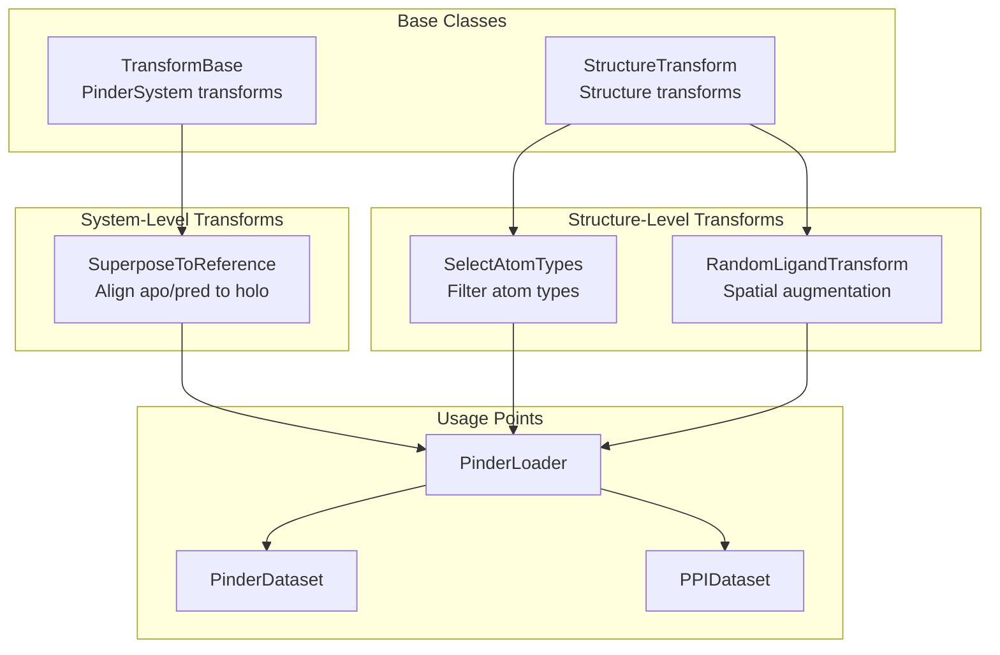
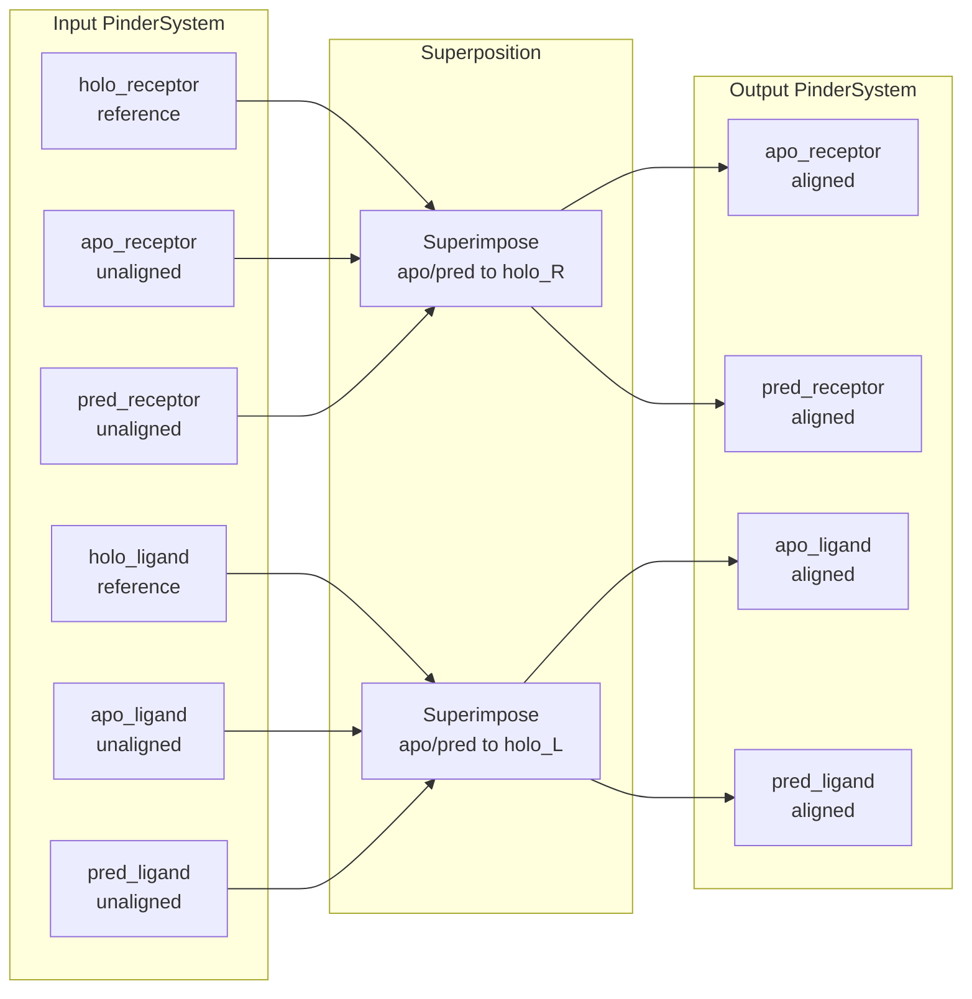
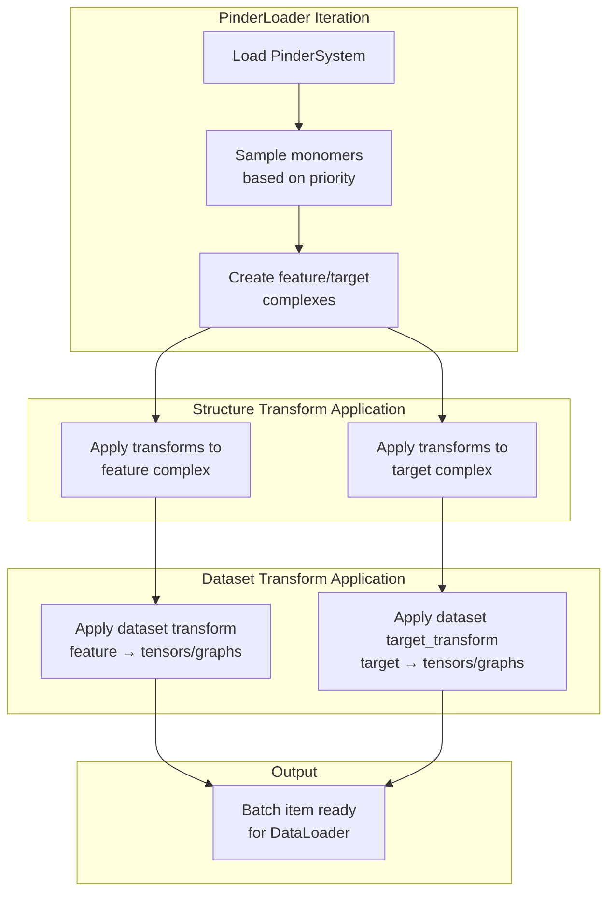

# Transforms and Augmentation

<details>
<summary>Relevant source files</summary>

The following files were used as context for generating this wiki page:

- [examples/pinder-loader.ipynb](examples/pinder-loader.ipynb)
- [src/pinder-core/pinder/core/loader/transforms.py](src/pinder-core/pinder/core/loader/transforms.py)
- [tests/core/loader/test_transforms.py](tests/core/loader/test_transforms.py)

</details>


This page documents the transformation and augmentation system in PINDER. Transforms provide a mechanism to modify protein structures during data loading, enabling atom filtering, spatial alignment, and data augmentation for training machine learning models.

For information about loading and filtering data, see [PinderLoader](#4.1). For details on the dataset classes that apply transforms, see [PinderDataset](#4.2) and [PPIDataset](#4.3).

## Overview

The PINDER transformation system operates at two levels:

1. **System-level transforms** - Operate on `PinderSystem` objects, modifying multiple structures simultaneously
2. **Structure-level transforms** - Operate on individual `Structure` objects, modifying atomic properties

Transforms are applied during data loading to prepare structures for model training, allowing you to standardize representations, reduce computational requirements, and augment training data.

**Sources:** [src/pinder-core/pinder/core/loader/transforms.py:1-96]()

## Transform Architecture



**Sources:** [src/pinder-core/pinder/core/loader/transforms.py:9-28]()

## Transform Types

### TransformBase

The abstract base class for transforms operating on `PinderSystem` objects. Subclasses must implement the `transform` method.

| Method | Arguments | Returns | Purpose |
|--------|-----------|---------|---------|
| `__call__` | `dimer: PinderSystem` | `PinderSystem` | Entry point, delegates to `transform` |
| `transform` | `dimer: PinderSystem` | `PinderSystem` | Implementation defined by subclass |

**Sources:** [src/pinder-core/pinder/core/loader/transforms.py:9-17]()

### StructureTransform

The abstract base class for transforms operating on individual `Structure` objects. These transforms can be applied independently to target and feature complexes.

| Method | Arguments | Returns | Purpose |
|--------|-----------|---------|---------|
| `__call__` | `structure: Structure` | `Structure` | Entry point, delegates to `transform` |
| `transform` | `structure: Structure` | `Structure` | Implementation defined by subclass |

**Sources:** [src/pinder-core/pinder/core/loader/transforms.py:20-28]()

## Available Transforms

### SelectAtomTypes

Filters a structure to retain only specified atom types. Commonly used to reduce structures to backbone atoms or alpha carbons for computational efficiency.

**Constructor Parameters:**

| Parameter | Type | Default | Description |
|-----------|------|---------|-------------|
| `atom_types` | `list[str]` | `["CA"]` | Atom names to retain |

**Common Usage:**

```python
from pinder.core.loader.transforms import SelectAtomTypes

# Alpha carbon only
ca_transform = SelectAtomTypes(atom_types=["CA"])

# Backbone atoms
backbone_transform = SelectAtomTypes(atom_types=["CA", "N", "C", "O"])
```

**Implementation Details:**

The transform delegates to `Structure.filter("atom_name", atom_types)`, which returns a new `Structure` containing only atoms whose names match the specified list.

**Sources:** [src/pinder-core/pinder/core/loader/transforms.py:31-36](), [tests/core/loader/test_transforms.py:86-105](), [examples/pinder-loader.ipynb:783-785]()

### SuperposeToReference

Aligns unbound (apo/predicted) monomers to their corresponding bound (holo) reference structures via spatial superposition. This ensures consistent coordinate frames across structure variants.

**Constructor Parameters:**

| Parameter | Type | Default | Description |
|-----------|------|---------|-------------|
| `reference_type` | `str` | `"holo"` | Reference structure type: `"holo"` or `"native"` |

**Transformation Process:**



When `reference_type="native"`, the holo structures are first aligned to the native complex before being used as references for apo/predicted alignment.

**Sources:** [src/pinder-core/pinder/core/loader/transforms.py:39-63](), [tests/core/loader/test_transforms.py:71-83]()

### RandomLigandTransform

Applies random rotation and translation to the ligand chain for data augmentation. This creates diverse starting configurations for training docking models.

**Constructor Parameters:**

| Parameter | Type | Default | Description |
|-----------|------|---------|-------------|
| `max_translation` | `float` | `10.0` | Maximum translation distance in Angstroms |

**Transformation Details:**

1. Separates ligand (chain L) and receptor (chain R) atoms
2. Applies random rotation matrix to ligand coordinates
3. Applies random translation vector (magnitude ≤ `max_translation`) to ligand
4. Recombines receptor and transformed ligand into single structure

The rotation is sampled uniformly from SO(3) using `scipy.spatial.transform.Rotation.random()`. Translation components are sampled from a normal distribution and scaled by `max_translation`.

**Important:** This transform requires the input structure to contain both "L" and "R" chain IDs. It will raise an assertion error otherwise.

**Sources:** [src/pinder-core/pinder/core/loader/transforms.py:66-95](), [tests/core/loader/test_transforms.py:15-62]()

## Using Transforms in Data Loading

### With PinderDataset

Structure-level transforms can be applied separately to target (ground-truth) and feature (decoy) complexes:

```python
from pinder.core.loader.dataset import PinderDataset
from pinder.core.loader.transforms import SelectAtomTypes

backbone_transform = SelectAtomTypes(atom_types=["CA", "N", "C", "O"])

dataset = PinderDataset(
    split="train",
    structure_transforms_target=[backbone_transform],
    structure_transforms_feature=[backbone_transform],
)
```

**Sources:** [examples/pinder-loader.ipynb:766-803]()

### With PinderLoader

The `PinderLoader` accepts structure transforms that are applied during iteration:

```python
from pinder.core import PinderLoader
from pinder.core.loader.transforms import SelectAtomTypes, SuperposeToReference

structure_transforms = [
    SelectAtomTypes(atom_types=["CA", "N", "C", "O"]),
]

loader = PinderLoader(
    split="train",
    structure_transforms=structure_transforms,
)

for system, feature_complex, target_complex in loader:
    # Both complexes have only backbone atoms
    pass
```

**Sources:** [examples/pinder-loader.ipynb:783-785]()

## Transform Pipeline Flow



Structure transforms operate on `Structure` objects before they are converted to tensors or graphs. Dataset transforms (`transform` and `target_transform` parameters) operate after structure-level transformations.

**Sources:** [examples/pinder-loader.ipynb:766-803]()

## Implementing Custom Transforms

### Structure-Level Custom Transform

To create a custom structure transform, subclass `StructureTransform` and implement the `transform` method:

```python
from pinder.core.loader.transforms import StructureTransform
from pinder.core.loader.structure import Structure

class FilterByBFactor(StructureTransform):
    def __init__(self, max_b_factor: float = 50.0):
        self.max_b_factor = max_b_factor
    
    def transform(self, structure: Structure) -> Structure:
        # Access underlying biotite AtomArray
        mask = structure.atom_array.b_factor <= self.max_b_factor
        filtered_array = structure.atom_array[mask]
        
        # Return new Structure with filtered atoms
        return Structure(
            filepath=structure.filepath,
            atom_array=filtered_array,
        )
```

**Sources:** [src/pinder-core/pinder/core/loader/transforms.py:20-28]()

### System-Level Custom Transform

To create a custom system transform, subclass `TransformBase` and implement the `transform` method:

```python
from pinder.core.loader.transforms import TransformBase
from pinder.core.index.system import PinderSystem

class NormalizeCoordinates(TransformBase):
    def transform(self, dimer: PinderSystem) -> PinderSystem:
        # Center all structures at origin
        for attr in ["holo_receptor", "holo_ligand", "apo_receptor", 
                     "apo_ligand", "pred_receptor", "pred_ligand"]:
            structure = getattr(dimer, attr)
            if structure is not None:
                centroid = structure.coords.mean(axis=0)
                structure.atom_array.coord -= centroid
                setattr(dimer, attr, structure)
        return dimer
```

**Sources:** [src/pinder-core/pinder/core/loader/transforms.py:9-17]()

## Transform Execution Order

When multiple transforms are provided, they are executed sequentially in the order specified:

| Stage | Location | Transforms Applied |
|-------|----------|-------------------|
| 1. System filtering | `PinderLoader` | `base_filters`, `sub_filters` |
| 2. Structure transforms | `PinderLoader` | `structure_transforms` list (in order) |
| 3. Dataset transforms | `PinderDataset` | `transform`, `target_transform` |

Within the `structure_transforms` list, transforms are applied left-to-right. For example:

```python
transforms = [
    SuperposeToReference(),  # Applied first
    SelectAtomTypes(["CA"]), # Applied second
]
```

This order ensures that superposition uses all atoms, then the structure is reduced to CA atoms.

**Sources:** [examples/pinder-loader.ipynb:766-803]()

## Common Transform Patterns

### Training Data Augmentation

For training with spatial diversity:

```python
from pinder.core.loader.transforms import RandomLigandTransform, SelectAtomTypes

transforms = [
    RandomLigandTransform(max_translation=15.0),
    SelectAtomTypes(atom_types=["CA", "N", "C", "O"]),
]

dataset = PinderDataset(
    split="train",
    monomer_priority="random_mixed",
    structure_transforms_feature=transforms,
    structure_transforms_target=[SelectAtomTypes(atom_types=["CA", "N", "C", "O"])],
)
```

**Sources:** [examples/pinder-loader.ipynb:766-803]()

### Evaluation with Aligned Structures

For evaluation with aligned unbound structures:

```python
from pinder.core.loader.transforms import SuperposeToReference, SelectAtomTypes

transforms = [
    SuperposeToReference(reference_type="holo"),
    SelectAtomTypes(atom_types=["CA"]),
]

loader = PinderLoader(
    split="test",
    subset="pinder_xl",
    monomer_priority="apo",
    structure_transforms=transforms,
)
```

**Sources:** [src/pinder-core/pinder/core/loader/transforms.py:39-63]()

### Reducing to Backbone Atoms

For computational efficiency:

```python
backbone_transform = SelectAtomTypes(atom_types=["CA", "N", "C", "O"])

dataset = PinderDataset(
    split="train",
    structure_transforms_feature=[backbone_transform],
    structure_transforms_target=[backbone_transform],
)
```

**Sources:** [examples/pinder-loader.ipynb:783-785](), [tests/core/loader/test_transforms.py:86-105]()

---