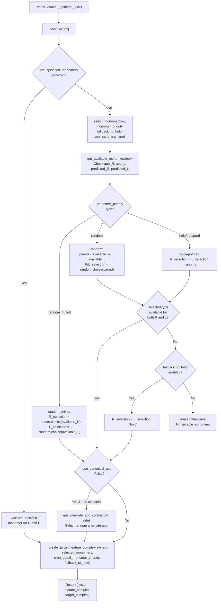
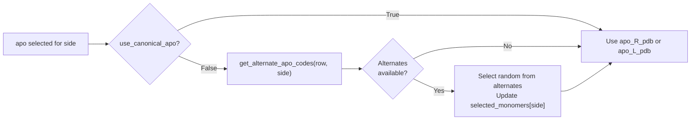
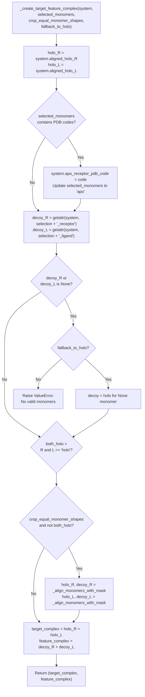

# Monomer Selection Strategies

<details>
<summary>Relevant source files</summary>

The following files were used as context for generating this wiki page:

- [examples/pinder-loader.ipynb](examples/pinder-loader.ipynb)
- [src/pinder-core/pinder/core/loader/loader.py](src/pinder-core/pinder/core/loader/loader.py)
- [src/pinder-core/pinder/core/utils/timer.py](src/pinder-core/pinder/core/utils/timer.py)

</details>


## Purpose and Scope

This page describes the monomer selection strategies available in PINDER for constructing protein-protein docking input pairs. When creating training or evaluation data, users can choose which structural variants (bound/unbound/predicted) to use as features, while the ground-truth native complex serves as the target. The selection strategy determines how the feature complex is constructed from available monomers.

For information about the `PinderSystem` class that manages different monomer variants, see [PinderSystem](#3.1). For details on the `PinderLoader` that orchestrates monomer selection during iteration, see [PinderLoader](#4.1). For filtering monomers based on quality criteria, see [Filtering System](#4.4).

## Monomer Types

Each PINDER system may contain up to three types of monomers for the receptor and ligand chains:

- **holo**: Bound monomers extracted from the native complex (always available)
- **apo**: Unbound monomers from different PDB structures (available for ~44K systems)
- **pred**: AlphaFold2 predicted monomers (available for ~43K systems)

The availability of apo and predicted monomers varies across systems, as indicated by boolean flags in the index (`apo_R`, `apo_L`, `predicted_R`, `predicted_L`).

Sources: [src/pinder-core/pinder/core/loader/loader.py:37-53]()

## Selection Strategy Types

PINDER supports five monomer selection strategies, defined by the `monomer_priority` parameter:

| Strategy | Description | Receptor | Ligand |
|----------|-------------|----------|--------|
| `holo` | Use bound monomers | holo | holo |
| `apo` | Use unbound monomers | apo | apo |
| `pred` | Use predicted monomers | pred | pred |
| `random` | Random but paired selection | same random type | same random type |
| `random_mixed` | Independent random selection | random type | random type |

The `random` strategy ensures both receptor and ligand use the same monomer type, selecting from the intersection of available types for both chains. The `random_mixed` strategy independently selects a random type for each chain from its available options.

Sources: [src/pinder-core/pinder/core/loader/loader.py:23](), [src/pinder-core/pinder/core/loader/loader.py:81-149]()

## Monomer Selection Flow



**Diagram: Monomer Selection Decision Tree**

This diagram shows the complete selection flow from index position to final complex pair creation, including all decision points and fallback logic.

Sources: [src/pinder-core/pinder/core/loader/loader.py:357-405](), [src/pinder-core/pinder/core/loader/loader.py:81-149]()

## Fallback Mechanisms

### Fallback to Holo

When `fallback_to_holo=True` (default), the loader automatically falls back to holo monomers if the requested monomer type is unavailable. This occurs at two stages:

1. **Selection stage**: If the `monomer_priority` is set to `apo` or `pred` but neither chain has the requested type, both chains default to `holo` ([src/pinder-core/pinder/core/loader/loader.py:128-129]())

2. **Loading stage**: If a sub-filter removes a monomer from the system (setting it to `None`), the loader falls back to `holo` for that chain ([src/pinder-core/pinder/core/loader/loader.py:172-177]())

With `fallback_to_holo=False`, a `ValueError` is raised if the requested monomer type is unavailable.

Sources: [src/pinder-core/pinder/core/loader/loader.py:111-113](), [src/pinder-core/pinder/core/loader/loader.py:172-181]()

### Pre-specified Monomers

The `pre_specified_monomers` parameter allows explicit control over which monomer type to use for each system, bypassing the `monomer_priority` logic. This can be provided as:

- A dictionary mapping system IDs to monomer types: `{"system_id": "apo"}`
- A DataFrame with `id` and `monomer` columns

All IDs in the loader's index must be present in the pre-specified mapping, and values must be `holo`, `apo`, or `pred`.

Sources: [src/pinder-core/pinder/core/loader/loader.py:245-250](), [src/pinder-core/pinder/core/loader/loader.py:327-346](), [src/pinder-core/pinder/core/loader/loader.py:372-377]()

## Canonical vs Alternate Apo Monomers

PINDER provides multiple apo monomers for some systems beyond the single "canonical" apo monomer used for evaluation. The canonical apo is specified in `apo_R_pdb` and `apo_L_pdb` columns, while additional alternates are listed in `apo_R_pdbs` and `apo_L_pdbs`.

When `use_canonical_apo=False`, the selector randomly chooses from available alternates if they exist:



**Diagram: Canonical vs Alternate Apo Selection**

The alternate apo codes are parsed from the semicolon-separated `apo_{R|L}_pdbs` field, excluding the canonical apo and empty strings.

Sources: [src/pinder-core/pinder/core/loader/loader.py:56-78](), [src/pinder-core/pinder/core/loader/loader.py:136-143]()

## Feature and Target Complex Construction

After monomer selection, the `_create_target_feature_complex` function constructs the two complexes:

- **Target complex**: Always uses aligned holo monomers (`system.aligned_holo_R + system.aligned_holo_L`)
- **Feature complex**: Uses selected monomers for receptor and ligand



**Diagram: Feature and Target Complex Construction**

When `crop_equal_monomer_shapes=True` and the feature complex uses non-holo monomers, the function aligns and crops monomers to ensure matching atom arrays between target and feature complexes using `_align_monomers_with_mask`.

Sources: [src/pinder-core/pinder/core/loader/loader.py:152-189]()

## Code Integration Points

The monomer selection system integrates with several core components:

### PinderLoader Configuration

The `PinderLoader` constructor accepts monomer selection parameters:

```python
loader = PinderLoader(
    split="train",
    monomer_priority="random_mixed",    # Selection strategy
    fallback_to_holo=True,              # Enable fallback
    use_canonical_apo=True,             # Use canonical apo
    pre_specified_monomers=None,        # Optional override
    crop_equal_monomer_shapes=True      # Align and crop
)
```

These parameters are stored as instance attributes and used in the `__getitem__` method during iteration.

Sources: [src/pinder-core/pinder/core/loader/loader.py:193-214](), [src/pinder-core/pinder/core/loader/loader.py:272-279]()

### Selection in Dataset Classes

Both `PinderDataset` and `PPIDataset` inherit monomer selection behavior from `PinderLoader`. They accept the same parameters and pass them to the parent class:

- `PinderDataset.__init__` accepts `monomer_priority`, `fallback_to_holo`, `use_canonical_apo`, and related parameters
- `PPIDataset.__init__` similarly forwards these parameters to `PinderLoader`

The datasets then apply transforms to the selected structures before returning them to the dataloader.

Sources: [examples/pinder-loader.ipynb:766-804]()

## Usage Examples

### Fixed Strategy Example

```python
from pinder.core import PinderLoader

# Use only apo monomers when available, fallback to holo
loader = PinderLoader(
    split="train",
    monomer_priority="apo",
    fallback_to_holo=True,
)

# Iterate over systems
for system, feature_complex, target_complex in loader:
    # feature_complex uses apo monomers (or holo as fallback)
    # target_complex always uses holo monomers
    pass
```

### Random Strategy Example

```python
# Randomly select monomer type, same for both chains
loader = PinderLoader(
    split="train",
    monomer_priority="random",
    fallback_to_holo=True,
)
```

### Random Mixed Strategy Example

```python
# Independently select monomer type for each chain
loader = PinderLoader(
    split="train",
    monomer_priority="random_mixed",
    fallback_to_holo=True,
)
```

### Alternate Apo Example

```python
# Sample from non-canonical apo monomers when available
loader = PinderLoader(
    split="train",
    monomer_priority="apo",
    use_canonical_apo=False,  # Enable alternate apo sampling
    fallback_to_holo=True,
)
```

### Pre-specified Monomers Example

```python
# Explicitly control monomer selection per system
pre_spec = {
    "8phr__X4_UNDEFINED--8phr__W4_UNDEFINED": "holo",
    "3wdb__A1_P9WPC9--3wdb__B1_P9WQB1": "apo",
    # ... more mappings
}

loader = PinderLoader(
    split="train",
    pre_specified_monomers=pre_spec,
    fallback_to_holo=True,
)
```

Sources: [examples/pinder-loader.ipynb:811-837](), [src/pinder-core/pinder/core/loader/loader.py:372-384]()

## Monomer Availability Query

The index can be queried to identify systems with specific monomer availability:

```python
from pinder.core import get_index

index = get_index()

# Systems with both apo monomers
apo_systems = index.query('apo_R and apo_L')

# Systems with at least one apo monomer
partial_apo = index.query('apo_R or apo_L')

# Systems with predicted monomers for both chains
pred_systems = index.query('predicted_R and predicted_L')

# Systems with only holo monomers (no alternatives)
holo_only = index.query('not (apo_R or apo_L or predicted_R or predicted_L)')
```

The boolean columns `apo_R`, `apo_L`, `predicted_R`, and `predicted_L` indicate monomer availability, allowing filtering before loading systems.

Sources: [examples/pinder-loader.ipynb:273-308]()

---