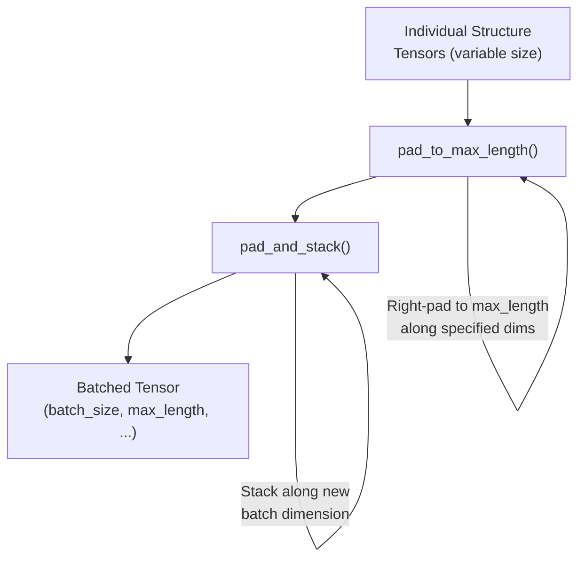
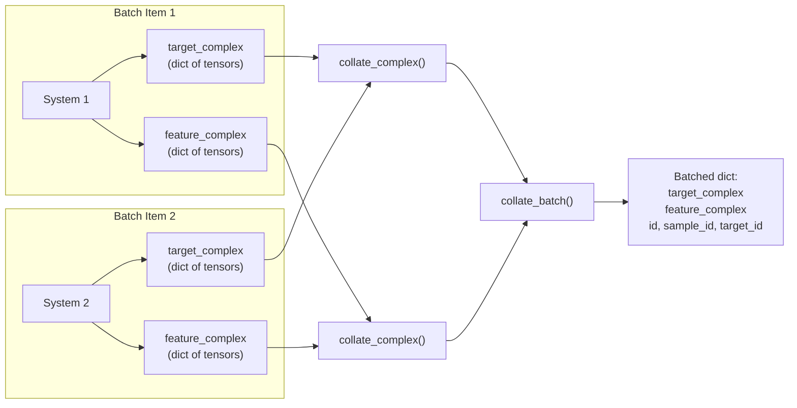
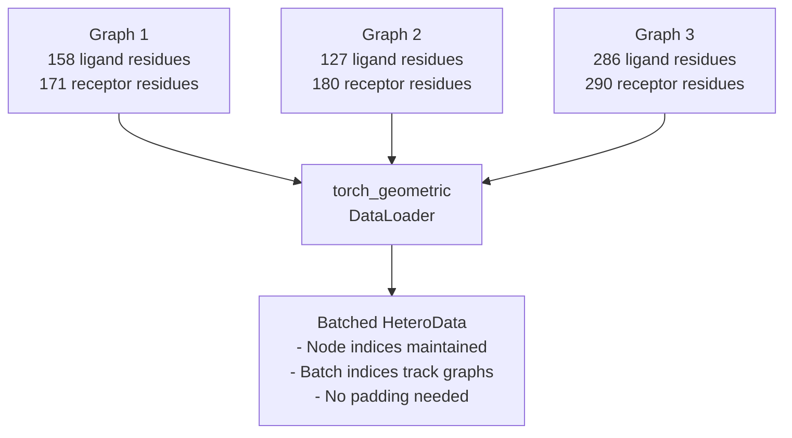
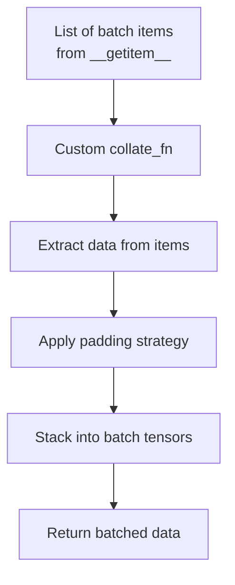

# Batching and Collation

<details>
<summary>Relevant source files</summary>

The following files were used as context for generating this wiki page:

- [examples/pinder-loader.ipynb](examples/pinder-loader.ipynb)
- [src/pinder-core/pinder/core/loader/dataset.py](src/pinder-core/pinder/core/loader/dataset.py)

</details>


## Purpose and Scope

This page explains how PINDER handles batching and collation of variable-sized protein structures for mini-batch training in PyTorch. Protein complexes have different numbers of atoms and residues, requiring special padding and stacking logic to create uniform tensors that can be processed by neural networks.

For information about the dataset classes that use these collation functions, see [PinderDataset](#4.2) and [PPIDataset](#4.3). For details on the transforms applied before collation, see [Transforms and Augmentation](#4.5).

## The Challenge of Variable-Sized Structures

Protein structures in PINDER have varying numbers of atoms depending on their size and composition. A mini-batch of structures cannot be directly converted to tensors because PyTorch's `torch.stack` requires all tensors to have identical shapes. 

For example:
- System 1: 688 atoms with shape `(688, 3)` for coordinates
- System 2: 1391 atoms with shape `(1391, 3)` for coordinates

Attempting to stack these without padding would raise:
```
RuntimeError: stack expects each tensor to be equal size, but got [688, 3] at entry 0 and [1391, 3] at entry 1
```

The solution is to pad all structures in a batch to the maximum size observed in that batch, using special padding values that can be masked or ignored during training.

**Sources:** [src/pinder-core/pinder/core/loader/dataset.py:69-162](), [examples/pinder-loader.ipynb:2740-2749]()

## Padding Strategy

### Padding Constants

PINDER defines specific padding values for different data types to ensure padded positions can be easily identified and masked:

| Constant | Value | Used For |
|----------|-------|----------|
| `COORDS_PAD_VALUE` | -100 | Atom and residue coordinates |
| `ATOM_TYPE_PAD_VALUE` | -1 | Atom type indices |
| `ELEMENT_TYPE_PAD_VALUE` | -1 | Element type indices |
| `RES_IDX_PAD_VALUE` | -99 | Residue indices |
| `CHAIN_ID_PAD_VALUE` | -1 | Chain identifiers |

These constants are chosen to be outside the valid range of actual data values, making it easy to create masks for valid positions during model training.

**Sources:** [src/pinder-core/pinder/core/loader/dataset.py:46-50]()

### Padding Functions



**Diagram: Padding and stacking pipeline for batching variable-sized structures**

#### pad_to_max_length

The `pad_to_max_length` function pads a single tensor to a specified maximum length along given dimensions using right-padding.

```python
def pad_to_max_length(
    mat: Tensor,
    max_length: int | Sequence[int] | Tensor,
    dims: Sequence[int],
    value: int | float | None = None,
) -> Tensor
```

Key parameters:
- `mat`: Tensor to pad
- `max_length`: Target size after padding (can be different for each dimension)
- `dims`: Which dimensions to pad
- `value`: Padding value to use

Examples:
- Input `(2, 3, 4)`, `max_length=5`, `dims=[0, 2]` → Output `(5, 3, 5)`
- Input `(2, 3, 4)`, `max_length=[5, 7]`, `dims=[0, 2]` → Output `(5, 3, 7)`

**Sources:** [src/pinder-core/pinder/core/loader/dataset.py:69-119]()

#### pad_and_stack

The `pad_and_stack` function pads a list of tensors to their maximum observed length and stacks them along a new batch dimension.

```python
def pad_and_stack(
    tensors: list[Tensor],
    dim: int = 0,
    dims_to_pad: list[int] | None = None,
    value: int | float | None = None,
) -> Tensor
```

Key parameters:
- `tensors`: List of tensors to pad and stack
- `dim`: New dimension for stacking (typically 0 for batch dimension)
- `dims_to_pad`: Which dimensions need padding (defaults to all)
- `value`: Padding value

The function automatically determines the maximum size along each dimension across all tensors in the list, then pads each tensor to match before stacking.

Examples:
- Input `[(4, 4, 3), (7, 7, 3)]`, `dim=0` → Output `(2, 7, 7, 3)`
- Input `[(2,), (7,)]`, `dim=0` → Output `(2, 7)`

**Sources:** [src/pinder-core/pinder/core/loader/dataset.py:122-162]()

## Collation for PinderDataset

The `PinderDataset` uses a two-level collation process: first collating individual complexes, then collating batches of systems.



**Diagram: Two-stage collation process for PinderDataset batches**

### collate_complex

The `collate_complex` function collates a list of structure dictionaries into a single batched dictionary. Each structure dictionary contains keys like `atom_types`, `atom_coordinates`, `residue_types`, etc.

```python
def collate_complex(
    structures: list[dict[str, Tensor]],
    coords_pad_value: int = COORDS_PAD_VALUE,
    atom_type_pad_value: int = ATOM_TYPE_PAD_VALUE,
    residue_id_pad_value: int = RES_IDX_PAD_VALUE,
    chain_id_pad_value: int = CHAIN_ID_PAD_VALUE,
    element_type_pad_value: int = ELEMENT_TYPE_PAD_VALUE,
) -> dict[str, Tensor]
```

The function:
1. Extracts each property from all structures (e.g., all `atom_coordinates` tensors)
2. Calls `pad_and_stack` for each property with appropriate padding values
3. Returns a dictionary with the same keys but batched tensors

Output shape: `(batch_size, max_atoms, ...)`

**Sources:** [src/pinder-core/pinder/core/loader/dataset.py:165-202]()

### collate_batch

The `collate_batch` function is the main collate function used by `torch.utils.data.DataLoader` when consuming `PinderDataset`. It processes a batch of data items (each containing `target_complex`, `feature_complex`, and metadata).

```python
def collate_batch(
    batch: list[dict[str, dict[str, Tensor] | str]],
) -> dict[str, dict[str, Tensor] | list[str]]
```

The function:
1. Separates target and feature complexes from all batch items
2. Calls `collate_complex` on each group
3. Collects metadata (IDs) into lists
4. Returns a dictionary with batched data and metadata

Output structure:
```python
{
    "target_complex": {
        "atom_coordinates": Tensor,  # (batch_size, max_atoms, 3)
        "atom_types": Tensor,        # (batch_size, max_atoms, 1)
        "residue_coordinates": Tensor, # (batch_size, max_residues, 3)
        # ... other properties
    },
    "feature_complex": {
        # Same structure as target_complex
    },
    "id": list[str],           # Original PINDER IDs
    "sample_id": list[str],    # Feature monomer IDs
    "target_id": list[str],    # Target monomer IDs
}
```

**Sources:** [src/pinder-core/pinder/core/loader/dataset.py:205-243]()

## Collation for PPIDataset

The `PPIDataset` uses PyTorch Geometric's `HeteroData` structure, which already handles variable-sized graphs. The `torch_geometric.loader.DataLoader` has built-in batching logic that:

1. Creates a batch object containing all nodes and edges from multiple graphs
2. Maintains separate indexing for each graph using batch indices
3. Does not require explicit padding since graphs are stored sparsely

When using `get_geo_loader`, the collation is handled automatically by PyTorch Geometric without requiring a custom `collate_fn`.



**Diagram: PyTorch Geometric's automatic batching for PPIDataset**

**Sources:** [src/pinder-core/pinder/core/loader/dataset.py:625-634]()

## Creating DataLoaders with Collation

### For PinderDataset

The `get_torch_loader` convenience function creates a `DataLoader` with the appropriate collate function:

```python
def get_torch_loader(
    dataset: PinderDataset,
    batch_size: int = 2,
    shuffle: bool = True,
    sampler: "Sampler[PinderDataset]" | None = None,
    num_workers: int = 1,
    collate_fn: Callable[[list[dict[str, Any]]], dict[str, Any]] = collate_batch,
    **kwargs: Any,
) -> "DataLoader[PinderDataset]"
```

By default, `collate_fn=collate_batch`, but users can provide custom collate functions.

Example usage:
```python
from pinder.core.loader.dataset import PinderDataset, get_torch_loader

dataset = PinderDataset(split="train")
dataloader = get_torch_loader(
    dataset,
    batch_size=8,
    shuffle=True,
    num_workers=4
)

for batch in dataloader:
    # batch["target_complex"]["atom_coordinates"] has shape (8, max_atoms, 3)
    # batch["feature_complex"]["atom_coordinates"] has shape (8, max_atoms, 3)
    pass
```

**Sources:** [src/pinder-core/pinder/core/loader/dataset.py:637-654]()

### For PPIDataset

The `get_geo_loader` function creates a PyTorch Geometric `DataLoader`:

```python
def get_geo_loader(
    dataset: PPIDataset, 
    batch_size: int = 2, 
    num_workers: int = 1
) -> TorchGeoDataLoader
```

No custom collate function is needed since PyTorch Geometric handles graph batching automatically.

**Sources:** [src/pinder-core/pinder/core/loader/dataset.py:625-634]()

## Custom Collation Functions

Users can implement custom collation functions for specific use cases. A custom collate function must accept a list of batch items and return batched data suitable for the model.



**Diagram: Custom collation function workflow**

Example custom collate function for coordinate-only data:

```python
def collate_coordinates(batch, coords_pad_value: int = -100):
    """Custom collate function that only handles coordinates."""
    feature_coords = []
    target_coords = []
    
    for feat, target in batch:
        # Convert numpy arrays to tensors if needed
        if isinstance(feat, np.ndarray):
            feat = torch.tensor(feat, dtype=torch.float32)
        if isinstance(target, np.ndarray):
            target = torch.tensor(target, dtype=torch.float32)
            
        feature_coords.append(feat)
        target_coords.append(target)
    
    # Use pad_and_stack utility
    feature_coords = pad_and_stack(
        feature_coords, dim=0, value=coords_pad_value
    )
    target_coords = pad_and_stack(
        target_coords, dim=0, value=coords_pad_value
    )
    
    return feature_coords, target_coords
```

This custom function can be passed to the `DataLoader`:

```python
dataloader = DataLoader(
    dataset,
    batch_size=4,
    collate_fn=collate_coordinates
)
```

The collate function determines what data structure your model receives. Common patterns:

1. **Dictionary of tensors**: Good for models that need multiple properties (atom types, coordinates, etc.)
2. **Tuple of tensors**: Simple for coordinate-only models
3. **Custom objects**: For complex models with specific input requirements

**Sources:** [examples/pinder-loader.ipynb:2740-2872]()

## Padding and Masking in Training

When using padded batches, models should mask padded positions to avoid training on invalid data. Common approaches:

1. **Attention masks**: Create boolean masks where `True` indicates valid positions
   ```python
   valid_mask = (coordinates != coords_pad_value).any(dim=-1)
   ```

2. **Loss masking**: Multiply losses by mask before aggregating
   ```python
   masked_loss = loss * valid_mask
   loss = masked_loss.sum() / valid_mask.sum()
   ```

3. **Batch element masking**: Track the actual length of each element for RNN-style models

The padding values are chosen to be easily identifiable (negative values outside the valid range) to simplify mask creation.

**Sources:** [src/pinder-core/pinder/core/loader/dataset.py:46-50]()

---