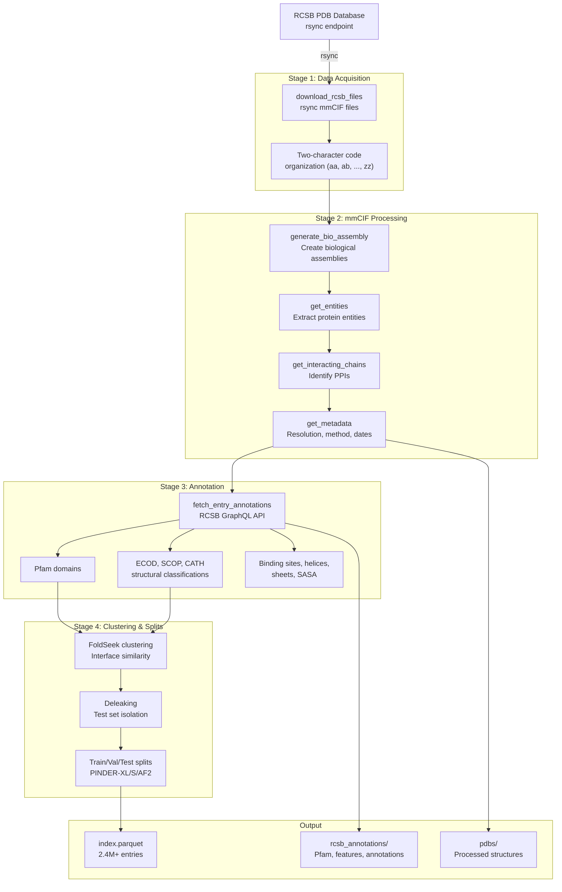
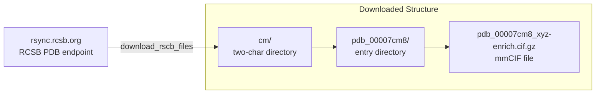
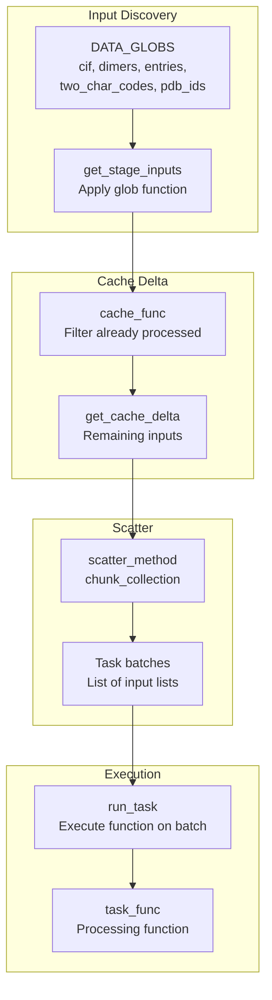
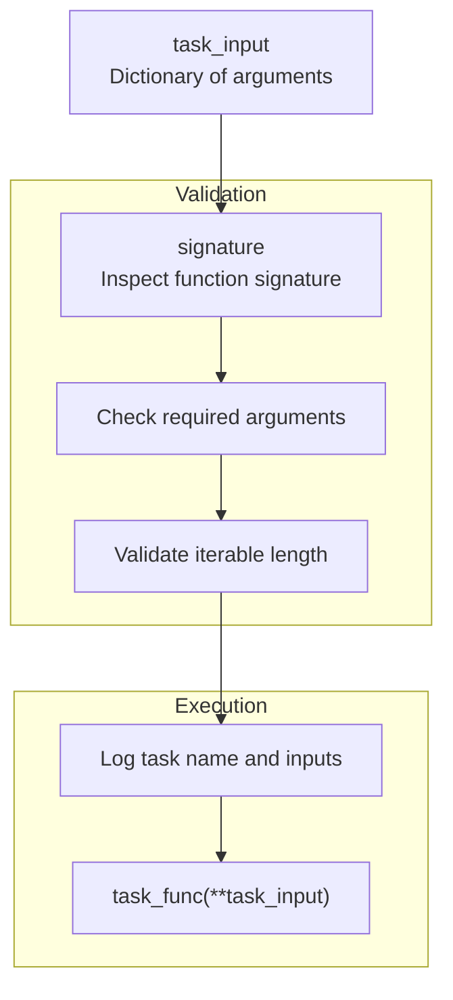
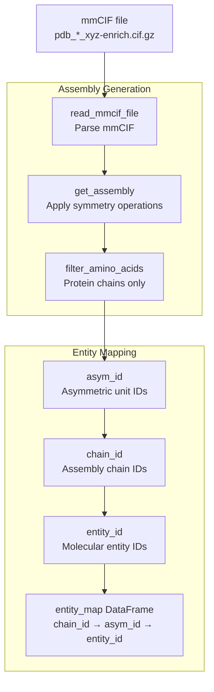
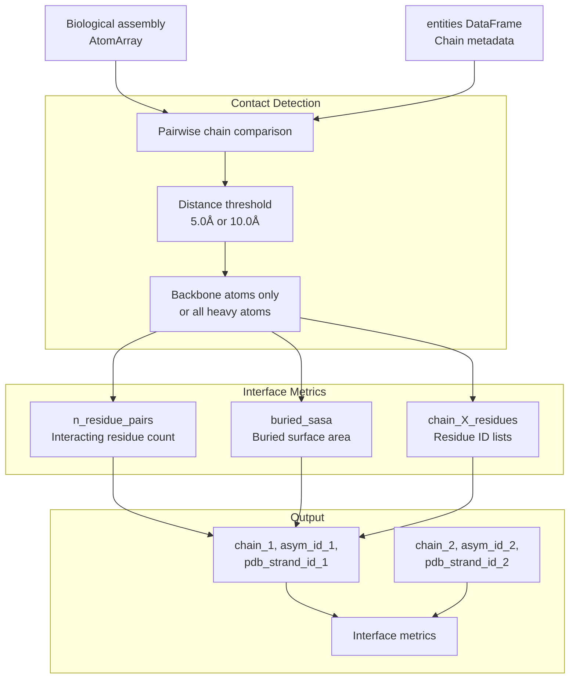
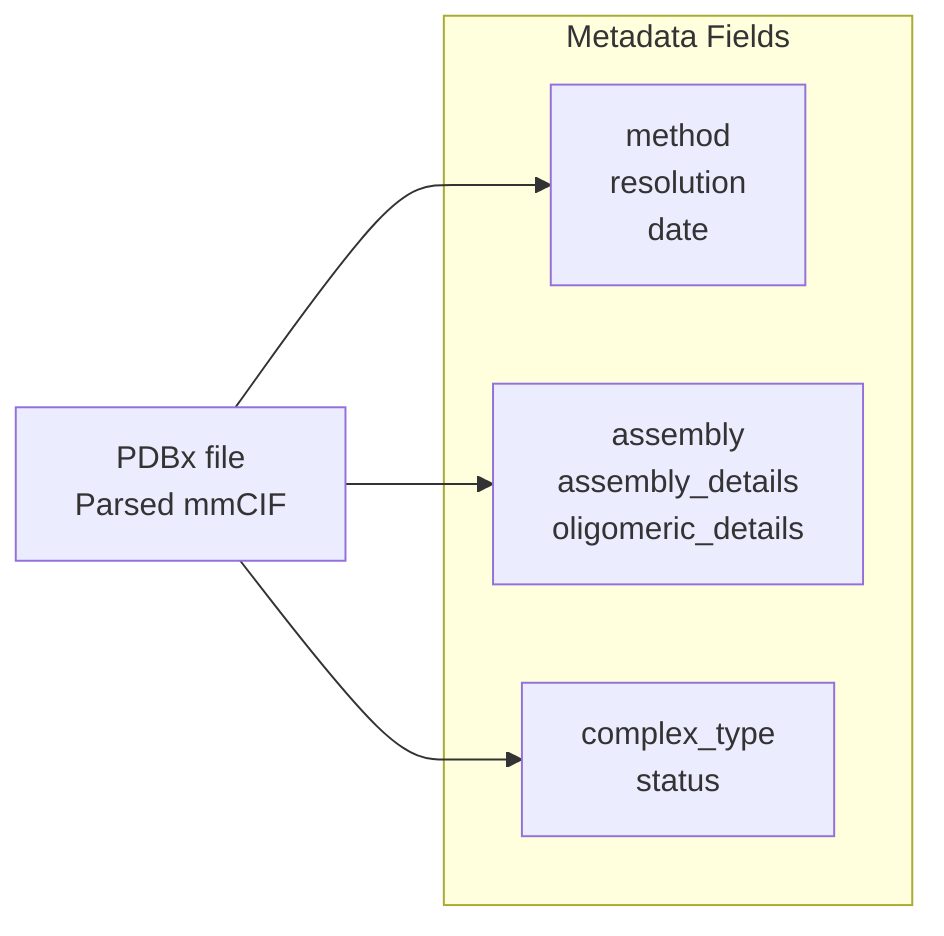
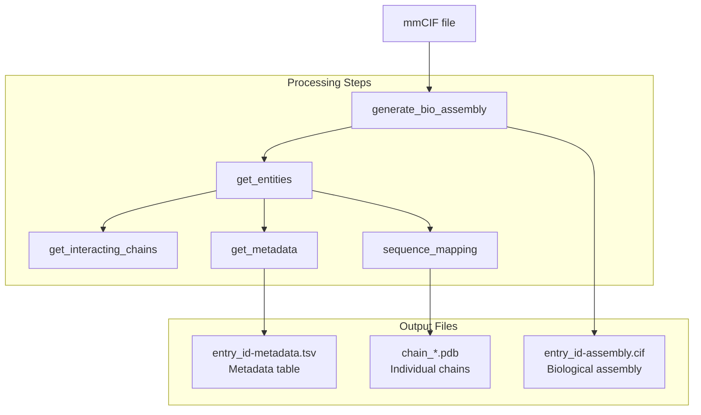
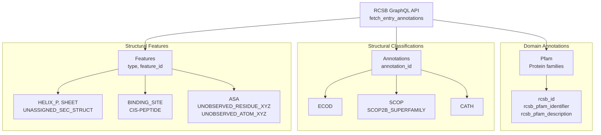
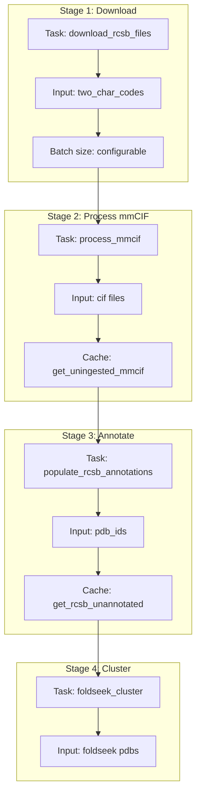

# Dataset Generation Pipeline

<details>
<summary>Relevant source files</summary>

The following files were used as context for generating this wiki page:

- [src/pinder-data/pinder/data/pipeline/tasks.py](src/pinder-data/pinder/data/pipeline/tasks.py)
- [tests/data/test_get_data.py](tests/data/test_get_data.py)
- [tests/data/test_graphql.py](tests/data/test_graphql.py)
- [tests/data/test_tasks.py](tests/data/test_tasks.py)

</details>


This page documents the data generation pipeline that transforms raw PDB structures from RCSB into the processed PINDER dataset. The pipeline handles downloading mmCIF files, processing biological assemblies, identifying protein-protein interactions, and fetching structural annotations.

For information about the final dataset structure and how to load it, see [Dataset Structure](#1.3). For details on the data loading system used after generation, see [Data Loading System](#4).

## Overview

The dataset generation pipeline orchestrates several stages to create the PINDER dataset from RCSB PDB snapshots:



**Pipeline Architecture**

The pipeline uses a task-based orchestration system with caching and parallel execution. Each stage operates on batches of inputs, with intermediate results cached to enable resumption after failures.

Sources: [tests/data/test_get_data.py:1-368](), [tests/data/test_tasks.py:1-105](), [src/pinder-data/pinder/data/pipeline/tasks.py:1-182]()

## Data Acquisition from RCSB

The pipeline downloads mmCIF files from RCSB PDB using rsync. Files are organized by two-character codes derived from PDB IDs.

### Two-Character Code Organization

PDB entries are organized into directories based on their middle two characters. For example, PDB ID `7cm8` goes into directory `cm/pdb_00007cm8/`.



**rsync Download Functions**

| Function | Purpose | Source |
|----------|---------|--------|
| `download_rscb_files` | Downloads all mmCIF files for a two-character code | [tests/data/test_get_data.py:12-17]() |
| `get_rsync_two_char_pdb_entries` | Lists available PDB entries for a two-character code | [tests/data/test_get_data.py:20-23]() |
| `get_all_rsync_entries` | Lists entries across multiple two-character codes | [tests/data/test_get_data.py:26-29]() |
| `get_two_char_codes_not_downloaded` | Identifies missing two-character codes for resumption | [tests/data/test_get_data.py:32-37]() |

Sources: [tests/data/test_get_data.py:12-37](), [src/pinder-data/pinder/data/pipeline/tasks.py:36-41]()

## Task Orchestration System

The pipeline uses a flexible task orchestration system that handles batching, caching, and parallel execution of processing stages.

### Task Structure



**Input Types and Glob Functions**

The `DATA_GLOBS` dictionary maps input type names to functions that discover unprocessed inputs:

| Input Type | Glob Function | Returns | Source |
|------------|--------------|---------|--------|
| `cif` | `cif_glob` | List of mmCIF files matching `*/*/*enrich.cif.gz` | [src/pinder-data/pinder/data/pipeline/tasks.py:23-24]() |
| `dimers` | `dimer_glob` | List of dimer PDB files matching `*/*/*__*--*__*.pdb` | [src/pinder-data/pinder/data/pipeline/tasks.py:27-28]() |
| `entries` | `entry_glob` | List of entry directories | [src/pinder-data/pinder/data/pipeline/tasks.py:31-33]() |
| `two_char_codes` | `two_char_code_rsync` | List of two-character codes not yet downloaded | [src/pinder-data/pinder/data/pipeline/tasks.py:36-41]() |
| `pdb_ids` | `pdb_id_glob` | List of PDB IDs from entry directories | [src/pinder-data/pinder/data/pipeline/tasks.py:44-47]() |
| `foldseek` | `foldseek_pdb_glob` | List of PDB files for FoldSeek clustering | [src/pinder-data/pinder/data/pipeline/tasks.py:50-51]() |
| `graph_types` | `graph_type_glob` | List of graph type specifications | [src/pinder-data/pinder/data/pipeline/tasks.py:54-65]() |
| `putative_apo_pairings` | `putative_apo_pairings` | DataFrame of apo-holo pairings | [src/pinder-data/pinder/data/pipeline/tasks.py:68-84]() |

### Stage Task Generation

The `get_stage_tasks` function orchestrates the complete flow:

```python
# Example usage pattern from tests
scatter_batches = tasks.get_stage_tasks(
    data_dir,
    input_type="cif",
    batch_size=2,
    cache_func=cache.get_uningested_mmcif,
    cache_kwargs={},
    scatter_method=scatter.chunk_collection,
)
```

**Processing Flow**

1. **Input Discovery**: Call glob function to find all potential inputs
2. **Cache Filtering**: Apply cache function to filter already-processed items
3. **Batching**: Use scatter method to create batches of specified size
4. **Task Execution**: Execute processing function on each batch

Sources: [src/pinder-data/pinder/data/pipeline/tasks.py:99-138](), [tests/data/test_tasks.py:22-92]()

### Task Execution

The `run_task` function provides robust execution with validation:



**Example Test Cases**

| Step Name | Input Type | Batch Size | Expected Batches | Cache Function |
|-----------|-----------|------------|------------------|----------------|
| `ingest_rcsb_files` | `cif` | 2 | 4 | `get_uningested_mmcif` |
| `get_pisa_annotations` | `cif` | 2 | 6 | `get_pisa_unannotated` |
| `get_rcsb_annotations` | `pdb_ids` | 1 | 13 | `get_rcsb_unannotated` |

Sources: [src/pinder-data/pinder/data/pipeline/tasks.py:141-182](), [tests/data/test_tasks.py:22-92]()

## mmCIF Processing

The pipeline processes mmCIF files to extract biological assemblies and identify protein-protein interactions.

### Biological Assembly Generation

The `generate_bio_assembly` function creates biological assemblies from asymmetric units:



**Assembly Processing Examples**

| mmCIF File | Assembly Chains | Asym IDs | Entity IDs | Notes |
|------------|-----------------|----------|------------|-------|
| `7bdu` | 7 | 7 | 3 | Standard dimeric complex |
| `7kmx` | 840 | 14 | 2 | Large oligomeric assembly |
| `2a79` | 34 | 13 | 7 | Multi-component complex |
| `6rw4` | 125 | 125 | 42 | Highly complex assembly |
| `2y26` | 120 | 40 | 2 | Symmetric structure |

Sources: [tests/data/test_get_data.py:284-361]()

### Entity Extraction

The `get_entities` function extracts protein entities from mmCIF files:

```python
# Example from test
pdbx_file = get_data.read_mmcif_file(gz_cif)
pdb_id = gz_cif.stem.split("_")[1][-4:].lower()
bio_asm, entity_map = get_data.generate_bio_assembly(gz_cif)
entities = get_data.get_entities(pdbx_file, entry_id=pdb_id)
```

The `entities` DataFrame contains:
- `entity_id`: Unique molecular entity identifier
- `asym_id`: Asymmetric unit chain identifier  
- `chain`: Assembly chain identifier
- `uniprot`: UniProt accession
- `length_resolved`: Number of resolved residues

Sources: [tests/data/test_get_data.py:104-148]()

### Interacting Chain Identification

The `get_interacting_chains` function identifies protein-protein interfaces:



**Interface Detection Parameters**

| Parameter | Default | Purpose |
|-----------|---------|---------|
| `contact_threshold` | 5.0 | Distance cutoff in Ångströms for defining contacts |
| `backbone_only` | False | Whether to consider only backbone atoms |

**Example Output**

For PDB `5cq2` with default parameters (5.0Å, all atoms):

```python
{
    "chain_1": "R",
    "asym_id_1": "R", 
    "chain_2": "L",
    "asym_id_2": "L",
    "pdb_strand_id_1": "R",
    "pdb_strand_id_2": "L",
    "entry_id": "5cq2",
    "n_residue_pairs": 3,
    "n_residues": 4,
    "buried_sasa": 169,
    "chain_1_residues": "31",
    "chain_2_residues": "4,5,6"
}
```

Increasing the threshold to 10.0Å expands the interface:

```python
{
    "n_residue_pairs": 31,
    "n_residues": 15,
    "buried_sasa": 169,
    "chain_1_residues": "27,28,29,30,31,32,33",
    "chain_2_residues": "2,3,4,5,6,7,8,9"
}
```

Sources: [tests/data/test_get_data.py:40-91](), [tests/data/test_get_data.py:93-162]()

### Metadata Extraction

The `get_metadata` function extracts experimental metadata:



**Example Metadata Record**

```python
{
    "entry_id": "7CM8",
    "method": "X-RAY DIFFRACTION",
    "date": "2020-07-25",
    "release_date": "2020-08-19",
    "resolution": "1.90",
    "assembly": "1",
    "assembly_details": "author_and_software_defined_assembly",
    "oligomeric_details": "dimeric",
    "oligomeric_count": "2",
    "biol_details": None,
    "complex_type": None,
    "status": None
}
```

Sources: [tests/data/test_get_data.py:165-188]()

### Complete mmCIF Processing

The `process_mmcif` function orchestrates the complete workflow:



**Processing Test Example**

```python
# Process mmCIF for PDB 7cm8
mmcif_file = pinder_data_cp / "nextgen_rcsb/cm/pdb_00007cm8/pdb_00007cm8_xyz-enrich.cif.gz"
get_data.process_mmcif(mmcif_file)

# Verify outputs
metadata_file = mmcif_file.parent / "7cm8-metadata.tsv"
assembly_cif = mmcif_file.parent / "7cm8-assembly.cif"
assert metadata_file.is_file()
assert assembly_cif.is_file()

# Check assembly has correct chain IDs
pdbx_file = atoms.biotite_pdbxfile().read(assembly_cif)
model = pdbx.get_structure(pdbx_file, model=1)
assert sorted(np.unique(model.chain_id)) == ["A1", "A2"]
```

Sources: [tests/data/test_get_data.py:217-239](), [tests/data/test_get_data.py:242-266](), [tests/data/test_get_data.py:364-367]()

## RCSB Annotations via GraphQL

The pipeline fetches structural annotations from RCSB PDB using their GraphQL API.

### Annotation Types



### Fetching Entry Annotations

The `fetch_entry_annotations` function queries RCSB GraphQL and saves results to JSON:

```python
# Example from test
pdb_id = "6Q0R"
data_json = tmp_path / f"{pdb_id}.json"
graphql.fetch_entry_annotations(pdb_id, data_json, use_cache=False)

# Parse annotation data
pfam_df, feature_df, annotation_df, ec_df = graphql.parse_annotation_data(data_json)
```

**Annotation Schema Sizes**

| DataFrame | Columns | Example PDB | Notes |
|-----------|---------|-------------|-------|
| `pfam_df` | 19 | 6Q0R | Pfam domain assignments |
| `feature_df` | 14 | 6Q0R | Structural features and secondary structure |
| `annotation_df` | 12 | 6Q0R | ECOD/SCOP/CATH classifications |
| `ec_df` | variable | 6Q0R | Enzyme commission numbers |

**Example Pfam Domains (PDB 6Q0R)**

| rcsb_id | rcsb_pfam_identifier | Description |
|---------|---------------------|-------------|
| PF00076 | RRM_1 | RNA recognition motif |
| PF14939 | DCAF15_WD40 | WD40 domain |
| PF03178 | CPSF_A | Cleavage/polyadenylation factor |
| PF10172 | DDA1 | DET1 and DDB1 associated protein |

**Feature Types in 6Q0R**

Expected feature types include:
- `ASA` - Accessible surface area
- `UNASSIGNED_SEC_STRUCT` - Unclassified secondary structure
- `CIS-PEPTIDE` - Cis peptide bonds
- `SCOP`, `SCOP2B_SUPERFAMILY` - SCOP classifications
- `UNOBSERVED_RESIDUE_XYZ`, `UNOBSERVED_ATOM_XYZ` - Missing coordinates
- `CATH` - CATH classifications
- `SHEET`, `HELIX_P` - Secondary structure elements
- `ECOD` - ECOD classifications
- `BINDING_SITE` - Ligand binding sites

**Annotation IDs in 6Q0R**

| Type | Annotation ID | Description |
|------|---------------|-------------|
| CATH | 3.30.70.330 | CATH topology |
| ECOD | 8051194, 8061923, 8052530 | ECOD classifications |
| SCOP | e6q0rA3, e6q0rA2, e6q0rA1, e6q0rD1, d6q0rd1, d6q0rd2 | SCOP domains |

Sources: [tests/data/test_graphql.py:41-63]()

### Parallel Annotation Population

The `populate_rcsb_annotations` function fetches annotations for multiple PDB IDs in parallel:

```python
pdb_ids = ["6Q0R", "2A79"]
graphql.populate_rcsb_annotations(
    pinder_dir=graphql_temp_dir,
    pdb_ids=pdb_ids,
    parallel=True,
    max_workers=2,
)
```

**Output Directory Structure**

```
rcsb_annotations/
├── pfam/
│   ├── 6Q0R.csv.gz
│   └── 2A79.csv.gz
├── features/
│   ├── 6Q0R.csv.gz
│   └── 2A79.csv.gz
└── annotations/
    ├── 6Q0R.csv.gz
    └── 2A79.csv.gz
```

Sources: [tests/data/test_graphql.py:66-82]()

### Annotation Collection

The `collect_rcsb_annotations` function aggregates individual annotation files:

```python
graphql.collect_rcsb_annotations(pinder_dir)
```

**Collected Files**

| File Name | Description |
|-----------|-------------|
| `pfam.csv.gz` | All Pfam domain annotations |
| `annotations_ecod.csv.gz` | ECOD classifications |
| `annotations_scop.csv.gz` | SCOP classifications |
| `annotations_cath.csv.gz` | CATH classifications |
| `features_ecod.csv.gz` | ECOD-related features |
| `features_scop.csv.gz` | SCOP-related features |
| `features_cath.csv.gz` | CATH-related features |

Sources: [tests/data/test_graphql.py:85-99]()

## Pipeline Integration

The complete dataset generation pipeline integrates all stages through the task orchestration system:



**Cache Functions**

The pipeline uses cache functions to track progress and enable resumption:

| Cache Function | Purpose | Stage |
|----------------|---------|-------|
| `get_uningested_mmcif` | Identifies unprocessed mmCIF files | mmCIF processing |
| `get_pisa_unannotated` | Identifies entries without PISA annotations | PISA annotation |
| `get_rcsb_unannotated` | Identifies entries without RCSB annotations | RCSB annotation |

Sources: [tests/data/test_tasks.py:22-92](), [src/pinder-data/pinder/data/pipeline/tasks.py:99-138]()

## Output Structure

The pipeline produces a structured dataset with several key components:

```
pinder/
├── pdbs/                          # Processed protein structures
│   ├── {pdb_id}__{chain1}_{uniprot1}--{pdb_id}__{chain2}_{uniprot2}.pdb
│   └── ...
├── test_set_pdbs/                 # Test set structures  
│   └── ...
├── mappings/                      # Sequence and structure mappings
│   └── ...
├── rcsb_annotations/              # Structural annotations
│   ├── pfam.csv.gz
│   ├── annotations_ecod.csv.gz
│   ├── annotations_scop.csv.gz
│   ├── annotations_cath.csv.gz
│   ├── features_ecod.csv.gz
│   ├── features_scop.csv.gz
│   └── features_cath.csv.gz
├── index.parquet                  # Main index (2.4M+ entries)
└── metadata.parquet               # Detailed metadata (45+ fields)
```

The final dataset structure is documented in detail in [Dataset Structure](#1.3).

Sources: [tests/data/test_get_data.py:1-368](), [tests/data/test_graphql.py:1-100]()

---