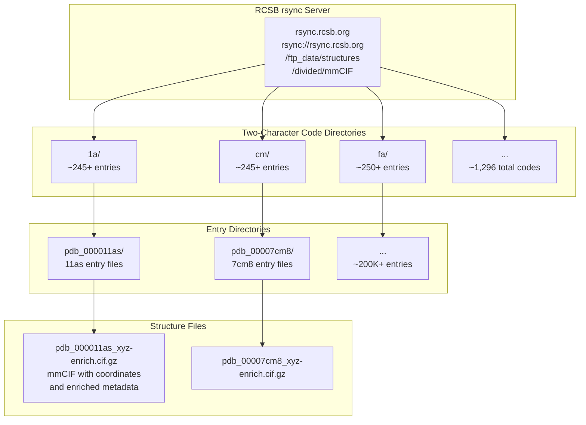
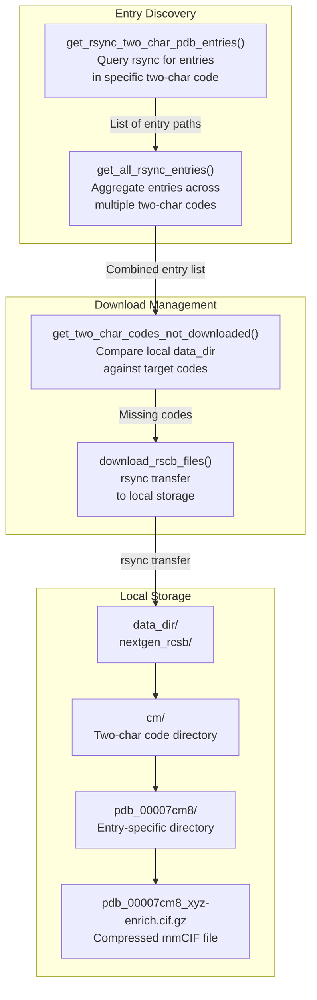
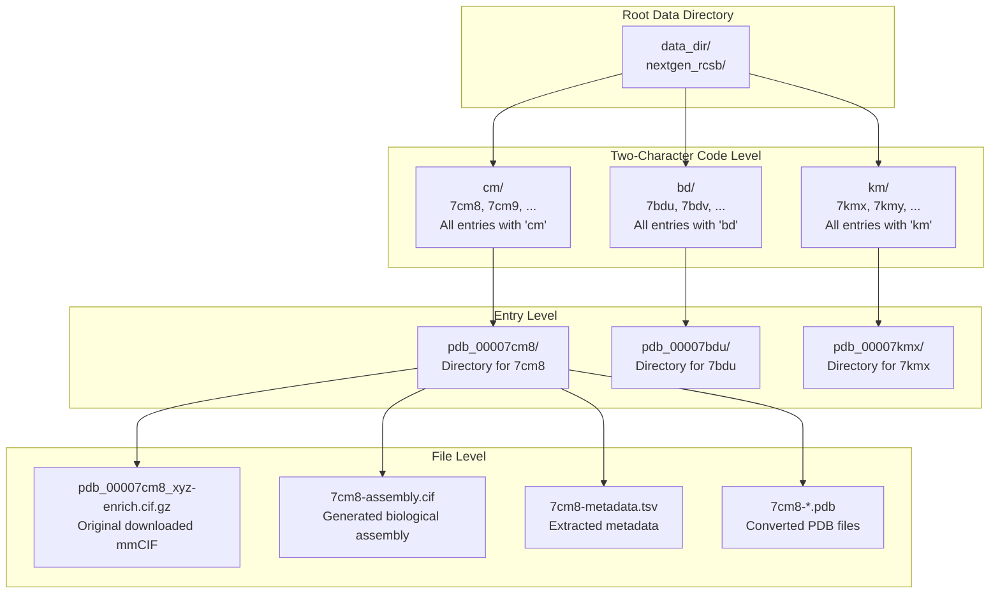
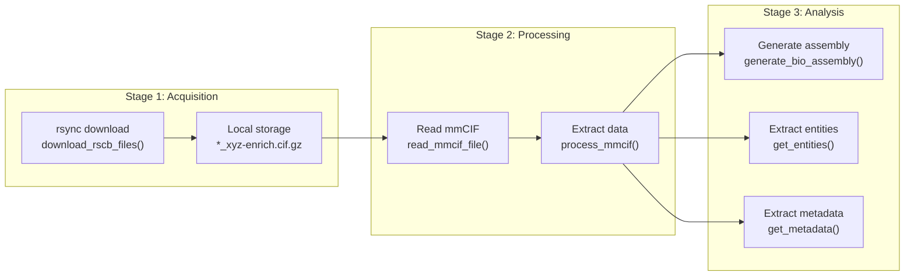

# Data Acquisition from RCSB

<details>
<summary>Relevant source files</summary>

The following files were used as context for generating this wiki page:

- [tests/data/test_get_data.py](tests/data/test_get_data.py)

</details>


This document explains how PINDER acquires raw protein structure data from the RCSB Protein Data Bank. This is the first stage in the dataset generation pipeline, responsible for downloading mmCIF files using rsync and organizing them in a two-character code directory structure.

For information about processing the downloaded mmCIF files into protein systems, see [mmCIF Processing](#5.3). For details on fetching annotations via GraphQL, see [RCSB Annotations](#5.4).

## Overview

The data acquisition system downloads protein structure files from RCSB PDB's rsync server. RCSB PDB contains over 200,000 protein structures as of the PINDER snapshot date (January 29, 2024). The system uses rsync for efficient incremental downloads and organizes files using RCSB's two-character code hierarchy to manage the large volume of data.

The acquisition process:
1. Identifies available PDB entries on the rsync server
2. Organizes entries by two-character codes (e.g., "cm", "fa", "1a")
3. Downloads mmCIF files with enriched metadata (`_xyz-enrich.cif.gz`)
4. Stores files in a structured directory hierarchy
5. Tracks which codes have been downloaded

Sources: [tests/data/test_get_data.py:12-17](), [tests/data/test_get_data.py:20-29]()

## RCSB PDB rsync Structure

### Two-Character Code Organization

RCSB PDB organizes entries using a two-character code derived from the middle characters of the PDB ID. For example:
- PDB ID `7cm8` → two-char code `cm`
- PDB ID `1a3b` → two-char code `a3`
- PDB ID `11as` → two-char code `1a`

This creates approximately 1,296 possible codes (36 × 36, using digits 0-9 and letters a-z), distributing entries across manageable directory groups.



**Figure 1: RCSB PDB rsync directory hierarchy**

Sources: [tests/data/test_get_data.py:13-17](), [tests/data/test_get_data.py:20-29]()

### mmCIF File Format

PINDER downloads the `_xyz-enrich.cif.gz` variant of mmCIF files, which contain:
- Atomic coordinates (xyz)
- Enriched metadata from RCSB annotations
- Entity definitions (protein chains, ligands, etc.)
- Biological assembly information
- Experimental metadata (resolution, method, date)
- UniProt cross-references

Sources: [tests/data/test_get_data.py:16-17](), [tests/data/test_get_data.py:167-168]()

## Data Acquisition Pipeline

### Architecture Overview



**Figure 2: Data acquisition pipeline from entry discovery to local storage**

Sources: [tests/data/test_get_data.py:12-37]()

### Core Functions

| Function | Module | Purpose | Returns |
|----------|--------|---------|---------|
| `get_rsync_two_char_pdb_entries()` | `pinder.data.rcsb_rsync` | Query rsync server for all entries under a single two-char code | `list` of entry paths |
| `get_all_rsync_entries()` | `pinder.data.rcsb_rsync` | Query rsync server for entries across multiple two-char codes | `list` of aggregated entry paths |
| `get_two_char_codes_not_downloaded()` | `pinder.data.rcsb_rsync` | Compare local data directory against target codes to identify missing data | `list` of two-char codes |
| `download_rscb_files()` | `pinder.data.rcsb_rsync` | Execute rsync transfer of mmCIF files for a specific two-char code | `None` (downloads to disk) |

Sources: [tests/data/test_get_data.py:12-37]()

## Download Process

### Querying Available Entries

The `get_rsync_two_char_pdb_entries()` function queries the RCSB rsync server to discover all entries for a given two-character code:

```python
# Example from tests
entries = rcsb_rsync.get_rsync_two_char_pdb_entries(two_char_code="cm")
# Returns list of entry paths like:
# ['rsync://rsync.rcsb.org/.../cm/pdb_00007cm8/...', ...]
assert len(entries) >= 245
```

The function can be used across multiple codes:

```python
entries = rcsb_rsync.get_all_rsync_entries(two_char_codes=["cm", "fa"])
assert len(entries) >= (245 + 250)
```

Sources: [tests/data/test_get_data.py:20-29]()

### Incremental Download Strategy

The system tracks which two-character codes have been downloaded to support incremental updates:

```python
# Check which codes are missing from local storage
missing = rcsb_rsync.get_two_char_codes_not_downloaded(
    data_dir, 
    two_char_codes=["cm", "fa"]
)
# Returns list of codes not yet downloaded
```

This allows the pipeline to:
- Resume interrupted downloads
- Update specific codes without re-downloading everything
- Efficiently manage the ~700GB total dataset size

Sources: [tests/data/test_get_data.py:32-37]()

### rsync Execution

The `download_rscb_files()` function executes the actual rsync transfer:

```python
# Download all entries for two-char code "1a"
rcsb_rsync.download_rscb_files(
    output_dir=tmp_path / "data",
    two_char_code="1a"
)
```

After execution, the directory structure looks like:

```
data/
└── 1a/
    └── pdb_000011as/
        └── pdb_000011as_xyz-enrich.cif.gz
```

The function:
- Uses rsync's efficient differential transfer protocol
- Preserves timestamps for change detection
- Downloads compressed files to minimize bandwidth
- Creates the two-character code and entry directories automatically

Sources: [tests/data/test_get_data.py:12-17]()

## Local Directory Structure

### File Organization



**Figure 3: Local directory structure and generated files**

Note: Files like `*-assembly.cif` and `*-metadata.tsv` are generated by downstream processing (see [mmCIF Processing](#5.3)), not during the initial download.

Sources: [tests/data/test_get_data.py:13-17](), [tests/data/test_get_data.py:167-168](), [tests/data/test_get_data.py:217-239]()

### File Naming Conventions

| Pattern | Example | Description |
|---------|---------|-------------|
| `pdb_0000<pdb_id>` | `pdb_00007cm8` | Entry directory name with zero-padded PDB ID |
| `pdb_0000<pdb_id>_xyz-enrich.cif.gz` | `pdb_00007cm8_xyz-enrich.cif.gz` | Downloaded mmCIF file with coordinates and metadata |
| `<pdb_id>-assembly.cif` | `7cm8-assembly.cif` | Biological assembly (generated downstream) |
| `<pdb_id>-metadata.tsv` | `7cm8-metadata.tsv` | Tab-separated metadata (generated downstream) |

The PDB ID is extracted from the filename by removing the prefix and suffix:
```python
pdb_id = gz_cif.stem.split("_")[1][-4:].lower()  # "7cm8"
```

Sources: [tests/data/test_get_data.py:112](), [tests/data/test_get_data.py:218-226]()

## Integration with Processing Pipeline

### Data Flow



**Figure 4: Integration between acquisition and processing stages**

Sources: [tests/data/test_get_data.py:114](), [tests/data/test_get_data.py:168-170](), [tests/data/test_get_data.py:229]()

### Input to Downstream Processing

The downloaded mmCIF files serve as input to several processing functions in `pinder.data.get_data`:

| Function | Input | Output | Purpose |
|----------|-------|--------|---------|
| `read_mmcif_file()` | `*_xyz-enrich.cif.gz` | `PDBXFile` object | Parse mmCIF into biotite structure |
| `generate_bio_assembly()` | `*_xyz-enrich.cif.gz` | `(AtomArray, DataFrame)` | Generate biological assembly from asymmetric unit |
| `get_entities()` | `PDBXFile` | `DataFrame` | Extract entity definitions (chains, ligands) |
| `get_metadata()` | `PDBXFile` | `DataFrame` | Extract experimental metadata |
| `process_mmcif()` | `*_xyz-enrich.cif.gz` | Multiple files | Orchestrate complete processing workflow |

Sources: [tests/data/test_get_data.py:114](), [tests/data/test_get_data.py:116-118](), [tests/data/test_get_data.py:168-170](), [tests/data/test_get_data.py:229]()

## Dataset Statistics

### Coverage and Scale

Based on the PINDER snapshot (January 29, 2024):

| Metric | Value |
|--------|-------|
| Total RCSB PDB structures | ~200,000 |
| Two-character codes | ~1,296 possible |
| Entries per code (average) | ~154 |
| Entries per code (example: cm) | ≥245 |
| Total dataset size | ~700GB |
| File format | mmCIF (gzipped) |
| Average file size | ~3.5MB |

Sources: [tests/data/test_get_data.py:20-29]()

### Example Entry Counts

```python
# Real counts from tests
entries_cm = get_rsync_two_char_pdb_entries("cm")  # ≥245 entries
entries_fa = get_rsync_two_char_pdb_entries("fa")  # ≥250 entries
combined = get_all_rsync_entries(["cm", "fa"])     # ≥495 entries
```

Sources: [tests/data/test_get_data.py:21-29]()

## Performance Considerations

### Bandwidth and Storage

- **Download size**: ~700GB for complete dataset
- **Network efficiency**: rsync protocol transfers only changed files
- **Compression**: gzip reduces file size by ~70-80%
- **Parallel downloads**: Can download multiple two-char codes simultaneously

### Incremental Updates

The two-character code organization enables efficient updates:

1. Query new entries: `get_rsync_two_char_pdb_entries(code)`
2. Compare with local: `get_two_char_codes_not_downloaded(data_dir, codes)`
3. Download only missing: `download_rscb_files(data_dir, missing_code)`

This allows updating the dataset with new weekly PDB releases without re-downloading the entire collection.

Sources: [tests/data/test_get_data.py:32-37]()

## Error Handling and Validation

### Download Verification

After download, the system verifies file existence:

```python
# Test verification example
data_dir = tmp_path / "data"
cif = data_dir / "1a/pdb_000011as/pdb_000011as_xyz-enrich.cif.gz"
assert cif.is_file()  # Verify successful download
```

Sources: [tests/data/test_get_data.py:13-17]()

### Missing Entry Handling

The pipeline tracks and reports missing two-character codes:

```python
missing = get_two_char_codes_not_downloaded(data_dir, ["cm", "fa"])
# Returns codes that need to be downloaded
```

This supports:
- Resuming interrupted downloads
- Identifying data gaps
- Planning incremental updates

Sources: [tests/data/test_get_data.py:32-37]()

---