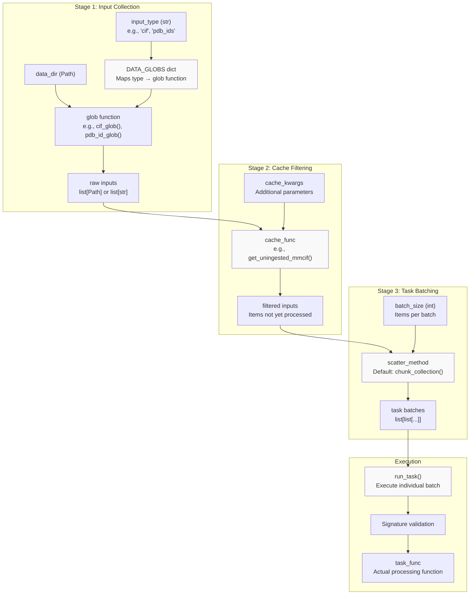
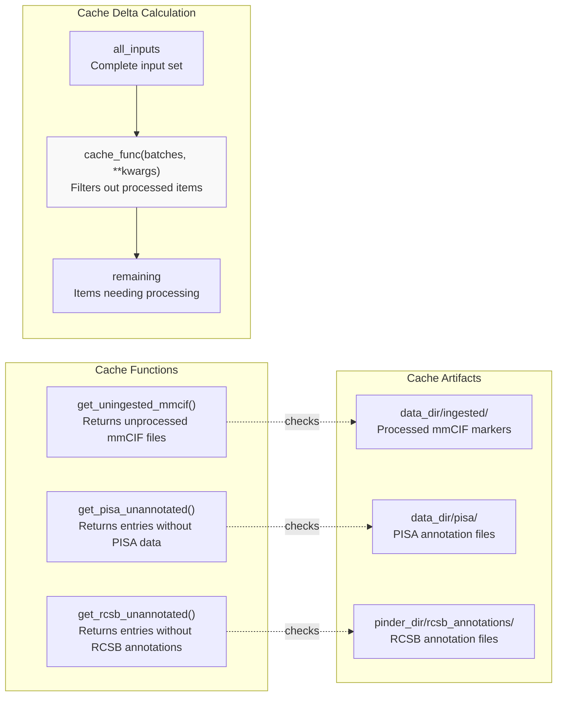
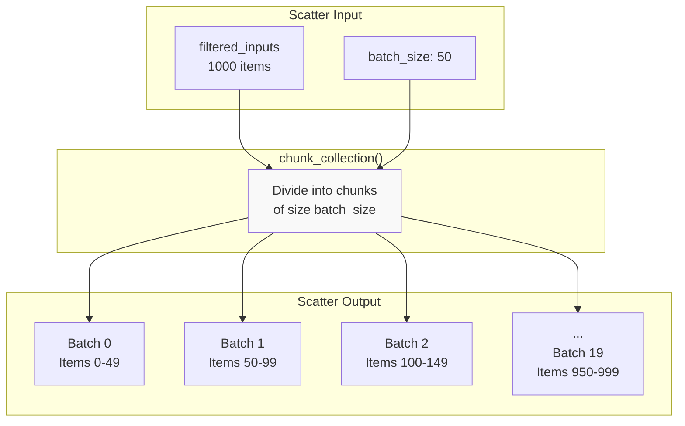
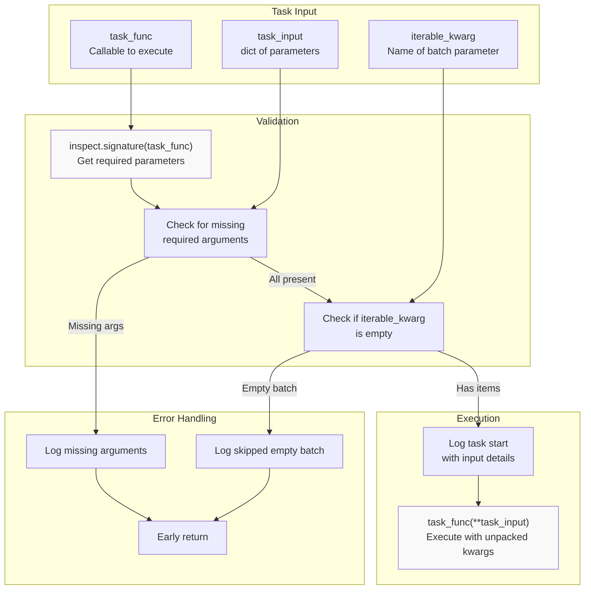
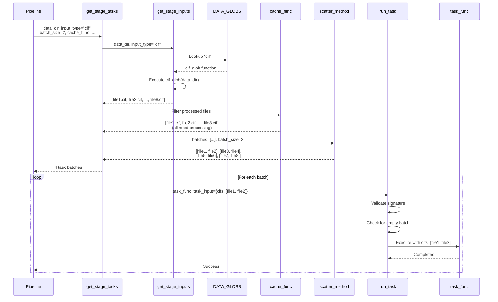

# Task Orchestration

<details>
<summary>Relevant source files</summary>

The following files were used as context for generating this wiki page:

- [src/pinder-data/pinder/data/pipeline/tasks.py](src/pinder-data/pinder/data/pipeline/tasks.py)
- [tests/data/test_graphql.py](tests/data/test_graphql.py)
- [tests/data/test_tasks.py](tests/data/test_tasks.py)

</details>


## Purpose and Scope

This document describes the task orchestration system in the PINDER data generation pipeline. The orchestration layer handles parallel processing of large-scale data transformations by batching inputs, caching processed results, and distributing work across multiple workers. This system sits between the data acquisition layer (see [Data Acquisition from RCSB](#5.1)) and the specific processing tasks like mmCIF parsing (see [mmCIF Processing](#5.3)) and annotation fetching (see [RCSB Annotations](#5.4)).

The orchestration system is implemented in [`src/pinder-data/pinder/data/pipeline/tasks.py`](src/pinder-data/pinder/data/pipeline/tasks.py:1-182)() and provides a unified interface for executing different pipeline stages with automatic progress tracking, failure handling, and incremental processing.

## Task Orchestration Flow

The task orchestration system follows a three-stage pattern: (1) collect inputs from the filesystem or external sources, (2) filter out already-processed items using cache functions, and (3) batch remaining work into parallel tasks.



**Sources:** [src/pinder-data/pinder/data/pipeline/tasks.py:99-139]()

## Input Collection System

The orchestration system uses a registry of input collection functions to gather work items for different pipeline stages. Each input type has a corresponding "glob" function that scans the filesystem or queries external sources.

### Input Types and Glob Functions

| Input Type | Glob Function | Return Type | Description |
|------------|---------------|-------------|-------------|
| `cif` | `cif_glob()` | `list[Path]` | mmCIF files matching `*/*/*enrich.cif.gz` |
| `dimers` | `dimer_glob()` | `list[Path]` | Dimer PDB files matching `*/*/*__*--*__*.pdb` |
| `entries` | `entry_glob()` | `list[Path]` | PDB entry directories |
| `two_char_codes` | `two_char_code_rsync()` | `list[str]` | Two-character codes from RCSB rsync |
| `pdb_ids` | `pdb_id_glob()` | `list[str]` | PDB IDs extracted from entry directories |
| `foldseek` | `foldseek_pdb_glob()` | `list[Path]` | PDB files for FoldSeek clustering |
| `graph_types` | `graph_type_glob()` | `list[tuple[str, bool]]` | Graph type specifications |
| `putative_apo_pairings` | `putative_apo_pairings()` | `pd.DataFrame` | Apo-holo pairing candidates |

**Sources:** [src/pinder-data/pinder/data/pipeline/tasks.py:23-96]()

### DATA_GLOBS Registry

The `DATA_GLOBS` dictionary maps input type strings to their corresponding glob functions, enabling dynamic dispatch based on stage requirements:

```python
DATA_GLOBS: dict[str, Callable[[Path], INPUT_TYPES]] = {
    "cif": cif_glob,
    "dimers": dimer_glob,
    "entries": entry_glob,
    "two_char_codes": two_char_code_rsync,
    "pdb_ids": pdb_id_glob,
    "foldseek": foldseek_pdb_glob,
    "graph_types": graph_type_glob,
    "putative_apo_pairings": putative_apo_pairings,
}
```

The `get_stage_inputs()` function uses this registry to collect inputs for a given pipeline stage:

**Sources:** [src/pinder-data/pinder/data/pipeline/tasks.py:87-105]()

## Caching Strategy

The orchestration system implements incremental processing by filtering out items that have already been processed. This is accomplished through cache functions that determine which inputs still require processing.



The `get_cache_delta()` function applies a cache function to filter inputs:

**Sources:** [src/pinder-data/pinder/data/pipeline/tasks.py:108-114](), [tests/data/test_tasks.py:22-92]()

### Example: Apo Pairing Cache

The `putative_apo_pairings()` function demonstrates a more complex caching strategy that checks for existing metrics to avoid recomputing pairing evaluations:

**Sources:** [src/pinder-data/pinder/data/pipeline/tasks.py:68-84]()

## Task Batching and Scatter Methods

After filtering cached items, the orchestration system batches remaining work into parallel tasks. The default scatter method is `chunk_collection()`, which divides inputs into fixed-size batches.



The `get_stage_tasks()` function orchestrates the complete flow from input collection to task batching:

**Sources:** [src/pinder-data/pinder/data/pipeline/tasks.py:117-138]()

## Task Execution and Validation

The `run_task()` function executes individual task batches with built-in validation and error handling. It inspects the task function's signature to ensure all required arguments are provided before execution.

### Task Execution Flow



**Sources:** [src/pinder-data/pinder/data/pipeline/tasks.py:141-181]()

### Signature Validation Logic

The task execution system validates function signatures before execution to catch configuration errors early:

1. **Extract required parameters** using `inspect.signature(task_func)`
2. **Check for missing arguments** by comparing signature parameters against `task_input` keys
3. **Validate iterable argument** by checking if the designated batch parameter is non-empty
4. **Log and skip** if validation fails, preventing wasted computation

**Sources:** [src/pinder-data/pinder/data/pipeline/tasks.py:154-176]()

## Pipeline Stage Integration

The orchestration system integrates with multiple pipeline stages, each with specific input types, cache functions, and processing tasks.

### Example Pipeline Stages


**Sources:** [tests/data/test_tasks.py:22-92]()

### Stage Configuration Parameters

Each pipeline stage is configured with the following parameters passed to `get_stage_tasks()`:

| Parameter | Type | Description |
|-----------|------|-------------|
| `data_dir` | `Path` | Root directory for pipeline data |
| `input_type` | `str` | Key into `DATA_GLOBS` registry |
| `batch_size` | `int` | Number of items per task batch |
| `cache_func` | `Callable` or `None` | Function to filter processed items |
| `cache_kwargs` | `dict` | Additional arguments for cache function |
| `scatter_method` | `Callable` | Batching function (default: `chunk_collection`) |
| `scatter_kwargs` | `dict` | Additional arguments for scatter method |

**Sources:** [src/pinder-data/pinder/data/pipeline/tasks.py:117-125]()

## Complete Orchestration Example

The following diagram shows how the orchestration system processes a complete pipeline stage from input collection to task execution:



**Sources:** [src/pinder-data/pinder/data/pipeline/tasks.py:99-181](), [tests/data/test_tasks.py:95-104]()

## Task Dependencies and Imports

The orchestration system imports processing functions from other modules in the data pipeline:

| Module | Imported Functions | Purpose |
|--------|-------------------|---------|
| `pinder.data.rcsb_rsync` | `get_rsync_directories()`, `get_two_char_codes_not_downloaded()`, `download_two_char_codes()` | RCSB data synchronization |
| `pinder.data.get_dimers` | `get_pdb_entry_dirs()` | Entry directory discovery |
| `pinder.data.get_apo` | `get_putative_pairings()` | Apo-holo pairing candidates |
| `pinder.data.pipeline.scatter` | `chunk_collection()` | Default batching strategy |

**Sources:** [src/pinder-data/pinder/data/pipeline/tasks.py:1-12](), [tests/data/test_tasks.py:95-104]()

## Logging and Progress Tracking

The orchestration system uses structured logging to track pipeline progress. Key log messages include:

- **Input summary**: `"{input_type}: {len(batches)} inputs -> {len(tasks)} task batches"`
- **Task start**: `"Running {task_name}: {arg_msg}"`
- **Empty batch skip**: `"Skipping {task_name}: {iterable_kwarg} inputs are empty..."`
- **Missing arguments**: `"Missing required arguments for {task_name}: {missing_args}"`

**Sources:** [src/pinder-data/pinder/data/pipeline/tasks.py:137-179]()

---