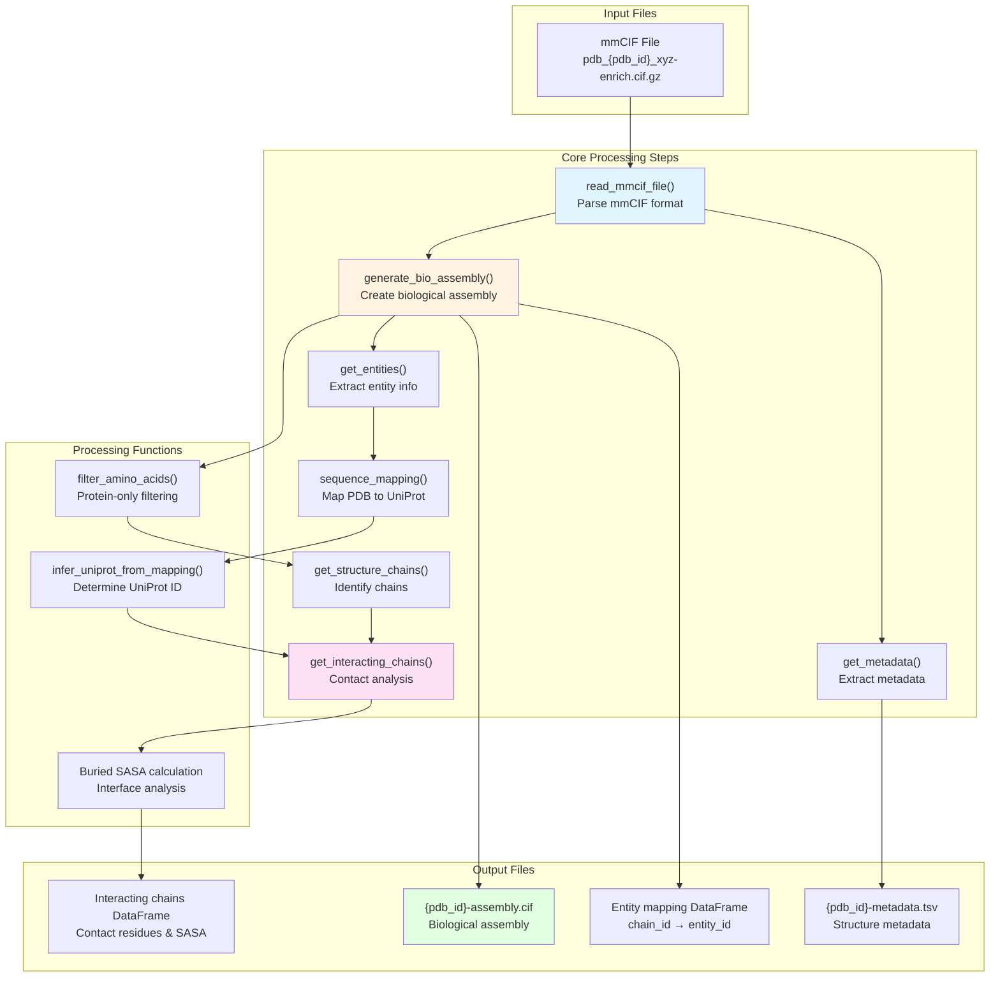
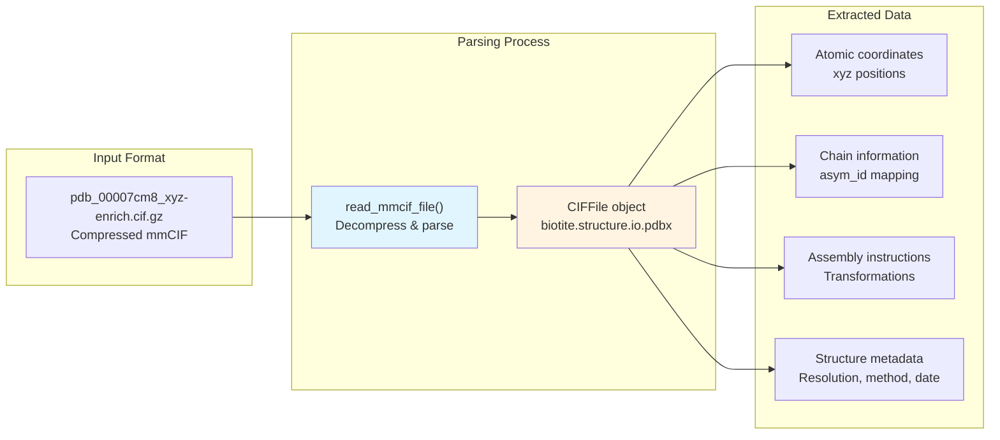
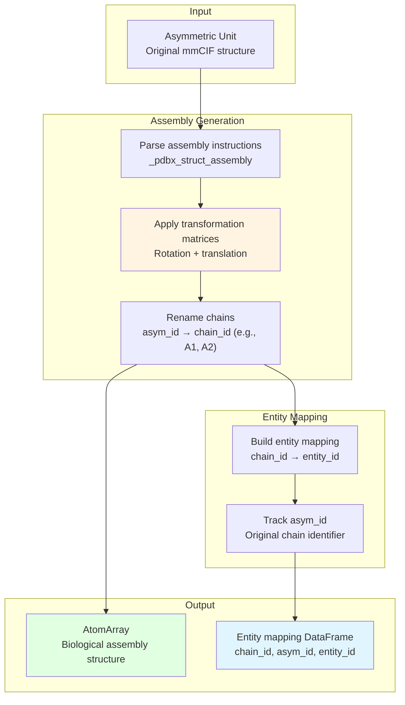
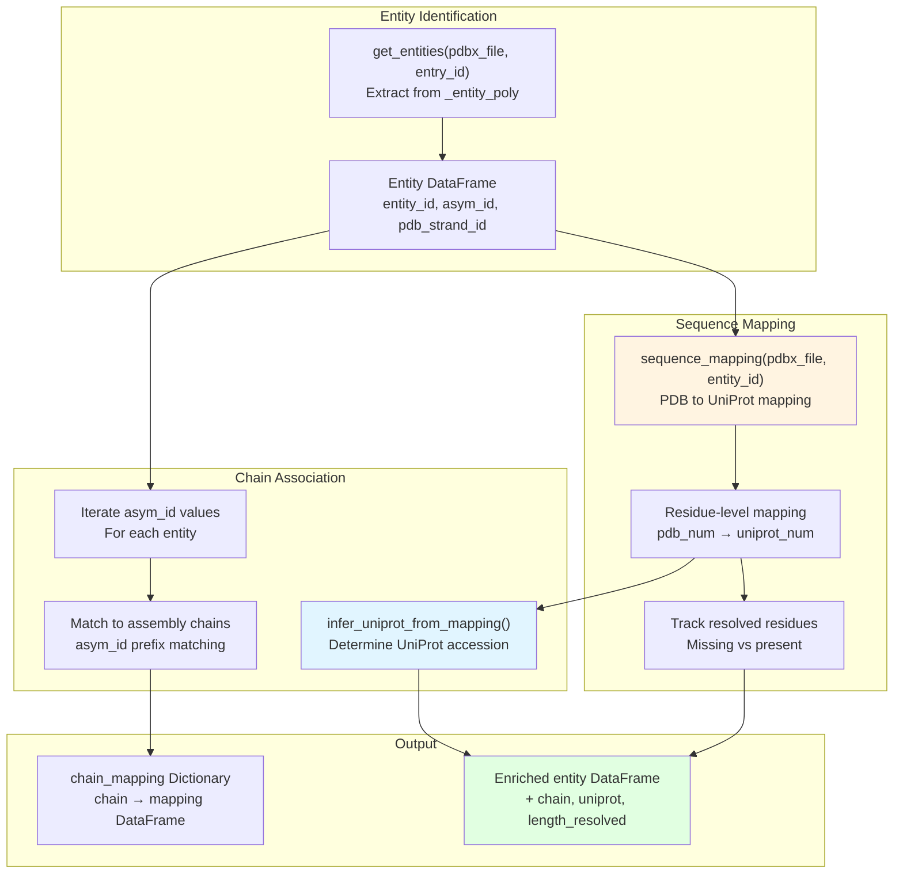
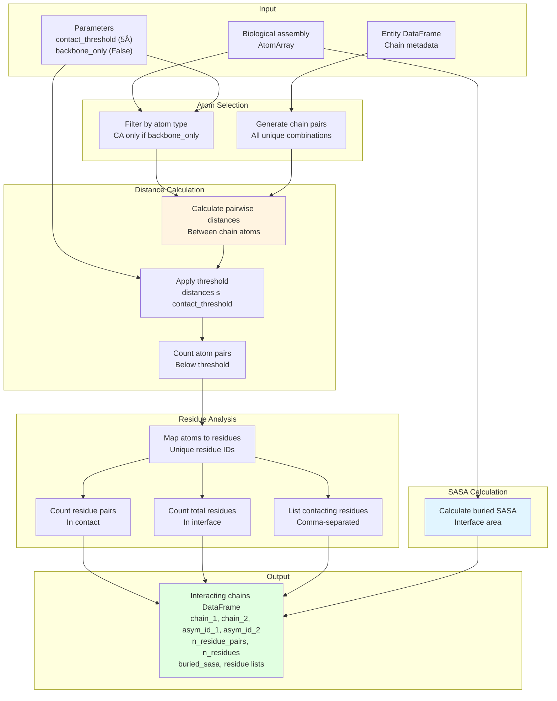
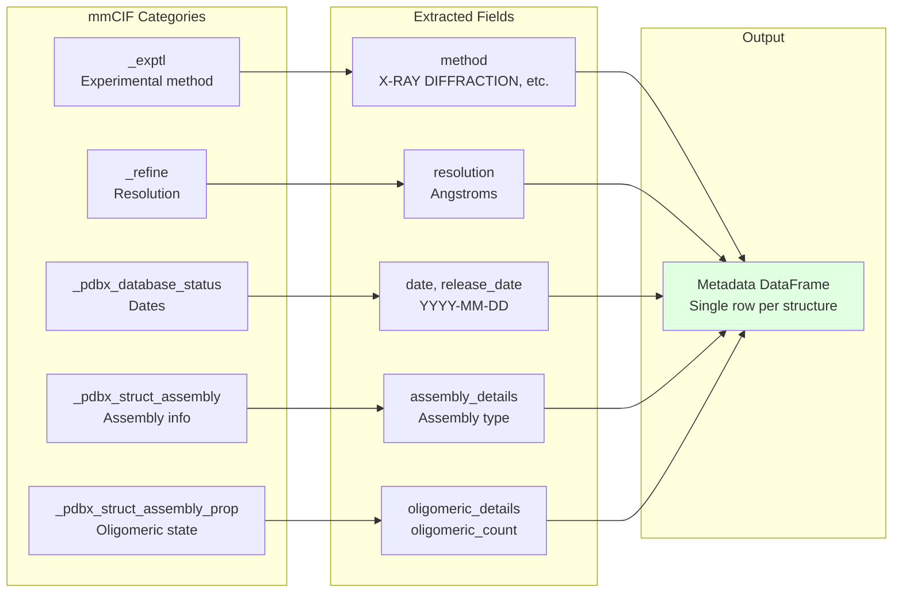
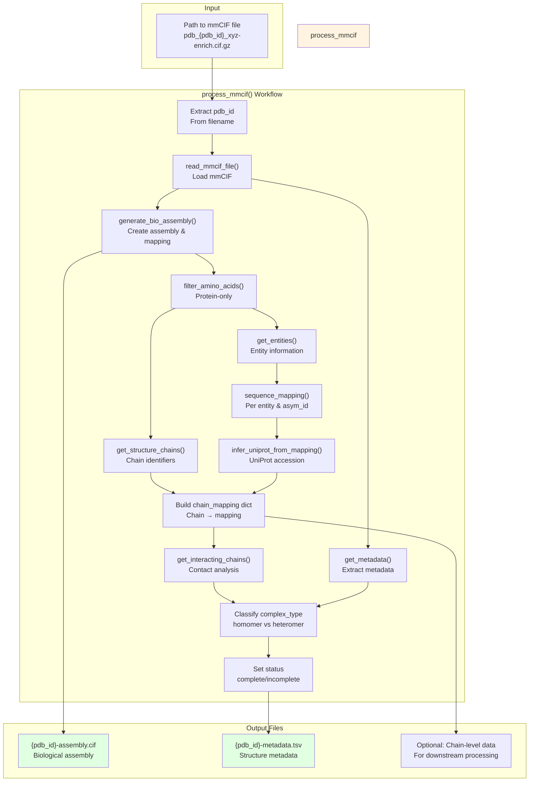

# mmCIF Processing

<details>
<summary>Relevant source files</summary>

The following files were used as context for generating this wiki page:

- [tests/data/test_get_data.py](tests/data/test_get_data.py)

</details>


## Purpose and Scope

This document describes the mmCIF (macromolecular Crystallographic Information File) processing system within the PINDER data generation pipeline. The mmCIF processing module is responsible for parsing raw structure files downloaded from RCSB PDB, generating biological assemblies, extracting entity information, identifying interacting chains, and producing structured output files for downstream dataset construction.

The mmCIF processing system is located in the `pinder.data.get_data` module and is a critical component of the dataset generation workflow. For information about how mmCIF files are acquired from RCSB, see [Data Acquisition from RCSB](#5.1). For details on task orchestration and parallel processing, see [Task Orchestration](#5.2). For information about GraphQL-based annotation fetching, see [RCSB Annotations](#5.4).

---

## mmCIF Processing Pipeline Overview

The following diagram shows the complete mmCIF processing pipeline, from input files to structured output:



**Sources:** [tests/data/test_get_data.py:217-240](), [tests/data/test_get_data.py:242-267](), [tests/data/test_get_data.py:348-362]()

---

## Reading and Parsing mmCIF Files

The `read_mmcif_file()` function parses compressed mmCIF files downloaded from RCSB PDB. These files follow the naming convention `pdb_{pdb_id}_xyz-enrich.cif.gz` and contain the complete structural information including atomic coordinates, metadata, and biological assembly instructions.



The `CIFFile` object from biotite provides access to all mmCIF data categories, including `_atom_site`, `_pdbx_struct_assembly`, `_entity_poly`, and others.

**Sources:** [tests/data/test_get_data.py:114](), [tests/data/test_get_data.py:168]()

---

## Biological Assembly Generation

The `generate_bio_assembly()` function transforms the asymmetric unit structure into the biologically relevant assembly using transformation matrices defined in the mmCIF file. This step is critical because crystallographic structures may contain only a portion of the functional biological unit.



The generated biological assembly may contain significantly more or fewer chains than the asymmetric unit. For example:
- PDB 7KMX: 14 asym_id chains expand to 840 assembly chains
- PDB 7BDU: 7 asym_id chains remain as 7 assembly chains
- PDB 2A79: 13 asym_id chains expand to 34 assembly chains

**Sources:** [tests/data/test_get_data.py:348-362](), [tests/data/test_get_data.py:116]()

---

## Entity Extraction and Sequence Mapping

Entity extraction identifies distinct molecular entities (proteins) within the structure and maps them to their sequences and UniProt accessions.



The sequence mapping process creates a residue-by-residue correspondence between PDB numbering and UniProt canonical sequences, tracking which residues are structurally resolved. This is essential for later alignment and superposition operations.

**Sources:** [tests/data/test_get_data.py:118-149]()

---

## Interacting Chain Identification

The `get_interacting_chains()` function performs contact analysis to identify which chain pairs form protein-protein interfaces. This is a core step in determining which structures qualify for inclusion in the PINDER dataset.

### Contact Detection Algorithm



### Contact Analysis Output

The `get_interacting_chains()` function returns a DataFrame with the following fields:

| Field | Description |
|-------|-------------|
| `chain_1` | First chain identifier from assembly |
| `chain_2` | Second chain identifier from assembly |
| `asym_id_1` | Asymmetric unit ID for chain 1 |
| `asym_id_2` | Asymmetric unit ID for chain 2 |
| `pdb_strand_id_1` | Author chain ID for chain 1 |
| `pdb_strand_id_2` | Author chain ID for chain 2 |
| `entry_id` | PDB ID |
| `n_residue_pairs` | Number of residue pairs in contact |
| `n_residues` | Total unique residues in interface |
| `buried_sasa` | Buried solvent accessible surface area (Ų) |
| `chain_1_residues` | Comma-separated list of contacting residue numbers |
| `chain_2_residues` | Comma-separated list of contacting residue numbers |

### Parameter Effects

The contact detection behavior varies based on parameters:

| `contact_threshold` | `backbone_only` | Effect |
|---------------------|-----------------|--------|
| 5.0 Å | False | Default configuration - all heavy atoms, tight contacts |
| 10.0 Å | False | Expanded interface - captures more distant interactions |
| 5.0 Å | True | Backbone only - Cα atoms, stricter interface definition |
| 10.0 Å | True | Relaxed backbone - broader interface region |

**Sources:** [tests/data/test_get_data.py:40-91](), [tests/data/test_get_data.py:93-163]()

---

## Metadata Extraction

The `get_metadata()` function extracts structural and experimental metadata from the mmCIF file that characterizes the quality and type of the structure.



Example metadata record:

| Field | Value |
|-------|-------|
| `entry_id` | 7CM8 |
| `method` | X-RAY DIFFRACTION |
| `date` | 2020-07-25 |
| `release_date` | 2020-08-19 |
| `resolution` | 1.90 |
| `assembly` | 1 |
| `assembly_details` | author_and_software_defined_assembly |
| `oligomeric_details` | dimeric |
| `oligomeric_count` | 2 |

**Sources:** [tests/data/test_get_data.py:165-189](), [tests/data/test_get_data.py:191-216]()

---

## Main Processing Function

The `process_mmcif()` function orchestrates the complete processing pipeline, coordinating all the steps described above.



The `process_mmcif()` function enriches the metadata with derived fields:

- `complex_type`: Determined by comparing UniProt accessions - "homomer" if all chains have the same UniProt ID, "heteromer" otherwise
- `status`: Set to "complete" if processing succeeds without errors, otherwise may indicate issues

**Sources:** [tests/data/test_get_data.py:217-240]()

---

## Output File Formats

### Assembly CIF File

The `{pdb_id}-assembly.cif` file contains the biological assembly with renamed chain identifiers. Chains are named using a prefix system where the asym_id from the asymmetric unit is preserved with numeric suffixes (e.g., `A1`, `A2` for multiple copies of asym_id `A`).

**Chain naming example for PDB 7CM8:**
```
Asymmetric unit:    A
Biological assembly: A1, A2  (dimer)
```

The assembly CIF can be converted to PDB format with specific chain selections using the `atoms.cif_to_pdb()` function.

**Sources:** [tests/data/test_get_data.py:242-267]()

### Metadata TSV File

The `{pdb_id}-metadata.tsv` file is a tab-separated values file containing a single row with the metadata fields extracted by `get_metadata()` plus derived fields from `process_mmcif()`:

```
entry_id    method    date    release_date    resolution    assembly    ...
7cm8        X-RAY...  2020... 2020-08-19     1.9           1          ...
```

**Sources:** [tests/data/test_get_data.py:227-236]()

---

## Special Cases and Edge Cases

### Large Oligomeric Assemblies

Some structures produce extremely large biological assemblies:

| PDB ID | Asym IDs | Assembly Chains | Entity IDs |
|--------|----------|-----------------|------------|
| 7KMX | 14 | 840 | 2 |
| 6RW4 | 125 | 125 | 42 |
| 2Y26 | 40 | 120 | 2 |

These structures require significant memory and processing time during contact analysis.

**Sources:** [tests/data/test_get_data.py:284-362]()

### Monomer Processing

Structures containing only a single protein chain are processed but may not produce interacting chain data since no protein-protein interface exists. The `process_mmcif()` function handles these cases gracefully.

**Sources:** [tests/data/test_get_data.py:364-368]()

### Invalid or Incomplete Structures

Some mmCIF files may lack required data or contain invalid structures. The `process_mmcif()` function may raise exceptions for these cases, which are caught during task orchestration to skip problematic entries.

**Sources:** [tests/data/test_get_data.py:237-240]()

---

## Integration with Dataset Pipeline

The mmCIF processing outputs feed directly into the dataset construction workflow:

1. **Assembly CIF files** are used to create monomer structures (receptor/ligand) by extracting individual chains
2. **Metadata TSV files** provide filtering criteria (resolution, method, oligomeric state)
3. **Entity mappings** enable pairing of apo structures with holo complexes based on UniProt accessions
4. **Interacting chain data** defines which chain pairs constitute valid protein-protein interfaces for the dataset

The processed data is organized in the file system by two-character PDB codes (e.g., `cm/pdb_00007cm8/`) and subsequently indexed for efficient access by the data loading system (see [PinderLoader](#4.1)).

**Sources:** [tests/data/test_get_data.py:1-368]()

---