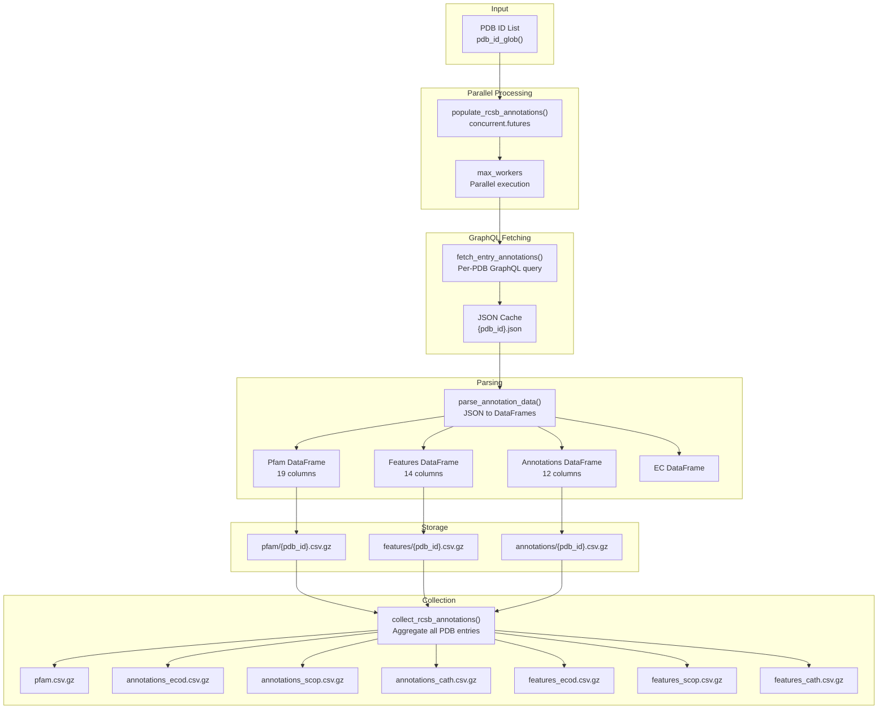
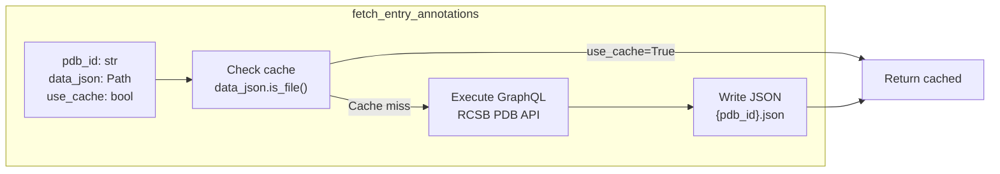
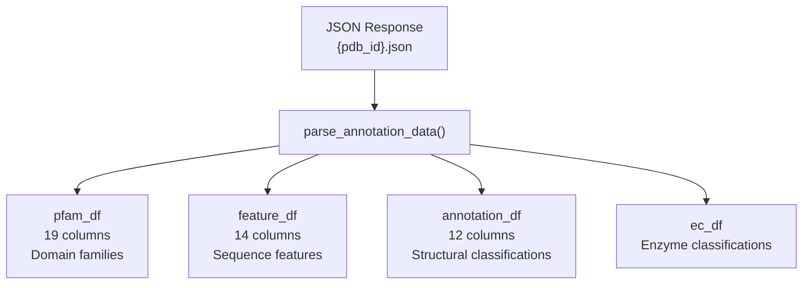
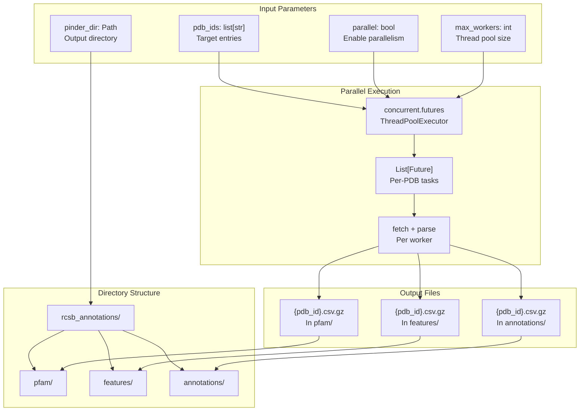
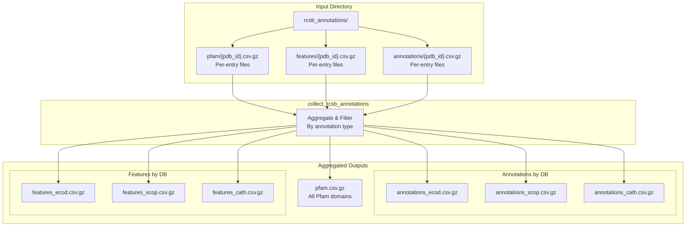
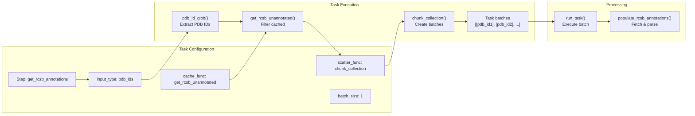

# RCSB Annotations

<details>
<summary>Relevant source files</summary>

The following files were used as context for generating this wiki page:

- [src/pinder-data/pinder/data/pipeline/tasks.py](src/pinder-data/pinder/data/pipeline/tasks.py)
- [tests/data/test_graphql.py](tests/data/test_graphql.py)
- [tests/data/test_tasks.py](tests/data/test_tasks.py)

</details>


## Purpose and Scope

This document describes the GraphQL-based annotation system that fetches structural and functional metadata from the RCSB PDB database. The annotation pipeline retrieves Pfam domains, ECOD/SCOP/CATH structural classifications, sequence features, and enzyme commission (EC) numbers for protein entries.

For information about downloading raw structure files from RCSB, see [Data Acquisition from RCSB](#5.1). For details on how annotation tasks are orchestrated within the broader pipeline, see [Task Orchestration](#5.2).

## Overview

The RCSB annotation system queries the RCSB PDB GraphQL API to enrich structural data with biological annotations. These annotations are essential for understanding protein domain composition, structural classifications, and functional properties that inform dataset filtering and analysis.

The system processes PDB IDs in parallel batches, fetching comprehensive annotation data and organizing it into structured CSV files for downstream use.



**Annotation Pipeline Architecture**

Sources: [tests/data/test_graphql.py:1-100](), [src/pinder-data/pinder/data/pipeline/tasks.py:44-47]()

## GraphQL API Integration

The annotation system interfaces with the RCSB PDB GraphQL API to retrieve structured metadata. The `fetch_entry_annotations()` function executes GraphQL queries for individual PDB entries and caches responses locally.

### Fetching Process

The fetching mechanism retrieves comprehensive annotation data for each PDB entry:



**Fetch Entry Annotations Flow**

The function supports caching to avoid redundant API calls. When `use_cache=True`, it skips fetching if the JSON file already exists.

Sources: [tests/data/test_graphql.py:47-50]()

## Annotation Types

The GraphQL API returns four distinct types of annotation data, each stored in separate DataFrames:

### Pfam Domain Annotations

Pfam annotations describe protein domain families and provide functional classification. The Pfam DataFrame contains 19 columns including:

| Key Fields | Description |
|------------|-------------|
| `rcsb_id` | Pfam accession (e.g., PF00076, PF14939) |
| `rcsb_pfam_identifier` | Pfam family name (e.g., RRM_1, CPSF_A) |
| Positional data | Start/end positions of domain boundaries |
| Asymmetric chain IDs | Chain associations |

Sources: [tests/data/test_graphql.py:51-60]()

### Structural Classification Annotations

The annotations DataFrame contains hierarchical structural classifications from ECOD, SCOP, and CATH databases. It has 12 columns and includes annotation IDs such as:

| Database | Example IDs |
|----------|-------------|
| CATH | 3.30.70.330 |
| ECOD | 8051194, 8061923, 8052530 |
| SCOP | e6q0rA1, e6q0rA2, e6q0rA3, e6q0rD1, d6q0rd1, d6q0rd2 |

Sources: [tests/data/test_graphql.py:13-38](), [tests/data/test_graphql.py:63]()

### Sequence Feature Annotations

The features DataFrame captures 14 columns of sequence-level annotations including:

| Feature Type | Description |
|--------------|-------------|
| `ASA` | Accessible surface area |
| `HELIX_P` | Alpha helix secondary structure |
| `SHEET` | Beta sheet secondary structure |
| `UNASSIGNED_SEC_STRUCT` | Unassigned secondary structure |
| `SCOP`, `SCOP2B_SUPERFAMILY` | SCOP classifications |
| `CATH`, `ECOD` | Structural domain features |
| `BINDING_SITE` | Ligand binding sites |
| `CIS-PEPTIDE` | Cis-peptide bonds |
| `UNOBSERVED_RESIDUE_XYZ` | Missing residues |
| `UNOBSERVED_ATOM_XYZ` | Missing atoms |

Sources: [tests/data/test_graphql.py:13-26](), [tests/data/test_graphql.py:61-62]()

### Enzyme Commission (EC) Numbers

The EC DataFrame captures enzyme classification data. While not all entries have EC annotations, the DataFrame structure accommodates these when present.

Sources: [tests/data/test_graphql.py:51](), [tests/data/test_graphql.py:56]()

## Data Parsing

The `parse_annotation_data()` function transforms raw JSON responses into structured DataFrames:



**Annotation Data Parsing**

The parser extracts different annotation types from the nested GraphQL response structure and normalizes them into tabular formats suitable for downstream analysis.

Sources: [tests/data/test_graphql.py:51-63]()

## Parallel Processing System

The `populate_rcsb_annotations()` function orchestrates parallel fetching and parsing of annotations across multiple PDB entries:



**Parallel Annotation Population**

The function creates separate subdirectories for each annotation type and writes compressed CSV files for each PDB entry. When `parallel=True`, it uses a thread pool to fetch multiple entries concurrently.

Sources: [tests/data/test_graphql.py:66-82]()

## Annotation Collection

After individual PDB entries are annotated, the `collect_rcsb_annotations()` function aggregates the per-entry CSV files into unified datasets:



**Annotation Collection Process**

The collection process reads all per-entry CSV files, filters annotations and features by their respective databases (ECOD, SCOP, CATH), and writes consolidated CSV files. The Pfam annotations are not database-specific and are aggregated into a single file.

Sources: [tests/data/test_graphql.py:85-99]()

## Task Integration

The annotation fetching integrates with the broader pipeline task system through the `get_rcsb_annotations` step:



**Task Integration Flow**

The annotation task follows the standard pipeline pattern:
1. **Input gathering**: `pdb_id_glob()` extracts PDB IDs from entry directories
2. **Cache filtering**: `get_rcsb_unannotated()` identifies entries without annotations
3. **Scatter**: `chunk_collection()` divides PDB IDs into batches
4. **Execution**: `run_task()` invokes `populate_rcsb_annotations()` for each batch

Sources: [tests/data/test_tasks.py:56-64](), [src/pinder-data/pinder/data/pipeline/tasks.py:44-47]()

## Directory Structure

The annotation system creates a hierarchical directory structure under `pinder_dir/rcsb_annotations/`:

```
pinder_dir/
└── rcsb_annotations/
    ├── pfam/
    │   ├── 6Q0R.csv.gz
    │   ├── 2A79.csv.gz
    │   └── ...
    ├── features/
    │   ├── 6Q0R.csv.gz
    │   ├── 2A79.csv.gz
    │   └── ...
    ├── annotations/
    │   ├── 6Q0R.csv.gz
    │   ├── 2A79.csv.gz
    │   └── ...
    ├── pfam.csv.gz
    ├── annotations_ecod.csv.gz
    ├── annotations_scop.csv.gz
    ├── annotations_cath.csv.gz
    ├── features_ecod.csv.gz
    ├── features_scop.csv.gz
    └── features_cath.csv.gz
```

Per-entry files are written during the population phase, while aggregated files are created during the collection phase.

Sources: [tests/data/test_graphql.py:74-82](), [tests/data/test_graphql.py:88-99]()

## Caching Strategy

The annotation system implements two levels of caching:

### JSON Response Caching

The `fetch_entry_annotations()` function caches raw GraphQL responses as JSON files. When `use_cache=True`, it skips API requests for entries with existing cache files.

### Task-Level Caching

The `get_rcsb_unannotated()` cache function (used in task orchestration) identifies PDB entries that lack annotation CSV files, preventing redundant fetching of already-processed entries.

This dual-caching approach optimizes both API usage and processing time, particularly important when re-running pipeline stages after failures or when adding new PDB entries to an existing dataset.

Sources: [tests/data/test_graphql.py:49](), [tests/data/test_tasks.py:59-60]()

## Key Functions Reference

| Function | Module | Purpose |
|----------|--------|---------|
| `fetch_entry_annotations()` | `pinder.data.annotation.graphql` | Fetch GraphQL data for single PDB entry |
| `parse_annotation_data()` | `pinder.data.annotation.graphql` | Parse JSON into DataFrames |
| `populate_rcsb_annotations()` | `pinder.data.annotation.graphql` | Parallel annotation fetching |
| `collect_rcsb_annotations()` | `pinder.data.annotation.graphql` | Aggregate per-entry CSVs |
| `pdb_id_glob()` | `pinder.data.pipeline.tasks` | Extract PDB IDs from directories |
| `get_rcsb_unannotated()` | `pinder.data.pipeline.cache` | Filter unannotated entries |

Sources: [tests/data/test_graphql.py:1-100](), [src/pinder-data/pinder/data/pipeline/tasks.py:44-47]()

---