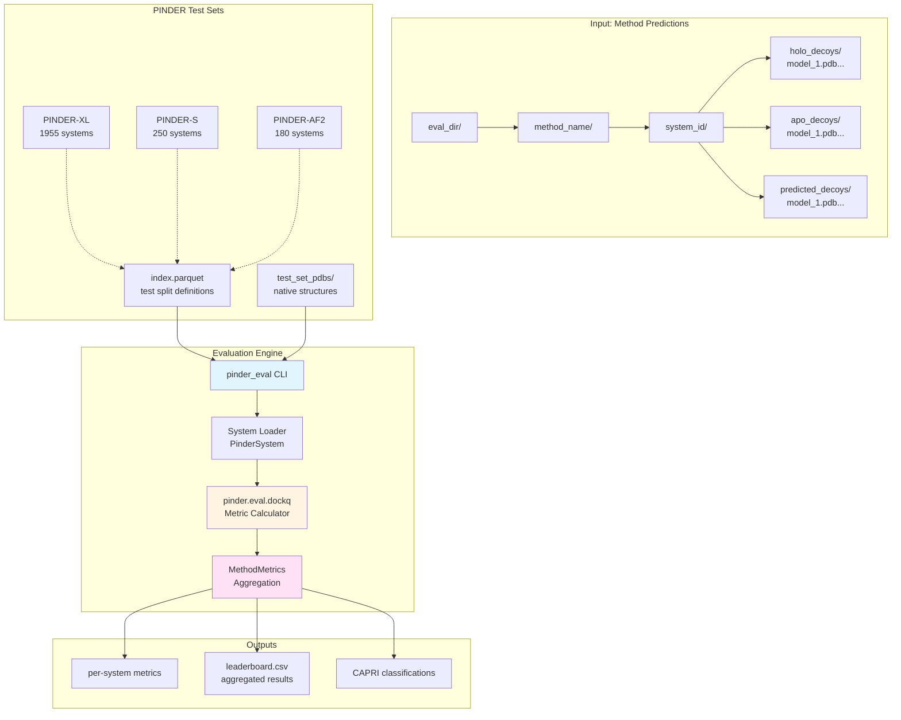
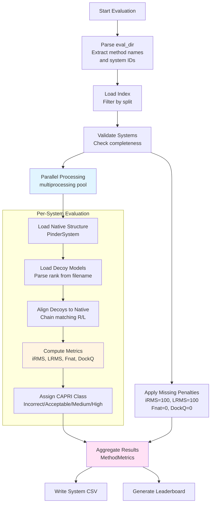
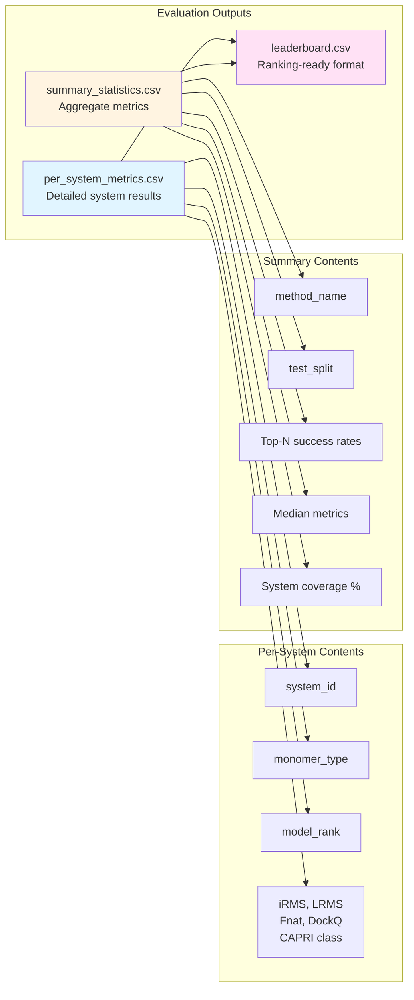
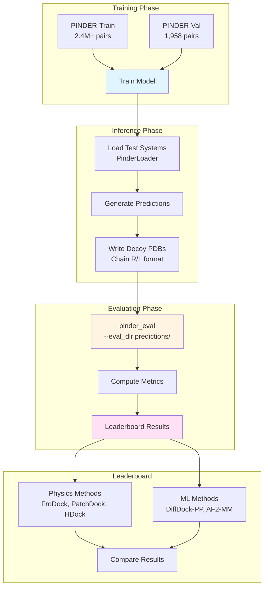

# Evaluation

<details>
<summary>Relevant source files</summary>

The following files were used as context for generating this wiki page:

- [README.md](README.md)

</details>


## Purpose and Scope

This page explains the PINDER evaluation system, which provides standardized assessment of protein-protein docking methods against benchmark test sets. The evaluation harness processes predicted structures and computes CAPRI-standard metrics to enable fair comparison across methods.

For detailed information about specific aspects of evaluation:
- For the CLI tool and directory structure, see [Evaluation Harness](#6.1)
- For metric definitions and calculations, see [Metrics](#6.2)
- For test set characteristics and selection, see [Benchmark Test Sets](#6.3)

## Overview

The PINDER evaluation system consists of three main components:

1. **Evaluation Harness**: A CLI tool (`pinder_eval`) and Python API that processes predicted structures
2. **Metrics Engine**: Implementations of CAPRI metrics (iRMS, LRMS, Fnat, DockQ) 
3. **Benchmark Test Sets**: Curated holdout sets (PINDER-XL, PINDER-S, PINDER-AF2) for standardized evaluation

The evaluation workflow follows community-standard CAPRI (Critical Assessment of PRediction of Interactions) guidelines for assessing docking quality.

Sources: [README.md:300-381]()

## System Architecture



**Description**: The evaluation system takes a standardized directory structure containing method predictions, loads native structures from test sets, computes CAPRI metrics per system, and aggregates results into leaderboard-ready outputs. The `pinder_eval` CLI orchestrates the entire process, using `MethodMetrics` for aggregation logic.

Sources: [README.md:307-381]()

## Evaluation Workflow



**Description**: Evaluation proceeds by parsing the directory structure, loading the appropriate test set index, validating system coverage, and processing each system in parallel. Missing predictions receive penalty scores to ensure fair comparison across incomplete method submissions.

Sources: [README.md:307-327](), [README.md:365-377]()

## Directory Structure Requirements

The evaluation system expects a specific directory layout that separates predictions by method, system, and monomer type:

```
eval_dir/
└── method_name/
    ├── system_id_1/
    │   ├── holo_decoys/
    │   │   ├── model_1.pdb
    │   │   ├── model_2.pdb
    │   │   └── ...
    │   ├── apo_decoys/
    │   │   ├── model_1.pdb
    │   │   └── ...
    │   └── predicted_decoys/
    │       ├── model_1.pdb
    │       └── ...
    └── system_id_2/
        └── ...
```

### Directory Component Requirements

| Component | Description | Required |
|-----------|-------------|----------|
| `eval_dir` | Root directory containing one or more methods | Yes |
| `method_name` | Subdirectory for each evaluated method | Yes |
| `system_id` | PINDER system ID (e.g., `1an1__A1_P00761--1an1__B1_P80424`) | Yes |
| `holo_decoys` | Predictions using holo (bound) monomers | Conditional* |
| `apo_decoys` | Predictions using apo (unbound) monomers | Conditional* |
| `predicted_decoys` | Predictions using AF2/predicted monomers | Conditional* |
| `model_<rank>.pdb` | Individual decoy models with extractable rank | Yes |

*At least one monomer type directory must be present per system.

### Decoy Model Requirements

Each decoy PDB file must satisfy:

1. **Chain naming**: Exactly two chains labeled `R` (receptor) and `L` (ligand)
2. **Rank extraction**: Filename must match regex pattern `r"\d+(?=\D*$)"` to extract prediction rank
3. **Structure validity**: Valid PDB format readable by structure parsing utilities

Sources: [README.md:328-363]()

## Command-Line Interface

The `pinder_eval` CLI provides the primary interface for running evaluations:

```bash
pinder_eval --eval_dir <path> \
            --method_name <name> \
            --allow_missing \
            --max_workers <N>
```

### CLI Arguments

| Argument | Short | Description | Default |
|----------|-------|-------------|---------|
| `--eval_dir` | `-f` | Path to evaluation directory | Required |
| `--method_name` | `-m`, `-n` | Optional output CSV prefix | `None` |
| `--serial` | `-s` | Disable parallel processing | `False` |
| `--allow_missing` | `-a` | Permit incomplete system coverage | `False` |
| `--custom_index` | `-c` | Path/URI to custom index file | `None` |
| `--max_workers` | `-w` | Maximum parallel processes | All cores |

### Example Usage

```bash
# Evaluate a single method on PINDER-S
pinder_eval --eval_dir ./predictions \
            --method_name my_method \
            --allow_missing

# Evaluate with custom parallelism
pinder_eval --eval_dir ./predictions \
            --max_workers 8

# Use custom test set definition
pinder_eval --eval_dir ./predictions \
            --custom_index gs://my-bucket/custom_index.parquet
```

Sources: [README.md:307-327]()

## Missing Prediction Penalties

To ensure fair comparison across methods, incomplete submissions receive standardized penalty scores:

| Metric | Penalty Value | Interpretation |
|--------|---------------|----------------|
| `iRMS` | 100.0 | Maximum possible error (Ångströms) |
| `LRMS` | 100.0 | Maximum possible error (Ångströms) |
| `Fnat` | 0.0 | No native contacts recovered |
| `DockQ` | 0.0 | Lowest quality score |
| `CAPRI` | "Incorrect" | Failed docking classification |

These penalties apply when:
- A system is missing from the submission
- A required monomer type directory is absent
- No decoy models can be parsed
- Structure loading fails

The `--allow_missing` flag enables evaluation on partial submissions by applying these penalties to missing systems rather than raising an error.

Sources: [README.md:365-377]()

## Evaluation Output Structure

The evaluation harness produces multiple output files for result analysis:



**Description**: The evaluation system generates granular per-system metrics for detailed analysis and aggregated summaries for method comparison. The leaderboard format follows community standards for result publication.

Sources: [README.md:380-381]()

## Test Set Selection

PINDER provides three benchmark test sets with different characteristics:

| Test Set | Systems | Purpose | Deleaking Strategy |
|----------|---------|---------|-------------------|
| **PINDER-XL** | 1,955 | Full evaluation benchmark | Structure & interface similarity |
| **PINDER-S** | 250 | Fast evaluation subset | Sampled from PINDER-XL |
| **PINDER-AF2** | 180 | AF2-MM comparison | iAlign-based transitive deleaking |

### Test Set Distribution

| Property | PINDER-XL | PINDER-S | PINDER-AF2 |
|----------|-----------|----------|------------|
| Holo pairs | 1,955 | 250 | 180 |
| Apo pairs | 342 | 93 | 30 |
| AF2 pairs | 1,747 | 250 | 127 |
| Heterodimers | - | 188 | - |
| Homodimers | - | 62 | - |

Each test set is stored in the `test_set_pdbs/` directory with native structures and pre-aligned monomers.

Sources: [README.md:244-252]()

## Integration with Training Pipeline



**Description**: The evaluation system integrates with the full training-to-leaderboard pipeline. Models trained on PINDER-Train generate predictions on test sets, which are evaluated by `pinder_eval` to produce leaderboard-comparable results alongside reference methods.

Sources: [README.md:288-298]()

## Evaluation Best Practices

### System Coverage

For fair comparison on leaderboards:
1. Evaluate on complete test sets (all systems in PINDER-XL/S/AF2)
2. Report coverage percentage if submission is incomplete
3. Use `--allow_missing` flag for partial submissions (penalties applied)

### Monomer Type Selection

Match evaluation to training conditions:
- If trained on **holo monomers**: evaluate using `holo_decoys/`
- If trained on **apo monomers**: evaluate using `apo_decoys/`
- If trained on **predicted monomers**: evaluate using `predicted_decoys/`

### Performance Optimization

For large-scale evaluation:
1. Use `--max_workers` to control parallelism based on available resources
2. Pre-validate decoy directory structure before running evaluation
3. Consider PINDER-S for rapid iteration during development
4. Use PINDER-XL/AF2 for final leaderboard submission

### Result Interpretation

When analyzing results:
1. Check system coverage in summary statistics
2. Compare median metrics (more robust than mean for skewed distributions)
3. Examine top-N success rates (e.g., % of systems with acceptable prediction in top 10)
4. Review per-system results to identify failure modes
5. Compare against baseline physics-based methods (FroDock, HDock, PatchDock)

Sources: [README.md:288-298](), [README.md:365-377]()

## Python API Usage

The evaluation system can also be used programmatically:

```python
from pinder.eval.dockq import MethodMetrics
from pathlib import Path

# Initialize evaluation
evaluator = MethodMetrics(
    eval_dir=Path("./predictions/my_method"),
    method_name="my_method",
    split="test",
    subset="pinder_s"
)

# Run evaluation
results = evaluator.evaluate()

# Access aggregated metrics
summary = evaluator.get_summary_statistics()
leaderboard_entry = evaluator.get_leaderboard_row()

# Access per-system results
per_system_df = evaluator.per_system_metrics
```

This API provides the same functionality as the CLI with programmatic access to results for integration into larger pipelines or custom analysis workflows.

Sources: [README.md:378-381]()

---