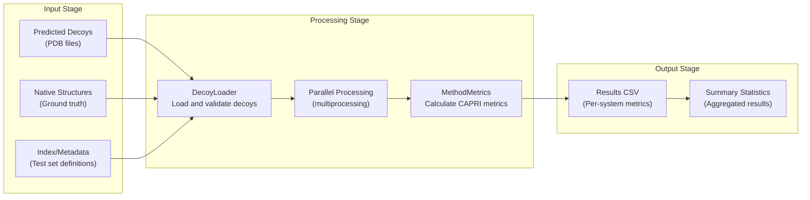
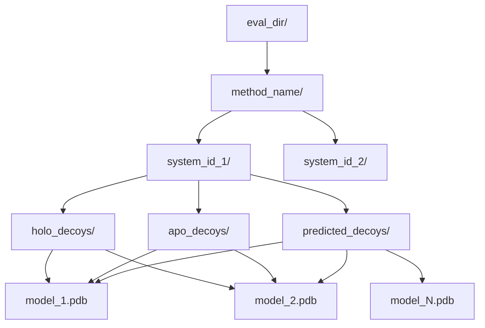
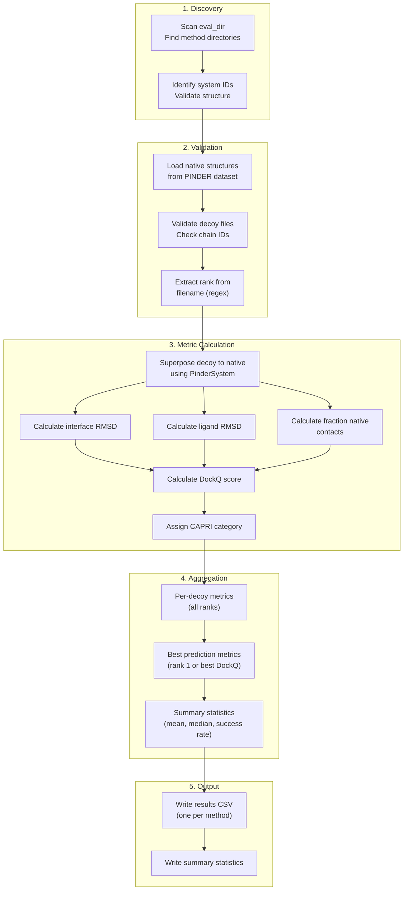
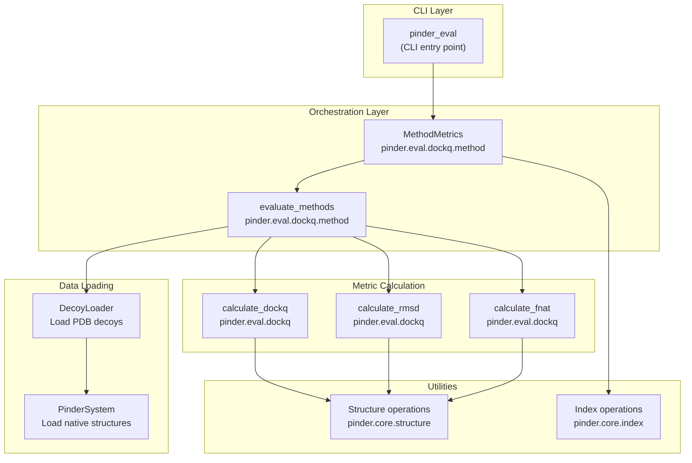

# Evaluation Harness

<details>
<summary>Relevant source files</summary>

The following files were used as context for generating this wiki page:

- [README.md](README.md)

</details>


The evaluation harness provides a standardized framework for evaluating protein-protein docking methods on PINDER test sets. It processes predictions from docking methods and computes CAPRI-standard metrics to enable fair comparisons across different approaches.

For detailed information on the specific metrics calculated (iRMS, LRMS, Fnat, DockQ), see [Metrics](#6.2). For information on the available benchmark test sets, see [Benchmark Test Sets](#6.3).

## Overview

The evaluation harness accepts predictions organized in a standardized directory structure and produces evaluation results for one or more docking methods. It supports parallel processing, handles missing predictions with penalty scores, and can evaluate custom test sets beyond the standard PINDER splits.

The evaluation process consists of three main stages:



**Sources:** [README.md:300-380]()

## CLI Tool: pinder_eval

The `pinder_eval` command-line tool is the primary interface for running evaluations. It orchestrates the entire evaluation workflow and provides flexible options for different use cases.

### Command Syntax

```bash
pinder_eval --eval_dir <path> [OPTIONS]
```

### Command-Line Options

| Option | Short | Type | Required | Description |
|--------|-------|------|----------|-------------|
| `--eval_dir` | `-f` | string | Yes | Path to directory containing method predictions |
| `--serial` | `-s` | flag | No | Disable parallel processing (use single process) |
| `--method_name` | `-m`, `-n` | string | No | Custom name for output CSV file |
| `--allow_missing` | `-a` | flag | No | Allow missing systems without failing |
| `--custom_index` | `-c` | string | No | Path or GCS URI to custom index with alternative splits |
| `--max_workers` | `-w` | integer | No | Maximum number of parallel processes (default: all cores) |

### Usage Examples

Evaluate a single method with default settings:
```bash
pinder_eval --eval_dir ./predictions/my_method/
```

Evaluate with custom method name and limited parallelism:
```bash
pinder_eval --eval_dir ./predictions/my_method/ \
    --method_name "MyMethod-v2" \
    --max_workers 8
```

Evaluate custom test set allowing missing predictions:
```bash
pinder_eval --eval_dir ./predictions/my_method/ \
    --custom_index ./my_custom_index.parquet \
    --allow_missing
```

**Sources:** [README.md:308-326]()

## Directory Structure Requirements

The evaluation harness expects a specific directory structure that organizes predictions by method, system ID, and monomer type.

### Standard Directory Layout



### Concrete Example

```
eval_dir_example/
└── some_method/
    ├── 1an1__A1_P00761--1an1__B1_P80424/
    │   ├── apo_decoys/
    │   │   ├── model_1.pdb
    │   │   └── model_2.pdb
    │   ├── holo_decoys/
    │   │   ├── model_1.pdb
    │   │   └── model_2.pdb
    │   └── predicted_decoys/
    │       ├── model_1.pdb
    │       └── model_2.pdb
    └── 1b8m__A1_P23560--1b8m__B1_P34130/
        ├── holo_decoys/
        │   ├── model_1.pdb
        │   └── model_2.pdb
        └── predicted_decoys/
            ├── model_1.pdb
            └── model_2.pdb
```

### Directory Structure Components

| Component | Naming Convention | Description |
|-----------|-------------------|-------------|
| **Method Directory** | Any valid directory name | Top-level directory for a single docking method |
| **System Directory** | PINDER system ID format | Directory named with exact PINDER system ID (e.g., `1an1__A1_P00761--1an1__B1_P80424`) |
| **Decoy Type Directories** | `holo_decoys`, `apo_decoys`, `predicted_decoys` | Subdirectories for predictions using different monomer types |
| **Decoy Files** | Must match regex pattern | PDB files containing predicted complex structures |

**Sources:** [README.md:329-361]()

## Naming Conventions

### System ID Format

System IDs follow the PINDER convention:
```
<receptor>--<ligand>
```

Where each monomer follows:
```
<pdb_id>__<chain_id>_<uniprot_id>
```

Example: `1an1__A1_P00761--1an1__B1_P80424`

### Decoy File Naming

Decoy files must contain a rank number that can be extracted using the regex pattern: `r"\d+(?=\D*$)"` (implemented in `MethodMetrics`).

Valid naming patterns:
- `model_1.pdb`, `model_2.pdb`, ... (rank extracted: 1, 2, ...)
- `decoy_001.pdb`, `decoy_002.pdb`, ... (rank extracted: 1, 2, ...)
- `prediction_rank_5.pdb` (rank extracted: 5)

The rank determines the order in which predictions are evaluated, with lower ranks (e.g., 1) representing higher-confidence predictions.

### Chain Naming in Decoys

Each decoy PDB file must contain exactly two chains:
- Chain `R`: Receptor monomer
- Chain `L`: Ligand monomer

This convention ensures consistent alignment with native structures during metric calculation.

**Sources:** [README.md:360-362]()

## Evaluation Workflow

The evaluation harness processes predictions through a multi-stage pipeline that loads decoys, calculates metrics, and aggregates results.



**Sources:** [README.md:300-380]()

## Missing System Handling

When a method fails to produce predictions for a system in the test set, the evaluation harness applies penalty scores to enable fair comparison across methods.

### Penalty Scores

```python
{
    "iRMS": 100.0,
    "LRMS": 100.0,
    "Fnat": 0.0,
    "DockQ": 0.0,
    "CAPRI": "Incorrect",
}
```

### Behavior Modes

| Mode | CLI Flag | Behavior |
|------|----------|----------|
| **Strict** (default) | None | Evaluation fails if any system is missing from any test set split |
| **Lenient** | `--allow_missing` | Missing systems receive penalty scores; evaluation continues |

### Missing System Detection

The harness identifies missing systems by comparing:
1. System IDs present in the method's directory structure
2. System IDs defined in the test set split (from index)

For each missing system:
- A warning is logged
- Penalty scores are assigned if `--allow_missing` is enabled
- The method's aggregate statistics reflect the penalty

**Sources:** [README.md:365-376]()

## Code Components

The evaluation harness is implemented in the `pinder-eval` package with key components organized as follows:



### Key Classes and Functions

| Component | Location | Purpose |
|-----------|----------|---------|
| `MethodMetrics` | `pinder.eval.dockq.method` | Orchestrates evaluation for a single method |
| `evaluate_methods` | `pinder.eval.dockq.method` | Evaluates multiple methods in parallel |
| `calculate_dockq` | `pinder.eval.dockq` | Computes DockQ score from individual metrics |
| `calculate_rmsd` | `pinder.eval.dockq` | Computes interface and ligand RMSD |
| `calculate_fnat` | `pinder.eval.dockq` | Computes fraction of native contacts |

**Sources:** [README.md:378-380]()

## Programmatic Usage

The evaluation harness can be used programmatically through the `pinder.eval` module, providing flexibility for custom workflows and integration into larger pipelines.

### Basic Programmatic Evaluation

```python
from pinder.eval.dockq import MethodMetrics

# Initialize evaluator for a single method
evaluator = MethodMetrics(
    method_name="my_docking_method",
    eval_dir="./predictions/",
    allow_missing=False,
    custom_index=None,
)

# Run evaluation
results = evaluator.evaluate()

# Access results
for system_id, metrics in results.items():
    print(f"{system_id}: DockQ={metrics['DockQ']:.3f}")
```

### Evaluating Multiple Methods

```python
from pinder.eval.dockq.method import evaluate_methods

# Evaluate all methods in directory
all_results = evaluate_methods(
    eval_dir="./predictions/",
    serial=False,  # Use parallel processing
    max_workers=8,
    allow_missing=True,
)

# Results organized by method name
for method, results in all_results.items():
    print(f"\n{method} Summary:")
    print(f"  Mean DockQ: {results['mean_dockq']:.3f}")
    print(f"  Success Rate: {results['success_rate']:.2%}")
```

### Custom Index Evaluation

```python
from pinder.eval.dockq import MethodMetrics

# Use custom test set
evaluator = MethodMetrics(
    method_name="my_method",
    eval_dir="./predictions/",
    custom_index="gs://my-bucket/custom_index.parquet",
)

results = evaluator.evaluate()
```

**Sources:** [README.md:378-380]()

## Output Format

The evaluation harness produces structured output files containing per-system metrics and summary statistics.

### Per-System Metrics CSV

Each evaluated method produces a CSV file with columns:

| Column | Type | Description |
|--------|------|-------------|
| `system_id` | string | PINDER system identifier |
| `monomer_type` | string | Type of monomer used (`holo`, `apo`, `predicted`) |
| `split` | string | Dataset split (`test`, `val`, or custom split name) |
| `rank` | integer | Prediction rank (1 = best) |
| `iRMS` | float | Interface RMSD (Å) |
| `LRMS` | float | Ligand RMSD (Å) |
| `Fnat` | float | Fraction of native contacts (0-1) |
| `DockQ` | float | DockQ score (0-1) |
| `CAPRI` | string | CAPRI category (`Incorrect`, `Acceptable`, `Medium`, `High`) |

### Summary Statistics

Aggregated statistics computed for each method and monomer type:

| Metric | Description |
|--------|-------------|
| Mean DockQ | Average DockQ score across all systems |
| Median DockQ | Median DockQ score |
| Success Rate | Fraction of systems with acceptable or better predictions |
| High Quality Rate | Fraction of systems with high-quality predictions |
| Mean iRMS | Average interface RMSD |
| Mean LRMS | Average ligand RMSD |
| Mean Fnat | Average fraction of native contacts |

**Sources:** [README.md:300-380]()

## Performance Considerations

### Parallel Processing

By default, the evaluation harness uses all available CPU cores to process systems in parallel. This can be controlled with:

```bash
# Use 8 cores
pinder_eval --eval_dir ./predictions/ --max_workers 8

# Use single process (for debugging)
pinder_eval --eval_dir ./predictions/ --serial
```

### Memory Usage

Memory usage scales with:
- Number of systems being evaluated
- Size of decoy structures
- Number of parallel workers

For large-scale evaluations (e.g., PINDER-XL with 1,955 systems), consider limiting `--max_workers` based on available RAM.

### Storage Requirements

Output files require minimal storage:
- Per-method CSV: ~1-10 MB depending on number of systems and decoys
- Summary statistics: <1 KB per method

**Sources:** [README.md:308-326]()

---