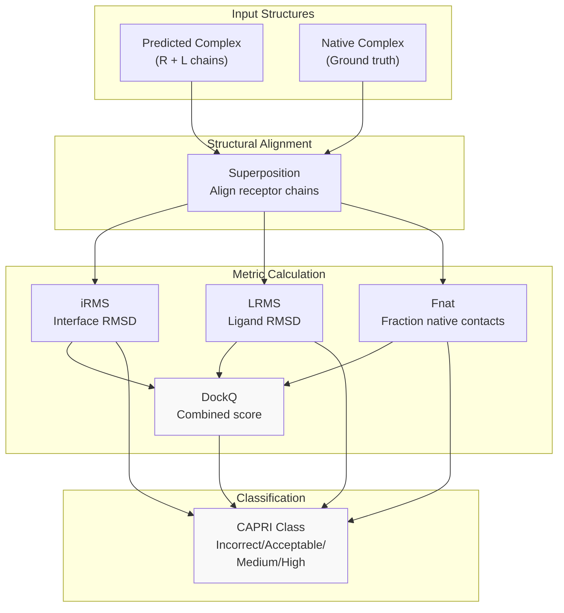
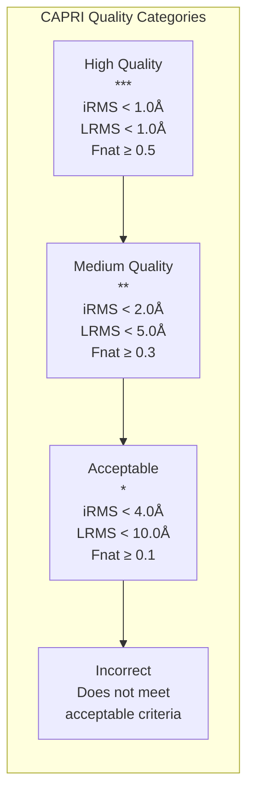
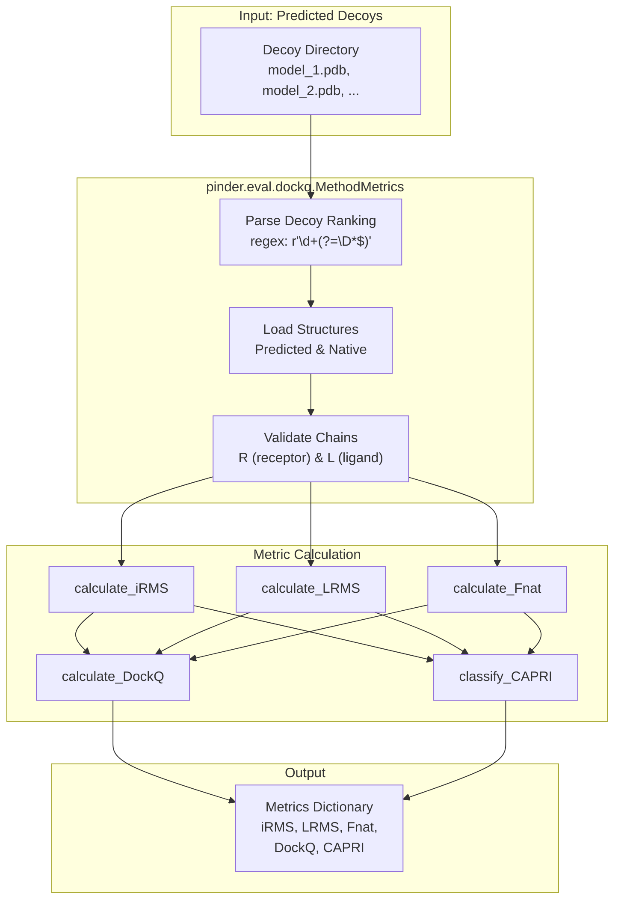
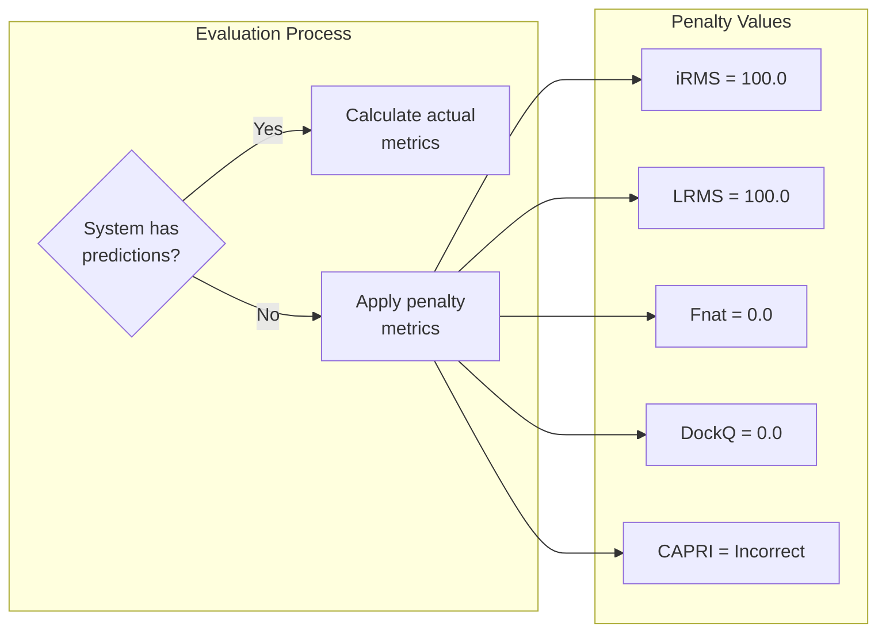

# Metrics

<details>
<summary>Relevant source files</summary>

The following files were used as context for generating this wiki page:

- [README.md](README.md)

</details>


This page documents the evaluation metrics used in PINDER for assessing protein-protein docking predictions. These metrics follow the community-standard CAPRI (Critical Assessment of PRediction of Interactions) criteria and are implemented in the `pinder.eval` package.

For information about using the evaluation harness to run these metrics on docking predictions, see [Evaluation Harness](#6.1). For details on the benchmark test sets these metrics are applied to, see [Benchmark Test Sets](#6.3).

---

## Purpose and Scope

PINDER uses standard CAPRI metrics to evaluate the quality of predicted protein-protein docking poses. The metrics assess both the overall structural accuracy and interface-specific quality of predictions. This page explains:

- The four primary metrics: iRMS, LRMS, Fnat, and DockQ
- The CAPRI classification system
- How metrics are calculated from predicted and native structures
- Penalty values for missing predictions

---

## CAPRI Metrics Overview

CAPRI (Critical Assessment of PRediction of Interactions) defines standardized metrics for evaluating protein-protein docking predictions. These metrics have been adopted by the structural biology community and provide a consistent framework for comparing different docking methods.



**Diagram: CAPRI Metrics Evaluation Flow**

All metrics are calculated after superposing the predicted complex onto the native complex using the receptor chain as reference. This alignment ensures that differences reflect ligand positioning accuracy rather than arbitrary coordinate system differences.

**Sources:** [README.md:302-378]()

---

## Primary Metrics

### iRMS (Interface RMSD)

Interface RMSD measures the positional deviation of interfacial backbone atoms between the predicted and native structures. Only residues at the interface (typically within 10Å of the partner chain) are included in the calculation.

**Calculation:**
- Identify interface residues in both native and predicted structures
- Compute RMSD of backbone atoms (N, CA, C, O) for these residues
- Lower values indicate better interface geometry

**Interpretation:**
- iRMS < 1.0Å: High accuracy
- iRMS < 2.0Å: Medium accuracy  
- iRMS < 4.0Å: Acceptable accuracy
- iRMS ≥ 4.0Å: Incorrect prediction

### LRMS (Ligand RMSD)

Ligand RMSD measures the overall positional deviation of the ligand chain after superposing structures using the receptor chain. This metric captures the global positioning accuracy of the ligand relative to the receptor.

**Calculation:**
- Superpose predicted and native structures using receptor chain
- Compute RMSD of all ligand backbone atoms
- Lower values indicate better global positioning

**Interpretation:**
- LRMS < 1.0Å: High accuracy
- LRMS < 5.0Å: Medium accuracy
- LRMS < 10.0Å: Acceptable accuracy
- LRMS ≥ 10.0Å: Incorrect prediction

### Fnat (Fraction of Native Contacts)

Fnat measures the fraction of native intermolecular contacts that are preserved in the predicted structure. A contact is typically defined as any pair of residues with atoms within 5Å of each other.

**Calculation:**
- Identify native contacts in ground truth structure
- Identify contacts in predicted structure
- Compute fraction: Fnat = (shared contacts) / (native contacts)
- Higher values indicate better interface recovery

**Interpretation:**
- Fnat ≥ 0.5: High accuracy
- Fnat ≥ 0.3: Medium accuracy
- Fnat ≥ 0.1: Acceptable accuracy
- Fnat < 0.1: Incorrect prediction

### DockQ

DockQ is a composite score that combines iRMS, LRMS, and Fnat into a single quality metric ranging from 0 to 1. It provides a balanced assessment of both global and interface-specific accuracy.

**Formula:**
```
DockQ = (Fnat + 1/(1 + (iRMS/1.5)²) + 1/(1 + (LRMS/8.5)²)) / 3
```

**Interpretation:**
- DockQ ≥ 0.23: Acceptable quality
- DockQ ≥ 0.49: Medium quality
- DockQ ≥ 0.80: High quality
- DockQ < 0.23: Incorrect prediction

**Sources:** [README.md:366-376]()

---

## CAPRI Classification

The CAPRI system classifies predictions into discrete quality categories based on thresholds for iRMS, LRMS, and Fnat. A prediction is assigned to the highest category for which it meets all criteria.



**Diagram: CAPRI Classification Hierarchy**

| Category | Stars | iRMS Threshold | LRMS Threshold | Fnat Threshold |
|----------|-------|----------------|----------------|----------------|
| High Quality | *** | < 1.0Å | < 1.0Å | ≥ 0.5 |
| Medium Quality | ** | < 2.0Å | < 5.0Å | ≥ 0.3 |
| Acceptable | * | < 4.0Å | < 10.0Å | ≥ 0.1 |
| Incorrect | - | ≥ 4.0Å | ≥ 10.0Å | < 0.1 |

**Sources:** [README.md:302-305]()

---

## Metric Implementation

The metrics are implemented in the `pinder.eval` package, specifically in the `pinder.eval.dockq` module. The evaluation harness processes predicted structures in the following way:



**Diagram: Metric Implementation Flow in pinder.eval**

### Decoy Naming Convention

Predicted decoys must follow a naming convention that allows extraction of prediction rank. The evaluation harness uses the regex pattern `r"\d+(?=\D*$)"` to extract ranking from filenames.

Valid examples:
- `model_1.pdb` → rank 1
- `model_2.pdb` → rank 2
- `decoy_01.pdb` → rank 1
- `prediction_042.pdb` → rank 42

**Sources:** [README.md:360-363]()

---

## Missing Predictions Penalty

To ensure fair comparison across methods on complete test sets, PINDER applies penalty metrics when a method fails to provide predictions for a system. This prevents methods from improving their averages by skipping difficult cases.



**Diagram: Missing Prediction Handling**

The penalty values are designed to be worse than any realistic prediction:

```python
{
    "iRMS": 100.0,    # Much worse than incorrect threshold (4.0Å)
    "LRMS": 100.0,    # Much worse than incorrect threshold (10.0Å)
    "Fnat": 0.0,      # No native contacts recovered
    "DockQ": 0.0,     # Minimum possible score
    "CAPRI": "Incorrect",  # Lowest classification
}
```

This ensures that methods are incentivized to provide predictions for all test cases rather than cherry-picking easy targets.

**Sources:** [README.md:365-376]()

---

## Usage in Leaderboards

The metrics are aggregated across test sets to generate leaderboard rankings. Typical aggregation includes:

| Aggregation | Description |
|-------------|-------------|
| Mean DockQ | Average DockQ score across all predictions |
| Success Rate | Percentage of predictions meeting quality thresholds |
| Top-1 Accuracy | Percentage where best-ranked prediction is correct |
| Top-5 Accuracy | Percentage where any of top 5 predictions is correct |

Methods are evaluated on multiple test sets (`PINDER-XL`, `PINDER-S`, `PINDER-AF2`) with different characteristics to assess generalization across:
- Dataset size (large vs. small)
- Structure types (holo, apo, predicted)
- Leakage control (AF2-MM deleaked)

**Sources:** [README.md:288-298]()

---

## Metric Calculation Details

### Interface Definition

The interface is defined using a distance threshold approach:
- **Contact distance:** Atoms within 5Å are considered in contact
- **Interface residues:** Residues with any atom within 10Å of partner chain
- **Backbone atoms:** N, CA, C, O atoms used for RMSD calculations

### Superposition Protocol

Before calculating metrics, structures are superposed:
1. Identify corresponding residues in receptor chains
2. Align predicted to native using receptor backbone atoms
3. Apply transformation to entire predicted complex
4. Calculate metrics on aligned structures

This ensures metrics reflect ligand positioning relative to receptor, independent of coordinate system.

**Sources:** [README.md:302-378]()

---

## Summary

PINDER uses four complementary metrics to evaluate docking predictions:

| Metric | Range | Measures | Best Value |
|--------|-------|----------|-----------|
| iRMS | 0-∞ Å | Interface geometry accuracy | 0 |
| LRMS | 0-∞ Å | Global ligand positioning | 0 |
| Fnat | 0-1 | Interface contact recovery | 1 |
| DockQ | 0-1 | Combined quality score | 1 |

These metrics are combined into CAPRI quality classifications (High/Medium/Acceptable/Incorrect) that provide intuitive assessment of prediction quality. The evaluation harness applies these metrics consistently across all methods and test sets, with penalty values ensuring fair comparison even when methods fail to provide predictions for difficult targets.

---