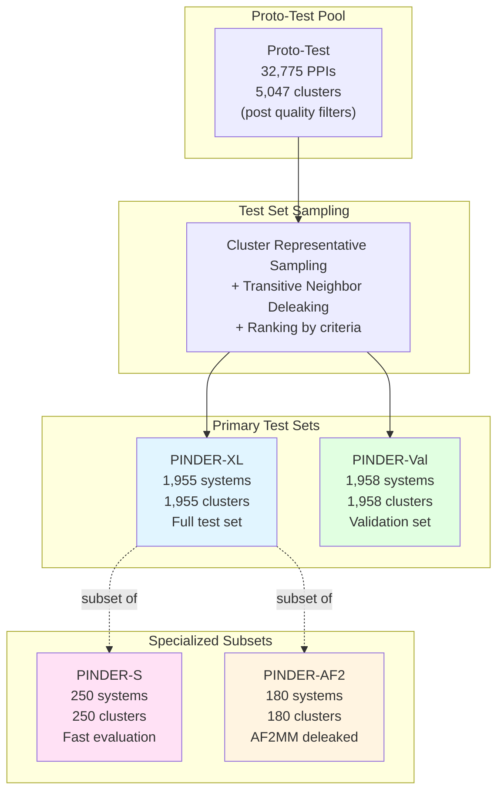
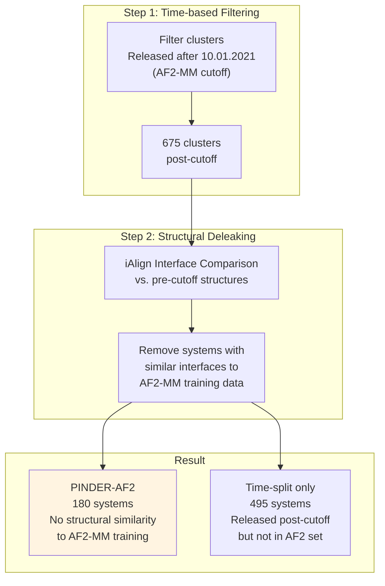
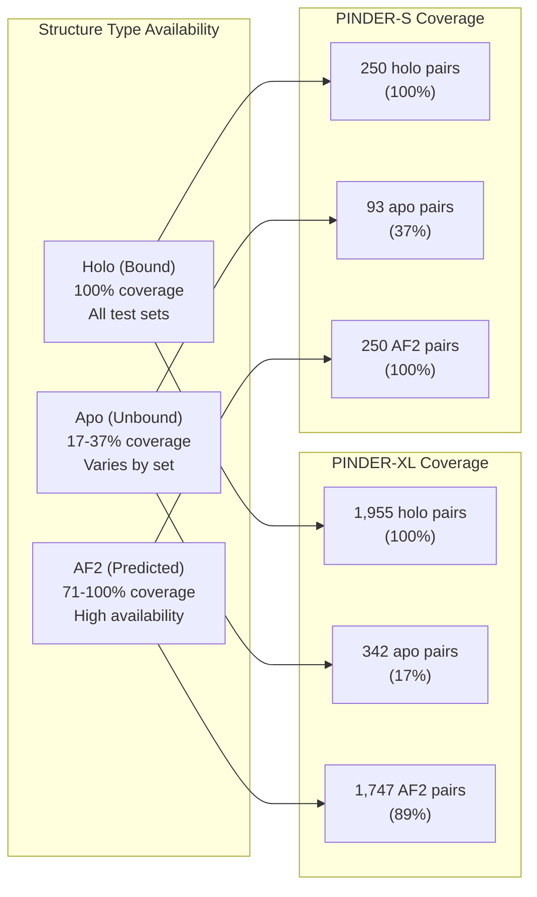
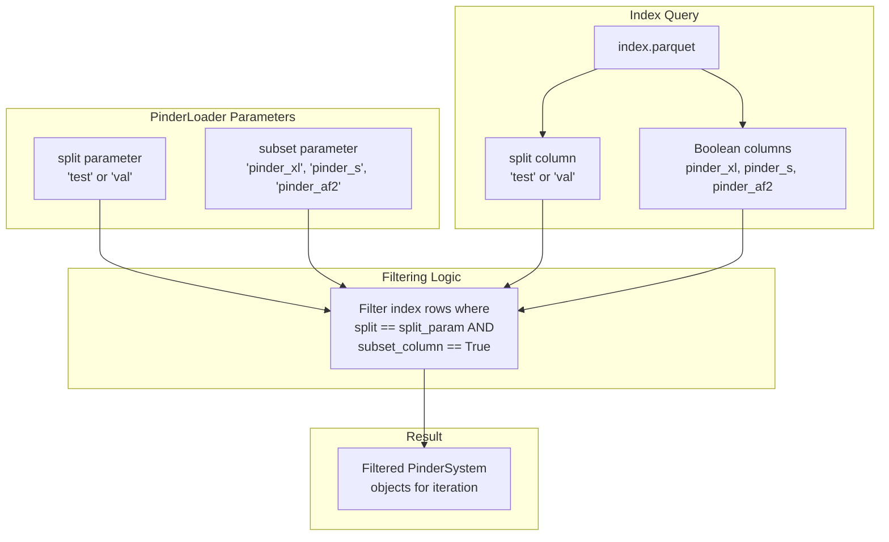
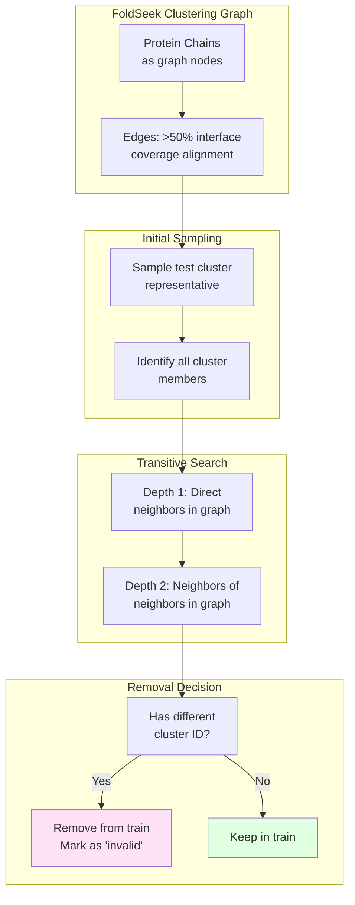

# Benchmark Test Sets

<details>
<summary>Relevant source files</summary>

The following files were used as context for generating this wiki page:

- [README.md](README.md)

</details>


This page describes the benchmark test sets provided by PINDER for evaluating protein-protein docking methods. It covers the four primary test/validation sets (PINDER-XL, PINDER-S, PINDER-AF2, and PINDER-Val), their construction criteria, and intended use cases.

For information on how to evaluate predictions against these test sets, see [Evaluation Harness](#6.1). For details on the metrics used for evaluation, see [Metrics](#6.2). For information on how the overall dataset splits were created, see [Dataset Splits and Benchmarks](#1.4).

---

## Overview of Test Set Hierarchy

PINDER provides four carefully curated test and validation sets, each designed for specific evaluation scenarios. All test sets are derived from a common pool of high-quality, filtered systems and share the same rigorous deleaking process against the training set.

### Test Set Hierarchy Diagram



**Sources:** [README.md:244-286]()

---

## PINDER-XL: Full Test Set

PINDER-XL is the primary and most comprehensive test set, consisting of 1,955 systems representing 1,955 interface clusters. It serves as the gold standard benchmark for evaluating docking methods on a diverse set of protein-protein interactions.

### Characteristics

| Property | Value | Description |
|----------|-------|-------------|
| **# Systems** | 1,955 | One representative per cluster |
| **# Clusters** | 1,955 | Each system represents a unique interface cluster |
| **# Holo Pairs** | 1,955 | All systems have bound complex structures |
| **# Apo Pairs** | 342 | Systems with paired unbound structures |
| **# AF2 Pairs** | 1,747 | Systems with paired AlphaFold2 predictions |
| **Split Label** | `"test"` | Split identifier in index |
| **Subset Label** | `"pinder_xl"` | Boolean column in index |

### Quality Criteria

All PINDER-XL systems pass the following filters:

- **Physiological contact**: Classified as biological interaction by PRODIGY-cryst
- **Dimer only**: Only binary complexes (no higher-order oligomers)
- **Method**: X-RAY DIFFRACTION only
- **Resolution**: ≤ 3.5Å
- **Chain length**: Minimum 40 residues per chain
- **Atom types**: ≥ 3 distinct element types
- **Interface gaps**: 0 interface atoms within 4Å of gaps
- **Elongation**: Maximum variance ≤ 0.98
- **Connectivity**: Single component per chain

### Code Usage

```python
from pinder.core import PinderLoader

# Load PINDER-XL test set
loader = PinderLoader(
    split="test",
    subset="pinder_xl"
)

# Iterate over test systems
for system in loader:
    print(f"System: {system.entry.id}")
    print(f"Has apo: {system.entry.apo_R and system.entry.apo_L}")
    print(f"Has predicted: {system.entry.predicted_R and system.entry.predicted_L}")
```

**Sources:** [README.md:249](), [README.md:746-762]()

---

## PINDER-S: Fast Evaluation Subset

PINDER-S is a carefully selected subset of PINDER-XL designed for rapid evaluation when testing on the full set is computationally prohibitive. It consists of 250 systems sampled to maximize diversity in protein families and functions.

### Characteristics

| Property | Value | Description |
|----------|-------|-------------|
| **# Systems** | 250 | Subset of PINDER-XL |
| **# Clusters** | 250 | One per cluster |
| **# Heterodimers** | 188 | 75% heterodimeric complexes |
| **# Homodimers** | 62 | 25% homodimeric complexes |
| **# Apo Pairs** | 93 | Systems with both apo structures |
| **# At least one Apo** | 143 | Systems with ≥1 apo monomer |
| **# AF2 Pairs** | 250 | All systems have paired AF2 predictions |
| **Split Label** | `"test"` | Split identifier in index |
| **Subset Label** | `"pinder_s"` | Boolean column in index |

### Selection Strategy

PINDER-S systems were sampled from PINDER-XL based on:

1. **Diverse annotations**: UniProt and PFAM family diversity
2. **Balanced composition**: Mix of heterodimers and homodimers
3. **Structure availability**: Preference for systems with apo structures
4. **Complete AF2 coverage**: All systems must have paired AF2 predictions

### When to Use PINDER-S

Use PINDER-S when:
- **Rapid prototyping**: Testing new methods quickly
- **Computationally expensive methods**: Sampling-based or physics-based methods
- **Preliminary benchmarking**: Initial validation before full PINDER-XL evaluation
- **Hyperparameter tuning**: Finding optimal parameters before large-scale evaluation

### Code Usage

```python
from pinder.core import PinderLoader

# Load PINDER-S subset
loader = PinderLoader(
    split="test",
    subset="pinder_s"
)

print(f"PINDER-S size: {len(loader)}")
# PINDER-S size: 250
```

**Sources:** [README.md:250](), [README.md:781]()

---

## PINDER-AF2: AF2-Multimer Deleaked Subset

PINDER-AF2 is a specialized subset designed for fair comparison with AlphaFold2-Multimer (AF2-MM). It contains 180 systems that are rigorously deleaked against the AF2-MM training set to prevent data leakage.

### Characteristics

| Property | Value | Description |
|----------|-------|-------------|
| **# Systems** | 180 | Subset of PINDER-XL |
| **# Clusters** | 180 | One per cluster |
| **# Holo Pairs** | 180 | All systems have bound complexes |
| **# Apo Pairs** | 30 | Systems with both apo structures |
| **# AF2 Pairs** | 127 | Systems with paired AF2 predictions |
| **Split Label** | `"test"` | Split identifier in index |
| **Subset Label** | `"pinder_af2"` | Boolean column in index |
| **Release Date** | After 10.01.2021 | AF2-MM training cutoff date |

### Deleaking Methodology



### Two-Stage Deleaking Process

1. **Temporal Deleaking**: Systems from clusters containing only entries released after October 1, 2021 (675 clusters)
2. **Structural Deleaking**: Further removal of systems with interface similarity to any pre-cutoff entries using iAlign

The 180 systems in PINDER-AF2 are guaranteed to be structurally distinct from AF2-MM 2.3 training data, while the remaining post-cutoff systems (495) are only guaranteed by temporal split.

### When to Use PINDER-AF2

Use PINDER-AF2 when:
- **Comparing to AF2-Multimer**: Ensuring fair comparison without training data leakage
- **Evaluating learning-based methods**: Testing on truly held-out data
- **Publishing benchmarks**: When rigorous deleaking is required
- **Method development**: Validating models trained on AF2-related datasets

### Code Usage

```python
from pinder.core import PinderLoader

# Load PINDER-AF2 subset
loader = PinderLoader(
    split="test",
    subset="pinder_af2"
)

# Filter for systems with apo structures
for system in loader:
    if system.entry.apo_R and system.entry.apo_L:
        print(f"AF2-deleaked with apo: {system.entry.id}")
```

**Sources:** [README.md:251](), [README.md:783-785]()

---

## PINDER-Val: Validation Set

PINDER-Val is a held-out validation set with identical quality criteria and distribution as PINDER-XL, designed for monitoring training performance and hyperparameter tuning without touching the test set.

### Characteristics

| Property | Value | Description |
|----------|-------|-------------|
| **# Systems** | 1,958 | Comparable size to PINDER-XL |
| **# Clusters** | 1,958 | One representative per cluster |
| **# Holo Pairs** | 1,958 | All systems have bound complexes |
| **# Apo Pairs** | 342 | Same apo availability as XL |
| **# AF2 Pairs** | 1,789 | Similar AF2 coverage |
| **Split Label** | `"val"` | Split identifier in index |
| **Quality Filters** | Identical to XL | Same stringent criteria |

### Purpose and Usage

PINDER-Val enables:
- **Training monitoring**: Track generalization without test set contamination
- **Early stopping**: Determine when to stop training
- **Hyperparameter selection**: Choose optimal model configurations
- **Architecture search**: Compare different model designs

### Distribution Similarity

PINDER-Val is constructed to mirror PINDER-XL in:
- Quality criteria (resolution, gaps, elongation, etc.)
- Cluster-based sampling (no interface leakage)
- Structure availability (apo and predicted monomers)
- Protein family diversity

### Code Usage

```python
from pinder.core import PinderLoader, PinderDataset

# Create validation dataset for training
val_dataset = PinderDataset(
    split="val",
    monomer_priority="holo"
)

# Use during training
for epoch in range(num_epochs):
    # Train on training set
    train(model, train_loader)
    
    # Validate on val set
    val_loss = validate(model, val_loader)
    print(f"Epoch {epoch}, Val Loss: {val_loss}")
```

**Sources:** [README.md:257-261](), [README.md:386-388]()

---

## Test Set Statistics Comparison

### Comprehensive Statistics Table

| Dataset | # Systems | # Clusters | # Holo Pairs | # Apo Pairs | # AF2 Pairs | # At least 1 Apo | Split Label | Subset Column |
|---------|-----------|------------|--------------|-------------|-------------|------------------|-------------|---------------|
| **PINDER-XL** | 1,955 | 1,955 | 1,955 | 342 | 1,747 | 436 | `"test"` | `pinder_xl` |
| **PINDER-S** | 250 | 250 | 250 | 93 | 250 | 143 | `"test"` | `pinder_s` |
| **PINDER-AF2** | 180 | 180 | 180 | 30 | 127 | - | `"test"` | `pinder_af2` |
| **PINDER-Val** | 1,958 | 1,958 | 1,958 | 342 | 1,789 | 441 | `"val"` | - |

### Structure Availability Breakdown



**Sources:** [README.md:244-261]()

---

## Test Set Construction Pipeline

### Quality Filter Implementation

The test set construction applies a series of cascading filters to ensure high-quality evaluation benchmarks.

```mermaid
graph TD
    START["RCSB PDB Snapshot<br/>01.29.2024<br/>~200K structures"]
    
    subgraph "Stage 1: Biological Relevance"
        BIO["PRODIGY-cryst<br/>Physiological contact<br/>prediction"]
        DIMER["Dimer Filter<br/>Binary complexes only"]
    end
    
    subgraph "Stage 2: Experimental Quality"
        METHOD["Method Filter<br/>X-RAY DIFFRACTION only"]
        RES["Resolution Filter<br/>≤ 3.5Å"]
        ELEMENTS["Element Filter<br/>≥ 3 atom types"]
    end
    
    subgraph "Stage 3: Structural Quality"
        LENGTH["Chain Length Filter<br/>≥ 40 residues"]
        GAPS["Interface Gap Filter<br/>0 gaps at 4Å threshold"]
        ELONG["Elongation Filter<br/>max_var ≤ 0.98"]
        COMP["Component Filter<br/>Single component"]
    end
    
    subgraph "Stage 4: Clustering & Deleaking"
        CLUSTER["FoldSeek Clustering<br/>Interface similarity"]
        SAMPLE["Cluster Representative<br/>Sampling"]
        DELEAK["Transitive Neighbor<br/>Deleaking (depth=2)"]
    end
    
    RESULT["Proto-Test Pool<br/>32,775 PPIs<br/>5,047 clusters"]
    
    FINAL["Test Sets<br/>XL: 1,955<br/>S: 250<br/>AF2: 180<br/>Val: 1,958"]
    
    START --> BIO
    BIO --> DIMER
    DIMER --> METHOD
    METHOD --> RES
    RES --> ELEMENTS
    ELEMENTS --> LENGTH
    LENGTH --> GAPS
    GAPS --> ELONG
    ELONG --> COMP
    COMP --> RESULT
    RESULT --> CLUSTER
    CLUSTER --> SAMPLE
    SAMPLE --> DELEAK
    DELEAK --> FINAL
    
    style RESULT fill:#e1f5ff
    style FINAL fill:#ffe1f5
```



### Filter Definitions in Code

The quality criteria are enforced through metadata fields that can be queried from the index:

**Metadata Fields Used for Test Set Filtering:**

| Field | Type | Test Set Criterion | IndexEntry/MetadataEntry |
|-------|------|-------------------|-------------------------|
| `label` | string | `"TRUE"` (biological) | MetadataEntry |
| `oligomeric_count` | int | `2` (dimer only) | MetadataEntry |
| `method` | string | `"X-RAY DIFFRACTION"` | MetadataEntry |
| `resolution` | float | `<= 3.5` | MetadataEntry |
| `num_atom_types` | int | `>= 3` | MetadataEntry |
| `length1`, `length2` | int | `>= 40` | MetadataEntry |
| `interface_atom_gaps_4A` | int | `== 0` | MetadataEntry |
| `max_var_1`, `max_var_2` | float | `<= 0.98` | MetadataEntry |
| `number_of_components_1`, `number_of_components_2` | int | `<= 1` | MetadataEntry |

**Sources:** [README.md:746-762]()

---

## Using Test Sets in Code

### Loading Specific Test Sets

The `PinderLoader` class provides access to test sets via the `split` and `subset` parameters:

```python
from pinder.core import PinderLoader

# Load PINDER-XL
xl_loader = PinderLoader(split="test", subset="pinder_xl")

# Load PINDER-S
s_loader = PinderLoader(split="test", subset="pinder_s")

# Load PINDER-AF2
af2_loader = PinderLoader(split="test", subset="pinder_af2")

# Load validation set
val_loader = PinderLoader(split="val")
```

### Querying Index for Test Set Membership

Test set membership is stored as boolean columns in the index:

```python
from pinder.core import get_index

# Load the index
index = get_index()

# Filter for PINDER-XL systems
xl_systems = index[index["pinder_xl"] == True]
print(f"PINDER-XL size: {len(xl_systems)}")

# Filter for PINDER-S systems
s_systems = index[index["pinder_s"] == True]
print(f"PINDER-S size: {len(s_systems)}")

# Filter for PINDER-AF2 systems
af2_systems = index[index["pinder_af2"] == True]
print(f"PINDER-AF2 size: {len(af2_systems)}")

# Get all test systems
test_systems = index[index["split"] == "test"]
print(f"Total test systems: {len(test_systems)}")
```

### Test Set Selection Flow



**Sources:** [README.md:657-667](), [src/pinder-core/pinder/core/loader/loader.py]()

---

## Test Set Deleaking Strategy

### Transitive Neighbor Removal

PINDER employs a rigorous deleaking strategy to prevent information leakage between train and test sets:



### Deleaking Implementation Details

1. **Cluster Construction**: FoldSeek structural alignment creates interface clusters based on >50% interface coverage
2. **Test Selection**: One representative sampled per cluster for test/val sets
3. **Direct Removal**: All other cluster members removed from train
4. **Transitive Search**: Systems with transitive hits within depth=2 but different cluster IDs are marked `invalid`
5. **Train Assignment**: Remaining systems assigned to training set

This ensures no training system shares significant interface similarity with test systems, even through intermediate structures.

**Sources:** [README.md:732-744](), [README.md:762]()

---

## Test Set File Organization

### Directory Structure

Test set systems are stored in a dedicated directory:

```
$PINDER_BASE_DIR/2024-02/
├── pdbs/                      # Training set structures
├── test_set_pdbs/            # Test and validation structures
│   ├── <system_id>/
│   │   ├── <system_id>__holo_receptor.pdb
│   │   ├── <system_id>__holo_ligand.pdb
│   │   ├── <system_id>__apo_receptor.pdb  # if available
│   │   ├── <system_id>__apo_ligand.pdb    # if available
│   │   ├── <system_id>__pred_receptor.pdb # if available
│   │   └── <system_id>__pred_ligand.pdb   # if available
├── mappings/
├── index.parquet             # Contains split and subset columns
└── metadata.parquet
```

### Test Set Directory Size

```bash
# Compressed
149M    test_set_pdbs.zip

# Unpacked
705M    test_set_pdbs/
```

The `test_set_pdbs/` directory contains all structures for systems in PINDER-XL, PINDER-S, PINDER-AF2, and PINDER-Val.

**Sources:** [README.md:162-208]()

---

## Summary

### Test Set Selection Guide

| Use Case | Recommended Set | Rationale |
|----------|----------------|-----------|
| Comprehensive evaluation | PINDER-XL | Full test set with maximum diversity |
| Rapid prototyping | PINDER-S | 250 systems selected for diversity |
| Comparing to AF2-MM | PINDER-AF2 | Rigorously deleaked against AF2 training |
| Training monitoring | PINDER-Val | Validation set with identical criteria |
| Method development | PINDER-Val → PINDER-S → PINDER-XL | Progressive evaluation strategy |
| Publication benchmarks | PINDER-XL + PINDER-AF2 | Most rigorous evaluation |

### Key Takeaways

1. **All test sets share identical quality criteria** ensuring fair comparison
2. **Cluster-based sampling** prevents redundancy and interface leakage
3. **Transitive deleaking** (depth=2) ensures no indirect leakage to training
4. **PINDER-S is a true subset** of PINDER-XL for consistent evaluation
5. **PINDER-AF2 provides additional structural deleaking** beyond temporal split
6. **PINDER-Val mirrors PINDER-XL** in quality and distribution

**Sources:** [README.md:244-286](), [README.md:746-785]()

---