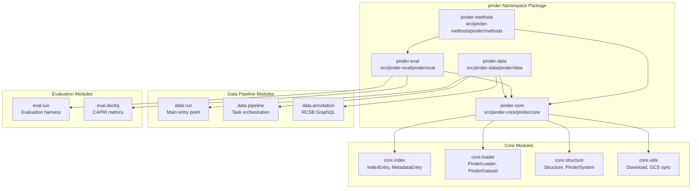
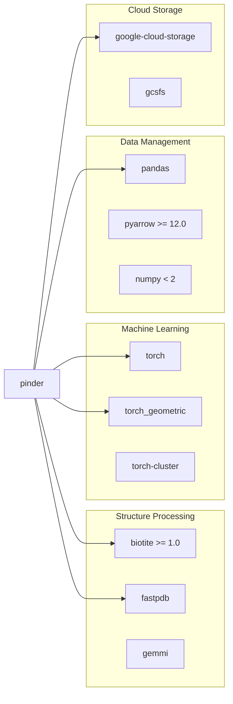
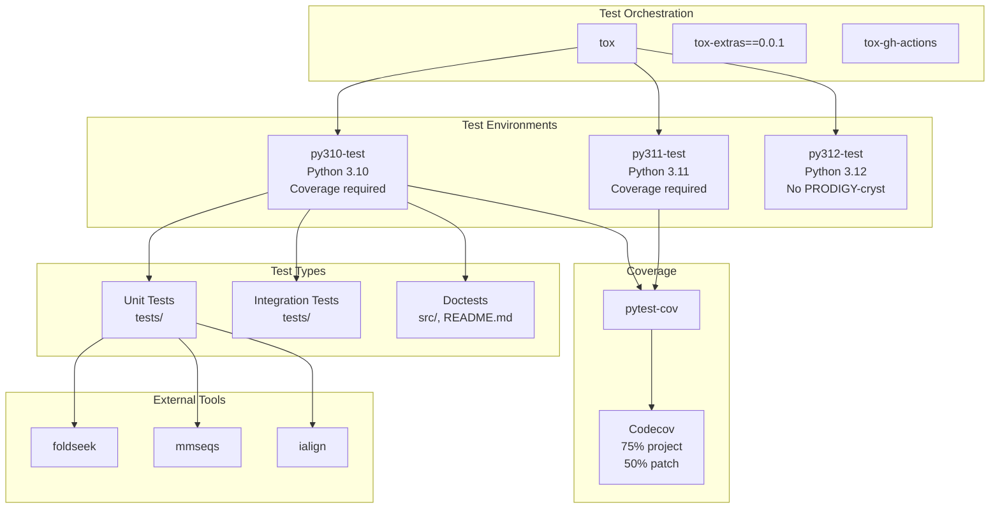
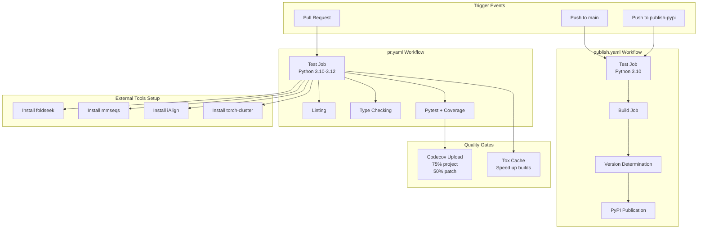
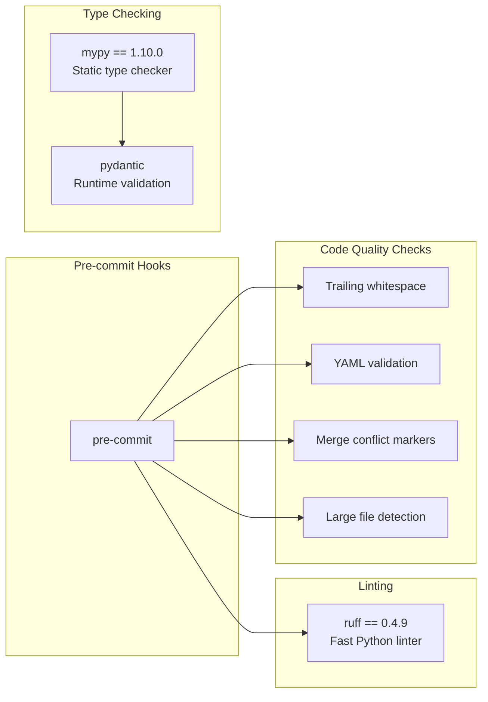

# Development Guide

<details>
<summary>Relevant source files</summary>

The following files were used as context for generating this wiki page:

- [.github/workflows/publish.yaml](.github/workflows/publish.yaml)
- [docker/hdock/Dockerfile.hdock](docker/hdock/Dockerfile.hdock)
- [pyproject.toml](pyproject.toml)
- [tox.ini](tox.ini)
- [version.sh](version.sh)

</details>


This document provides comprehensive information for developers contributing to the PINDER project. It covers the project's organization as a namespace package, development environment setup, testing infrastructure, continuous integration/deployment workflows, and code quality standards.

For information about using PINDER as a dataset or library, see the Quick Start Guide ([2](#2)). For details on generating the PINDER dataset from scratch, see the Dataset Generation Pipeline ([5](#5)).

## Project Organization

PINDER is organized as a namespace package consisting of four independent but related components under the `pinder` namespace. This structure allows for modular installation and development while maintaining clear separation of concerns.



Sources: [pyproject.toml:138-146](), [pyproject.toml:38-47]()

### Package Responsibilities

| Package | Purpose | Key Components |
|---------|---------|----------------|
| `pinder-core` | Core data structures, loaders, and dataset access | `PinderSystem`, `PinderLoader`, `PinderDataset`, `PPIDataset`, `Structure` |
| `pinder-data` | Dataset generation pipeline and data ingestion | Task orchestration, mmCIF processing, RCSB GraphQL annotations |
| `pinder-eval` | Evaluation harness for docking methods | CAPRI metrics (DockQ, iRMS, LRMS, Fnat), benchmark evaluation |
| `pinder-methods` | Reference method implementations | Baseline docking algorithms |

Sources: [pyproject.toml:138-146]()

### Command-Line Utilities

The package provides several CLI entry points for common operations:

| Command | Module | Purpose |
|---------|--------|---------|
| `pinder_download` | `pinder.core.index.utils:download_pinder_cmd` | Download PINDER dataset |
| `pinder_sync_data` | `pinder.core.index.utils:sync_pinder_structure_data` | Sync structure files from GCS |
| `pinder_update_index` | `pinder.core.index.utils:update_index_cmd` | Update local index files |
| `pinder_data` | `pinder.data.run:main` | Run data generation pipeline |
| `pinder_eval` | `pinder.eval.run:main` | Run evaluation harness |
| `pinder_create_submission` | `pinder.eval.create_submission:main` | Create submission files |
| `pinder_methods` | `pinder.methods.main:main` | Run reference methods |
| `pinder_qc` | `pinder.data.qc.run:main` | Quality control checks |
| `pinder_plot` | `pinder.data.plot.run:main` | Generate plots |

Sources: [pyproject.toml:38-47]()

## Development Environment Setup

### Core Dependencies

PINDER requires Python 3.10 or higher. Core dependencies include:



Sources: [pyproject.toml:4-24]()

### Optional Dependencies

The project provides several optional dependency groups for different use cases:

**Development Dependencies** (`dev`):
- Includes `lint`, `test`, `type`, `leaderboard`, and `data` groups
- Install with: `pip install pinder[dev]`

**Testing** (`test`):
```python
tox >= 4
pytest == 7.2.0
pytest-cov == 4.0.0
```

**Linting** (`lint`):
```python
ruff == 0.4.9
pre-commit == 3.6.0
```

**Type Checking** (`type`):
```python
mypy == 1.10.0
pydantic
types-PyYAML
types-requests
```

**Data Pipeline** (`data`):
```python
fire
gemmi
networkx
python-graphql-client
mpire
matplotlib
seaborn
```

Sources: [pyproject.toml:49-124]()

### External Tools

Several external bioinformatics tools are required for testing and data processing:

| Tool | Purpose | Installation |
|------|---------|-------------|
| **foldseek** | Structure alignment and clustering | Download from [steineggerlab/foldseek](https://github.com/steineggerlab/foldseek) |
| **mmseqs** | Sequence clustering | Download from [soedinglab/MMseqs2](https://github.com/soedinglab/MMseqs2) |
| **iAlign** | Interface alignment | Download from [CSSB iAlign](https://sites.gatech.edu/cssb/ialign/) |
| **torch-cluster** | Graph neural network operations | `pip install torch-cluster -f https://data.pyg.org/whl/torch-2.3.1+cpu.html` |

Sources: [.github/workflows/publish.yaml:29-54](), [tox.ini:18-21]()

### Setting Up the Development Environment

```bash
# Clone the repository
git clone https://github.com/pinder-org/pinder.git
cd pinder

# Install with development dependencies
pip install -e .[dev]

# Install external tools (Linux example)
# foldseek
curl -LO https://github.com/steineggerlab/foldseek/releases/download/9-427df8a/foldseek-linux-avx2.tar.gz
tar xvzf foldseek-linux-avx2.tar.gz
export PATH="$(pwd)/foldseek/bin/:$PATH"

# mmseqs
curl -LO https://github.com/soedinglab/MMseqs2/releases/download/15-6f452/mmseqs-linux-avx2.tar.gz
tar xvfz mmseqs-linux-avx2.tar.gz
export PATH="$(pwd)/mmseqs/bin/:$PATH"

# iAlign
curl -LO http://cssb2.biology.gatech.edu/skolnick/files/iAlign/ialign_64_v1.1b2.tar.gz
tar xvzf ialign_64_v1.1b2.tar.gz
export PATH="$(pwd)/ialign/bin/:$PATH"

# Install torch-cluster
pip install torch-cluster -f https://data.pyg.org/whl/torch-2.3.1+cpu.html

# Install pre-commit hooks
pre-commit install
```

Sources: [.github/workflows/publish.yaml:29-54](), [tox.ini:50-71]()

## Testing Infrastructure

PINDER uses `tox` for test automation across multiple Python versions with comprehensive coverage requirements.



Sources: [tox.ini:1-72]()

### Test Environment Configuration

The `tox.ini` file defines three test environment types for each Python version:

**Lint Environments** (`py310-lint`, `py311-lint`, `py312-lint`):
- Runs `pre-commit` hooks on all files
- No package installation required
- Fast execution for quick checks

**Type Checking** (`py310-type`, `py311-type`, `py312-type`):
- Runs `mypy` type checker on `src` directory
- Ensures type safety across the codebase

**Test Environments** (`py310-test`, `py311-test`, `py312-test`):
- Executes `pytest` with coverage tracking
- Includes doctests from source files and `README.md`
- Python 3.10 runs all tests
- Python 3.11 requires 80% coverage: `--cov-fail-under=80`
- Python 3.12 skips PRODIGY-cryst (requires scikit-learn ≤ 1.2.2)

Sources: [tox.ini:2-3](), [tox.ini:23-71]()

### Coverage Configuration

Coverage is measured and reported with specific requirements:

```ini
[coverage:run]
branch = true
parallel = true
omit = src/pinder-data/pinder/data/plot/*
source = .tox/py310-test/lib/python3.10/site-packages/pinder/

[coverage:report]
show_missing = true
precision = 2
include_namespace_packages = true
```

**Codecov Requirements**:
- **Project coverage**: 75% minimum
- **Patch coverage**: 50% minimum (new code in PRs)

Sources: [tox.ini:37-48](), [.github/workflows/publish.yaml:70-83]()

### Running Tests

```bash
# Run all tests for current Python version
tox

# Run specific environment
tox -e py310-test

# Run with specific pytest arguments
tox -e py310-test -- tests/test_loader.py -v

# Run linting only
tox -e py310-lint

# Run type checking only
tox -e py310-type

# Run tests with coverage report
tox -e py311-test -- --cov=pinder --cov-report=term-missing
```

### Test Structure

Tests are organized by component:

| Directory | Purpose |
|-----------|---------|
| `tests/` | Main test suite |
| `src/` | Inline doctests in source code |
| `README.md` | Documentation examples as tests |

The `pytest.ini_options` in `pyproject.toml` enables automatic doctest discovery:

```python
[tool.pytest.ini_options]
minversion = "6.0"
addopts = "--doctest-modules --doctest-glob='*md' --doctest-continue-on-failure"
doctest_optionflags = "NORMALIZE_WHITESPACE ELLIPSIS"
testpaths = ["tests"]
```

Sources: [pyproject.toml:151-157]()

## CI/CD Pipeline

PINDER uses GitHub Actions for continuous integration and automated PyPI publishing. The pipeline ensures code quality, runs comprehensive tests, and handles semantic versioning.



Sources: [.github/workflows/publish.yaml:1-145]()

### Workflow: `publish.yaml`

The main CI/CD workflow handles testing and publishing on pushes to `main` or `publish-pypi` branches.

**Test Job** ([.github/workflows/publish.yaml:8-83]()):
1. **Checkout**: Uses `actions/checkout@v4`
2. **Python Setup**: Uses `actions/setup-python@v5` with Python 3.10
3. **External Tools Installation**:
   - foldseek 9-427df8a
   - mmseqs 15-6f452
   - iAlign v1.1b2
4. **Tox Execution**: Runs full test suite with coverage
5. **Coverage Upload**: Submits to Codecov with token authentication

**PyPI Publish Job** ([.github/workflows/publish.yaml:84-145]()):
- Depends on successful test job
- Requires `release` environment approval
- Steps:
  1. Install build dependencies: `build`, `setuptools_scm`, `semver`, `tomlkit`
  2. Fetch existing git tags: `git fetch --prune --unshallow --tags`
  3. Determine version using `version.sh` script
  4. Create git tag: `git tag v{VERSION}`
  5. Build package: `python -m build`
  6. Publish to PyPI using `pypa/gh-action-pypi-publish@release/v1`
  7. Push tags to repository: `git push --tags`

Sources: [.github/workflows/publish.yaml:8-145]()

### Semantic Versioning with `version.sh`

The `version.sh` script implements automatic semantic versioning based on commit messages:

```bash
# Determines new git tag from existing tags and commit message
# Searches for "bumpversion command" where command is:
#   - major: Breaking changes
#   - minor: New features
#   - patch: Bug fixes (default)
#   - skip: No new version
```

**Version Determination Logic**:
1. Fetch latest tag: `LATEST_TAG=$(git for-each-ref --sort=creatordate ...)`
2. Check if HEAD is already tagged (skip if true)
3. Extract bump command from commit message: `git log -n 1 | sed -n "/^.*bumpversion \(.*\)$/s//\1/p"`
4. Default to `patch` if no command found
5. Calculate new version: `semver.bump_{BUMP}(LATEST_VERSION)`
6. Output new tag: `v{NEW_VERSION}`

**Example Commit Messages**:
```
feat: Add new feature [bumpversion minor]
fix: Correct bug in loader [bumpversion patch]
BREAKING: Redesign API [bumpversion major]
docs: Update README [bumpversion skip]
```

Sources: [version.sh:1-32]()

### Skip CI

To skip CI execution, include `[skip ci]` in the commit message. Both workflows check for this flag:

```yaml
if: |
    github.repository == 'pinder-org/pinder' &&
    ! contains(toJSON(github.event.commits.*.message), '[skip ci]')
```

Sources: [.github/workflows/publish.yaml:13-15](), [.github/workflows/publish.yaml:89-91]()

## Code Quality Standards

PINDER enforces strict code quality standards through automated tooling.



Sources: [pyproject.toml:50-67]()

### Ruff Linter

Ruff is a fast Python linter written in Rust that combines functionality from multiple tools (flake8, isort, pyupgrade, etc.):

```bash
# Run ruff on all files
ruff check .

# Auto-fix issues
ruff check --fix .

# Run via pre-commit
pre-commit run ruff --all-files
```

Configuration is typically in `.ruff.toml` or `pyproject.toml`.

Sources: [pyproject.toml:51]()

### Mypy Type Checker

Mypy performs static type analysis to catch type errors before runtime:

```bash
# Run mypy on source directory
mypy src

# Run via tox
tox -e py310-type
```

The project uses Pydantic for runtime validation, which provides type stubs for mypy.

Sources: [pyproject.toml:61-67](), [tox.ini:30-34]()

### Pre-commit Hooks

Pre-commit runs automated checks before each commit:

```bash
# Install hooks
pre-commit install

# Run all hooks manually
pre-commit run --all-files

# Update hook versions
pre-commit autoupdate
```

Common hooks include:
- Trailing whitespace removal
- YAML syntax validation
- Large file detection
- Merge conflict marker detection
- Ruff linting

Sources: [pyproject.toml:52-53](), [tox.ini:23-28]()

### Coverage Requirements

Code coverage is enforced through Codecov integration:

| Metric | Requirement | Description |
|--------|-------------|-------------|
| **Project Coverage** | 75% | Overall codebase coverage |
| **Patch Coverage** | 50% | New code in pull requests |

Coverage is calculated with branch coverage enabled:

```ini
[coverage:run]
branch = true
parallel = true
```

Certain directories are excluded from coverage:

```ini
omit = src/pinder-data/pinder/data/plot/*
```

Sources: [tox.ini:37-48](), [.github/workflows/publish.yaml:73-83]()

## Build System Configuration

PINDER uses modern Python packaging with `setuptools_scm` for automatic version management.

### Build Backend

```toml
[build-system]
build-backend = "setuptools.build_meta"
requires = [
    "build == 0.10.0",
    "setuptools >= 65.4.0",
    "setuptools_scm[toml] >= 7.1.0",
]
```

Sources: [pyproject.toml:127-133]()

### Setuptools Configuration

**Namespace Package Discovery**:

```toml
[tool.setuptools.packages.find]
where = [
    "src/pinder-core",
    "src/pinder-data",
    "src/pinder-eval",
    "src/pinder-methods",
]
include = ["pinder.*"]
namespaces = true
```

This configuration enables the four-package namespace structure where all packages share the `pinder` namespace but can be developed and installed independently.

**Package Data**:

```toml
[tool.setuptools.package-data]
pinder = ["**.yaml"]
```

Includes all YAML configuration files in the package distribution.

Sources: [pyproject.toml:138-149]()

### Version Management with setuptools_scm

Version numbers are automatically determined from git tags:

```toml
[tool.setuptools_scm]
root = "."
```

Combined with the `version.sh` script, this provides:
- Automatic version increment based on git tags
- Development versions for unreleased commits
- Consistent versioning across all namespace packages

Sources: [pyproject.toml:135-136]()

## Docker-Based Development

For advanced use cases, PINDER provides Docker images that include the complete development environment plus external tools.

### HDOCK Docker Example

The HDOCK Dockerfile demonstrates a complete setup:

**Base Configuration**:
- Base image: `mambaorg/micromamba:1.5-jammy`
- Python version: 3.10
- Platform: `linux/amd64`

**System Dependencies**:
- gcc, build-essential
- git, wget, curl
- Google Cloud SDK (gsutil)

**Python Environment**:
```dockerfile
RUN micromamba install -y -n base -c conda-forge \
    python=3.10 \
    google-cloud-storage \
    gcsfs \
    keyrings.google-artifactregistry-auth
```

**PINDER Installation**:
```dockerfile
RUN git clone https://github.com/pinder-org/pinder.git && \
    cd pinder && pip install .
```

Sources: [docker/hdock/Dockerfile.hdock:1-96]()

## Development Workflow Summary

1. **Setup**: Clone repository, install dependencies with `pip install -e .[dev]`, install external tools
2. **Development**: Make changes, run `pre-commit` hooks, ensure type hints
3. **Testing**: Run `tox` locally to test across Python versions
4. **Pull Request**: Push to feature branch, open PR, CI runs automatically
5. **Review**: Address review comments, ensure coverage requirements met
6. **Merge**: Squash and merge to main with appropriate `[bumpversion X]` tag
7. **Release**: GitHub Actions automatically versions, builds, and publishes to PyPI

### Key Commands

```bash
# Development
pip install -e .[dev]
pre-commit install

# Testing
tox                           # Run all environments
tox -e py310-test            # Single environment
tox -e py310-lint            # Linting only

# Version check
bash version.sh

# Build package
python -m build

# Install locally built package
pip install dist/pinder-*.whl
```

Sources: [tox.ini:1-72](), [.github/workflows/publish.yaml:1-145](), [version.sh:1-32]()

---