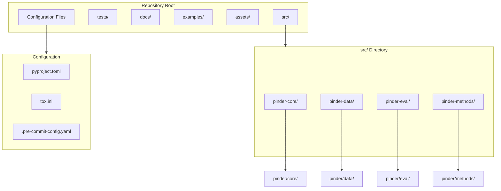
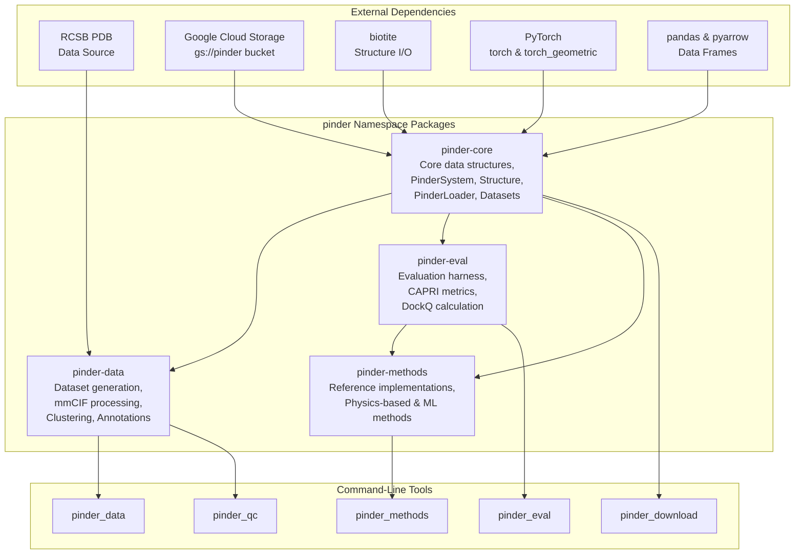
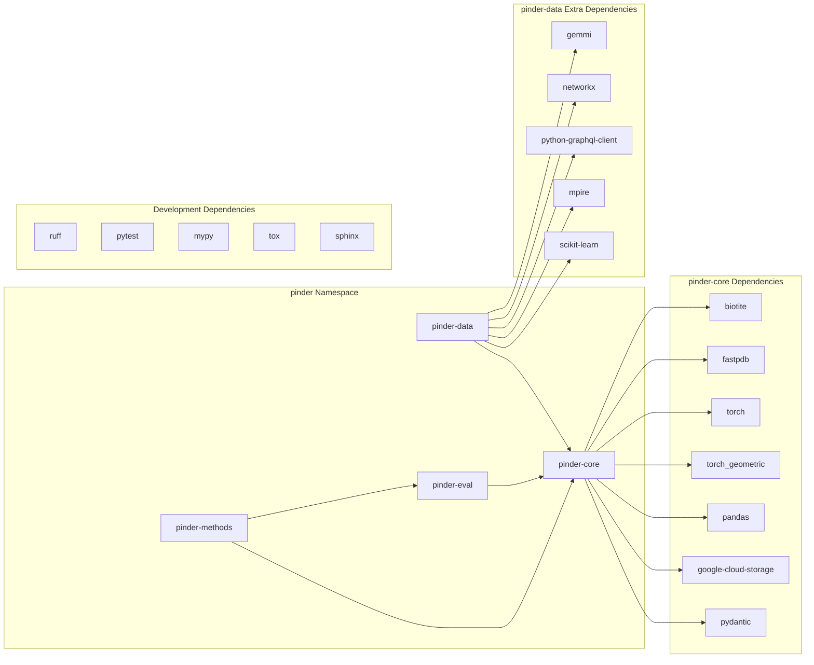

# Project Structure

<details>
<summary>Relevant source files</summary>

The following files were used as context for generating this wiki page:

- [README.md](README.md)
- [pyproject.toml](pyproject.toml)

</details>


This document describes the organizational structure of the PINDER codebase, including its four-package namespace architecture, directory layout, inter-package dependencies, and installation options. For details on the development workflow and testing setup, see [Development Setup](#7.2) and [Testing](#7.3). For information about the CI/CD pipeline, see [CI/CD Pipeline](#7.4).

## Repository Organization

The PINDER repository is organized as a namespace package consisting of four independently installable subpackages under the `pinder` namespace. This modular design allows users to install only the components they need.



**Directory Structure**

Sources: [README.md:689-696](), [pyproject.toml:138-146]()

## Package Architecture

The four packages form a dependency hierarchy where `pinder-core` serves as the foundation, with other packages building upon it. The architecture diagram below shows the relationships between packages and their primary responsibilities.



Sources: [README.md:689-696](), [pyproject.toml:38-47](), [pyproject.toml:1-24]()

## pinder-core

The `pinder-core` package provides the foundational data structures and loading utilities for working with the PINDER dataset. It is the only required dependency for users who want to load and use the dataset.

**Key Modules and Classes:**

| Module | Primary Classes/Functions | Purpose |
|--------|---------------------------|---------|
| `pinder.core.index.system` | `PinderSystem` | Manages collection of structures (native, holo, apo, predicted) for a protein complex |
| `pinder.core.loader.structure` | `Structure` | Wraps biotite's AtomArray with filtering, alignment, and property access |
| `pinder.core.loader.loader` | `PinderLoader` | Iterator with filtering and monomer selection strategies |
| `pinder.core.loader.dataset` | `PinderDataset`, `PPIDataset` | PyTorch and PyTorch Geometric dataset implementations |
| `pinder.core.loader.filters` | `PinderFilterBase`, `PinderFilterSubBase`, `StructureFilter` | Three-tier filtering system |
| `pinder.core.loader.transforms` | `TransformBase`, `StructureTransform` | Data augmentation and preprocessing |
| `pinder.core.index.utils` | `get_pinder_location()`, `download_pinder_cmd()` | Dataset management utilities |

**Command-Line Tools:**

- `pinder_download`: Downloads the complete PINDER dataset from Google Cloud Storage
- `pinder_sync_data`: Synchronizes structure files after patch updates
- `pinder_update_index`: Updates local index.parquet and metadata.parquet files

Sources: [README.md:692](), [pyproject.toml:40-45](), [README.md:410-427]()

## pinder-data

The `pinder-data` package contains the complete pipeline for generating the PINDER dataset from raw RCSB PDB data. This package is primarily for dataset maintainers and users interested in dataset generation methodology.

**Key Modules and Components:**

| Module | Purpose |
|--------|---------|
| `pinder.data.pipeline` | Orchestrates data acquisition, processing, and annotation workflows |
| `pinder.data.qc` | Quality control checks and filtering |
| `pinder.data.annotation` | Fetches annotations from RCSB GraphQL API (PFAM, ECOD, SCOP, CATH) |
| `pinder.data.alignment` | Sequence and structure alignment for apo/predicted monomer matching |
| `pinder.data.foldseek_utils` | Interface clustering via FoldSeek |
| `pinder.data.plot` | Visualization and dataset statistics |

**Command-Line Tools:**

- `pinder_data`: Main entry point for dataset generation pipeline
- `pinder_qc`: Quality control and validation tools
- `pinder_plot`: Generate dataset visualizations and statistics

**Optional Dependencies:**

The `pinder-data` package requires additional dependencies specified in the `data` extra:

- `gemmi`: mmCIF file parsing
- `networkx`: Graph-based clustering algorithms
- `python-graphql-client`: RCSB API queries
- `mpire`: Parallel processing utilities
- `matplotlib`, `seaborn`, `colormath`: Visualization

Sources: [README.md:693](), [pyproject.toml:46-47](), [pyproject.toml:96-106]()

## pinder-eval

The `pinder-eval` package provides a complete evaluation harness for assessing protein-protein docking predictions using standard CAPRI metrics.

**Key Modules and Classes:**

| Module | Primary Classes/Functions | Purpose |
|--------|---------------------------|---------|
| `pinder.eval.dockq.method` | `MethodMetrics` | Orchestrates evaluation across test sets and methods |
| `pinder.eval.dockq.calculate` | `DockQ` calculation functions | Computes iRMS, LRMS, Fnat, DockQ scores |
| `pinder.eval.run` | `main()` | CLI entry point for evaluation pipeline |
| `pinder.eval.create_submission` | Submission generation utilities | Formats results for leaderboard submission |

**Command-Line Tools:**

- `pinder_eval`: Evaluates docking predictions against ground truth structures
- `pinder_create_submission`: Generates leaderboard-ready submission files

**Expected Directory Structure:**

The evaluation harness expects predictions in a specific directory layout:

```
eval_dir/
└── method_name/
    └── <pinder_system_id>/
        ├── holo_decoys/
        │   ├── model_1.pdb
        │   └── model_2.pdb
        ├── apo_decoys/
        │   └── model_1.pdb
        └── predicted_decoys/
            └── model_1.pdb
```

Sources: [README.md:694](), [pyproject.toml:41-42](), [README.md:300-378]()

## pinder-methods

The `pinder-methods` package contains reference implementations of docking methods that use PINDER for training and evaluation. This serves as both a benchmark baseline and example integration.

**Included Methods:**

- Physics-based methods: FroDock, PatchDock, HDock
- ML-based methods: DiffDock-PP, AF2-MM (evaluation only)

**Command-Line Tools:**

- `pinder_methods`: Runs reference docking methods on PINDER test sets

The package depends on both `pinder-core` and `pinder-eval` to access dataset loading utilities and evaluation metrics.

Sources: [README.md:695](), [pyproject.toml:43](), [README.md:288-297]()

## Package Dependencies

The dependency relationships between packages and their external requirements are shown below:



Sources: [pyproject.toml:4-24](), [pyproject.toml:96-106]()

## Installation Options

The modular package structure allows flexible installation based on user needs. The following table summarizes available installation commands:

| Command | Packages Installed | Use Case |
|---------|-------------------|----------|
| `pip install pinder` | `pinder-core` only | Load and use the dataset |
| `pip install pinder[eval]` | `pinder-core` + `pinder-eval` | Load dataset and evaluate predictions |
| `pip install pinder[data]` | `pinder-core` + `pinder-data` | Dataset generation and loading |
| `pip install pinder[all]` | All packages with optional dependencies | Complete functionality |
| `pip install pinder[dev]` | All packages + dev tools | Development and testing |
| `pip install pinder[docs]` | Documentation build tools | Build documentation locally |
| `pip install pinder[leaderboard]` | Leaderboard visualization tools | Generate leaderboard reports |

**Development Installation:**

For contributors working on the codebase:

```bash
git clone https://github.com/pinder-org/pinder.git
cd pinder
pip install -e '.[dev]'
```

The `-e` flag installs packages in editable mode, allowing code changes to take effect immediately.

Sources: [README.md:101-118](), [README.md:844-847](), [pyproject.toml:49-124]()

## Build Configuration

The PINDER project uses modern Python packaging standards with the following key configurations:

**Namespace Packages:**

The project uses implicit namespace packages (PEP 420) configured in [pyproject.toml:138-146]():

```toml
[tool.setuptools.packages.find]
where = [
    "src/pinder-core",
    "src/pinder-data",
    "src/pinder-eval",
    "src/pinder-methods",
]
include = ["pinder.*"]
namespaces = true
```

This allows all four packages to share the `pinder` namespace while being independently installable.

**Version Management:**

Versions are managed automatically using `setuptools_scm`, which derives version numbers from git tags:

```toml
[tool.setuptools_scm]
root = "."
```

This ensures consistent versioning across all packages and enables semantic versioning via git tags.

**Package Data:**

YAML configuration files are included in package distributions:

```toml
[tool.setuptools.package-data]
pinder = ["**.yaml"]
```

Sources: [pyproject.toml:135-149]()

## Testing Structure

Tests are organized to mirror the package structure:

```
tests/
├── test_core/       # Tests for pinder-core
├── test_data/       # Tests for pinder-data
├── test_eval/       # Tests for pinder-eval
└── test_methods/    # Tests for pinder-methods
```

The test suite uses pytest with multi-version testing via tox across Python 3.10, 3.11, and 3.12. For details on running tests and coverage requirements, see [Testing](#7.3).

Sources: [pyproject.toml:151-157](), [README.md:856-859]()

---