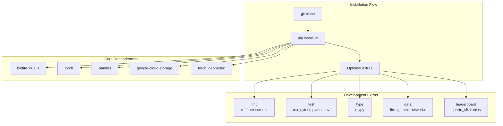
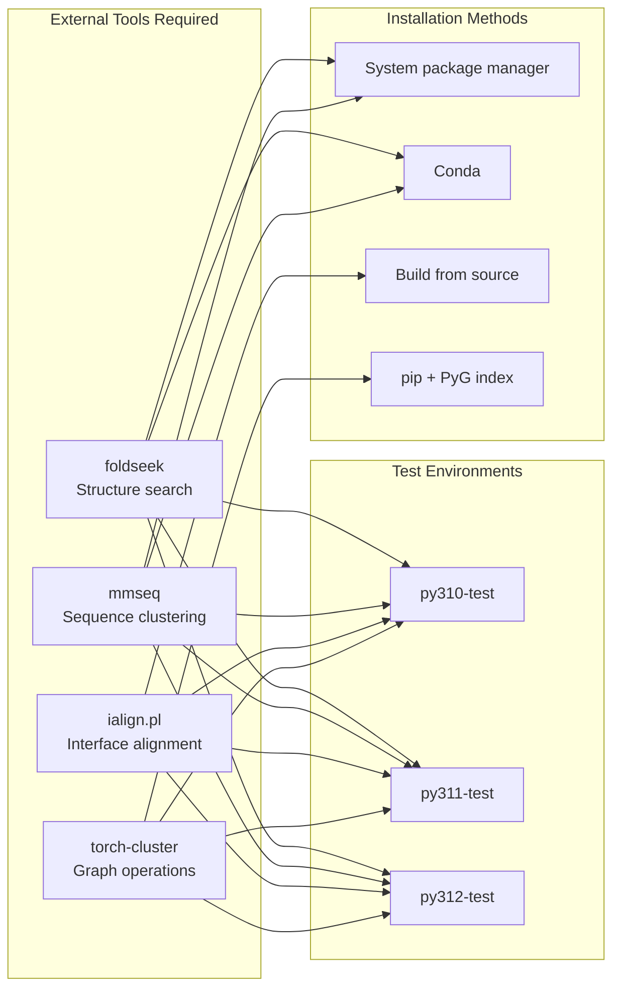

# Development Setup

<details>
<summary>Relevant source files</summary>

The following files were used as context for generating this wiki page:

- [pyproject.toml](pyproject.toml)
- [tox.ini](tox.ini)

</details>


This page guides developers through setting up a local development environment for contributing to PINDER. It covers Python version requirements, installation methods, optional dependency groups, and external tool configuration.

For information about the overall project structure, see [Project Structure](#7.1). For testing the development environment, see [Testing](#7.3).

## System Requirements

PINDER requires Python 3.10 or higher. The project officially supports three Python versions:

| Python Version | Support Level | Coverage Required |
|----------------|---------------|-------------------|
| 3.10 | Full (primary) | Yes (80%) |
| 3.11 | Full | Yes (80%) |
| 3.12 | Basic | No |

The minimum Python version is enforced in the project configuration at [pyproject.toml:27]().

Sources: [pyproject.toml:27](), [tox.ini:9-12]()

## Installation Methods

### Basic Installation

For end users who only need to use PINDER datasets and loaders:

```bash
pip install pinder
```

This installs the core dependencies required for data loading and structure manipulation, including:
- `biotite` for structure I/O
- `fastpdb` for fast PDB parsing
- `torch` and `torch_geometric` for ML integration
- `pandas` and `pyarrow` for index/metadata handling
- `google-cloud-storage` and `gcsfs` for dataset access

Sources: [pyproject.toml:4-24]()

### Development Installation

Contributors should install PINDER in editable mode with development dependencies:

```bash
git clone https://github.com/pinder-org/pinder.git
cd pinder
pip install -e ".[dev]"
```

The `-e` flag creates an editable installation where code changes are immediately reflected without reinstalling. The `dev` extra includes all optional dependency groups.



Sources: [pyproject.toml:122-124]()

## Optional Dependencies

PINDER uses optional dependency groups to allow selective installation based on use case. Each group is defined in `[project.optional-dependencies]`.

### Dependency Groups

#### `lint` - Code Quality Tools

```bash
pip install "pinder[lint]"
```

Installs linting and formatting tools:
- `ruff==0.4.9` - Fast Python linter and formatter
- `pre-commit==3.6.0` - Git hook framework for code quality checks

Used by the `lint` tox environment at [tox.ini:23-28]().

Sources: [pyproject.toml:50-53]()

#### `test` - Testing Framework

```bash
pip install "pinder[test]"
```

Installs testing infrastructure:
- `tox>=4` - Test environment automation
- `pytest==7.2.0` - Testing framework
- `pytest-cov==4.0.0` - Coverage reporting
- `build==0.9.0` - Package building
- `setuptools_scm[toml]==7.0.5` - Version management

Sources: [pyproject.toml:54-60]()

#### `type` - Type Checking

```bash
pip install "pinder[type]"
```

Installs type checking tools:
- `mypy==1.10.0` - Static type checker
- Type stubs for `pydantic`, `PyYAML`, `requests`

Used by the `type` tox environment at [tox.ini:30-34]().

Sources: [pyproject.toml:61-67]()

#### `docs` - Documentation Generation

```bash
pip install "pinder[docs]"
```

Installs Sphinx documentation tools including:
- `jupyter-sphinx` - Jupyter notebook integration
- `myst-nb` and `myst-parser` - Markdown support
- `pydata-sphinx-theme` - Theme
- `sphinxcontrib-*` - Various Sphinx extensions

Sources: [pyproject.toml:69-87]()

#### `data` - Dataset Generation

```bash
pip install "pinder[data]"
```

Installs tools for the data generation pipeline:
- `fire` - CLI framework
- `gemmi` - mmCIF file processing
- `networkx` - Graph algorithms
- `scikit-learn<=1.2.2` - Machine learning utilities (required for PRODIGY-cryst)
- `python-graphql-client` - RCSB GraphQL queries
- `mpire` - Parallel processing
- `matplotlib`, `seaborn`, `colormath` - Visualization

**Note:** Python 3.12 users should use `datapy312` instead, which installs a newer `scikit-learn` version since version 1.2.2 doesn't provide Python 3.12 wheels.

Sources: [pyproject.toml:96-119]()

#### `leaderboard` - Evaluation Leaderboard

```bash
pip install "pinder[leaderboard]"
```

Installs tools for generating evaluation leaderboards:
- `quarto_cli` - Document generation
- `itables` - Interactive tables
- `matplotlib` and `seaborn` - Plotting

Sources: [pyproject.toml:89-94]()

#### `dev` - All Development Tools

```bash
pip install "pinder[dev]"
```

Meta-package that installs `lint`, `test`, `type`, `leaderboard`, and `data` groups together.

Sources: [pyproject.toml:122-124]()

### Dependency Selection Table

| Use Case | Install Command | Groups Included |
|----------|----------------|-----------------|
| Dataset usage only | `pip install pinder` | Core only |
| Code contribution | `pip install -e ".[dev]"` | All development groups |
| Testing only | `pip install ".[test]"` | `test` |
| Documentation work | `pip install ".[docs]"` | `docs` |
| Data pipeline work | `pip install ".[data]"` | `data` (or `datapy312` for Python 3.12) |

## External Tools

Several external bioinformatics tools must be installed separately and available in the system PATH. These are required for testing but not for normal dataset usage.



Sources: [tox.ini:18-21](), [tox.ini:54-56](), [tox.ini:67-68]()

### foldseek

Structure alignment tool for protein comparison. Installation varies by platform:

```bash
# macOS with Homebrew
brew install foldseek

# Ubuntu/Debian
apt-get install foldseek

# Conda
conda install -c conda-forge -c bioconda foldseek
```

The tool must be available as the `foldseek` command in PATH. Tox allows this external executable at [tox.ini:19]().

### mmseq

Sequence clustering tool. Installation:

```bash
# Conda
conda install -c conda-forge -c bioconda mmseqs2

# Or download binary from:
# https://github.com/soedinglab/MMseqs2
```

The tool must be available as the `mmseq` command in PATH. Tox allows this external executable at [tox.ini:20]().

### ialign.pl

Interface alignment Perl script. Must be installed from source:

```bash
# Download from the iAlign website
# http://www.med.umich.edu/lrc/ialign/
# Ensure Perl is installed and script is executable
chmod +x ialign.pl
# Add to PATH or place in a standard bin directory
```

The tool must be available as the `ialign.pl` command in PATH. Tox allows this external executable at [tox.ini:21]().

### torch-cluster

PyTorch extension for graph clustering operations. Must be installed from PyTorch Geometric's wheel index:

```bash
# For PyTorch 2.3.1 (as used in tox)
pip install torch-cluster -f https://data.pyg.org/whl/torch-2.3.1+cpu.html
```

This is automatically installed in tox test environments at [tox.ini:55]() and [tox.ini:68]().

### PRODIGY-cryst

Protein-protein binding affinity prediction tool. Installed from GitHub during test setup:

```bash
pip install git+https://github.com/yusuf1759/prodigy-cryst.git
```

This is automatically installed in Python 3.10 and 3.11 test environments at [tox.ini:56](), but not in Python 3.12 (see note about `scikit-learn` compatibility).

## Environment Configuration

### Environment Variables

Two environment variables may be needed for Google Cloud Storage access:

| Variable | Purpose | Required For |
|----------|---------|--------------|
| `GOOGLE_APPLICATION_CREDENTIALS` | Path to GCS service account JSON key | Authenticated GCS access |
| `GOOGLE_CLOUD_PROJECT` | GCP project ID | GCS operations |

These are passed through to tox test environments at [tox.ini:15-17]().

Set them in your shell profile:

```bash
export GOOGLE_APPLICATION_CREDENTIALS="/path/to/service-account-key.json"
export GOOGLE_CLOUD_PROJECT="your-gcp-project-id"
```

For public dataset access, these variables are not required as PINDER datasets are publicly readable.

Sources: [tox.ini:15-17]()

### Tox Configuration

Tox is the primary tool for running tests across multiple Python versions. The configuration defines three test environment types:

1. **Linting environments** (`py310-lint`, `py311-lint`, `py312-lint`)
2. **Type checking environments** (`py310-type`, `py311-type`, `py312-type`)
3. **Testing environments** (`py310-test`, `py311-test`, `py312-test`)

Each environment is isolated and installs dependencies fresh. The configuration at [tox.ini:1-6]() specifies:

```ini
[tox]
envlist = {py310,py311,py312}-lint,{py310,py311,py312}-type,{py310,py311,py312}-test
isolated_build = true
requires =
    tox-extras==0.0.1
    tox-gh-actions
```

The `tox-gh-actions` plugin automatically maps GitHub Actions Python versions to tox environments at [tox.ini:8-12]().

Sources: [tox.ini:1-12]()

## Verification

After setting up your development environment, verify the installation:

### Check Core Installation

```bash
python -c "import pinder; print(pinder.__version__)"
```

### Check Optional Dependencies

```bash
# Check linting tools
ruff --version
pre-commit --version

# Check type checker
mypy --version

# Check testing tools
pytest --version
tox --version
```

### Check External Tools

```bash
foldseek --version
mmseq version
perl ialign.pl --help
```

### Run Quick Test

Run tests for your Python version:

```bash
# Run all tests for current Python version
tox -e py310-test  # or py311-test, py312-test

# Run specific test file
tox -e py310-test -- tests/core/test_loader.py

# Run with coverage
tox -e py311-test  # py311 includes coverage by default
```

The test environments automatically install all required dependencies including `torch==2.3.1`, `torch-cluster`, and `prodigy-cryst` as specified in [tox.ini:50-71]().

Sources: [tox.ini:50-71]()

## Package Structure Location

PINDER uses a namespace package structure with source code located in the `src/` directory:

```
src/
├── pinder-core/     # Core data structures and loaders
├── pinder-data/     # Dataset generation pipeline
├── pinder-eval/     # Evaluation harness
└── pinder-methods/  # Reference implementations
```

The `setuptools` configuration at [pyproject.toml:138-146]() specifies these locations:

```toml
[tool.setuptools.packages.find]
where = [
    "src/pinder-core",
    "src/pinder-data",
    "src/pinder-eval",
    "src/pinder-methods",
]
include = ["pinder.*"]
namespaces = true
```

All packages share the `pinder` namespace, so imports use `pinder.core`, `pinder.data`, etc.

For more details on the package organization, see [Project Structure](#7.1).

Sources: [pyproject.toml:138-146]()

## Command-Line Tools

After installation, several command-line tools become available via entry points defined at [pyproject.toml:38-47]():

| Command | Purpose | Module |
|---------|---------|--------|
| `pinder_data` | Run data generation pipeline | `pinder.data.run:main` |
| `pinder_download` | Download PINDER dataset | `pinder.core.index.utils:download_pinder_cmd` |
| `pinder_eval` | Run evaluation harness | `pinder.eval.run:main` |
| `pinder_create_submission` | Create submission file | `pinder.eval.create_submission:main` |
| `pinder_methods` | Run reference methods | `pinder.methods.main:main` |
| `pinder_sync_data` | Sync structure data | `pinder.core.index.utils:sync_pinder_structure_data` |
| `pinder_update_index` | Update dataset index | `pinder.core.index.utils:update_index_cmd` |
| `pinder_qc` | Run quality control | `pinder.data.qc.run:main` |
| `pinder_plot` | Generate plots | `pinder.data.plot.run:main` |

Test these are available:

```bash
pinder_download --help
pinder_eval --help
```

Sources: [pyproject.toml:38-47]()

---