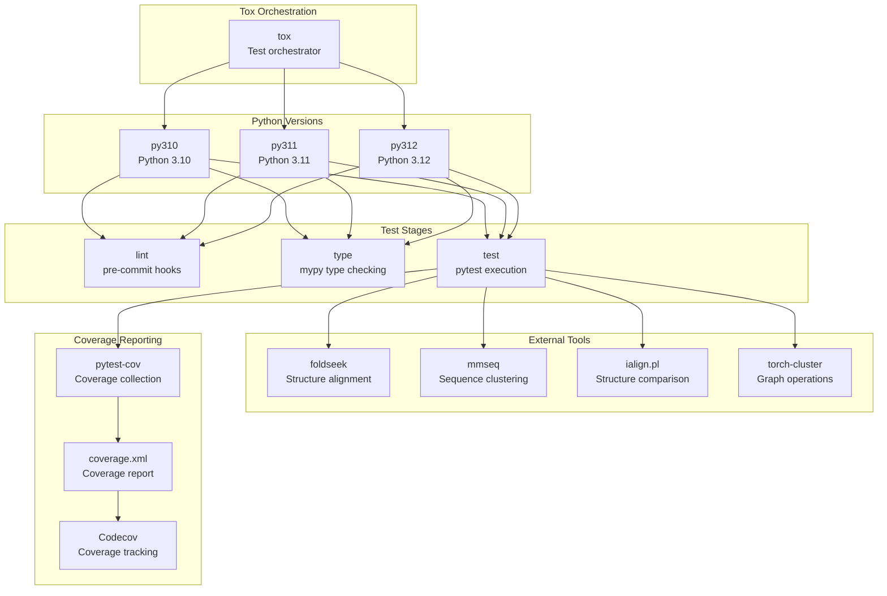
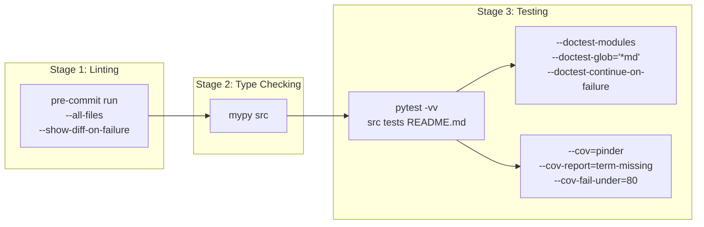
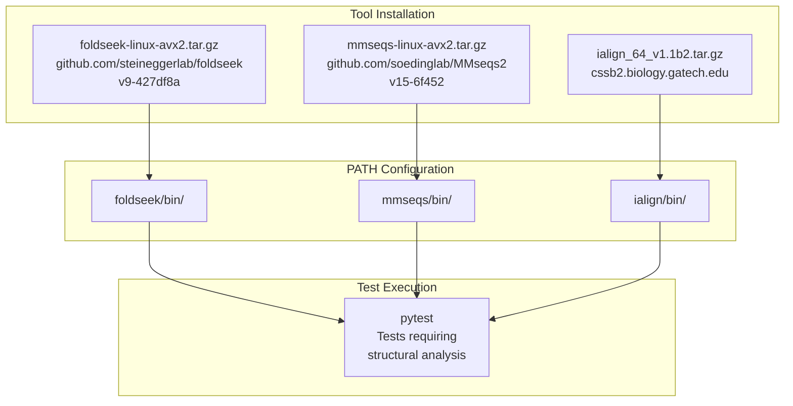
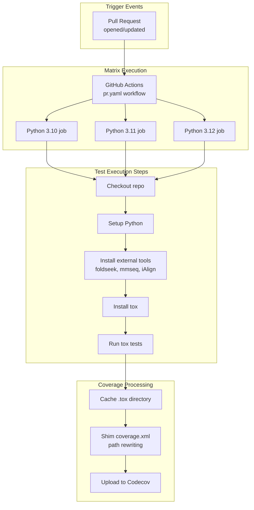

# Testing

<details>
<summary>Relevant source files</summary>

The following files were used as context for generating this wiki page:

- [.github/workflows/pr.yaml](.github/workflows/pr.yaml)
- [tests/core/loader/test_dataset.py](tests/core/loader/test_dataset.py)
- [tox.ini](tox.ini)

</details>


This document describes the testing infrastructure for PINDER, including the tox-based multi-version testing setup, coverage requirements, external tool dependencies, and CI/CD integration. For information about the broader CI/CD pipeline and publishing workflow, see [CI/CD Pipeline](#7.4). For code quality standards including linting and type checking, see [Code Quality](#7.5).

## Overview

PINDER uses a comprehensive testing strategy that validates functionality across three Python versions (3.10, 3.11, 3.12) through `tox`, with pytest as the underlying test runner. The test suite includes unit tests, integration tests, and doctest validation, along with code coverage tracking through Codecov. External bioinformatics tools (foldseek, mmseq, iAlign) are installed as test dependencies to validate structural analysis functionality.

**Sources:** [tox.ini:1-72](), [.github/workflows/pr.yaml:1-86]()

## Test Environment Architecture



**Test Environment Architecture**  
This diagram shows how tox orchestrates testing across three Python versions, each running lint, type checking, and pytest stages. External bioinformatics tools are installed as test dependencies, and coverage is collected via pytest-cov and reported to Codecov.

**Sources:** [tox.ini:1-72](), [.github/workflows/pr.yaml:23-62]()

## Tox Configuration

### Environment Matrix

The tox configuration defines nine test environments across three stages and three Python versions:

| Environment | Python Version | Purpose |
|------------|---------------|---------|
| `py310-lint` | 3.10 | Pre-commit hook validation |
| `py310-type` | 3.10 | mypy type checking |
| `py310-test` | 3.10 | Full test suite with coverage |
| `py311-lint` | 3.11 | Pre-commit hook validation |
| `py311-type` | 3.11 | mypy type checking |
| `py311-test` | 3.11 | Full test suite with coverage requirement (≥80%) |
| `py312-lint` | 3.12 | Pre-commit hook validation |
| `py312-type` | 3.12 | mypy type checking |
| `py312-test` | 3.12 | Basic test suite (no coverage requirement) |

**Sources:** [tox.ini:2-3](), [tox.ini:23-71]()

### Environment Variables

Tox environments pass through specific environment variables needed for Google Cloud integration:

- `GOOGLE_APPLICATION_CREDENTIALS`: Authentication credentials for GCS access
- `GOOGLE_CLOUD_PROJECT`: GCP project identifier

**Sources:** [tox.ini:15-17]()

### Allowlisted External Commands

The following external commands are explicitly allowed in test environments:

- `foldseek`: Structural alignment and search
- `mmseq`: Sequence clustering and database creation
- `ialign.pl`: Structure-structure alignment
- `pytest`: Test execution (for py310, py311, py312 test environments)

**Sources:** [tox.ini:18-22](), [tox.ini:52](), [tox.ini:65]()

## Test Stages



**Test Execution Pipeline**  
This diagram shows the three sequential test stages. Each stage must pass before proceeding to the next. Coverage requirements only apply to py311-test environment.

**Sources:** [tox.ini:23-71]()

### Lint Stage

The lint stage executes all pre-commit hooks across the entire codebase:

```bash
# Command executed in py310-lint, py311-lint, py312-lint
pre-commit run --all-files --show-diff-on-failure
```

Key characteristics:
- Skips source distribution build (`skip_sdist = true`)
- Skips package installation (`skip_install = true`)
- Uses `tox_extras = lint` dependency group
- Shows diffs when checks fail

**Sources:** [tox.ini:23-28]()

### Type Checking Stage

The type checking stage runs mypy on the source directory:

```bash
# Command executed in py310-type, py311-type, py312-type
mypy src
```

Key characteristics:
- Skips source distribution build
- Skips package installation
- Uses `tox_extras = type` dependency group
- Type checks all code under `src/`

**Sources:** [tox.ini:30-34]()

### Test Stage

The test stage runs pytest with comprehensive options and varies by Python version:

**Python 3.10:**
```bash
pytest -vv src tests README.md
```

**Python 3.11:**
```bash
pytest -vv src tests README.md --cov=pinder --cov-report=term-missing:skip-covered --cov-fail-under=80
```

**Python 3.12:**
```bash
pytest -vv src tests README.md
```

**Sources:** [tox.ini:50-71]()

#### Test Dependencies Installation

Before running tests, several dependencies are installed in a specific order:

```bash
# Commands executed before pytest in all test environments
pip install 'torch==2.3.1'
pip install torch-cluster -f https://data.pyg.org/whl/torch-2.3.1+cpu.html
pip install git+https://github.com/yusuf1759/prodigy-cryst.git  # Not in py312
pip install -e .
```

**Sources:** [tox.ini:53-57](), [tox.ini:66-69]()

## Coverage Requirements

Coverage is configured in the tox.ini file with the following settings:

### Coverage Collection

```ini
[coverage:run]
branch = true
parallel = true
omit = src/pinder-data/pinder/data/plot/*
source = .tox/py310-test/lib/python3.10/site-packages/pinder/
```

Key settings:
- **Branch coverage enabled**: Tracks both statement and branch coverage
- **Parallel mode**: Supports concurrent test execution
- **Omitted paths**: Plotting modules excluded from coverage
- **Source specification**: Points to installed package in tox environment

**Sources:** [tox.ini:37-42]()

### Coverage Reporting

```ini
[coverage:report]
show_missing = true
precision = 2
include_namespace_packages = true
```

Coverage requirements:
- **Python 3.11**: Minimum 80% coverage required (`--cov-fail-under=80`)
- **Python 3.10, 3.12**: Coverage collected but not enforced
- **Report format**: Terminal output with missing lines highlighted
- **Precision**: Two decimal places for percentages

**Sources:** [tox.ini:44-47](), [tox.ini:60]()

## External Tool Dependencies

Several external bioinformatics tools are required for testing structural analysis functionality. These are installed during CI workflows but must be manually installed for local development.



**External Tool Installation Flow**  
This diagram shows how external bioinformatics tools are downloaded, extracted, and added to PATH for test execution. These tools are required for structural analysis tests.

**Sources:** [.github/workflows/pr.yaml:31-56]()

### Tool Installation Commands

**foldseek:**
```bash
curl -LO https://github.com/steineggerlab/foldseek/releases/download/9-427df8a/foldseek-linux-avx2.tar.gz
tar xvzf foldseek-linux-avx2.tar.gz
export PATH=$(pwd)/foldseek/bin/:$PATH
```

**mmseq:**
```bash
curl -LO https://github.com/soedinglab/MMseqs2/releases/download/15-6f452/mmseqs-linux-avx2.tar.gz
tar xvfz mmseqs-linux-avx2.tar.gz
export PATH=$(pwd)/mmseqs/bin/:$PATH
```

**iAlign:**
```bash
curl -LO http://cssb2.biology.gatech.edu/skolnick/files/iAlign/ialign_64_v1.1b2.tar.gz
tar xvzf ialign_64_v1.1b2.tar.gz
export PATH=$(pwd)/ialign/bin/:$PATH
```

**torch-cluster:**
```bash
pip install torch-cluster -f https://data.pyg.org/whl/torch-2.3.1+cpu.html
```

**Sources:** [.github/workflows/pr.yaml:31-56](), [tox.ini:55]()

## Running Tests

### Local Testing

To run the full test suite locally:

```bash
# Install tox
pip install tox

# Run all environments
tox

# Run specific Python version
tox -e py311-test

# Run specific stage across all versions
tox -e py310-lint,py311-lint,py312-lint

# Run with specific pytest args
tox -e py311-test -- tests/core/loader/test_dataset.py -v

# Run with parallel execution
tox -p auto
```

### CI Testing

CI testing is triggered on pull requests and executes via GitHub Actions. The workflow:

1. **Matrix strategy**: Tests run in parallel across Python 3.10, 3.11, 3.12
2. **Skip conditions**: 
   - Only runs on `pinder-org/pinder` repository
   - Skipped if commit message contains `[skip ci]`
3. **Concurrency**: Old runs cancelled when new commits pushed
4. **Coverage upload**: py311 results uploaded to Codecov

**Sources:** [.github/workflows/pr.yaml:1-86]()

## Test Organization

### Test Structure

The test directory mirrors the source code structure:

```
tests/
├── core/
│   ├── loader/
│   │   ├── test_dataset.py      # Dataset and loader tests
│   │   ├── test_geodata.py      # Graph data tests
│   │   └── test_transforms.py   # Transform tests
│   ├── test_index.py            # Index and metadata tests
│   └── test_structure.py        # Structure class tests
├── data/
│   └── test_pipeline.py         # Data generation pipeline tests
└── eval/
    └── test_metrics.py          # Evaluation metrics tests
```

**Sources:** [tests/core/loader/test_dataset.py:1-1]()

### Pytest Fixtures

Common fixtures are used across tests to set up test environments:

- `pinder_temp_dir`: Creates temporary directory with test data
- `capfd`: Captures stdout/stderr for output validation

**Sources:** [tests/core/loader/test_dataset.py:32](), [tests/core/loader/test_dataset.py:94]()

## Example Test Patterns

### Parametrized Dataset Tests

The test suite uses pytest parametrization extensively to test multiple scenarios:

```python
@pytest.mark.parametrize(
    "split, ids, monomer_priority, expected_len",
    [
        ("train", None, "holo", 1560682),
        ("val", None, "holo", 1958),
        ("test", None, "holo", 1955),
        ("train", ["7mbm__I1_P84233--7mbm__J1_P62799"], "holo", 1),
        (None, ["7mbm__I1_P84233--7mbm__J1_P62799"], "holo", 1),
    ],
)
def test_pinder_dataset(split, ids, monomer_priority, expected_len, pinder_temp_dir):
    # Test implementation
```

**Sources:** [tests/core/loader/test_dataset.py:158-174]()

### Dataset Validation Pattern

Tests validate dataset structure, size, and content:

```python
def test_pinder_dataset(split, ids, monomer_priority, expected_len, pinder_temp_dir):
    dataset = PinderDataset(
        split=split,
        ids=ids,
        monomer_priority=monomer_priority,
    )
    assert len(dataset) == expected_len
    assert len(dataset) == len(dataset.loader)
    data_item = dataset[0]
    assert isinstance(data_item, dict)
    assert isinstance(data_item["target_complex"], dict)
    assert isinstance(data_item["feature_complex"], dict)
    assert set(data_item["target_complex"].keys()) == EXPECTED_STRUCTURE_KEYS
    assert set(data_item["feature_complex"].keys()) == EXPECTED_STRUCTURE_KEYS
```

**Sources:** [tests/core/loader/test_dataset.py:168-182]()

### Loader Integration Tests

Tests validate DataLoader integration with PyTorch and PyTorch Geometric:

```python
@pytest.mark.parametrize(
    "split, monomer_priority, batch_size",
    [
        ("train", "holo", 2),
        ("train", "apo", 1),
        ("train", "pred", 1),
        ("train", "random_mixed", 1),
        ("val", "holo", 1),
        ("test", "holo", 1),
    ],
)
def test_torch_loader(split, monomer_priority, batch_size, pinder_temp_dir):
    dataset = PinderDataset(
        split=split,
        monomer_priority=monomer_priority,
    )
    loader = get_torch_loader(dataset, num_workers=0, batch_size=batch_size)
    assert isinstance(loader, DataLoader)
    batch = next(iter(loader))
    assert set(batch.keys()) == {
        "target_complex",
        "feature_complex",
        "id",
        "sample_id",
        "target_id",
    }
    assert feature_coords.shape[0] == batch_size
    assert feature_coords.shape[2] == 3
```

**Sources:** [tests/core/loader/test_dataset.py:192-228]()

### Graph Dataset Tests

Tests for PyTorch Geometric graph representations:

```python
def test_pairedpdb_heterodata(pinder_temp_dir):
    pinder_id = "3s9d__B1_P48551--3s9d__A1_P01563"
    system = PinderSystem(pinder_id)
    nodes = {NodeRepresentation("atom"), NodeRepresentation("residue")}
    holo_data = PairedPDB.from_pinder_system(
        system=system,
        monomer1="holo_receptor",
        monomer2="holo_ligand",
        node_types=nodes,
    )
    assert isinstance(holo_data, HeteroData)
    expected_node_types = [
        "ligand_residue",
        "receptor_residue",
        "ligand_atom",
        "receptor_atom",
    ]
    assert holo_data.num_nodes == 2780
    assert holo_data.node_types == expected_node_types
```

**Sources:** [tests/core/loader/test_dataset.py:32-62]()

## CI/CD Integration



**CI/CD Test Workflow**  
This diagram shows how GitHub Actions orchestrates parallel test execution across Python versions, installs external tools, runs tox, and uploads coverage results to Codecov.

**Sources:** [.github/workflows/pr.yaml:1-86]()

### Concurrency Control

The CI workflow implements concurrency control to cancel outdated test runs:

```yaml
concurrency:
  group: ${{ github.ref }}
  cancel-in-progress: true
```

This ensures only the most recent commit's tests run, saving CI resources.

**Sources:** [.github/workflows/pr.yaml:8-12]()

### Coverage Path Shimming

Because tests run inside tox virtual environments, coverage paths must be rewritten before upload:

```bash
sed -i.tmp "s|<source>.*\.tox.*site-packages|<source>$(pwd)/src|" coverage.xml
```

This converts tox environment paths to source paths for accurate Codecov reporting.

**Sources:** [.github/workflows/pr.yaml:72-74]()

### Test Caching

The `.tox` directory is cached to speed up subsequent test runs:

```yaml
- name: Directory Cache
  uses: actions/cache@v4
  with:
    path: .tox
    key: tox-${{ runner.os }}-${{ matrix.python-version }}-${{ hashFiles('tox.ini') }}
    restore-keys: |
      tox-${{ runner.os }}-${{ matrix.python-version }}-
```

Cache keys include OS, Python version, and tox.ini hash to ensure cache validity.

**Sources:** [.github/workflows/pr.yaml:64-70]()

## Test Execution Options

### Doctest Validation

Tests include docstring examples from source files and README:

```bash
pytest --doctest-modules --doctest-glob='*md' --doctest-continue-on-failure
```

Options:
- `--doctest-modules`: Test docstrings in Python modules
- `--doctest-glob='*md'`: Test code blocks in markdown files
- `--doctest-continue-on-failure`: Continue testing after doctest failures

**Sources:** [.github/workflows/pr.yaml:62]()

### Performance Profiling

Tests can display the 10 slowest tests:

```bash
pytest --durations=10
```

**Sources:** [.github/workflows/pr.yaml:62]()

### Color Output

Color-coded test output is enabled in CI:

```bash
pytest --color=yes
```

**Sources:** [.github/workflows/pr.yaml:62]()

---