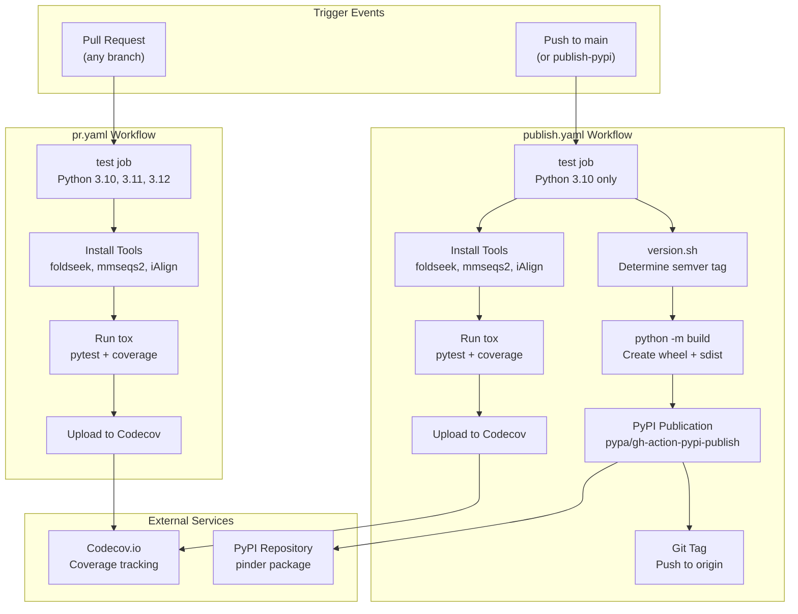
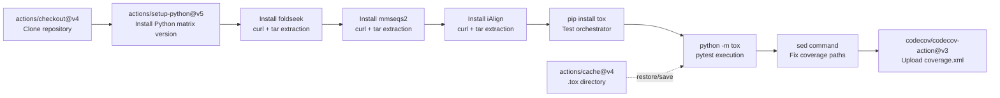
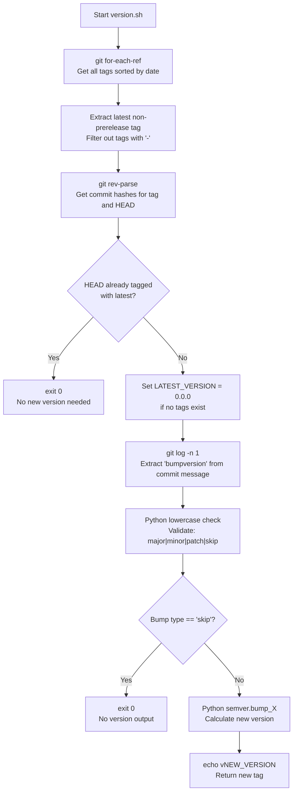
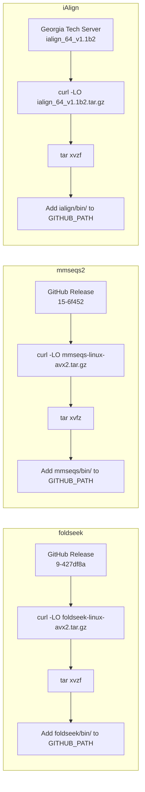
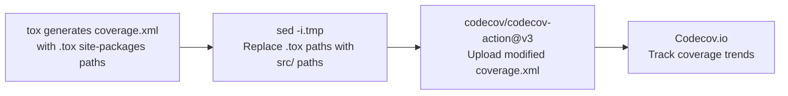
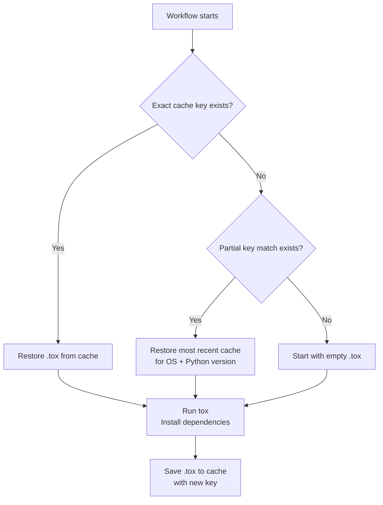
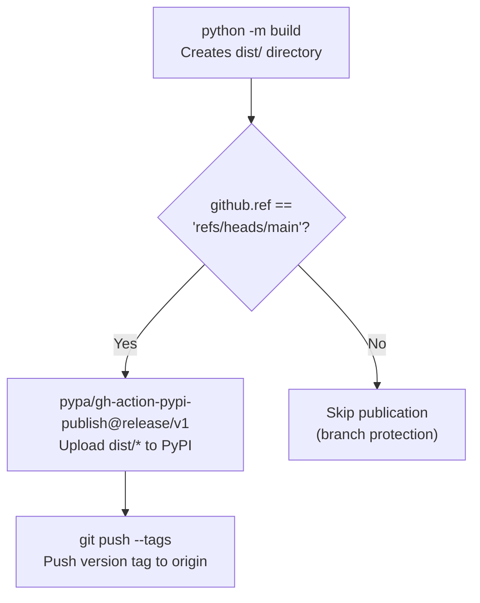

# CI/CD Pipeline

<details>
<summary>Relevant source files</summary>

The following files were used as context for generating this wiki page:

- [.github/workflows/pr.yaml](.github/workflows/pr.yaml)
- [.github/workflows/publish.yaml](.github/workflows/publish.yaml)
- [docker/hdock/Dockerfile.hdock](docker/hdock/Dockerfile.hdock)
- [version.sh](version.sh)

</details>


The PINDER project uses GitHub Actions for continuous integration and deployment. This page documents the automated workflows that validate pull requests, run tests across multiple Python versions, and publish releases to PyPI with semantic versioning.

For information about local testing setup, see [Testing](#7.3). For code quality tools and requirements, see [Code Quality](#7.5).

## Overview

The CI/CD pipeline consists of two primary GitHub Actions workflows that execute different stages of the development lifecycle:

- **PR Validation** ([.github/workflows/pr.yaml]()): Runs on every pull request to validate code quality and test compatibility
- **Publication** ([.github/workflows/publish.yaml]()): Runs on pushes to `main` branch to test, version, and publish to PyPI

Both workflows install external bioinformatics tools required for testing structural analysis functionality and use `tox` for multi-version Python testing.

Sources: [.github/workflows/pr.yaml:1-86](), [.github/workflows/publish.yaml:1-145]()

## Workflow Architecture



Sources: [.github/workflows/pr.yaml:1-86](), [.github/workflows/publish.yaml:1-145]()

## PR Validation Workflow

The `pr.yaml` workflow validates all pull requests before they can be merged. It runs concurrently across three Python versions to ensure compatibility.

### Workflow Configuration

| Property | Value |
|----------|-------|
| Trigger | `pull_request` event |
| Concurrency | Per-branch (cancels older commits: [.github/workflows/pr.yaml:8-12]()) |
| Python Versions | 3.10, 3.11, 3.12 |
| Runner | `ubuntu-latest` |
| Skip Condition | `[skip ci]` in commit message |

### Job Sequence



The workflow performs these steps for each Python version in the matrix:

1. **Checkout**: Uses `actions/checkout@v4` to clone the repository ([.github/workflows/pr.yaml:24-25]())
2. **Python Setup**: Installs the matrix Python version via `actions/setup-python@v5` ([.github/workflows/pr.yaml:26-29]())
3. **Tool Installation**: Installs three external bioinformatics tools in sequence:
   - `foldseek` from GitHub releases ([.github/workflows/pr.yaml:31-39]())
   - `mmseqs2` from GitHub releases ([.github/workflows/pr.yaml:41-46]())
   - `iAlign` from Georgia Tech server ([.github/workflows/pr.yaml:48-56]())
4. **Tox Installation**: Installs the test orchestrator ([.github/workflows/pr.yaml:58-59]())
5. **Test Execution**: Runs `tox` with pytest and coverage options ([.github/workflows/pr.yaml:61-62]())
6. **Cache Management**: Caches `.tox` directory keyed by OS, Python version, and `tox.ini` hash ([.github/workflows/pr.yaml:64-70]())
7. **Coverage Processing**: Adjusts file paths in `coverage.xml` for Codecov ([.github/workflows/pr.yaml:72-74]())
8. **Coverage Upload**: Sends results to Codecov with token authentication ([.github/workflows/pr.yaml:75-85]())

Sources: [.github/workflows/pr.yaml:13-86]()

## Publication Workflow

The `publish.yaml` workflow executes when code is pushed to the `main` or `publish-pypi` branches. It performs the same testing as PR validation but only for Python 3.10, then proceeds to version and publish the package.

### Workflow Structure

```mermaid
graph TB
    subgraph "test job"
        TEST_START["Matrix: Python 3.10 only"]
        TEST_CHECKOUT["actions/checkout@v4"]
        TEST_SETUP["actions/setup-python@v5"]
        TEST_TOOLS["Install foldseek, mmseqs2, iAlign"]
        TEST_CACHE["actions/cache@v4<br/>Cache .tox"]
        TEST_TOX["python -m tox<br/>Run full test suite"]
        TEST_SHIM["sed coverage path fix"]
        TEST_CODECOV["codecov/codecov-action@v3"]
    end
    
    subgraph "pypi-publish job"
        PUB_START["depends on: test job"]
        PUB_CHECKOUT["actions/checkout@v4"]
        PUB_SETUP["Setup Python 3.10"]
        PUB_DEPS["pip install build setuptools<br/>setuptools_scm semver tomlkit"]
        PUB_FETCH["git fetch tags<br/>Get existing versions"]
        PUB_VERSION["bash version.sh<br/>Calculate new semver"]
        PUB_VALIDATE["Validate tag != 'v'<br/>Exit if invalid"]
        PUB_TAG["git tag new version"]
        PUB_BUILD["python -m build<br/>Create dist artifacts"]
        PUB_PYPI["pypa/gh-action-pypi-publish@v1<br/>Upload to PyPI"]
        PUB_PUSH["git push --tags<br/>Persist version tag"]
    end
    
    TEST_START --> TEST_CHECKOUT
    TEST_CHECKOUT --> TEST_SETUP
    TEST_SETUP --> TEST_TOOLS
    TEST_TOOLS --> TEST_CACHE
    TEST_CACHE --> TEST_TOX
    TEST_TOX --> TEST_SHIM
    TEST_SHIM --> TEST_CODECOV
    
    TEST_CODECOV --> PUB_START
    PUB_START --> PUB_CHECKOUT
    PUB_CHECKOUT --> PUB_SETUP
    PUB_SETUP --> PUB_DEPS
    PUB_DEPS --> PUB_FETCH
    PUB_FETCH --> PUB_VERSION
    PUB_VERSION --> PUB_VALIDATE
    PUB_VALIDATE --> PUB_TAG
    PUB_TAG --> PUB_BUILD
    PUB_BUILD --> PUB_PYPI
    PUB_PYPI --> PUB_PUSH
```



The workflow has two sequential jobs:

### test Job

Identical to the PR workflow but only runs for Python 3.10 ([.github/workflows/publish.yaml:8-83]()):

- Installs external tools (foldseek, mmseqs2, iAlign)
- Runs full test suite via `tox`
- Uploads coverage to Codecov
- Must pass before `pypi-publish` job executes

### pypi-publish Job

Handles versioning and publishing ([.github/workflows/publish.yaml:84-145]()):

| Step | Command/Action | Purpose |
|------|----------------|---------|
| Checkout | `actions/checkout@v4` | Clone repository with full history |
| Install Build Tools | `pip install build setuptools setuptools_scm[toml] wheel semver tomlkit` | Package building dependencies |
| Fetch Tags | `git fetch --prune --unshallow --tags` | Get all existing version tags |
| Version Calculation | `bash version.sh` | Determine new semantic version |
| Tag Validation | Check `tag-name != 'v'` | Ensure version was calculated |
| Create Tag | `git tag $TAG` | Tag current commit locally |
| Build | `python -m build` | Generate wheel and source distribution |
| Publish | `pypa/gh-action-pypi-publish@release/v1` | Upload to PyPI (main branch only) |
| Persist Tag | `git push --tags` | Push tag to remote repository |

The job uses the `release` environment and requires `id-token: write` and `contents: write` permissions for trusted publishing to PyPI ([.github/workflows/publish.yaml:88-94]()).

Sources: [.github/workflows/publish.yaml:7-145]()

## Semantic Versioning

The `version.sh` script implements automatic semantic versioning based on commit messages. It determines the new version by inspecting the latest commit for a `bumpversion` directive.

### Versioning Algorithm



The script performs the following logic ([version.sh:1-32]()):

1. **Retrieve Tags**: Uses `git for-each-ref` to get all tags sorted by creation date ([version.sh:10-11]())
2. **Filter Latest**: Selects the most recent tag without hyphens (no pre-releases) ([version.sh:11]())
3. **Compare Commits**: Checks if HEAD is already tagged with the latest version ([version.sh:14-21]())
4. **Extract Directive**: Searches commit message for `bumpversion <type>` pattern ([version.sh:26]())
5. **Normalize Type**: Converts to lowercase and validates as `major`, `minor`, `patch`, or `skip` ([version.sh:27]())
6. **Calculate Version**: If not `skip`, uses Python `semver` library to increment version ([version.sh:28-31]())

### Commit Message Format

To control versioning, include one of these in your commit message:

```
bumpversion major  # 1.2.3 → 2.0.0
bumpversion minor  # 1.2.3 → 1.3.0
bumpversion patch  # 1.2.3 → 1.2.4 (default if no directive)
bumpversion skip   # No new version created
```

If no directive is found, the script defaults to `patch` increment ([version.sh:27]()).

Sources: [version.sh:1-32]()

## Testing Infrastructure

Both workflows use `tox` to orchestrate testing across Python versions. The test execution includes several specialized options.

### Tox Command Structure

The workflows execute tox with a comprehensive pytest configuration:

```bash
python -m tox -- src tests \
  --doctest-modules \
  --doctest-glob='*md' \
  --doctest-continue-on-failure \
  --cov-config=tox.ini \
  --color=yes \
  --durations=10 \
  --cov-report=xml
```

| Option | Purpose |
|--------|---------|
| `src tests` | Test both source code and test directories |
| `--doctest-modules` | Execute doctests in Python modules |
| `--doctest-glob='*md'` | Execute doctests in Markdown documentation |
| `--doctest-continue-on-failure` | Continue testing after doctest failures |
| `--cov-config=tox.ini` | Use tox.ini for coverage configuration |
| `--color=yes` | Enable colored output |
| `--durations=10` | Report 10 slowest tests |
| `--cov-report=xml` | Generate coverage.xml for Codecov |

Sources: [.github/workflows/pr.yaml:61-62](), [.github/workflows/publish.yaml:67-68]()

### Python Version Matrix

| Workflow | Python Versions | Purpose |
|----------|----------------|---------|
| `pr.yaml` | 3.10, 3.11, 3.12 | Validate compatibility across versions |
| `publish.yaml` | 3.10 only | Fast final validation before release |

The PR workflow uses a matrix strategy to run tests in parallel across all three versions ([.github/workflows/pr.yaml:16-18]()).

Sources: [.github/workflows/pr.yaml:16-18](), [.github/workflows/publish.yaml:10-12]()

## External Dependencies

The workflows install three external bioinformatics tools required for structural analysis tests. These are not available via PyPI and must be downloaded and installed separately.

### Tool Installation Process



### Tool Details

| Tool | Version | Source | Purpose |
|------|---------|--------|---------|
| foldseek | 9-427df8a | [GitHub](https://github.com/steineggerlab/foldseek) | Structure similarity search |
| mmseqs2 | 15-6f452 | [GitHub](https://github.com/soedinglab/MMseqs2) | Sequence clustering |
| iAlign | v1.1b2 | [Georgia Tech](https://sites.gatech.edu/cssb/ialign/) | Structure alignment |

Each tool is:
1. Downloaded using `curl -LO` to preserve filename
2. Extracted using `tar`
3. Added to `$GITHUB_PATH` so binaries are available to test suite

The installation steps are identical in both workflows ([.github/workflows/pr.yaml:31-56](), [.github/workflows/publish.yaml:29-54]()).

Sources: [.github/workflows/pr.yaml:31-56](), [.github/workflows/publish.yaml:29-54]()

## Code Coverage

Both workflows upload coverage reports to Codecov for tracking test coverage over time. The upload process includes a path-fixing step to ensure correct file mappings.

### Coverage Workflow



### Path Shimming

The coverage file generated by tox contains paths that include `.tox` virtual environment directories. These must be corrected before upload:

```bash
sed -i.tmp "s|<source>.*\.tox.*site-packages|<source>$(pwd)/src|" coverage.xml
```

This `sed` command replaces the virtual environment source path with the actual `src/` directory path ([.github/workflows/pr.yaml:72-74](), [.github/workflows/publish.yaml:70-72]()).

### Codecov Configuration

The `codecov/codecov-action@v3` step is configured with:

| Parameter | Value | Purpose |
|-----------|-------|---------|
| `token` | `${{ secrets.CODECOV_TOKEN }}` | Authentication token from repository secrets |
| `env_vars` | `OS,PYTHON` | Include OS and Python version in report |
| `files` | `./coverage.xml` | Path to coverage report |
| `codecov_yml_path` | `./codecov.yml` | Path to Codecov configuration |
| `verbose` | `true` | Enable detailed logging |

The `fail_ci_if_error` option is commented out, meaning the workflow continues even if Codecov upload fails ([.github/workflows/pr.yaml:75-85](), [.github/workflows/publish.yaml:73-83]()).

Sources: [.github/workflows/pr.yaml:72-85](), [.github/workflows/publish.yaml:70-83]()

## Caching Strategy

The workflows cache the `.tox` directory to speed up test execution by preserving installed dependencies between runs.

### Cache Configuration

```yaml
uses: actions/cache@v4
with:
  path: .tox
  key: tox-${{ runner.os }}-${{ matrix.python-version }}-${{ hashFiles('tox.ini') }}
  restore-keys: |
    tox-${{ runner.os }}-${{ matrix.python-version }}-
```

The cache is keyed by three components ([.github/workflows/pr.yaml:64-70](), [.github/workflows/publish.yaml:59-65]()):

| Component | Purpose |
|-----------|---------|
| `runner.os` | Separate caches per operating system |
| `matrix.python-version` | Separate caches per Python version |
| `hashFiles('tox.ini')` | Invalidate cache when tox configuration changes |

The `restore-keys` provide a fallback mechanism: if an exact cache match isn't found, the action will restore the most recent cache for the same OS and Python version.

### Cache Behavior



The cache significantly reduces workflow execution time by avoiding reinstallation of dependencies when `tox.ini` hasn't changed.

Sources: [.github/workflows/pr.yaml:64-70](), [.github/workflows/publish.yaml:59-65]()

## PyPI Publication

The `publish.yaml` workflow publishes to PyPI using the official PyPI GitHub Action with trusted publishing (no API token required).

### Publication Configuration

The `pypi-publish` job requires:

- **Environment**: `release` (configured in GitHub repository settings)
- **Permissions**: 
  - `id-token: write` for OIDC token generation
  - `contents: write` for pushing git tags
- **Condition**: Only runs on `main` branch pushes ([.github/workflows/publish.yaml:138]())

### Publication Process



The publication step uses PyPI's trusted publishing mechanism ([.github/workflows/publish.yaml:137-143]()):

1. The `id-token: write` permission allows GitHub to generate an OIDC token
2. PyPI verifies the token matches the configured trusted publisher
3. The package is uploaded without requiring a static API token
4. Git tags are pushed to the repository to mark the release

The same build artifacts are published regardless of branch, but the actual PyPI upload only occurs for the `main` branch ([.github/workflows/publish.yaml:138]()).

### Build Artifacts

The `python -m build` command creates two distribution formats in the `dist/` directory:

- **Wheel** (`.whl`): Binary distribution for faster installation
- **Source Distribution** (`.tar.gz`): Source code archive

Both are uploaded to PyPI by the `gh-action-pypi-publish` action ([.github/workflows/publish.yaml:133-139]()).

Sources: [.github/workflows/publish.yaml:84-145]()

## Workflow Permissions

Both workflows declare specific permissions to follow the principle of least privilege:

### pr.yaml Permissions

```yaml
permissions:
  contents: read
  id-token: write
  pull-requests: write
```

- `contents: read`: Access repository code
- `id-token: write`: Generate OIDC tokens for Codecov
- `pull-requests: write`: Comment on PRs (if enabled)

### publish.yaml Permissions

The `test` job has the same permissions as `pr.yaml`. The `pypi-publish` job requires additional permissions:

```yaml
permissions:
  id-token: write
  contents: write
```

- `id-token: write`: Generate OIDC tokens for PyPI trusted publishing
- `contents: write`: Push git tags to repository

Sources: [.github/workflows/pr.yaml:4-7](), [.github/workflows/publish.yaml:17-20](), [.github/workflows/publish.yaml:92-94]()

## Workflow Triggers

### pr.yaml Triggers

- **Event**: All pull requests against any branch
- **Concurrency**: Per-branch with `cancel-in-progress: true` ([.github/workflows/pr.yaml:8-12]())
  - Earlier workflow runs are automatically cancelled when new commits are pushed
  - Prevents resource waste on outdated code
- **Skip Condition**: Commit messages containing `[skip ci]` ([.github/workflows/pr.yaml:19-21]())

### publish.yaml Triggers

- **Branches**: `main` and `publish-pypi` ([.github/workflows/publish.yaml:3-6]())
- **Skip Condition**: Commit messages containing `[skip ci]` ([.github/workflows/publish.yaml:13-15](), [.github/workflows/publish.yaml:89-91]())
- **Repository Check**: Only runs for `pinder-org/pinder` repository to prevent forks from publishing

Sources: [.github/workflows/pr.yaml:1-21](), [.github/workflows/publish.yaml:1-91]()

---