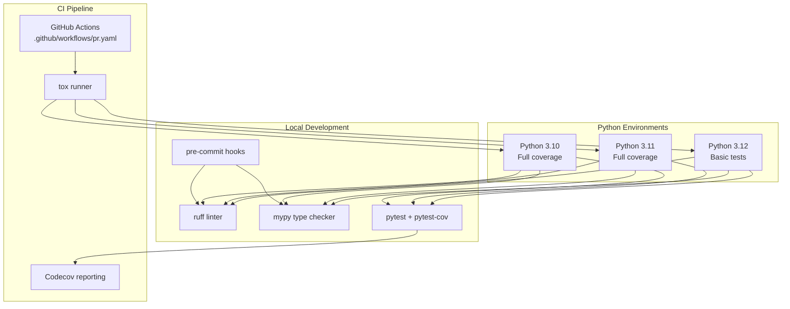
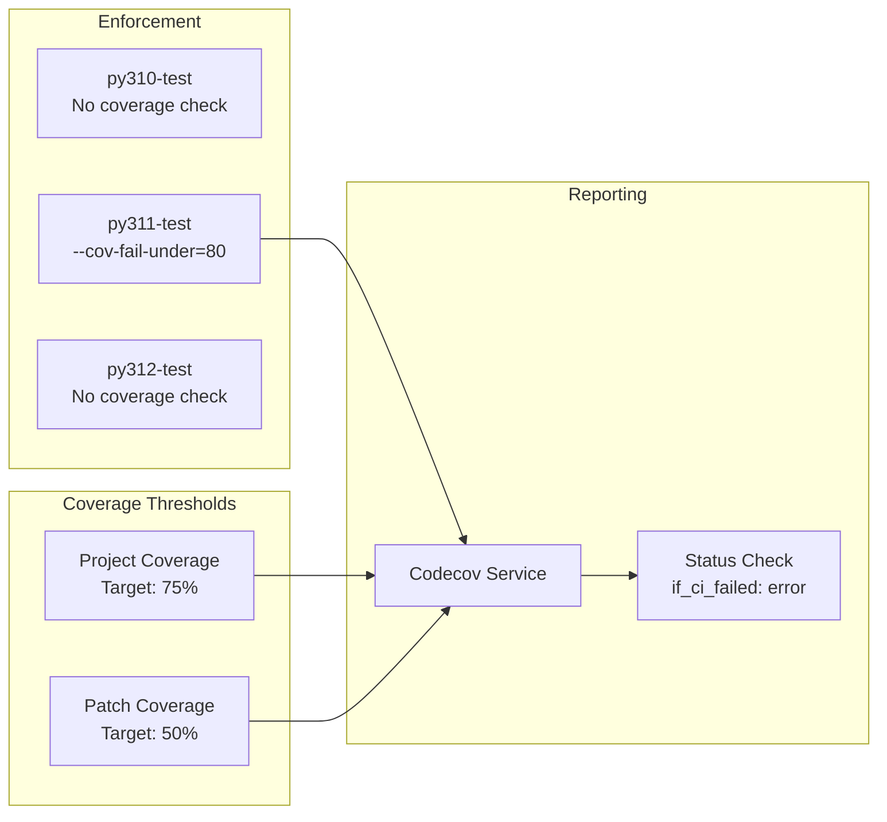
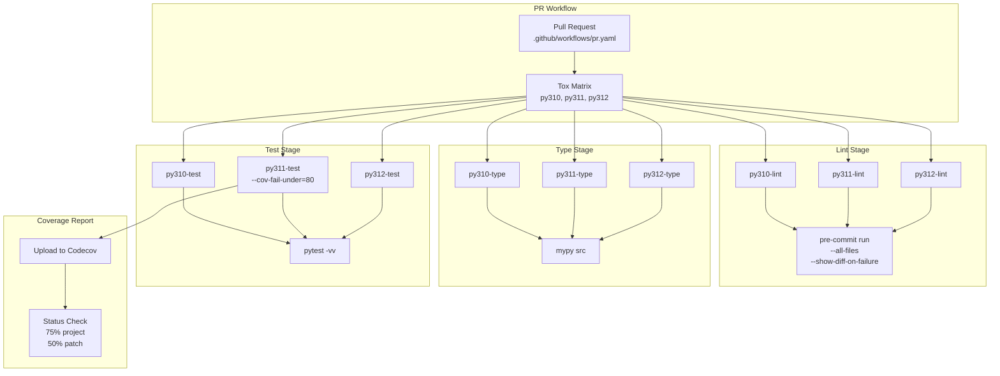

# Code Quality

<details>
<summary>Relevant source files</summary>

The following files were used as context for generating this wiki page:

- [codecov.yml](codecov.yml)
- [docs/pinder.rst](docs/pinder.rst)
- [examples/superposition.ipynb](examples/superposition.ipynb)
- [pyproject.toml](pyproject.toml)
- [tox.ini](tox.ini)

</details>


This document describes the code quality infrastructure in the PINDER repository, including linting, type checking, test coverage requirements, and automated enforcement through CI/CD. For information about the testing framework and test execution, see [Testing](#7.3). For CI/CD pipeline configuration, see [CI/CD Pipeline](#7.4).

## Overview

PINDER maintains code quality through a multi-layered approach:

- **Linting**: `ruff` for code style and error detection
- **Type checking**: `mypy` for static type analysis
- **Test coverage**: `pytest-cov` with minimum thresholds
- **Pre-commit hooks**: Automated checks before commits
- **CI enforcement**: GitHub Actions validates all changes

All quality checks run across three Python versions (3.10, 3.11, 3.12) using `tox` for environment isolation.

## Quality Tool Chain



**Sources:** [pyproject.toml:50-67](), [tox.ini:1-72](), [codecov.yml:1-13]()

## Linting with Ruff

PINDER uses `ruff` version 0.4.9 for fast Python linting, which combines multiple tools (flake8, isort, pyupgrade) into a single high-performance linter.

### Configuration

Ruff is specified in the `lint` optional dependencies:

```
[project.optional-dependencies]
lint = [
    "ruff == 0.4.9",
    "pre-commit == 3.6.0",
]
```

### Execution

Ruff runs automatically through pre-commit hooks and during CI:

```
[testenv:{py310,py311,py312}-lint]
commands =
    pre-commit run --all-files --show-diff-on-failure
```

The `--show-diff-on-failure` flag provides detailed output when violations are detected.

**Sources:** [pyproject.toml:50-53](), [tox.ini:23-28]()

## Type Checking with Mypy

Static type checking is enforced using `mypy` version 1.10.0 across the entire `src/` directory tree.

### Configuration

Type checking dependencies:

```
[project.optional-dependencies]
type = [
    "mypy==1.10.0",
    "pydantic",
    "types-PyYAML",
    "types-requests",
]
```

Additional type stub packages (`pydantic`, `types-PyYAML`, `types-requests`) provide type information for third-party libraries.

### Execution

Mypy analyzes all source code in dedicated tox environments:

```
[testenv:{py310,py311,py312}-type]
skip_sdist = true
skip_install = true
tox_extras = type
commands = mypy src
```

The `skip_install` directive ensures mypy runs without installing the package, checking the source tree directly.

**Sources:** [pyproject.toml:61-67](), [tox.ini:30-34]()

## Test Coverage Requirements



**Sources:** [codecov.yml:1-13](), [tox.ini:50-61]()

### Codecov Configuration

The repository enforces minimum coverage thresholds through Codecov:

| Metric | Target | Enforcement |
|--------|--------|-------------|
| **Project Coverage** | 75% | Required for merge |
| **Patch Coverage** | 50% | Required for merge |
| **CI Requirement** | Pass | Blocks on CI failure |

These thresholds are defined in [codecov.yml:4-13]():

```yaml
coverage:
  status:
    project:
      default:
        target: 75%
        if_ci_failed: error
    patch:
      default:
        target: 50%
```

### Pytest Configuration

Coverage is collected using `pytest-cov` with the following configuration:

- **Branch coverage**: Enabled to track conditional execution paths
- **Parallel execution**: Supports concurrent test runs
- **Source tracking**: Monitors code in installed package location
- **Omitted paths**: Excludes plotting utilities from coverage

Coverage settings in [tox.ini:37-47]():

```ini
[coverage:run]
branch = true
parallel = true
omit = src/pinder-data/pinder/data/plot/*
source =
    .tox/py310-test/lib/python3.10/site-packages/pinder/
```

### Python Version-Specific Coverage

Different Python versions have different coverage requirements:

| Python Version | Coverage Check | Threshold |
|----------------|----------------|-----------|
| **3.10** | None | N/A |
| **3.11** | Enforced | 80% |
| **3.12** | None | N/A |

Python 3.11 runs with strict coverage enforcement:

```bash
pytest -vv --cov=pinder --cov-report=term-missing:skip-covered --cov-fail-under=80
```

The `--cov-fail-under=80` flag fails the test run if coverage drops below 80%, which is stricter than the Codecov project target of 75%.

**Sources:** [tox.ini:50-72]()

## Pre-commit Hooks

Pre-commit hooks provide immediate feedback during development by running quality checks before code is committed.

### Hook Configuration

Pre-commit is managed through the `.pre-commit-config.yaml` file (not shown in provided files) and integrates with ruff:

```python
[project.optional-dependencies]
lint = [
    "ruff == 0.4.9",
    "pre-commit == 3.6.0",
]
```

### Hook Execution

Hooks run automatically on `git commit` or manually:

```bash
# Run all hooks on staged files
pre-commit run

# Run all hooks on all files
pre-commit run --all-files

# Run with diff display on failure
pre-commit run --all-files --show-diff-on-failure
```

The CI pipeline uses the `--show-diff-on-failure` option to provide detailed feedback when violations are detected.

**Sources:** [pyproject.toml:50-53](), [tox.ini:27-28]()

## CI/CD Integration



**Sources:** [tox.ini:1-72](), [codecov.yml:1-13]()

### GitHub Actions Environment Mapping

The `tox-gh-actions` plugin automatically maps GitHub Actions Python versions to tox environments:

```ini
[gh-actions]
python =
    3.10: py310
    3.11: py311
    3.12: py312
```

This ensures consistent testing across local development and CI.

### External Tool Dependencies

Some tests require external bioinformatics tools to be available in the execution environment:

```ini
[testenv]
passenv =
    GOOGLE_APPLICATION_CREDENTIALS
    GOOGLE_CLOUD_PROJECT
allowlist_externals =
    foldseek
    mmseq
    ialign.pl
```

These tools must be installed separately and available in the system PATH:

- **foldseek**: Protein structure comparison
- **mmseq**: Sequence clustering
- **ialign.pl**: Structure alignment

**Sources:** [tox.ini:8-21]()

## Running Quality Checks Locally

### Install Development Dependencies

```bash
pip install -e ".[lint,test,type]"
```

Or install all development dependencies:

```bash
pip install -e ".[dev]"
```

The `dev` extra includes `lint,test,type,leaderboard,data` dependencies.

### Run Individual Checks

```bash
# Linting
pre-commit run --all-files

# Type checking
mypy src

# Tests with coverage
pytest -vv --cov=pinder --cov-report=term-missing
```

### Run Complete Tox Suite

```bash
# All environments
tox

# Specific environment
tox -e py311-test

# Specific stage across all Python versions
tox -e py{310,311,312}-lint
```

### Interpret Results

**Lint failures**: Fix code style issues highlighted by ruff. The `--show-diff-on-failure` output shows exact changes needed.

**Type errors**: Add type annotations or adjust existing ones. Mypy errors include file, line number, and description.

**Coverage failures**: Add tests for uncovered code paths. The `--cov-report=term-missing` option shows specific lines lacking coverage.

**Sources:** [pyproject.toml:50-124](), [tox.ini:1-72]()

## Coverage Omissions

Certain paths are explicitly excluded from coverage requirements:

- **Plotting utilities**: `src/pinder-data/pinder/data/plot/*` - Visualization code that is difficult to test programmatically

These omissions are configured in [tox.ini:40]():

```ini
[coverage:run]
omit = src/pinder-data/pinder/data/plot/*
```

**Sources:** [tox.ini:37-47]()

## Quality Metrics Summary

| Tool | Version | Purpose | Enforcement |
|------|---------|---------|-------------|
| **ruff** | 0.4.9 | Linting | Pre-commit, CI |
| **mypy** | 1.10.0 | Type checking | CI |
| **pytest** | 7.2.0 | Testing | CI |
| **pytest-cov** | 4.0.0 | Coverage | CI |
| **codecov** | Service | Coverage reporting | Required: 75%/50% |

**Sources:** [pyproject.toml:50-67]()

---