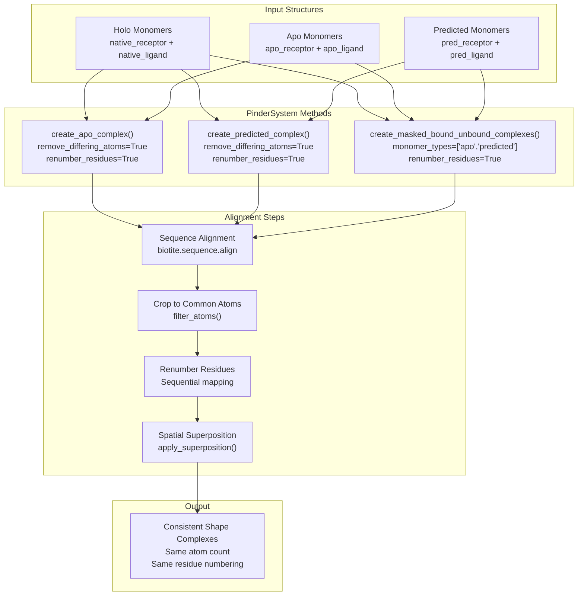
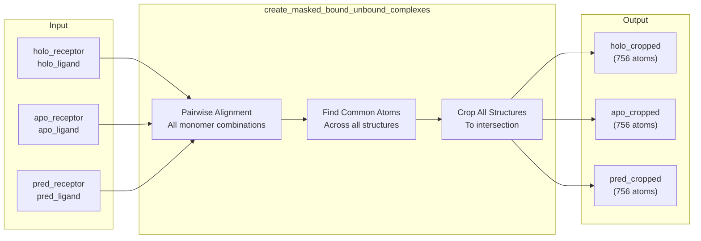
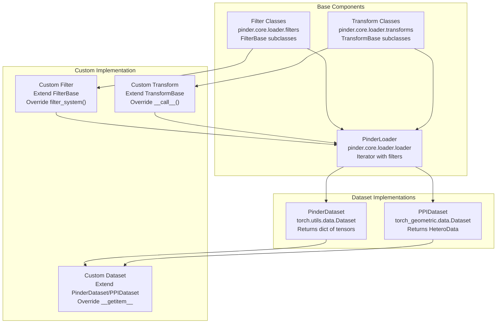
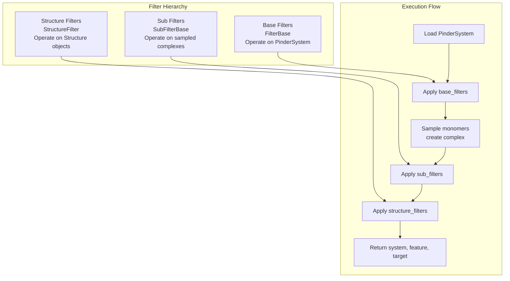
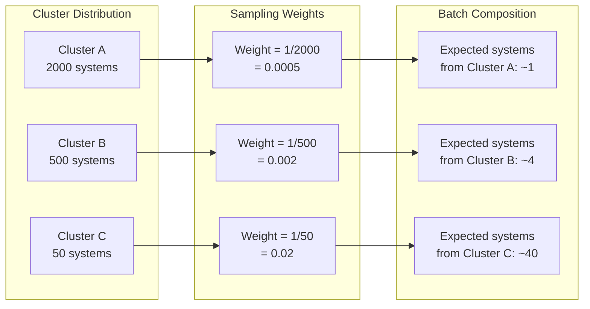
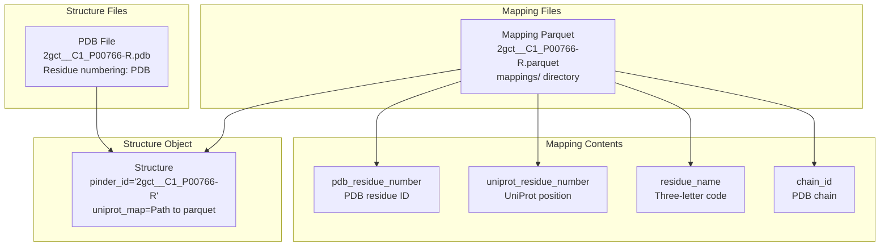
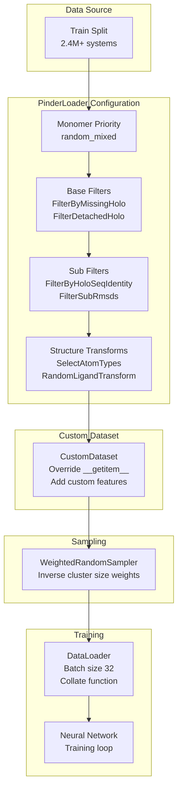

# Advanced Topics

<details>
<summary>Relevant source files</summary>

The following files were used as context for generating this wiki page:

- [codecov.yml](codecov.yml)
- [docs/pinder.rst](docs/pinder.rst)
- [examples/pinder-loader.ipynb](examples/pinder-loader.ipynb)
- [examples/superposition.ipynb](examples/superposition.ipynb)

</details>


## Purpose and Scope

This page covers advanced usage patterns, optimizations, and specialized functionality in PINDER that go beyond basic data loading. Topics include structure superposition techniques for handling monomers with differing atoms, implementing custom datasets and transforms, diversity-aware sampling strategies, and understanding UniProt coordinate mappings.

For basic data loading patterns, see [Quick Start Guide](#2). For details on the core data structures, see [Core Data Structures](#3). For standard filtering and transformation, see [Data Loading System](#4).

---

## Structure Superposition and Consistent Shapes

### The Challenge

When working with alternative monomers (apo, predicted) alongside holo structures, a common challenge arises: the structures may have different numbers of atoms, different sequence lengths, or different residue numbering. This creates difficulties for machine learning models that expect consistent input dimensions.

Consider a system where:
- Holo receptor has 689 atoms
- Apo receptor has 1,735 atoms  
- Predicted receptor has 1,799 atoms

Direct concatenation or comparison is impossible without alignment and cropping.

### Superposition Workflow



**Sources:** [examples/superposition.ipynb:1-1180]()

### Single Monomer Type Cropping

When creating a complex from a single alternative monomer type (e.g., only apo), use `create_apo_complex()` or `create_predicted_complex()`:

| Parameter | Effect | Default |
|-----------|--------|---------|
| `remove_differing_atoms` | Crop to atoms common between holo and alternative | `False` |
| `renumber_residues` | Apply sequential residue numbering | `False` |

The method performs sequence alignment, identifies common residues, and crops the alternative monomer to match the holo structure. The holo structure may also be modified if atoms cannot be mapped.

**Example behavior:**
- Input: Holo complex (758 atoms), Apo complex (764 atoms)
- Output with `remove_differing_atoms=True`: Apo complex (756 atoms)
- Remaining mismatch (2 atoms): Due to unmappable atoms like terminal groups or sequence gaps

**Sources:** [examples/superposition.ipynb:336-369](), [examples/superposition.ipynb:380-467]()

### Multi-Monomer Type Cropping

When working with multiple alternative monomer types simultaneously (e.g., both apo and predicted), use `create_masked_bound_unbound_complexes()`:



**Sources:** [examples/superposition.ipynb:1085-1156]()

The `monomer_types` parameter controls which alternative types are included in the intersection calculation. Omitted types are returned uncropped.

### Sequence Alignment Considerations

The cropping process relies on sequence alignment to map residues between structures. When sequences have gaps or significant differences, the resulting cropped structures may lose substantial portions:

**Example from 2gct system:**
- Holo ligand: 11 residue peptide (CYS 1 to SER 11)
- Apo ligand: 20 residues with gap (CYS 1 to LEU 10, then ILE 16)
- Result: Holo atom "SER 11 N" cannot be mapped to apo (residue 11-15 missing)

This is an inherent limitation when alternative structures have different coverage of the sequence.

**Sources:** [examples/superposition.ipynb:470-1041]()

---

## Custom Dataset Implementation

### Dataset Architecture

PINDER provides two reference dataset implementations that can be extended for custom use cases:



**Sources:** [examples/pinder-loader.ipynb:679-715](), [examples/pinder-loader.ipynb:749-803]()

### Extending PinderDataset

The `PinderDataset` class provides a template for tensor-based datasets. Key extension points:

| Method/Parameter | Purpose | Default |
|------------------|---------|---------|
| `transform` | Convert feature Structure to tensors | `structure2tensor_transform` |
| `target_transform` | Convert target Structure to tensors | `structure2tensor_transform` |
| `structure_transforms_feature` | List of Structure-level transforms for features | `[]` |
| `structure_transforms_target` | List of Structure-level transforms for targets | `[]` |

**Custom dataset pattern:**

```python
from pinder.core.loader.dataset import PinderDataset

class MyCustomDataset(PinderDataset):
    def __init__(self, *args, **kwargs):
        super().__init__(*args, **kwargs)
        # Add custom initialization
        
    def __getitem__(self, index: int) -> dict:
        # Get base item from PinderLoader
        system, feature_complex, target_complex = self.loader[index]
        
        # Apply custom processing
        custom_features = self.custom_featurization(feature_complex)
        custom_target = self.custom_target_processing(target_complex)
        
        return {
            'id': system.entry.id,
            'features': custom_features,
            'target': custom_target,
            'metadata': self.extract_metadata(system)
        }
```

**Sources:** [examples/pinder-loader.ipynb:717-803]()

### Extending PPIDataset

The `PPIDataset` class creates graph-based representations using PyTorch Geometric's `HeteroData` format. This is suitable for graph neural networks that process receptor and ligand as separate node types.

**Key characteristics:**
- Returns `HeteroData` with separate node types: `ligand_atom`, `receptor_atom`, `ligand_residue`, `receptor_residue`
- Suitable for architectures that explicitly model protein-protein interfaces
- Uses `torch_geometric.data.DataLoader` for batching

**Sources:** [examples/pinder-loader.ipynb:694-714]()

### Custom Filters

Filters operate at three levels in the PinderLoader pipeline:



**Sources:** [examples/pinder-loader.ipynb:454-479]()

**Custom filter implementation:**

```python
from pinder.core.loader.filters import FilterBase

class CustomQualityFilter(FilterBase):
    def __init__(self, min_resolution: float = 2.5):
        super().__init__()
        self.min_resolution = min_resolution
        
    def filter_system(self, system: PinderSystem) -> bool:
        # Return True to keep system, False to filter out
        metadata = system.entry.to_dict()
        resolution = metadata.get('resolution', float('inf'))
        return resolution <= self.min_resolution
```

Filters are passed to `PinderLoader` via `base_filters`, `sub_filters`, or `structure_filters` lists.

**Sources:** [examples/pinder-loader.ipynb:457-469]()

### Custom Transforms

Transforms modify Structure objects before they are converted to tensors:

```python
from pinder.core.loader.transforms import TransformBase
from pinder.core.loader.structure import Structure

class CustomTransform(TransformBase):
    def __init__(self, some_parameter: float):
        super().__init__()
        self.parameter = some_parameter
        
    def __call__(self, structure: Structure) -> Structure:
        # Modify structure in-place or return new Structure
        # Access atomic data via structure.atom_array
        modified_coords = self.apply_transformation(structure.coords)
        structure.atom_array.coord = modified_coords
        return structure
```

Built-in transforms include:
- `SelectAtomTypes`: Filter to specific atom types (CA, N, C, O, etc.)
- `RandomLigandTransform`: Random spatial perturbation of ligand
- `SuperposeToReference`: Align complex to reference structure

**Sources:** [examples/pinder-loader.ipynb:782-785]()

---

## Diversity Sampling

### Inverse Cluster Size Sampling

PINDER systems are clustered by interface similarity. The training set has highly imbalanced cluster sizes, with some clusters containing thousands of examples and others containing only a few.

**Sampling strategy:**



**Implementation:**

The inverse cluster size sampling is implemented by assigning each system a weight proportional to `1 / cluster_size`. This ensures that rare interface geometries are sampled more frequently during training, improving model generalization.

**Usage with PinderLoader:**

```python
from pinder.core import PinderLoader
from torch.utils.data import WeightedRandomSampler

loader = PinderLoader(split="train")

# Extract cluster IDs and compute weights
cluster_ids = loader.index['cluster_id']
cluster_sizes = cluster_ids.value_counts()
weights = cluster_ids.map(lambda x: 1.0 / cluster_sizes[x])

# Create sampler
sampler = WeightedRandomSampler(
    weights=weights,
    num_samples=len(weights),
    replacement=True
)

# Use with DataLoader
dataloader = torch.utils.data.DataLoader(
    dataset,
    batch_size=32,
    sampler=sampler
)
```

This approach ensures balanced exposure to diverse interface types during training, even when the dataset has highly skewed cluster distributions.

**Sources:** Based on the table of contents description for section 8.3

---

## UniProt Coordinate Mappings

### PDB vs UniProt Numbering

Protein structures in the PDB often have different residue numbering than the corresponding UniProt sequence. This occurs due to:

- Missing residues at the N- or C-terminus
- Expression tags or fusion constructs
- Sequence variants
- Insertion codes
- Different isoforms

PINDER provides UniProt mapping files that allow conversion between PDB residue numbering and UniProt canonical sequence numbering.

### Mapping File Structure



**Sources:** [examples/pinder-loader.ipynb:196-221](), [examples/superposition.ipynb:168-204]()

### Accessing Mappings

Mapping files are loaded automatically when a `Structure` object is instantiated:

```python
from pinder.core import PinderSystem

system = PinderSystem("2gct__C1_P00766--2gct__A1_P00766")
receptor = system.holo_receptor

# Mapping file path
print(receptor.uniprot_map)
# Output: /path/to/pinder/mappings/2gct__C1_P00766-R.parquet

# Load mapping
import pandas as pd
mapping = pd.read_parquet(receptor.uniprot_map)

# Columns: pdb_residue_number, uniprot_residue_number, residue_name, chain_id
```

The mapping allows bidirectional conversion:
- **PDB → UniProt:** Find UniProt position for a given PDB residue
- **UniProt → PDB:** Find PDB residue(s) corresponding to a UniProt position

### Use Cases

| Use Case | Approach |
|----------|----------|
| Align structures from different PDBs of same protein | Map both to UniProt coordinates, then align |
| Annotate functional sites | Use UniProt positions from databases, map to PDB structure |
| Handle insertions/deletions | UniProt provides canonical numbering |
| Cross-reference with sequence databases | UniProt is standard reference |

### Mapping Coverage

Not all PDB residues have UniProt mappings:
- Expression tags: Not in UniProt sequence
- Post-translational modifications: May differ from canonical sequence
- Sequence variants: If PDB sequence doesn't match UniProt exactly

The `uniprot_map` field in the `Structure` object is `None` for:
- Native complexes (no single-chain UniProt assignment)
- Structures without mapped UniProt IDs
- Predicted structures (AlphaFold uses UniProt IDs as-is)

**Sources:** [examples/pinder-loader.ipynb:196-221](), [examples/superposition.ipynb:180-204]()

---

## Integration Patterns

### Combining Advanced Features

Complex ML pipelines often require combining multiple advanced features:



**Example integration:**

```python
from pinder.core import PinderLoader
from pinder.core.loader import filters, transforms
from pinder.core.loader.dataset import PinderDataset
from torch.utils.data import DataLoader, WeightedRandomSampler

# Configure loader with filters and transforms
base_filters = [
    filters.FilterByMissingHolo(),
    filters.FilterDetachedHolo(radius=12, max_components=2)
]
sub_filters = [
    filters.FilterByHoloSeqIdentity(min_sequence_identity=0.8),
    filters.FilterSubRmsds(rmsd_cutoff=7.5)
]
structure_transforms = [
    transforms.SelectAtomTypes(atom_types=["CA", "N", "C", "O"])
]

# Create custom dataset
dataset = CustomPPIDataset(
    split="train",
    monomer_priority="random_mixed",
    base_filters=base_filters,
    sub_filters=sub_filters,
    structure_transforms_feature=structure_transforms,
    structure_transforms_target=structure_transforms
)

# Setup diversity sampling
cluster_ids = dataset.loader.index['cluster_id']
cluster_sizes = cluster_ids.value_counts()
weights = cluster_ids.map(lambda x: 1.0 / cluster_sizes[x])
sampler = WeightedRandomSampler(weights, len(weights), replacement=True)

# Create dataloader
dataloader = DataLoader(
    dataset,
    batch_size=32,
    sampler=sampler,
    collate_fn=custom_collate_fn,
    num_workers=4
)
```

**Sources:** [examples/pinder-loader.ipynb:766-803]()

---

## Performance Considerations

### Computational Costs

| Operation | Cost | Mitigation |
|-----------|------|------------|
| Structure loading | I/O bound | Use caching, pre-load index |
| Sequence alignment | O(n*m) | Cache alignments, use compiled tools |
| Superposition | O(n) atoms | Filter to CA-only for alignment |
| Graph construction | O(n²) edges | Use radius cutoff, sparse representations |
| Transform application | Varies | Apply minimal set, vectorize operations |

### Memory Management

When working with large datasets:
- Use `num_workers > 0` in DataLoader for parallel loading
- Implement `__getitem__` to load structures on-demand
- Clear intermediate Structure objects after conversion to tensors
- Use `pin_memory=True` for GPU training

### Filter Ordering

Filters are applied sequentially. Order them from least to most expensive:

1. **Base filters** (cheap): Check boolean flags in index
2. **Sub filters** (moderate): Require structure loading and alignment
3. **Structure filters** (expensive): Detailed atomic operations

**Sources:** [examples/pinder-loader.ipynb:412-479]()

---