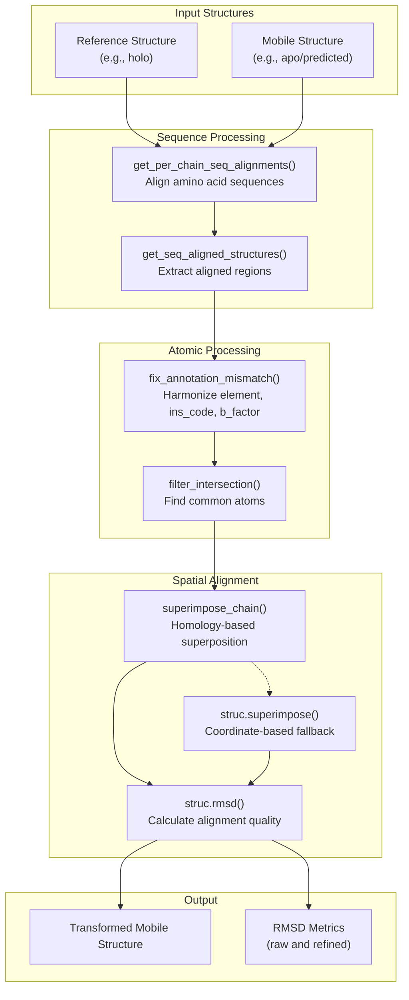
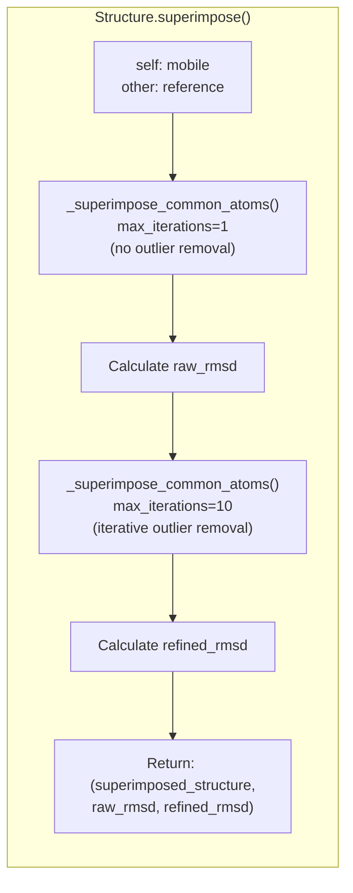
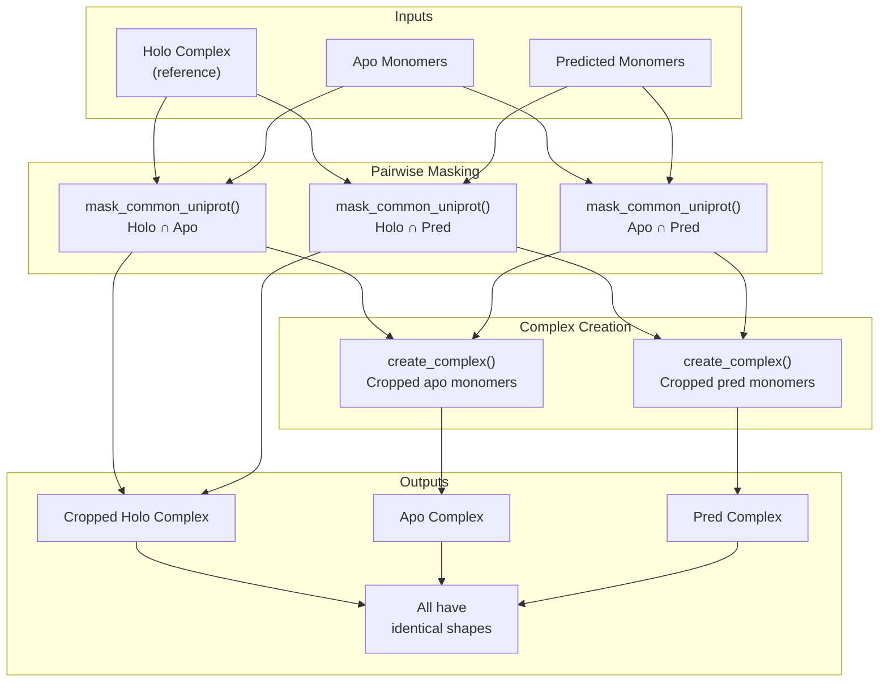
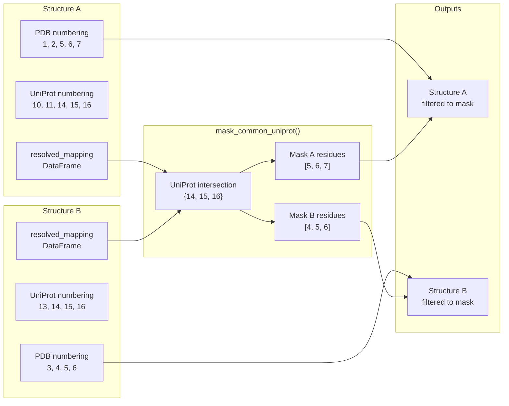

# Structure Superposition

<details>
<summary>Relevant source files</summary>

The following files were used as context for generating this wiki page:

- [codecov.yml](codecov.yml)
- [docs/pinder.rst](docs/pinder.rst)
- [examples/superposition.ipynb](examples/superposition.ipynb)
- [src/pinder-core/pinder/core/loader/structure.py](src/pinder-core/pinder/core/loader/structure.py)

</details>


## Purpose and Scope

This document explains the structure superposition system in PINDER, which provides methods for spatially aligning protein structures and creating complexes with consistent atomic compositions. Structure superposition is essential for comparing alternative structural states (holo, apo, predicted) and preparing ML-ready data with matching atom counts across different structure variants.

For general structure manipulation operations, see [Atomic Operations](#3.3). For information about the PinderSystem class that orchestrates these operations, see [PinderSystem](#3.1).

## Overview

Structure superposition in PINDER performs spatial alignment between protein structures while handling sequence differences, missing residues, and varying atom annotations. The system supports both simple alignment (spatial transformation only) and complex creation (cropping to common atoms).



**Diagram 1: Structure Superposition Workflow**

Sources: [src/pinder-core/pinder/core/loader/structure.py:296-326](), [src/pinder-core/pinder/core/loader/structure.py:636-674]()

## Core Methods

### Structure.superimpose()

The primary user-facing method for structure alignment. It performs a two-pass superposition: first without outlier removal (raw RMSD), then with iterative outlier removal (refined RMSD).



**Diagram 2: Two-Pass Superposition Strategy**

The method returns a tuple containing:
- `Structure`: The mobile structure transformed to align with the reference
- `float`: Raw RMSD (no outlier removal)
- `float`: Refined RMSD (with outlier removal)

Sources: [src/pinder-core/pinder/core/loader/structure.py:296-326]()

### _superimpose_common_atoms()

Internal function implementing the core superposition logic. It attempts homology-based alignment via `superimpose_chain`, falling back to coordinate-based alignment if insufficient anchors are found.

| Parameter | Type | Description |
|-----------|------|-------------|
| `fixed` | `AtomArray` | Reference structure (remains stationary) |
| `mobile` | `AtomArray` | Structure to transform |
| `max_iterations` | `int` | Number of outlier removal iterations (1 = none) |

**Returns**: `(transformed_mobile, transformation, fixed_anchors, mobile_anchors)`

The fallback mechanism handles edge cases like very short peptides where homology-based alignment fails due to insufficient anchor atoms:

1. Harmonize annotation differences (element, ins_code, b_factor)
2. Find intersection of common atoms using `struc.filter_intersection()`
3. Perform coordinate-based superposition on common atoms
4. Return masks indicating which atoms were used for alignment

Sources: [src/pinder-core/pinder/core/loader/structure.py:636-674]()

### Structure.align_common_sequence()

Aligns two structures based on sequence homology, optionally cropping to common atoms and renumbering residues.

| Parameter | Type | Default | Description |
|-----------|------|---------|-------------|
| `other` | `Structure` | - | Reference structure to align to |
| `copy` | `bool` | `True` | Return new Structure objects vs modifying in-place |
| `remove_differing_atoms` | `bool` | `True` | Crop to atoms present in both structures |
| `renumber_residues` | `bool` | `False` | Map residue IDs from mobile to reference |
| `remove_differing_annotations` | `bool` | `False` | Also remove atoms with differing annotations |

This method performs sequence-based alignment without spatial transformation. It's commonly used as a preprocessing step before creating complexes with consistent shapes.

Sources: [src/pinder-core/pinder/core/loader/structure.py:156-209]()

## Creating Consistent Complexes

A common challenge in PINDER is creating alternative complex variants (holo, apo, predicted) with identical atomic compositions for ML pipelines. The system provides two approaches:

### Single Alternative: create_apo_complex() / create_pred_complex()

Creates a complex from alternative monomers without modifying the reference structure.

```python
# Basic usage - may have slight shape differences
apo_complex = pinder_system.create_apo_complex(remove_differing_atoms=False)

# With cropping - reference structure unchanged
apo_complex = pinder_system.create_apo_complex(remove_differing_atoms=True)

# With renumbering - aligns residue IDs
apo_complex = pinder_system.create_apo_complex(
    remove_differing_atoms=True, 
    renumber_residues=True
)
```

**Important**: These methods align the mobile structure to the reference but do not modify the reference. If the alternative structure is missing atoms present in the reference, the resulting shapes will differ.

Sources: [examples/superposition.ipynb:336-446]()

### Multiple Alternatives: create_masked_bound_unbound_complexes()

Creates multiple complexes with guaranteed identical shapes by cropping all structures (including reference) to their common intersection.



**Diagram 3: Masked Complex Creation Workflow**

```python
# Crop only to apo (predicted remains uncropped)
holo_cropped, apo_cropped, pred_full = pinder_system.create_masked_bound_unbound_complexes(
    monomer_types=["apo"],
    renumber_residues=True
)

# Crop to intersection of both apo and predicted
holo_cropped, apo_cropped, pred_cropped = pinder_system.create_masked_bound_unbound_complexes(
    monomer_types=["apo", "predicted"],
    renumber_residues=True
)

# All three structures now have identical atom counts
assert holo_cropped.n_atoms == apo_cropped.n_atoms == pred_cropped.n_atoms
```

**Warning**: This operation is destructive to the reference structure. If alternative structures have significantly different atom annotations or missing residues, the cropped holo structure may no longer accurately represent the original bound state.

Sources: [examples/superposition.ipynb:1086-1156]()

## UniProt-Based Residue Mapping

The `mask_common_uniprot()` function enables alignment between structures with different residue numbering schemes by using UniProt canonical numbering as a common reference.



**Diagram 4: UniProt-Based Residue Alignment**

The function handles three scenarios:

1. **Both structures have UniProt mappings**: Creates `uniprot_uuid` by concatenating UniProt accession and residue number, finds intersection
2. **Only one structure has mapping**: Uses the mapping to translate between PDB and UniProt numbering for the other structure (assumed to already be in UniProt coordinates)
3. **Predicted structures**: Extracts UniProt ID from `pinder_id` format (e.g., `af__P12345`) to ensure correct mapping

Sources: [src/pinder-core/pinder/core/loader/structure.py:532-606]()

## RMSD Calculation

The superposition system calculates two RMSD metrics:

### Raw RMSD
Calculated after initial superposition without outlier removal (`max_iterations=1`). Represents the alignment quality across all common atoms, including potential outliers from flexible regions or structural differences.

### Refined RMSD  
Calculated after iterative outlier removal (default `max_iterations=10`). Provides a measure of core structural similarity by excluding atoms that deviate significantly during iterative refinement.

The `superimpose_chain()` function from `pinder.core.structure.superimpose` performs the iterative refinement, progressively removing atoms with high deviations until convergence or the maximum iteration count is reached.

Sources: [src/pinder-core/pinder/core/loader/structure.py:296-326]()

## Common Use Cases

### 1. Aligning Alternative Monomers to Holo

```python
from pinder.core import PinderSystem

ps = PinderSystem("8ovo__A1_Q9HD20--8ovo__B1_P08311")

# Get apo receptor aligned to holo receptor
apo_r = ps.apo_receptor
holo_r = ps.holo_receptor

apo_r_aligned, raw_rmsd, refined_rmsd = apo_r.superimpose(holo_r)
print(f"Raw RMSD: {raw_rmsd:.2f} Å, Refined RMSD: {refined_rmsd:.2f} Å")
```

### 2. Creating ML Training Batches

```python
# Ensure all alternative complexes have identical shapes
holo, apo, pred = ps.create_masked_bound_unbound_complexes(
    monomer_types=["apo", "predicted"],
    renumber_residues=True,
    remove_differing_atoms=True
)

# Now safe to stack as tensors
coords = np.stack([
    holo.coords,
    apo.coords, 
    pred.coords
], axis=0)  # Shape: (3, N_atoms, 3)
```

### 3. Sequence Alignment Before Superposition

```python
# Align sequences first, then superimpose spatially
aligned_self, aligned_other = structure1.align_common_sequence(
    structure2,
    remove_differing_atoms=True,
    renumber_residues=True
)

superimposed, raw_rmsd, refined_rmsd = aligned_self.superimpose(aligned_other)
```

Sources: [examples/superposition.ipynb:212-339](), [src/pinder-core/pinder/core/loader/structure.py:296-326]()

## Limitations and Considerations

### Missing Atoms in Reference
If the alternative structure is missing atoms present in the reference, simple alignment will not produce identical shapes. The reference structure must also be cropped using `create_masked_bound_unbound_complexes()`.

Example from the notebook: A holo peptide has 11 residues (1-11), but the apo structure has a gap (residues 1-10, then 16+). After alignment, the holo retains terminal atoms that cannot be mapped to the apo structure.

Sources: [examples/superposition.ipynb:470-483]()

### Terminal Residues and OXT Atoms
Terminal oxygen atoms (OXT) and N-terminal atoms may differ between structures due to crystallization artifacts or biological differences. These atoms often appear in shape mismatch counts even after alignment.

Sources: [examples/superposition.ipynb:449-468]()

### Sequence Gaps
Structures with non-contiguous residue numbering (gaps in the sequence) require careful handling. The `align_common_sequence()` method will skip gap regions, potentially resulting in fragmented alignments.

Sources: [examples/superposition.ipynb:732-733]()

### Annotation Mismatches
Different PDB files may use different annotation conventions (element symbols, insertion codes, B-factors). The `fix_annotation_mismatch()` function in `pinder.core.structure.surgery` harmonizes these differences before intersection operations.

Sources: [src/pinder-core/pinder/core/loader/structure.py:660-662]()

### Destructive Cropping
When using `create_masked_bound_unbound_complexes()` with multiple monomer types, the reference (holo) structure is cropped to the intersection of all alternatives. If alternatives have low quality or significant structural differences, this can substantially modify the reference structure, potentially removing important interface residues.

Sources: [examples/superposition.ipynb:1069-1082]()

## API Reference Summary

| Method/Function | Location | Purpose |
|-----------------|----------|---------|
| `Structure.superimpose()` | [structure.py:296-326]() | User-facing spatial alignment with RMSD metrics |
| `Structure.align_common_sequence()` | [structure.py:156-209]() | Sequence-based alignment and cropping |
| `_superimpose_common_atoms()` | [structure.py:636-674]() | Core superposition implementation with fallback |
| `mask_common_uniprot()` | [structure.py:532-606]() | UniProt-based residue mapping and filtering |
| `PinderSystem.create_apo_complex()` | PinderSystem class | Create apo complex aligned to holo |
| `PinderSystem.create_pred_complex()` | PinderSystem class | Create predicted complex aligned to holo |
| `PinderSystem.create_masked_bound_unbound_complexes()` | PinderSystem class | Create multiple complexes with identical shapes |

Sources: [src/pinder-core/pinder/core/loader/structure.py:1-675](), [examples/superposition.ipynb:1-1180]()

---