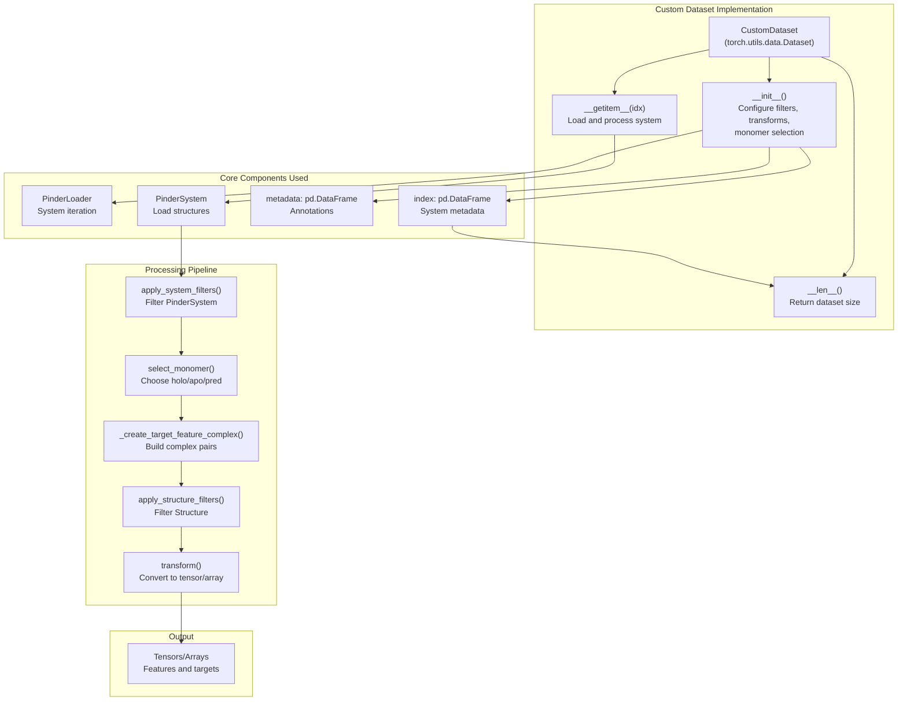
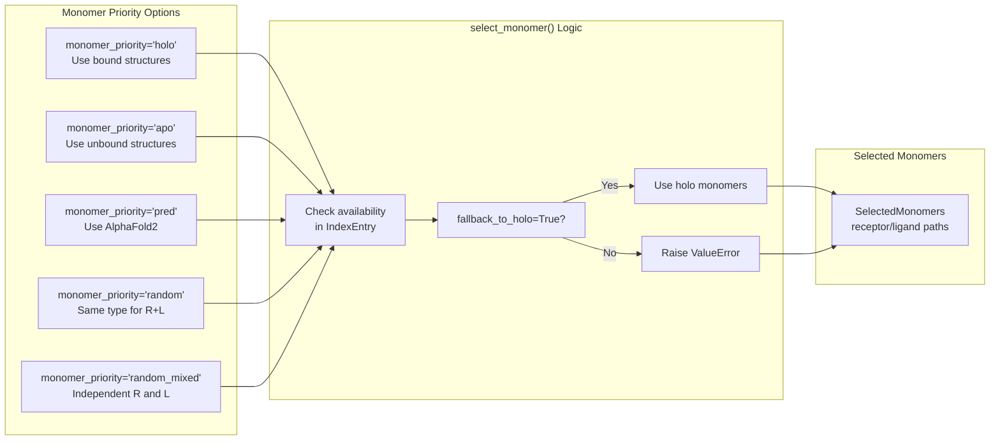
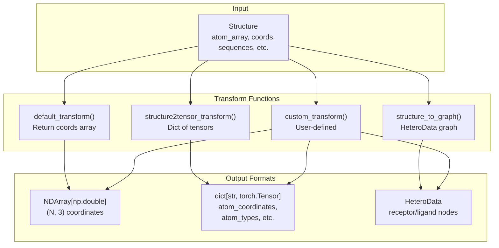
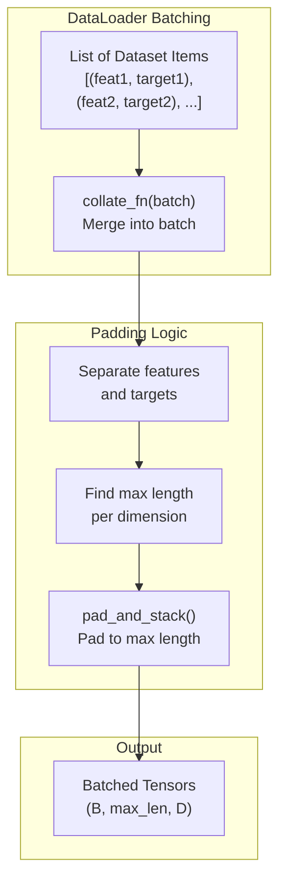
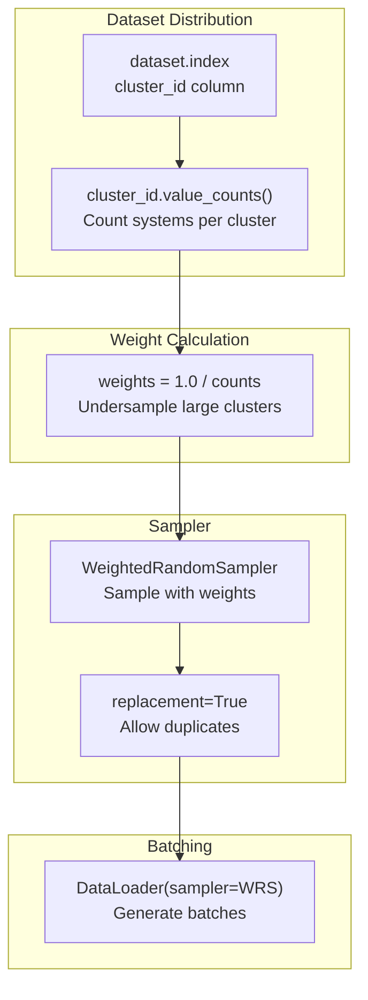
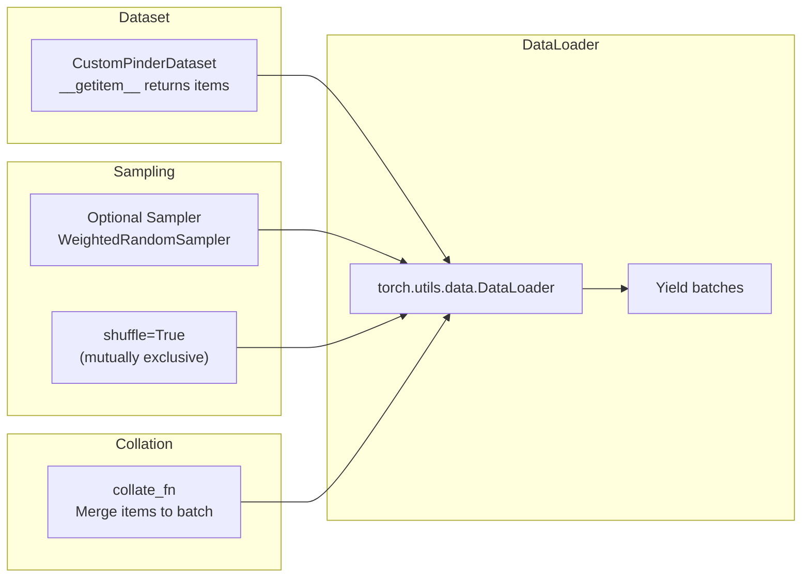
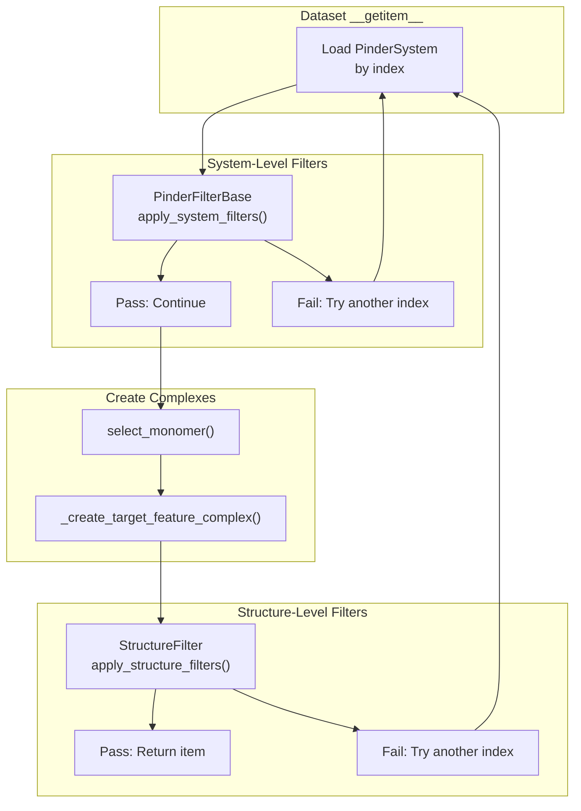

# Custom Datasets

<details>
<summary>Relevant source files</summary>

The following files were used as context for generating this wiki page:

- [examples/pinder-loader.ipynb](examples/pinder-loader.ipynb)
- [src/pinder-core/pinder/core/loader/dataset.py](src/pinder-core/pinder/core/loader/dataset.py)

</details>


## Purpose and Scope

This page explains how to implement custom PyTorch dataset classes that work with PINDER data. It covers extending or replacing the built-in `PinderDataset` and `PPIDataset` classes to create custom data pipelines for machine learning workflows. The material focuses on leveraging `PinderLoader` functionality while customizing data representation, filtering, transformation, and sampling strategies.

For information about using the existing `PinderDataset` and `PPIDataset` classes, see [PinderDataset](#4.2) and [PPIDataset](#4.3). For details on the underlying `PinderLoader` iterator, see [PinderLoader](#4.1).

## Overview of Built-in Dataset Classes

PINDER provides two reference implementations in [src/pinder-core/pinder/core/loader/dataset.py:1-655]():

| Dataset Class | Base Class | Output Format | Use Case |
|--------------|------------|---------------|----------|
| `PinderDataset` | `torch.utils.data.Dataset` | Dictionary of tensors (coordinates, atom types, residue types, etc.) | Standard neural networks with tensor inputs |
| `PPIDataset` | `torch_geometric.data.Dataset` | `HeteroData` graph with separate receptor/ligand nodes | Graph neural networks with heterogeneous graphs |

Both classes use `PinderLoader` internally to handle system iteration, filtering, and monomer selection. Custom datasets should follow similar patterns.

Sources: [src/pinder-core/pinder/core/loader/dataset.py:1-655]()

## Custom Dataset Architecture



Sources: [examples/pinder-loader.ipynb:2293-2413](), [src/pinder-core/pinder/core/loader/dataset.py:246-318]()

## Implementing a Custom PyTorch Dataset

### Minimal Implementation

A custom dataset must implement three methods:

1. `__init__` - Initialize configuration and data indices
2. `__len__` - Return number of items
3. `__getitem__` - Load and return a single item

**Example structure from [examples/pinder-loader.ipynb:2293-2413]()**:

```python
class CustomPinderDataset(Dataset):
    def __init__(
        self, 
        split: str, 
        monomer_priority: str = "random", 
        fallback_to_holo: bool = True,
        transform=None,
        structure_filters: list[StructureFilter] = [],
        system_filters: list[PinderFilterBase] = [],
    ):
        # Load and filter index
        self.index = get_index().query(f'split == "{split}"')
        self.metadata = get_metadata()
        # Store configuration
        self.monomer_priority = monomer_priority
        self.structure_filters = structure_filters
        
    def __len__(self):
        return len(self.index)
        
    def __getitem__(self, idx: int):
        # Load system
        row = self.index.iloc[idx]
        system = PinderSystem(row.id)
        # Select monomers
        selected_monomers = select_monomer(row, self.monomer_priority)
        # Create complex pair
        target, feature = _create_target_feature_complex(system, selected_monomers)
        # Apply transforms
        if self.transform:
            feature = self.transform(feature)
        return feature, target
```

### Key Components

| Component | Purpose | Implementation |
|-----------|---------|----------------|
| `PinderLoader` utilities | System iteration and monomer selection | Import from `pinder.core.loader.loader` |
| `select_monomer()` | Choose holo/apo/pred monomers | [src/pinder-core/pinder/core/loader/loader.py:293-372]() |
| `_create_target_feature_complex()` | Build complex pairs with cropping | [src/pinder-core/pinder/core/loader/loader.py:62-117]() |
| Filter classes | System and structure filtering | [src/pinder-core/pinder/core/loader/filters.py]() |

Sources: [examples/pinder-loader.ipynb:2293-2413](), [src/pinder-core/pinder/core/loader/dataset.py:246-318]()

## Monomer Selection Strategies



The `monomer_priority` parameter controls which structure types to use:

- `"holo"`: Bound structures from native complex
- `"apo"`: Unbound structures (canonical by default)
- `"pred"`: AlphaFold2 predicted structures
- `"random"`: Random selection, same type for receptor and ligand
- `"random_mixed"`: Independent random selection for receptor and ligand

Sources: [examples/pinder-loader.ipynb:811-837](), [src/pinder-core/pinder/core/loader/loader.py:293-372]()

## Custom Transform Functions

Transform functions convert `Structure` objects into model-ready formats. They are applied via the `transform` and `target_transform` parameters.

### Transform Patterns



### Example Transforms

**Coordinates only** [examples/pinder-loader.ipynb:2471-2472]():
```python
def default_transform(structure: Structure) -> NDArray[np.double]:
    return structure.coords
```

**Dictionary of tensors** [src/pinder-core/pinder/core/loader/dataset.py:55-66]():
```python
def structure2tensor_transform(structure: Structure) -> dict[str, torch.Tensor]:
    calpha = structure.filter("atom_name", mask=["CA"])
    props = structure2tensor(
        atom_coordinates=structure.coords,
        atom_types=structure.atom_array.atom_name,
        element_types=structure.atom_array.element,
        residue_coordinates=calpha.coords,
        residue_types=structure.atom_array.res_name,
        residue_ids=structure.atom_array.res_id,
        chain_ids=structure.atom_array.chain_id,
    )
    return props
```

Sources: [src/pinder-core/pinder/core/loader/dataset.py:55-66](), [examples/pinder-loader.ipynb:2471-2472]()

## Custom Collation Functions

Collation functions merge individual dataset items into mini-batches. Since protein structures have variable sizes, custom collation is often required to pad tensors.

### Collation Flow



### Padding Utilities

The `pad_and_stack()` function [src/pinder-core/pinder/core/loader/dataset.py:122-162]() handles variable-sized tensors:

```python
def pad_and_stack(
    tensors: list[Tensor],
    dim: int = 0,
    dims_to_pad: list[int] | None = None,
    value: int | float | None = None,
) -> Tensor:
    """Pads tensors to max length and stacks along new dimension."""
```

**Example collation** [examples/pinder-loader.ipynb:2847-2861]():
```python
def collate_coordinates(batch, coords_pad_value: int = -100):
    feature_coords = []
    target_coords = []
    for feat, target in batch:
        if isinstance(feat, np.ndarray):
            feat = torch.tensor(feat, dtype=torch.float32)
        feature_coords.append(feat)
        target_coords.append(target)
    
    feature_coords = pad_and_stack(feature_coords, dim=0, value=coords_pad_value)
    target_coords = pad_and_stack(target_coords, dim=0, value=coords_pad_value)
    return feature_coords, target_coords
```

### Built-in Collation

The `collate_batch()` function [src/pinder-core/pinder/core/loader/dataset.py:205-243]() provides a reference implementation for dictionary-based items:

```python
def collate_batch(
    batch: list[dict[str, dict[str, Tensor] | str]],
) -> dict[str, dict[str, Tensor] | list[str]]:
    """Collate PinderDataset items with padding."""
```

It uses `collate_complex()` [src/pinder-core/pinder/core/loader/dataset.py:165-202]() to pad structural properties with default values:

| Property | Pad Value | Constant |
|----------|-----------|----------|
| Coordinates | -100 | `COORDS_PAD_VALUE` |
| Atom types | -1 | `ATOM_TYPE_PAD_VALUE` |
| Residue IDs | -99 | `RES_IDX_PAD_VALUE` |
| Chain IDs | -1 | `CHAIN_ID_PAD_VALUE` |
| Element types | -1 | `ELEMENT_TYPE_PAD_VALUE` |

Sources: [src/pinder-core/pinder/core/loader/dataset.py:46-202](), [examples/pinder-loader.ipynb:2847-2861]()

## Custom Sampling Strategies

Samplers control how the DataLoader iterates through the dataset. Custom samplers can implement diversity sampling, stratification, or other selection strategies.

### Inverse Cluster Size Sampling



**Example implementation** [examples/pinder-loader.ipynb:2538-2556]():
```python
def inverse_cluster_size_sampler(
    dataset: PinderDataset, 
    replacement: bool = True
):
    index = dataset.index
    cluster_counts = index["cluster_id"].value_counts().rename("cluster_count")
    index = index.merge(cluster_counts, left_on="cluster_id", right_index=True)
    # Undersample large clusters
    cluster_weights = 1.0 / torch.tensor(index.cluster_count.values)
    return WeightedRandomSampler(
        weights=cluster_weights,
        num_samples=len(cluster_counts),
        replacement=replacement,
    )
```

This strategy ensures balanced representation across structural diversity by giving lower weight to overrepresented interface types.

Sources: [examples/pinder-loader.ipynb:2538-2562]()

## Integration with DataLoaders

### Standard PyTorch DataLoader



**Example usage** [examples/pinder-loader.ipynb:2654-2690]():
```python
def get_loader(
    dataset: CustomPinderDataset,
    sampler: torch.utils.data.Sampler | None = None,
    batch_size: int = 2,
    shuffle: bool = False,
    num_workers: int = 0,
    collate_fn: Callable | None = None,
) -> DataLoader:
    return DataLoader(
        dataset,
        batch_size=batch_size,
        shuffle=shuffle,
        num_workers=num_workers,
        sampler=sampler,
        collate_fn=collate_fn,
    )

# Usage
train_data = CustomPinderDataset(
    split="train",
    transform=default_transform,
    target_transform=default_transform,
)
train_loader = get_loader(
    train_data,
    sampler=inverse_cluster_size_sampler(train_data),
    collate_fn=collate_coordinates,
    batch_size=2,
)
```

### PyTorch Geometric DataLoader

For graph-based datasets, use `torch_geometric.loader.DataLoader` with appropriate graph collation:

**Helper function** [src/pinder-core/pinder/core/loader/dataset.py:625-634]():
```python
def get_geo_loader(
    dataset: PPIDataset, 
    batch_size: int = 2, 
    num_workers: int = 1
) -> TorchGeoDataLoader:
    return TorchGeoDataLoader(
        dataset,
        batch_size=batch_size,
        shuffle=True,
        drop_last=True,
        num_workers=num_workers,
    )
```

Sources: [examples/pinder-loader.ipynb:2613-2690](), [src/pinder-core/pinder/core/loader/dataset.py:625-655]()

## Filtering Systems

Custom datasets should implement filtering at multiple levels:

### Filter Application Flow



### Filter Implementation

**System filters** [examples/pinder-loader.ipynb:2396-2409]():
```python
def apply_system_filters(self, system: PinderSystem) -> PinderSystem | bool:
    for system_filter in self.system_filters:
        if isinstance(system_filter, filters.PinderFilterBase):
            if not system_filter(system):
                return False
    return system
```

**Structure filters** [examples/pinder-loader.ipynb:2396-2402]():
```python
def apply_structure_filters(self, structure: Structure) -> bool:
    pass_filters = True
    for structure_filter in self.structure_filters:
        if not structure_filter(structure):
            pass_filters = False
            break
    return pass_filters
```

### Retry Logic

When filters reject an item, the dataset should attempt another index [examples/pinder-loader.ipynb:2358-2388]():
```python
def __getitem__(self, idx: int):
    valid_idx = False
    attempts = 0
    while not valid_idx and attempts < self.max_load_attempts:
        attempts += 1
        # Try to load and filter
        system = self.apply_system_filters(system)
        if not isinstance(system, PinderSystem):
            idx = random.choice(list(range(len(self))))
            continue
        # Create complexes
        target, feature = _create_target_feature_complex(...)
        valid_idx = self.apply_structure_filters(target)
        if not valid_idx:
            idx = random.choice(list(range(len(self))))
    
    if not valid_idx:
        raise IndexError(f"Unable to find valid item after {attempts} attempts")
    return feature, target
```

Sources: [examples/pinder-loader.ipynb:2358-2409](), [src/pinder-core/pinder/core/loader/dataset.py:299-318]()

## Complete Example

### Custom Dataset Definition

```python
from torch.utils.data import Dataset
from pinder.core import get_index, get_metadata, PinderSystem
from pinder.core.loader.loader import select_monomer, _create_target_feature_complex
from pinder.core.loader import filters

class CustomPinderDataset(Dataset):
    def __init__(
        self,
        split: str,
        monomer_priority: str = "random",
        fallback_to_holo: bool = True,
        crop_equal_monomer_shapes: bool = True,
        transform=None,
        target_transform=None,
        structure_filters: list[filters.StructureFilter] = [],
        system_filters: list[filters.PinderFilterBase] = [],
        metadata_filter: str | None = None,
        max_load_attempts: int = 10,
    ):
        self.split = split
        self.monomer_priority = monomer_priority
        self.fallback_to_holo = fallback_to_holo
        self.crop_equal_monomer_shapes = crop_equal_monomer_shapes
        self.transform = transform
        self.target_transform = target_transform
        self.system_filters = system_filters
        self.structure_filters = structure_filters
        self.max_load_attempts = max_load_attempts
        
        # Load and filter index
        self.index = get_index().query(f'split == "{split}"').reset_index(drop=True)
        self.metadata = get_metadata()
        if metadata_filter:
            self.metadata = self.metadata.query(metadata_filter)
        self.index = self.index[self.index["id"].isin(set(self.metadata.id))]
    
    def __len__(self):
        return len(self.index)
    
    def __getitem__(self, idx: int):
        # Implementation with retry logic
        ...
```

### Usage with DataLoader

```python
# Create dataset
train_data = CustomPinderDataset(
    split="train",
    structure_filters=[filters.MinAtomTypesFilter()],
    metadata_filter="(buried_sasa >= 500)",
    transform=default_transform,
    target_transform=default_transform,
)

# Create sampler for diversity
sampler = inverse_cluster_size_sampler(train_data)

# Create dataloader
train_loader = DataLoader(
    train_data,
    batch_size=2,
    sampler=sampler,
    collate_fn=collate_coordinates,
    num_workers=0,
)

# Iterate
for features, targets in train_loader:
    # Training logic
    ...
```

Sources: [examples/pinder-loader.ipynb:2293-2732]()

---