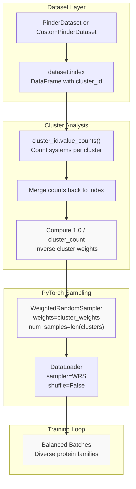
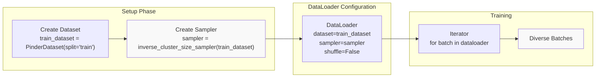
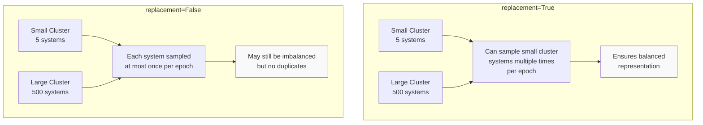
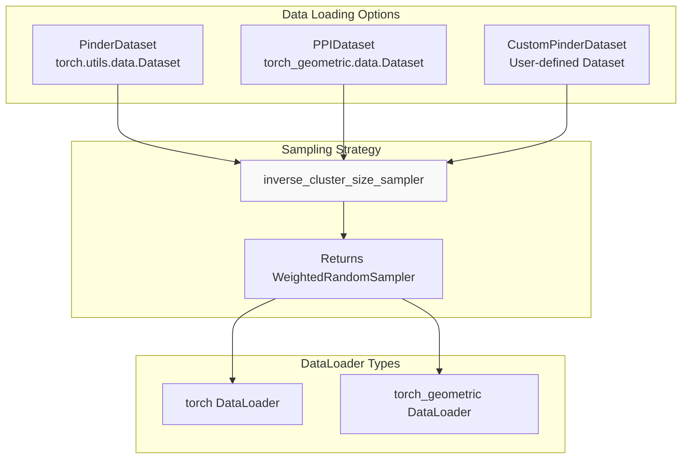
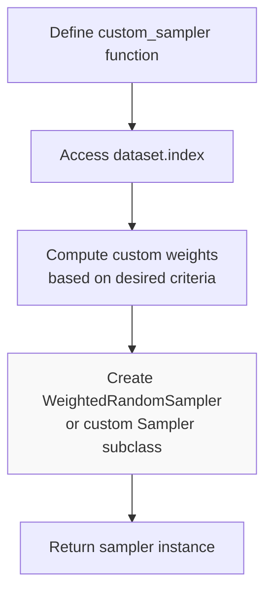

# Diversity Sampling

<details>
<summary>Relevant source files</summary>

The following files were used as context for generating this wiki page:

- [examples/pinder-loader.ipynb](examples/pinder-loader.ipynb)

</details>


## Purpose and Scope

This page explains diversity sampling strategies for creating balanced training batches from the PINDER dataset. Diversity sampling addresses the challenge that protein complexes in PINDER are clustered by structural similarity, resulting in highly imbalanced cluster sizes. Without diversity sampling, training batches would be dominated by a few large protein families, leading to biased models.

For information about the underlying cluster structure and dataset splits, see [Dataset Splits and Benchmarks](#1.4). For general data loading concepts, see [Data Loading System](#4).

---

## The Imbalanced Cluster Problem

PINDER organizes protein complexes into clusters based on FoldSeek structural similarity. Each system in the index has a `cluster_id` that groups structurally similar protein-protein interfaces. However, cluster sizes vary dramatically:

| Characteristic | Description |
|---------------|-------------|
| **Small clusters** | May contain just 1-10 systems representing rare protein families |
| **Large clusters** | Can contain hundreds or thousands of systems from common protein families |
| **Training impact** | Without sampling adjustments, large clusters dominate batches |
| **Model bias** | Models trained on imbalanced data may overfit to common families |

The goal of diversity sampling is to ensure that each batch contains representatives from diverse structural families, not just the most abundant ones.

Sources: [examples/pinder-loader.ipynb:2518-2562]()

---

## Inverse Cluster Size Sampling

### Concept

The primary diversity sampling strategy implemented in PINDER is **inverse cluster size sampling**, where the sampling weight for each system is inversely proportional to its cluster size. This means:

- Systems in small clusters (rare protein families) are sampled more frequently
- Systems in large clusters (common protein families) are sampled less frequently
- The effective sampling rate balances cluster representation

### Mathematical Formulation

For a system $i$ in cluster $c$ with size $|c|$:

$$w_i = \frac{1}{|c|}$$

This weight is then used with PyTorch's `WeightedRandomSampler` to draw samples according to the computed probability distribution.

---

## Implementation Architecture



**Diagram: Diversity Sampling Pipeline**

The pipeline starts with the dataset index, computes cluster statistics, calculates inverse weights, and feeds them into PyTorch's sampling mechanism.

Sources: [examples/pinder-loader.ipynb:2518-2562]()

---

## Code Implementation

### The `inverse_cluster_size_sampler` Function

The reference implementation in the PINDER tutorial demonstrates how to create a diversity sampler:

[examples/pinder-loader.ipynb:2538-2557]()

```python
from torch.utils.data import WeightedRandomSampler

def inverse_cluster_size_sampler(dataset: PinderDataset, replacement: bool = True):
    index = dataset.index
    cluster_counts = (
        index["cluster_id"].value_counts().rename("cluster_count")
    )
    index = index.merge(
        cluster_counts, left_on="cluster_id", right_index=True
    )
    # undersample large clusters
    cluster_weights = 1.0 / torch.tensor(index.cluster_count.values)
    return WeightedRandomSampler(
        weights=cluster_weights,
        num_samples=len(cluster_counts),
        replacement=replacement,
    )
```

### Key Components

| Component | Type | Purpose |
|-----------|------|---------|
| `dataset.index` | `pd.DataFrame` | Contains `cluster_id` for each system |
| `cluster_id.value_counts()` | `pd.Series` | Counts how many systems per cluster |
| `1.0 / cluster_count` | `torch.Tensor` | Inverse weights for sampling |
| `WeightedRandomSampler` | PyTorch Sampler | Implements weighted random sampling |
| `replacement=True` | bool | Allow sampling same system multiple times in epoch |
| `num_samples` | int | Number of samples to draw per epoch |

Sources: [examples/pinder-loader.ipynb:2538-2557]()

---

## Integration with DataLoader

### Basic Usage Pattern



**Diagram: DataLoader Integration Flow**

The sampler is created from the dataset and passed to the DataLoader. Note that `shuffle` must be `False` when using a custom sampler.

Sources: [examples/pinder-loader.ipynb:2612-2625]()

### Example Code

[examples/pinder-loader.ipynb:2676-2692]()

```python
train_data = CustomPinderDataset(
    split="train", 
    structure_filters=[filters.MinAtomTypesFilter()], 
    metadata_filter="(buried_sasa >= 500)",
    transform=default_transform, 
    target_transform=default_transform,
)
train_dataloader = get_loader(
    train_data, 
    sampler=inverse_cluster_size_sampler(train_data),
    batch_size=1,
)
```

### Critical Constraints

| Parameter | Value | Reason |
|-----------|-------|--------|
| `shuffle` | `False` | Mutually exclusive with custom `sampler` |
| `sampler` | Custom sampler instance | Controls sampling distribution |
| `replacement` | `True` (typical) | Allows oversampling of rare clusters |
| `num_samples` | `len(unique_clusters)` | Controls epoch length |

Sources: [examples/pinder-loader.ipynb:2612-2625]()

---

## Sampling Behavior and Trade-offs

### With Replacement vs Without Replacement



**Diagram: Replacement Strategy Comparison**

With replacement allows true balanced sampling by oversampling rare clusters. Without replacement prevents duplicate samples but may still result in some imbalance.

### Trade-off Table

| Aspect | With Replacement | Without Replacement |
|--------|-----------------|---------------------|
| **Balance** | Perfect cluster balance possible | Limited by smallest cluster |
| **Overfitting risk** | Higher (same examples repeated) | Lower (each system seen once) |
| **Epoch size** | Flexible (`num_samples`) | Fixed by dataset size |
| **Use case** | Small datasets, extreme imbalance | Large datasets, mild imbalance |

Sources: [examples/pinder-loader.ipynb:2538-2557]()

---

## Integration Points with PinderLoader

While the tutorial demonstrates diversity sampling with custom datasets, the sampling strategy can be applied to any PyTorch dataset derived from PINDER data. The key requirements are:

1. Dataset must expose `.index` attribute with `cluster_id` column
2. Sampler must be compatible with `torch.utils.data.DataLoader`
3. `shuffle=False` when using custom sampler

### Workflow Diagram



**Diagram: Diversity Sampling with Different Dataset Types**

The same `inverse_cluster_size_sampler` function can be used with any dataset that provides cluster information.

Sources: [examples/pinder-loader.ipynb:2676-2692]()

---

## Alternative Sampling Strategies

While inverse cluster size sampling is the primary strategy documented in PINDER, users can implement alternative approaches by creating custom samplers:

### Possible Strategies

| Strategy | Description | Implementation |
|----------|-------------|----------------|
| **Uniform cluster sampling** | Sample clusters uniformly, then sample within cluster | Two-stage sampler |
| **Stratified sampling** | Ensure fixed number per cluster per batch | Custom batch sampler |
| **Weighted by difficulty** | Weight by prediction difficulty metrics | Use model predictions as weights |
| **Hybrid approaches** | Combine cluster size with other factors | Multiply multiple weight factors |

### Custom Sampler Template



**Diagram: Custom Sampler Creation Pattern**

Any custom sampling strategy follows this general pattern of computing weights from dataset metadata and creating a PyTorch sampler.

Sources: [examples/pinder-loader.ipynb:2538-2557]()

---

## Practical Considerations

### When to Use Diversity Sampling

| Scenario | Recommendation |
|----------|---------------|
| **Training set** | Strongly recommended to prevent family bias |
| **Validation set** | Optional, typically use natural distribution |
| **Test set** | Not recommended, evaluate on natural distribution |
| **Small datasets** | Essential for balanced representation |
| **Large datasets** | Still beneficial but less critical |

### Performance Impact

Diversity sampling has minimal computational overhead:

- Weight computation: One-time cost at dataset initialization
- Sampling overhead: Negligible compared to data loading/processing
- Memory: O(N) for weight storage where N = dataset size

### Monitoring Cluster Distribution

To verify diversity sampling effectiveness:

```python
# Track cluster distribution in batches
cluster_counts = defaultdict(int)
for batch in dataloader:
    for system_id in batch['id']:
        cluster_id = index[index.id == system_id].cluster_id.iloc[0]
        cluster_counts[cluster_id] += 1

# Should see more uniform distribution than without sampling
```

Sources: [examples/pinder-loader.ipynb:2518-2562]()

---

## Complete Example

### End-to-End Implementation

[examples/pinder-loader.ipynb:2676-2692]()

This complete example demonstrates:
1. Creating a custom dataset with metadata filters
2. Applying structure filters
3. Creating diversity sampler
4. Configuring DataLoader
5. Iterating through balanced batches

The result is a training pipeline that ensures diverse protein family representation in each epoch, leading to more robust and generalizable models.

Sources: [examples/pinder-loader.ipynb:2676-2692](), [examples/pinder-loader.ipynb:2729-2733]()

---