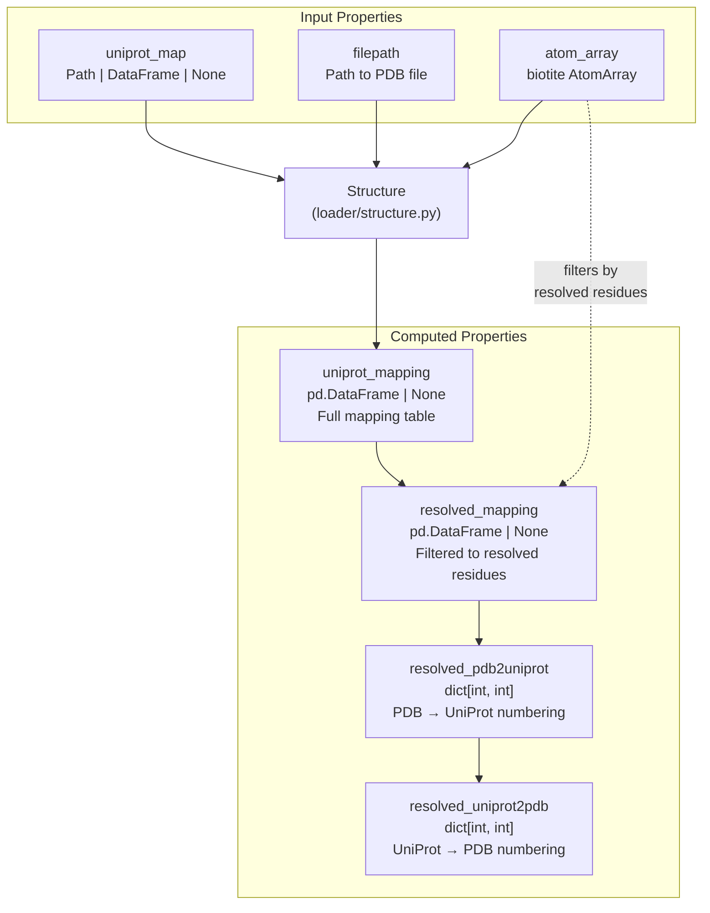
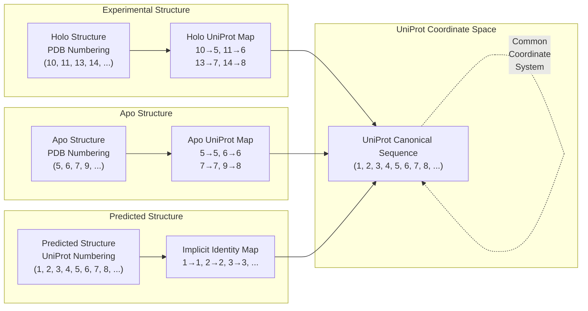
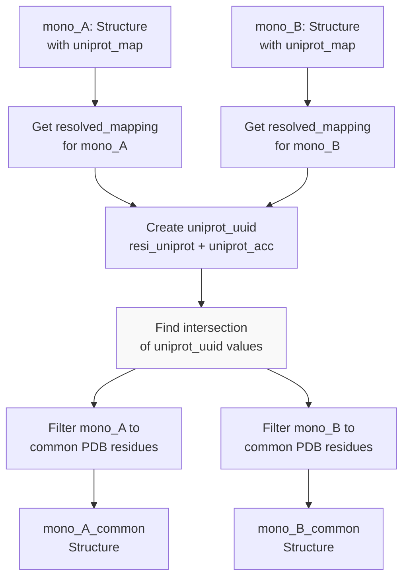
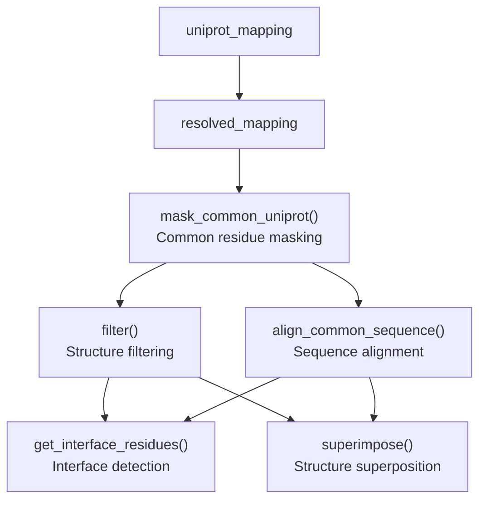

# UniProt Mappings

<details>
<summary>Relevant source files</summary>

The following files were used as context for generating this wiki page:

- [src/pinder-core/pinder/core/loader/structure.py](src/pinder-core/pinder/core/loader/structure.py)
- [src/pinder-core/pinder/core/structure/atoms.py](src/pinder-core/pinder/core/structure/atoms.py)

</details>


This document explains how PINDER handles the mapping between PDB residue numbering and UniProt canonical sequence numbering. UniProt mappings are critical for aligning structures that use different coordinate systems, particularly when matching experimental structures (using PDB numbering) with predicted structures (using UniProt numbering).

For information about general sequence alignment and structure superposition, see [Structure Superposition](#8.1). For details on the core Structure class, see [Structure Class](#3.2).

## Purpose and Scope

UniProt mappings serve as a common coordinate system for residue identification across different structure types. When working with PINDER systems that contain holo (bound), apo (unbound), and predicted structures, each structure may use different residue numbering schemes:

- **Experimental structures (holo/apo)**: Use PDB-specific residue numbering, which may have gaps, non-sequential numbering, or insertion codes
- **Predicted structures (AlphaFold)**: Use sequential UniProt canonical sequence numbering
- **UniProt mappings**: Provide the bridge between these coordinate systems

**Sources**: [src/pinder-core/pinder/core/loader/structure.py:1-675]()

## UniProt Mapping Data Structure

UniProt mappings in PINDER are stored as Parquet files or pandas DataFrames with the following schema:

| Column | Type | Description |
|--------|------|-------------|
| `resi` | int | PDB residue ID number |
| `resi_uniprot` | int | UniProt canonical sequence residue number |
| `uniprot_acc` | str | UniProt accession ID |
| Additional columns | various | Chain ID, residue name, and other metadata |

The mapping files are stored in the `mappings/` directory within the PINDER dataset structure (see [Dataset Structure](#1.3)).

**Sources**: [src/pinder-core/pinder/core/loader/structure.py:45-46](), [src/pinder-core/pinder/core/loader/structure.py:329-337]()

## Structure Class UniProt Properties

The `Structure` class provides several properties for accessing and working with UniProt mappings:



**Sources**: [src/pinder-core/pinder/core/loader/structure.py:329-371]()

### uniprot_mapping Property

Returns the full UniProt mapping DataFrame if available. Loads from file path if necessary.

```python
@property
def uniprot_mapping(self) -> pd.DataFrame | None:
    if isinstance(self.uniprot_map, Path):
        df = pd.read_parquet(self.uniprot_map)
        df = set_mapping_column_types(df)
        return df
    elif isinstance(self.uniprot_map, pd.DataFrame):
        return self.uniprot_map
    return None
```

**Sources**: [src/pinder-core/pinder/core/loader/structure.py:329-337]()

### resolved_mapping Property

Filters the mapping to include only residues that are actually present (resolved) in the PDB structure. This is important because PDB structures may be missing residues due to disorder or experimental limitations.

**Sources**: [src/pinder-core/pinder/core/loader/structure.py:340-349]()

### resolved_pdb2uniprot Property

Creates a dictionary mapping from PDB residue IDs to UniProt residue numbers for resolved residues only. If no mapping is available, creates an identity mapping.

**Sources**: [src/pinder-core/pinder/core/loader/structure.py:352-364]()

### resolved_uniprot2pdb Property

Creates the inverse mapping from UniProt residue numbers to PDB residue IDs. Simply reverses the `resolved_pdb2uniprot` dictionary.

**Sources**: [src/pinder-core/pinder/core/loader/structure.py:367-371]()

## Coordinate System Transformation Flow

The following diagram illustrates how UniProt mappings enable coordinate system transformations:



**Sources**: [src/pinder-core/pinder/core/loader/structure.py:532-606]()

## Masking Common Residues Using UniProt

The `mask_common_uniprot` function uses UniProt mappings to identify and filter structures to contain only residues that are common between two structures. This is essential for comparing structures with different numbering schemes.



**Sources**: [src/pinder-core/pinder/core/loader/structure.py:532-606]()

### mask_common_uniprot Function Workflow

The function handles three distinct cases:

#### Case 1: Both Structures Have UniProt Mappings

When both structures have experimental origins with UniProt mappings available:

1. Load `resolved_mapping` for both structures
2. Create unique identifiers combining UniProt residue number and accession: `uniprot_uuid = resi_uniprot + "-" + uniprot_acc`
3. Find the intersection of these identifiers
4. Filter both structures to only include residues with matching UniProt coordinates

**Sources**: [src/pinder-core/pinder/core/loader/structure.py:541-556]()

#### Case 2: Only One Structure Has Mapping (Predicted Structure)

When one structure is predicted (already in UniProt numbering) and the other is experimental:

1. Extract the UniProt accession from the predicted structure's `pinder_id`
2. Filter the experimental structure's mapping to that specific UniProt accession
3. Find residues where:
   - The experimental structure's `resi_uniprot` matches the predicted structure's `res_id`
   - The residues are resolved in both structures
4. Filter both structures to these common residues

**Sources**: [src/pinder-core/pinder/core/loader/structure.py:556-590]()

#### Case 3: No Common Residues

If no common residues are found (possibly due to different domains or mapping errors):

- Log an error message
- Return the original structures unmodified

**Sources**: [src/pinder-core/pinder/core/loader/structure.py:592-598]()

## Usage in PinderSystem

UniProt mappings are automatically loaded when creating `Structure` objects within a `PinderSystem`. The mapping enables:

1. **Structure alignment**: Aligning holo and apo structures that may have different PDB numbering
2. **Predicted structure comparison**: Comparing AlphaFold predictions (UniProt numbering) with experimental structures
3. **Interface definition**: Identifying corresponding interface residues across different structure types
4. **Evaluation**: Ensuring metrics are computed on equivalent residue sets

**Sources**: [src/pinder-core/pinder/core/loader/structure.py:42-49](), [src/pinder-core/pinder/core/loader/structure.py:329-371]()

## Practical Example

Here's how UniProt mappings work in practice:

```python
from pinder.core import PinderSystem

# Load a system
ps = PinderSystem("8i2f__A1_O34841--8i2f__B1_P54421")

# Access holo receptor structure
holo_R = ps.holo_receptor

# Check if UniProt mapping is available
if holo_R.uniprot_mapping is not None:
    print(f"Mapping available with {len(holo_R.uniprot_mapping)} entries")
    
    # Get PDB to UniProt mapping
    pdb2uni = holo_R.resolved_pdb2uniprot
    print(f"PDB residue 10 maps to UniProt residue {pdb2uni.get(10)}")
    
    # Get UniProt to PDB mapping
    uni2pdb = holo_R.resolved_uniprot2pdb
    print(f"UniProt residue 5 maps to PDB residue {uni2pdb.get(5)}")

# If comparing with predicted structure
if ps.pred_receptor_available:
    pred_R = ps.pred_receptor
    # Predicted structure uses UniProt numbering directly
    # Can use mask_common_uniprot to find common residues
    from pinder.core.loader.structure import mask_common_uniprot
    holo_common, pred_common = mask_common_uniprot(holo_R, pred_R)
    print(f"Found {len(holo_common.residues)} common residues")
```

**Sources**: [src/pinder-core/pinder/core/loader/structure.py:329-371](), [src/pinder-core/pinder/core/loader/structure.py:532-606]()

## Handling Missing Mappings

Not all structures in PINDER have UniProt mappings. When mappings are unavailable:

1. The `uniprot_mapping` property returns `None`
2. The `resolved_pdb2uniprot` creates an identity mapping (PDB residue ID → PDB residue ID)
3. Functions like `mask_common_uniprot` fall back to sequence-based alignment methods (see [Structure Superposition](#8.1))

This ensures that the code continues to function even when UniProt mappings are not available, though with reduced accuracy in residue correspondence.

**Sources**: [src/pinder-core/pinder/core/loader/structure.py:352-364]()

## Integration with Structure Operations

UniProt mappings integrate with other structure operations:



**Sources**: [src/pinder-core/pinder/core/loader/structure.py:122-210](), [src/pinder-core/pinder/core/loader/structure.py:296-326](), [src/pinder-core/pinder/core/loader/structure.py:532-606]()

## Key Implementation Details

### Data Type Enforcement

The `set_mapping_column_types` function ensures that mapping DataFrames have consistent column types, preventing errors from type mismatches during concatenation or comparison operations.

**Sources**: [src/pinder-core/pinder/core/loader/structure.py:111]()

### Structure Addition

When combining two structures using the `+` operator, UniProt mappings are also concatenated. The implementation handles:

- Different DataFrame schemas by aligning dtypes before concatenation
- Empty or all-NA mappings that would cause warnings
- Missing mappings (returns `None`)

**Sources**: [src/pinder-core/pinder/core/loader/structure.py:89-120]()

### Chimeric Sequences

The code handles chimeric sequences in predicted structures by extracting the UniProt accession from the `pinder_id` and filtering mappings to match the correct accession.

**Sources**: [src/pinder-core/pinder/core/loader/structure.py:559-562](), [src/pinder-core/pinder/core/loader/structure.py:577-580]()

## Summary

UniProt mappings are the bridge between different residue numbering systems in PINDER:

- **Storage**: Parquet files or DataFrames with PDB-to-UniProt residue mappings
- **Access**: Properties on the `Structure` class provide convenient access and filtering
- **Usage**: Enable comparison and alignment of structures with different numbering schemes
- **Fallback**: Identity mappings or sequence alignment when mappings unavailable

Understanding UniProt mappings is essential for working with PINDER systems that mix experimental and predicted structures, or when analyzing interfaces across different structure types.

**Sources**: [src/pinder-core/pinder/core/loader/structure.py:1-675]()

---