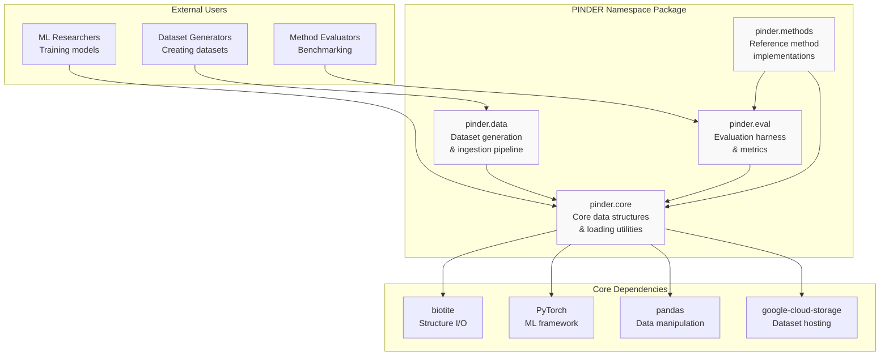
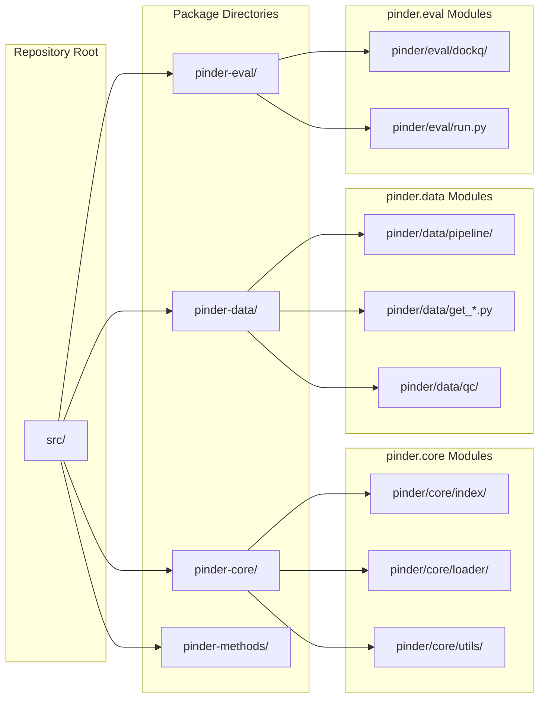
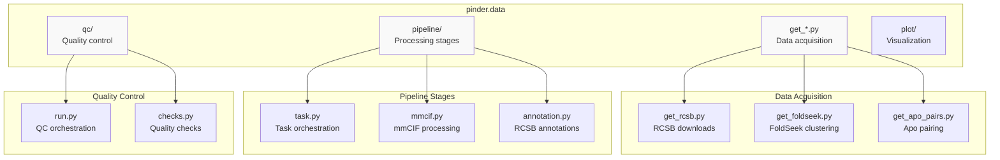
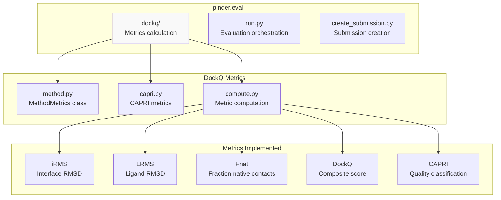
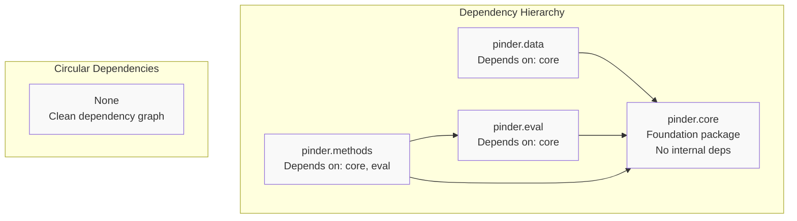

# Package Reference

<details>
<summary>Relevant source files</summary>

The following files were used as context for generating this wiki page:

- [README.md](README.md)
- [pyproject.toml](pyproject.toml)

</details>


This document provides a comprehensive overview of the PINDER package ecosystem, including its structure, module organization, entry points, and core dependencies. This serves as a reference for understanding the package architecture and navigating the codebase.

For detailed API documentation of specific classes and functions, see the subsections: [pinder.core](#9.1), [pinder.core.loader](#9.2), [pinder.data](#9.3), and [pinder.eval](#9.4). For guides on using these packages, see [Quick Start Guide](#2).

## Package Ecosystem Overview

PINDER is organized as a namespace package with four main subpackages, each serving a distinct purpose in the protein interaction dataset and evaluation workflow.



**Sources:** [README.md:689-696](), [pyproject.toml:138-146]()

## Package Structure and File Organization

The PINDER repository uses a source layout with each subpackage located in its own directory under `src/`.



**Sources:** [pyproject.toml:138-146](), [README.md:689-696]()

| Package | Source Directory | Primary Purpose | Key Modules |
|---------|-----------------|-----------------|-------------|
| `pinder-core` | `src/pinder-core/pinder/core/` | Data structures, loading, filtering | `index/`, `loader/`, `utils/` |
| `pinder-data` | `src/pinder-data/pinder/data/` | Dataset generation from RCSB | `pipeline/`, `get_*.py`, `qc/` |
| `pinder-eval` | `src/pinder-eval/pinder/eval/` | Evaluation metrics and harness | `dockq/`, `run.py` |
| `pinder-methods` | `src/pinder-methods/pinder/methods/` | Reference implementations | Method-specific modules |

**Sources:** [pyproject.toml:138-146]()

## Command-Line Entry Points

PINDER provides several CLI tools for dataset management, evaluation, and data generation. These are defined as console scripts in the package configuration.

```mermaid
graph TB
    subgraph "Dataset Management"
        DOWNLOAD["pinder_download<br/>Download dataset"]
        SYNC["pinder_sync_data<br/>Sync structure files"]
        UPDATE["pinder_update_index<br/>Update index files"]
    end
    
    subgraph "Evaluation"
        EVAL["pinder_eval<br/>Run evaluation harness"]
        SUBMIT["pinder_create_submission<br/>Create submission"]
    end
    
    subgraph "Data Generation"
        DATA["pinder_data<br/>Run data pipeline"]
        QC["pinder_qc<br/>Quality control"]
        PLOT["pinder_plot<br/>Generate plots"]
    end
    
    subgraph "Methods"
        METHODS["pinder_methods<br/>Run reference methods"]
    end
    
    subgraph "Implementation Modules"
        DOWNLOAD --> UTILS_DL["pinder.core.index.utils<br/>download_pinder_cmd"]
        SYNC --> UTILS_SYNC["pinder.core.index.utils<br/>sync_pinder_structure_data"]
        UPDATE --> UTILS_UPD["pinder.core.index.utils<br/>update_index_cmd"]
        
        EVAL --> EVAL_RUN["pinder.eval.run<br/>main"]
        SUBMIT --> EVAL_SUB["pinder.eval.create_submission<br/>main"]
        
        DATA --> DATA_RUN["pinder.data.run<br/>main"]
        QC --> QC_RUN["pinder.data.qc.run<br/>main"]
        PLOT --> PLOT_RUN["pinder.data.plot.run<br/>main"]
        
        METHODS --> METH_MAIN["pinder.methods.main<br/>main"]
    end
    
    style DOWNLOAD fill:#f9f9f9
    style SYNC fill:#f9f9f9
    style UPDATE fill:#f9f9f9
    style EVAL fill:#f9f9f9
    style SUBMIT fill:#f9f9f9
    style DATA fill:#f9f9f9
    style QC fill:#f9f9f9
    style PLOT fill:#f9f9f9
    style METHODS fill:#f9f9f9
```



**Sources:** [pyproject.toml:38-47]()

| Script Name | Entry Point Function | Purpose |
|-------------|---------------------|---------|
| `pinder_download` | `pinder.core.index.utils:download_pinder_cmd` | Download complete PINDER dataset from GCS |
| `pinder_sync_data` | `pinder.core.index.utils:sync_pinder_structure_data` | Sync missing structure files |
| `pinder_update_index` | `pinder.core.index.utils:update_index_cmd` | Update local index files |
| `pinder_eval` | `pinder.eval.run:main` | Run evaluation harness on predictions |
| `pinder_create_submission` | `pinder.eval.create_submission:main` | Create benchmark submission |
| `pinder_data` | `pinder.data.run:main` | Execute data generation pipeline |
| `pinder_qc` | `pinder.data.qc.run:main` | Run quality control checks |
| `pinder_plot` | `pinder.data.plot.run:main` | Generate dataset visualizations |
| `pinder_methods` | `pinder.methods.main:main` | Run reference method implementations |

**Sources:** [pyproject.toml:38-47](), [README.md:148-160](), [README.md:308-326]()

## Core Dependencies

PINDER relies on several key external libraries for structure manipulation, machine learning, and data management.

### Required Dependencies

| Dependency | Version Constraint | Purpose |
|-----------|-------------------|---------|
| `biotite` | `>= 1.0` | Protein structure I/O and manipulation |
| `fastpdb` | No constraint | Accelerated PDB parsing (Rust-based) |
| `numpy` | `< 2` | Numerical operations on atomic coordinates |
| `pandas` | No constraint | Index and metadata dataframe operations |
| `pyarrow` | `>= 12.0` | Efficient parquet file reading/writing |
| `torch` | No constraint | PyTorch tensors and dataloaders |
| `torch_geometric` | No constraint | Graph neural network data structures |
| `pydantic` | `>= 2.0` | Data validation for IndexEntry/MetadataEntry |
| `google-cloud-storage` | No constraint | GCS bucket access for dataset |
| `gcsfs` | No constraint | Filesystem interface for GCS |

**Sources:** [pyproject.toml:4-24]()

### Optional Dependencies

| Extra Name | Dependencies | Purpose |
|-----------|-------------|---------|
| `[data]` | `fire`, `gemmi`, `networkx`, `scikit-learn`, `python-graphql-client`, `mpire`, `matplotlib`, `seaborn`, `colormath` | Dataset generation pipeline |
| `[test]` | `tox`, `pytest`, `pytest-cov`, `build`, `setuptools_scm` | Testing infrastructure |
| `[lint]` | `ruff`, `pre-commit` | Code quality tools |
| `[type]` | `mypy`, type stubs | Static type checking |
| `[docs]` | `sphinx`, `myst-parser`, `jupyter-sphinx` | Documentation building |
| `[leaderboard]` | `quarto_cli`, `itables`, `matplotlib`, `seaborn` | Leaderboard generation |
| `[dev]` | All of the above | Complete development environment |

**Sources:** [pyproject.toml:49-124]()

### External Bioinformatics Tools

Some functionality requires external binaries to be installed separately:

- **foldseek**: Used for structure-based clustering and alignment
- **mmseqs2**: Used for sequence-based operations
- **iAlign**: Used for interface alignment during deleaking
- **torch-cluster**: Optional PyTorch geometric dependency for graph operations

**Sources:** [README.md:70-92]()

## pinder.core Module Organization

The `pinder.core` package contains the primary data structures and utilities for working with PINDER data.

```mermaid
graph TB
    subgraph "pinder.core"
        INDEX_PKG["index/<br/>Dataset indexing"]
        LOADER_PKG["loader/<br/>Data loading"]
        UTILS_PKG["utils/<br/>Utilities"]
    end
    
    subgraph "index/ modules"
        SYSTEM["system.py<br/>PinderSystem class"]
        UTILS_IDX["utils.py<br/>Download & sync"]
        SCHEMA["__init__.py<br/>IndexEntry schema"]
    end
    
    subgraph "loader/ modules"
        LOADER["loader.py<br/>PinderLoader iterator"]
        DATASET["dataset.py<br/>PinderDataset, PPIDataset"]
        STRUCTURE["structure.py<br/>Structure class"]
        FILTERS["filters.py<br/>Filter implementations"]
        TRANSFORMS["transforms.py<br/>Transform implementations"]
        GEODATA["geodata.py<br/>Graph data structures"]
    end
    
    subgraph "utils/ modules"
        CONFIG["config.py<br/>Configuration"]
        PROCESS["process.py<br/>Processing utilities"]
    end
    
    INDEX_PKG --> SYSTEM
    INDEX_PKG --> UTILS_IDX
    INDEX_PKG --> SCHEMA
    
    LOADER_PKG --> LOADER
    LOADER_PKG --> DATASET
    LOADER_PKG --> STRUCTURE
    LOADER_PKG --> FILTERS
    LOADER_PKG --> TRANSFORMS
    LOADER_PKG --> GEODATA
    
    UTILS_PKG --> CONFIG
    UTILS_PKG --> PROCESS
    
    style INDEX_PKG fill:#f9f9f9
    style LOADER_PKG fill:#f9f9f9
    style UTILS_PKG fill:#f9f9f9
```



**Sources:** [README.md:407-427]()

### Key Classes and Functions in pinder.core

| Module | Key Classes/Functions | Purpose |
|--------|----------------------|---------|
| `pinder.core.index.system` | `PinderSystem` | Manages all structural variants of a protein complex |
| `pinder.core.index.utils` | `get_pinder_location()`, `download_pinder_cmd()`, `sync_pinder_structure_data()` | Dataset download and management |
| `pinder.core.index` | `IndexEntry`, `MetadataEntry` | Pydantic schemas for dataset annotations |
| `pinder.core.loader.loader` | `PinderLoader` | Iterator with filtering and monomer selection |
| `pinder.core.loader.dataset` | `PinderDataset`, `PPIDataset`, `get_torch_loader()`, `get_geo_loader()` | PyTorch dataset implementations |
| `pinder.core.loader.structure` | `Structure` | Wrapper around biotite AtomArray with utilities |
| `pinder.core.loader.filters` | `PinderFilterBase`, `PinderFilterSubBase`, `StructureFilter` | Filter base classes and implementations |
| `pinder.core.loader.transforms` | `TransformBase`, `StructureTransform` | Transform base classes and implementations |
| `pinder.core.loader.geodata` | `NodeRepresentation`, `PairedPDB` | Graph neural network data structures |

**Sources:** [README.md:410-426]()

## pinder.data Module Organization

The `pinder.data` package implements the dataset generation pipeline from raw RCSB PDB data.



**Sources:** [README.md:689-696]()

### Data Pipeline Components

| Component | Purpose | Key Operations |
|-----------|---------|----------------|
| RCSB Download | Acquire mmCIF files from RCSB | rsync-based download with two-character code organization |
| Biological Assembly | Generate bioassemblies | Parse mmCIF, apply symmetry operations |
| Interface Detection | Find interacting chains | 10Å backbone atom distance threshold |
| FoldSeek Clustering | Cluster by interface similarity | All-vs-all alignment, community detection |
| Apo Pairing | Match unbound structures | UniProt-based alignment with quality metrics |
| AFDB Pairing | Match predicted structures | AlphaFold DB alignment via UniProt |
| Annotation | Fetch metadata | GraphQL queries to RCSB for Pfam, ECOD, SCOP, CATH |

**Sources:** [README.md:698-709](), [README.md:710-730]()

## pinder.eval Module Organization

The `pinder.eval` package provides evaluation metrics and leaderboard generation.



**Sources:** [README.md:300-327](), [README.md:380]()

### Evaluation Harness Components

| Component | Purpose | Key Features |
|-----------|---------|--------------|
| `MethodMetrics` | Aggregate method performance | Processes decoy directories, extracts ranks, calculates metrics |
| CAPRI Metrics | Standard docking evaluation | iRMS, LRMS, Fnat, DockQ according to CAPRI standards |
| Penalty System | Handle missing predictions | Assigns penalty scores (iRMS=100, LRMS=100, Fnat=0, DockQ=0) |
| Parallel Evaluation | Multi-system processing | Multiprocessing support for fast evaluation |
| Leaderboard Generation | Aggregate results | CSV output with per-system and aggregate metrics |

**Sources:** [README.md:300-381]()

### Expected Directory Structure for Evaluation

```
eval_dir/
└── method_name/
    └── <pinder_id>/
        ├── holo_decoys/
        │   ├── model_1.pdb
        │   └── model_2.pdb
        ├── apo_decoys/
        │   └── model_1.pdb
        └── predicted_decoys/
            └── model_1.pdb
```

Each decoy PDB must contain exactly two chains: `R` (receptor) and `L` (ligand). Decoy names must contain a rank number extractable via regex pattern `r"\d+(?=\D*$)"`.

**Sources:** [README.md:328-363]()

## Dependency Graph Between Packages

The four packages have clear dependency relationships, with `pinder.core` serving as the foundation.



**Sources:** [README.md:689-696]()

This clean dependency structure ensures:
- `pinder.core` can be installed standalone for data loading
- `pinder.data` includes core for processing utilities
- `pinder.eval` uses core structures for evaluation
- `pinder.methods` leverages both core and eval for implementations

## Installation Configurations

PINDER supports multiple installation configurations depending on user needs.

| Installation Command | Packages Included | Use Case |
|---------------------|-------------------|----------|
| `pip install pinder` | `pinder.core` + dependencies | Dataset loading and ML training |
| `pip install pinder[eval]` | core + `pinder.eval` | Adding evaluation capabilities |
| `pip install pinder[data]` | core + `pinder.data` | Dataset generation |
| `pip install pinder[all]` | All packages | Complete functionality |
| `pip install pinder[dev]` | All + dev tools | Development environment |

**Sources:** [README.md:100-118](), [pyproject.toml:49-124]()

### Platform-Specific Considerations

**fastpdb** (required dependency):
- Pre-built wheels available for Linux (glibc>=2.34), MacOS (>=10.12), Windows
- Requires Rust toolchain for source builds on other platforms

**torch-cluster** (optional):
- Required for some graph operations
- Install via PyG wheel repository or from source
- On Apple Silicon MacOS, must install from source

**PRODIGY-cryst** (optional, for pinder.data):
- Git-based installation: `pip install git+https://github.com/yusuf1759/prodigy-cryst.git`
- Used for biological interface prediction

**Sources:** [README.md:22-99]()

---