# pinder.core

<details>
<summary>Relevant source files</summary>

The following files were used as context for generating this wiki page:

- [src/pinder-core/pinder/core/index/system.py](src/pinder-core/pinder/core/index/system.py)
- [src/pinder-core/pinder/core/loader/loader.py](src/pinder-core/pinder/core/loader/loader.py)
- [src/pinder-core/pinder/core/loader/structure.py](src/pinder-core/pinder/core/loader/structure.py)
- [src/pinder-core/pinder/core/utils/timer.py](src/pinder-core/pinder/core/utils/timer.py)

</details>


The `pinder.core` package provides the foundational data structures, loading utilities, and structural manipulation capabilities for working with the PINDER dataset. It serves as the base dependency for all other PINDER packages and contains the core abstractions needed to load protein systems, apply filters, perform structure alignments, and prepare data for machine learning workflows.

For information about the data loading system implementation details, see [pinder.core.loader](#9.2). For details about the dataset generation pipeline, see [pinder.data](#9.3). For evaluation utilities, see [pinder.eval](#9.4).

## Package Organization

The `pinder.core` package is organized into several submodules, each with specific responsibilities:

| Submodule | Purpose | Key Classes/Functions |
|-----------|---------|----------------------|
| `pinder.core.index` | Dataset indexing and metadata management | `PinderSystem`, `IndexEntry`, `MetadataEntry` |
| `pinder.core.loader` | Data loading, filtering, and transformation | `PinderLoader`, `PinderDataset`, `PPIDataset` |
| `pinder.core.loader.structure` | Structure representation and manipulation | `Structure`, atomic operations |
| `pinder.core.structure` | Low-level structural operations | Alignment, RMSD, contact calculation |
| `pinder.core.utils` | Utilities and helper functions | Logging, cloud storage, constants |

**Sources:** [src/pinder-core/pinder/core/loader/loader.py:1-439](), [src/pinder-core/pinder/core/loader/structure.py:1-675](), [src/pinder-core/pinder/core/index/system.py:1-806]()

## Core Architecture

The following diagram shows how the main components of `pinder.core` relate to each other, from the dataset index through to ML-ready structures:

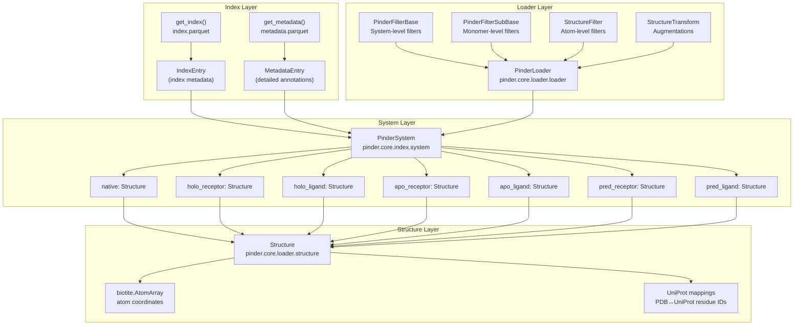

**Sources:** [src/pinder-core/pinder/core/index/system.py:89-162](), [src/pinder-core/pinder/core/loader/structure.py:42-143](), [src/pinder-core/pinder/core/loader/loader.py:192-290]()

## Index and Metadata Layer

The index layer provides access to the PINDER dataset catalog through two primary data structures:

### IndexEntry

Contains core metadata for each protein system in the dataset (58 fields total):

- System identifiers (`id`, `pdb_id`)
- Split assignment (`split`, `cluster_id`)
- PDB file paths for all structure types
- Quality metrics (`resolution`, `method`)
- Structural properties (`length1`, `length2`, `oligomeric_count`)
- Availability flags (`apo_R`, `apo_L`, `predicted_R`, `predicted_L`)

**Sources:** [src/pinder-core/pinder/core/index/system.py:12-18]()

### MetadataEntry

Contains detailed annotations (45+ fields):

- Interface characteristics (`interface_atom_gaps_4A`, `buried_sasa`)
- Conformational change metrics (`apo_R_rmsd`, `pred_L_rmsd`)
- Sequence features (`chain_R`, `chain_L`)
- Domain annotations (Pfam, ECOD, SCOP, CATH)

**Sources:** [src/pinder-core/pinder/core/index/utils.py]()

### Loading Index Data

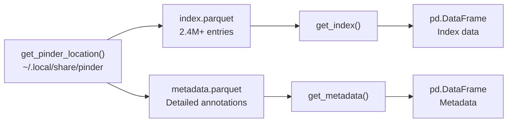

**Sources:** [src/pinder-core/pinder/core/index/utils.py]()

## PinderSystem: The Core System Abstraction

`PinderSystem` is the primary class for working with individual protein complexes. It manages all structural variants and provides methods for analysis and manipulation.

### Structure Initialization Strategy

The `PinderSystem` uses lazy loading via `@cached_property` decorators. Only the native complex is loaded on initialization; other structures (holo, apo, predicted) are loaded on first access:

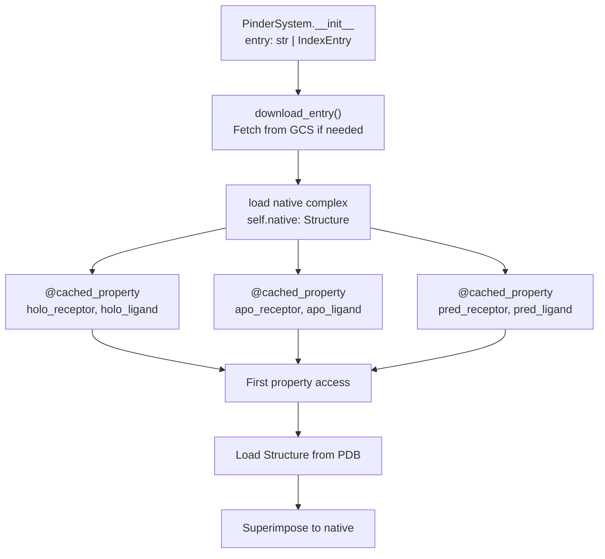

**Sources:** [src/pinder-core/pinder/core/index/system.py:110-162](), [src/pinder-core/pinder/core/index/system.py:163-261]()

### Key PinderSystem Methods

| Method | Purpose | Returns |
|--------|---------|---------|
| `create_complex(receptor, ligand)` | Create complex from monomers aligned to native | `Structure` |
| `create_apo_complex()` | Create complex from apo monomers | `Structure` |
| `create_pred_complex()` | Create complex from predicted monomers | `Structure` |
| `create_masked_bound_unbound_complexes()` | Create cropped complexes with equal atom counts | `tuple[Structure, Structure, Structure]` |
| `unbound_rmsd(monomer_name)` | Calculate RMSD of unbound vs. holo | `dict[str, float]` |
| `unbound_difficulty(monomer_name)` | Assess docking difficulty | `dict[str, float | str]` |
| `filter_common_uniprot_res()` | Filter to common UniProt residues | `None` (modifies in place) |

**Sources:** [src/pinder-core/pinder/core/index/system.py:376-488](), [src/pinder-core/pinder/core/index/system.py:490-556]()

### Alternate Apo Selection

The system supports multiple apo structures per monomer. By default, the canonical apo is used, but alternates can be specified:

```python
# Using alternate apo receptor
system = PinderSystem("8a5h__A1_P51531--8a5h__B1_Q9NZJ5", apo_receptor_pdb_code="4pzl")
```

**Sources:** [src/pinder-core/pinder/core/index/system.py:110-118](), [src/pinder-core/pinder/core/index/system.py:199-241]()

## Structure: Atomic Data Representation

The `Structure` class wraps `biotite.structure.AtomArray` with additional functionality for filtering, alignment, and property access.

### Structure Data Model

```mermaid
graph TB
    Structure["Structure<br/>pinder.core.loader.structure.Structure"]
    
    subgraph "Core Attributes"
        filepath["filepath: Path<br/>PDB file location"]
        atom_array["atom_array: AtomArray<br/>Atomic coordinates"]
        uniprot_map["uniprot_map: Path | DataFrame<br/>PDB↔UniProt mappings"]
        pinder_id["pinder_id: str<br/>System identifier"]
    end
    
    subgraph "Properties"
        coords["coords: NDArray<br/>Nx3 coordinate array"]
        chains["chains: list[str]<br/>Chain IDs"]
        residues["residues: list[int]<br/>Residue numbers"]
        sequence["sequence: str<br/>Amino acid sequence"]
        n_atoms["n_atoms: int<br/>Atom count"]
    end
    
    subgraph "Mappings"
        resolved_pdb2uniprot["resolved_pdb2uniprot: dict<br/>PDB→UniProt residue IDs"]
        resolved_uniprot2pdb["resolved_uniprot2pdb: dict<br/>UniProt→PDB residue IDs"]
        chain_sequence["chain_sequence: dict<br/>Chain→residue sequence"]
    end
    
    subgraph "Methods"
        filter_method["filter(property, mask)<br/>Filter atoms"]
        align_method["align_common_sequence(other)<br/>Sequence alignment"]
        superimpose_method["superimpose(other)<br/>Structural alignment"]
        get_contacts["get_contacts(radius)<br/>Interface contacts"]
        to_pdb["to_pdb(filepath)<br/>Write PDB file"]
    end
    
    Structure --> filepath
    Structure --> atom_array
    Structure --> uniprot_map
    Structure --> pinder_id
    
    Structure --> coords
    Structure --> chains
    Structure --> residues
    Structure --> sequence
    Structure --> n_atoms
    
    Structure --> resolved_pdb2uniprot
    Structure --> resolved_uniprot2pdb
    Structure --> chain_sequence
    
    Structure --> filter_method
    Structure --> align_method
    Structure --> superimpose_method
    Structure --> get_contacts
    Structure --> to_pdb
```

**Sources:** [src/pinder-core/pinder/core/loader/structure.py:42-120](), [src/pinder-core/pinder/core/loader/structure.py:328-505]()

### Key Structure Operations

#### Filtering

The `filter()` method creates filtered copies based on atom properties:

```python
# Filter to specific chains
receptor = structure.filter("chain_id", ["R"])

# Filter to backbone atoms
backbone = structure.filter("atom_name", ["N", "CA", "C", "O"])
```

**Sources:** [src/pinder-core/pinder/core/loader/structure.py:122-142]()

#### Sequence Alignment and Cropping

The `align_common_sequence()` method aligns two structures based on sequence, optionally cropping to common atoms:

```python
# Align and crop to common atoms
holo, apo = apo.align_common_sequence(
    holo, 
    remove_differing_atoms=True,
    renumber_residues=False
)
```

**Sources:** [src/pinder-core/pinder/core/loader/structure.py:156-209]()

#### Structural Superposition

The `superimpose()` method performs structural alignment and returns RMSD metrics:

```python
# Superimpose and get RMSD
aligned_structure, raw_rmsd, refined_rmsd = mobile.superimpose(fixed)
```

**Sources:** [src/pinder-core/pinder/core/loader/structure.py:296-326](), [src/pinder-core/pinder/core/loader/structure.py:636-674]()

#### Combining Structures

Structures can be combined using the `+` operator:

```python
# Create complex from monomers
complex_structure = receptor + ligand
```

**Sources:** [src/pinder-core/pinder/core/loader/structure.py:89-120]()

### UniProt Residue Mappings

The `Structure` class maintains mappings between PDB and UniProt residue numbering:

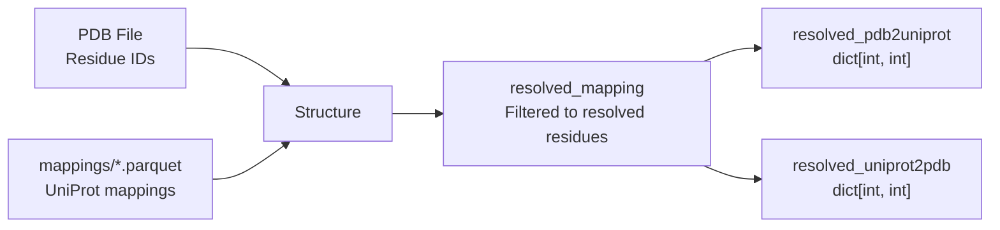

These mappings are critical for aligning apo and predicted structures (which use UniProt numbering) with holo structures (which use PDB numbering).

**Sources:** [src/pinder-core/pinder/core/loader/structure.py:329-371]()

## PinderLoader: Orchestrating Data Loading

`PinderLoader` is the primary iterator for loading PINDER systems with filtering and transformation support. It bridges the gap between the raw dataset index and ML-ready structures.

### PinderLoader Workflow

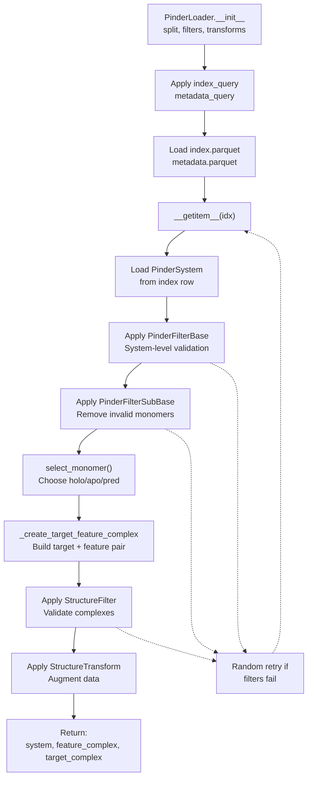

**Sources:** [src/pinder-core/pinder/core/loader/loader.py:192-405](), [src/pinder-core/pinder/core/loader/loader.py:357-405]()

### Monomer Selection Strategy

The `select_monomer()` function determines which monomer type to use based on the `monomer_priority` parameter:

| Priority | Behavior |
|----------|----------|
| `"holo"` | Use holo monomers for both receptor and ligand |
| `"apo"` | Use apo monomers (with holo fallback if not available) |
| `"pred"` | Use predicted monomers (with holo fallback) |
| `"random"` | Randomly select from available types (same type for R and L) |
| `"random_mixed"` | Randomly select for R and L independently |

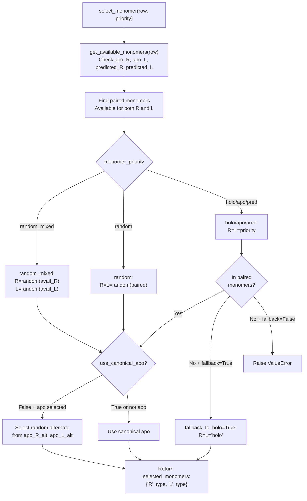

**Sources:** [src/pinder-core/pinder/core/loader/loader.py:81-149](), [src/pinder-core/pinder/core/loader/loader.py:37-53]()

### Three-Tier Filtering System

The loader supports three levels of filtering:

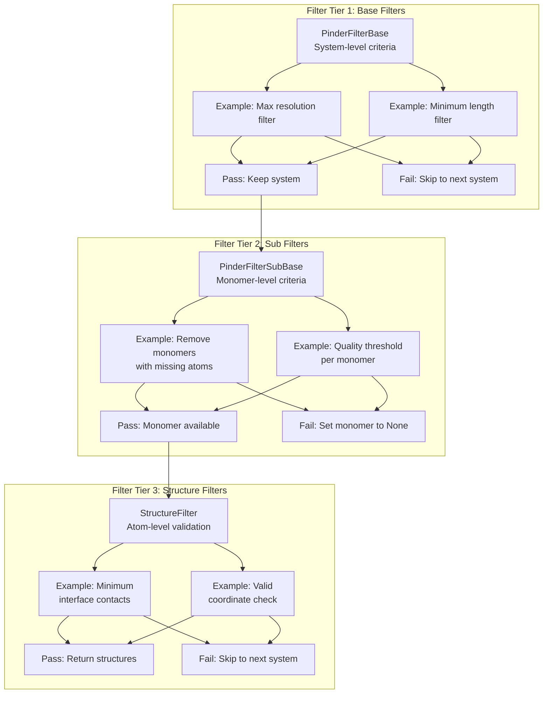

**Sources:** [src/pinder-core/pinder/core/loader/loader.py:415-435](), [src/pinder-core/pinder/core/loader/filters.py]()

### Cropping and Superposition

The `crop_equal_monomer_shapes` parameter controls whether holo and feature complexes are cropped to have identical atom counts. This is essential for some model architectures:

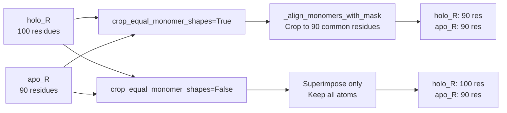

**Sources:** [src/pinder-core/pinder/core/loader/loader.py:152-189](), [src/pinder-core/pinder/core/index/system.py:37-51]()

## Module Structure Summary

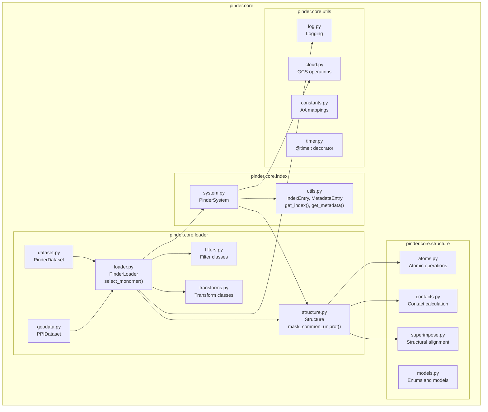

**Sources:** [src/pinder-core/pinder/core/]()

## Typical Usage Patterns

### Loading a Single System

```python
from pinder.core import PinderSystem

# Load system by ID
system = PinderSystem("4gzm__A1_Q9Y5P2--4gzm__B1_Q13263")

# Access structures (lazy loaded on first access)
native = system.native
holo_r = system.holo_receptor
apo_r = system.apo_receptor
pred_r = system.pred_receptor

# Create complexes
apo_complex = system.create_apo_complex()
pred_complex = system.create_pred_complex()
```

### Iterating with PinderLoader

```python
from pinder.core.loader import PinderLoader

# Create loader with filters
loader = PinderLoader(
    split="train",
    monomer_priority="apo",
    fallback_to_holo=True
)

# Iterate over systems
for system, feature, target in loader:
    # system: PinderSystem
    # feature: unbound complex (apo in this case)
    # target: bound complex (holo)
    print(f"System: {system.entry.id}")
    print(f"Feature atoms: {feature.n_atoms}")
    print(f"Target atoms: {target.n_atoms}")
```

### Filtering and Transformation

```python
from pinder.core.loader import PinderLoader
from pinder.core.loader.filters import FilterByMissingHolo
from pinder.core.loader.transforms import SelectAtomTypes

loader = PinderLoader(
    split="val",
    base_filters=[FilterByMissingHolo()],
    structure_transforms_feature=[SelectAtomTypes(atom_types=["CA"])],
    monomer_priority="holo"
)
```

**Sources:** [src/pinder-core/pinder/core/index/system.py:110-162](), [src/pinder-core/pinder/core/loader/loader.py:192-350]()

## Performance Considerations

### Lazy Loading

All monomer structures in `PinderSystem` use `@cached_property` to avoid loading unnecessary data:

```python
@cached_property
def apo_receptor(self) -> Structure:
    # Only loaded when accessed
    return self.load_structure(...)
```

This means accessing only `native` and `holo_receptor` will not trigger loading of apo or predicted structures.

**Sources:** [src/pinder-core/pinder/core/index/system.py:163-261]()

### PDB Engine Selection

The `Structure` class supports two PDB parsing engines:

- `"fastpdb"` (default): Faster parsing, suitable for most cases
- `"biotite"`: More robust for malformed PDB files

```python
system = PinderSystem("8a5h__A1_P51531--8a5h__B1_Q9NZJ5", pdb_engine="biotite")
```

**Sources:** [src/pinder-core/pinder/core/loader/structure.py:48-64]()

### Cloud Storage Integration

The `PinderSystem.download_entry()` method automatically downloads missing files from Google Cloud Storage:

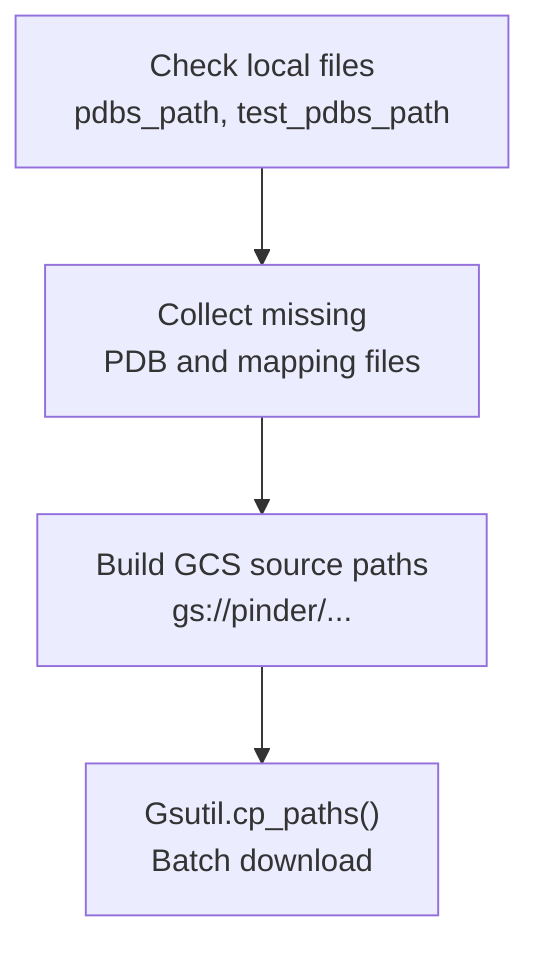

**Sources:** [src/pinder-core/pinder/core/index/system.py:614-645]()

## Utilities

### Logging

The `setup_logger()` function provides consistent logging across the package:

```python
from pinder.core.utils import setup_logger

log = setup_logger(__name__)
log.info("Processing system...")
```

**Sources:** [src/pinder-core/pinder/core/utils/log.py]()

### Timing

The `@timeit` decorator measures function execution time:

```python
from pinder.core.utils.timer import timeit

@timeit
def process_system(system_id: str):
    system = PinderSystem(system_id)
    # Processing...
```

**Sources:** [src/pinder-core/pinder/core/utils/timer.py:13-29]()

### Constants

The `pinder.core.utils.constants` module provides amino acid mappings and standard residue definitions:

- `AA_TO_INDEX`: Single-letter code to index
- `INDEX_TO_AA_THREE`: Index to three-letter code
- `three_to_one_noncanonical_mapping`: Three-letter to one-letter with non-standard residues
- `BB_ATOMS`: Backbone atom names
- `AA_TO_SC_ATOMS`: Side-chain atoms per residue type

**Sources:** [src/pinder-core/pinder/core/utils/constants.py]()

---