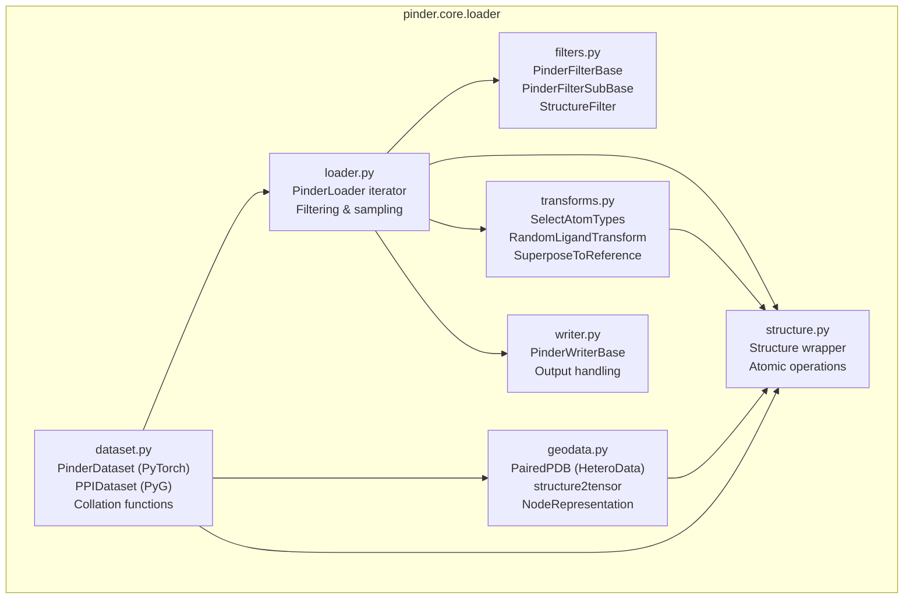
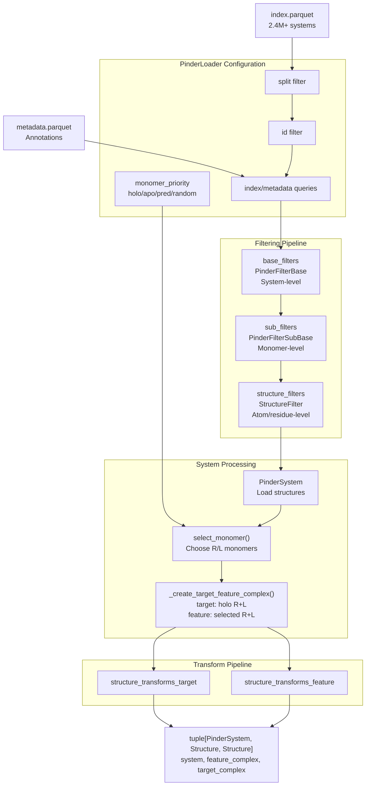
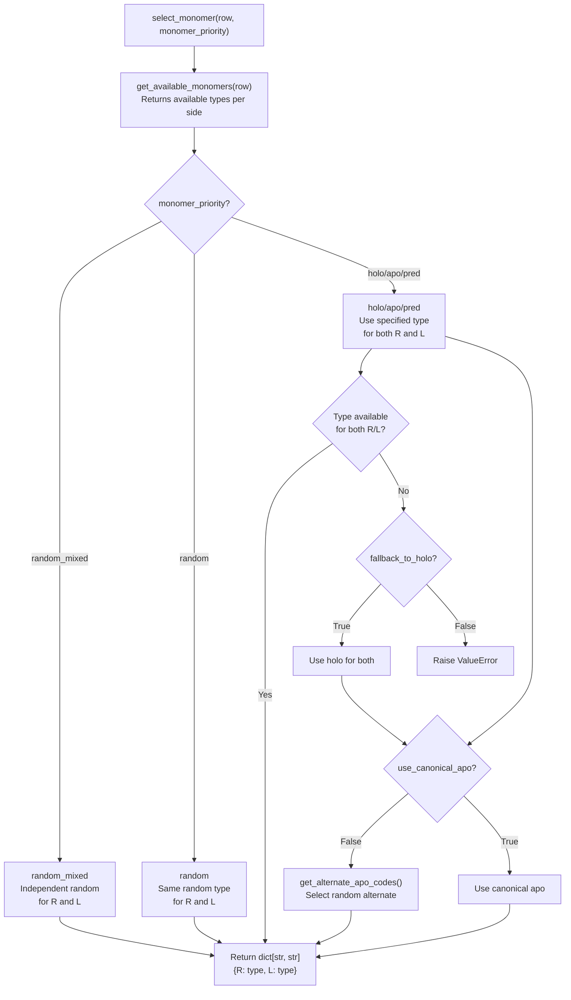
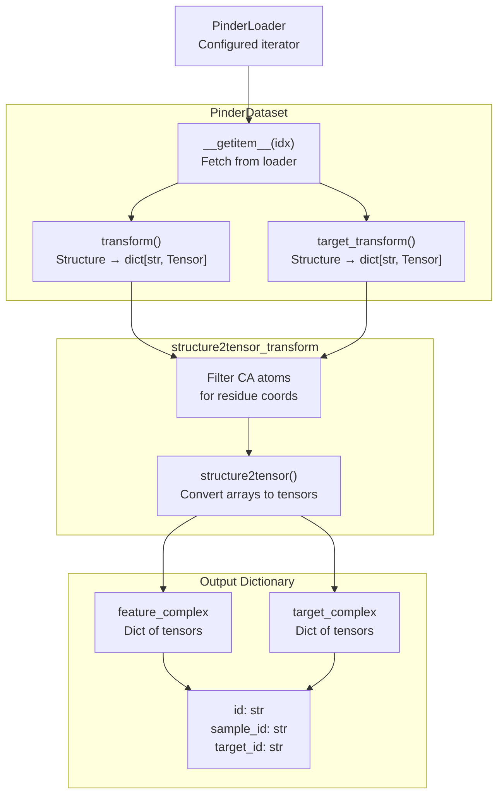
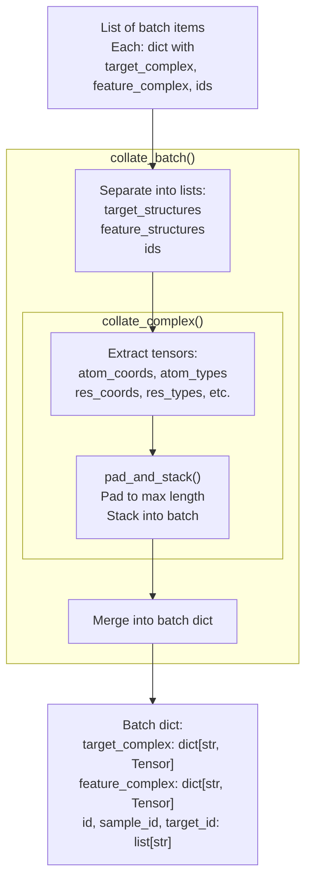
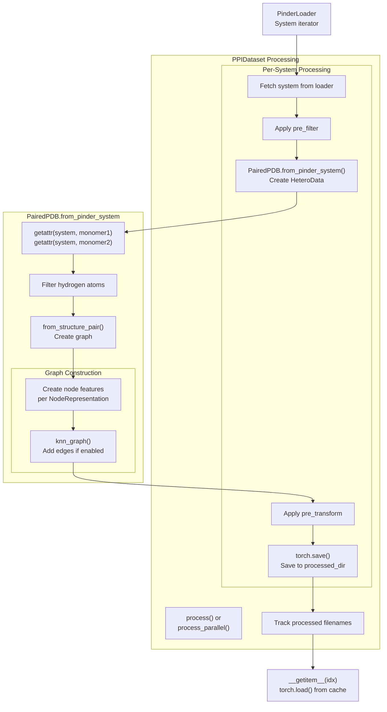
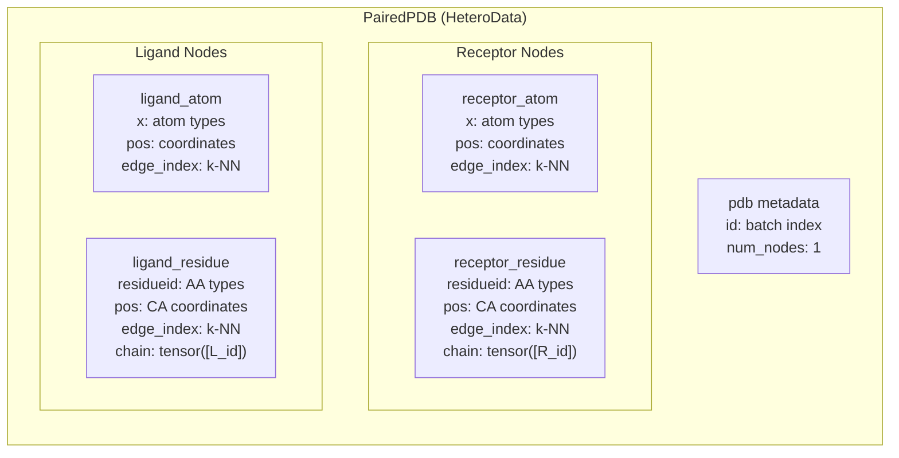
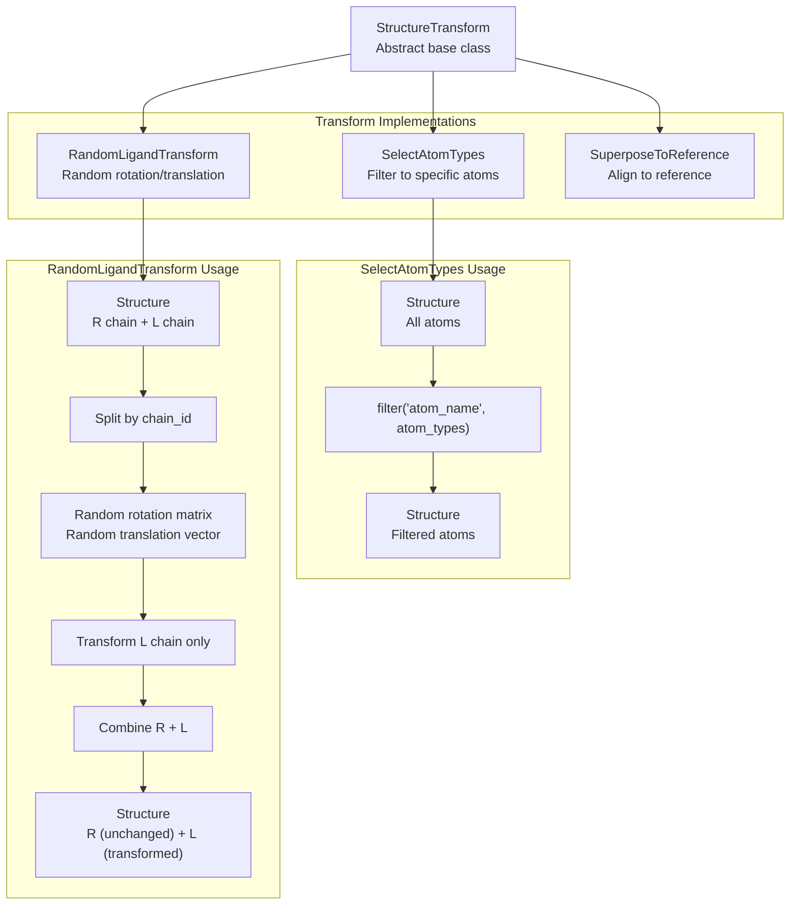

# pinder.core.loader

<details>
<summary>Relevant source files</summary>

The following files were used as context for generating this wiki page:

- [src/pinder-core/pinder/core/loader/dataset.py](src/pinder-core/pinder/core/loader/dataset.py)
- [src/pinder-core/pinder/core/loader/geodata.py](src/pinder-core/pinder/core/loader/geodata.py)
- [src/pinder-core/pinder/core/loader/loader.py](src/pinder-core/pinder/core/loader/loader.py)
- [src/pinder-core/pinder/core/loader/transforms.py](src/pinder-core/pinder/core/loader/transforms.py)
- [src/pinder-core/pinder/core/utils/timer.py](src/pinder-core/pinder/core/utils/timer.py)
- [tests/core/loader/test_transforms.py](tests/core/loader/test_transforms.py)

</details>


The `pinder.core.loader` module provides the data loading infrastructure for the PINDER dataset, bridging raw protein structure files to ML-ready tensors and graphs. This module contains iterator classes, PyTorch dataset implementations, filtering utilities, data transformations, and collation functions for batch processing.

For high-level data loading workflows and tutorials, see [Data Loading System](#4). For information about the core data structures that loaders operate on (PinderSystem, Structure), see [Core Data Structures](#3).

## Module Structure

The `pinder.core.loader` package consists of five main modules that work together to provide flexible data loading capabilities:



**Module Responsibilities:**

| Module | Purpose | Key Classes |
|--------|---------|-------------|
| `loader.py` | Core iterator with filtering and monomer selection | `PinderLoader` |
| `dataset.py` | PyTorch/PyG dataset implementations and collation | `PinderDataset`, `PPIDataset` |
| `structure.py` | Structure wrapper and atomic operations | `Structure` |
| `transforms.py` | Data augmentation and preprocessing | `SelectAtomTypes`, `RandomLigandTransform`, `SuperposeToReference` |
| `geodata.py` | Graph representations for GNNs | `PairedPDB`, `NodeRepresentation` |
| `filters.py` | System and structure filtering logic | Multiple filter classes |
| `writer.py` | Output and persistence utilities | `PinderWriterBase` |

Sources: [src/pinder-core/pinder/core/loader/dataset.py:1-19](), [src/pinder-core/pinder/core/loader/loader.py:1-24](), [src/pinder-core/pinder/core/loader/geodata.py:1-28]()

## PinderLoader

`PinderLoader` is the core orchestration class that manages iterating over PINDER systems, applying filters, selecting monomers, and creating target/feature complex pairs.



Sources: [src/pinder-core/pinder/core/loader/loader.py:192-439]()

### Initialization Parameters

The `PinderLoader.__init__()` method accepts extensive configuration for filtering and processing:

**Core Parameters:**
- `split` (str): Dataset split - "train", "val", "test" 
- `ids` (list[str]): Specific system IDs to load
- `index` (pd.DataFrame): Pre-filtered index (default: loads via `get_index()`)
- `metadata` (pd.DataFrame): Pre-filtered metadata (default: loads via `get_metadata()`)
- `subset` (DatasetName): Test subset - pinder_xl, pinder_s, or pinder_af2

**Filtering Parameters:**
- `base_filters` (list[PinderFilterBase]): System-level filters
- `sub_filters` (list[PinderFilterSubBase]): Monomer-level filters  
- `structure_filters` (list[StructureFilter]): Structure-level filters
- `index_query` (str): Pandas query string for index
- `metadata_query` (str): Pandas query string for metadata

**Monomer Selection Parameters:**
- `monomer_priority` (str): "holo", "apo", "pred", "random", or "random_mixed"
- `fallback_to_holo` (bool): Fall back to holo when priority unavailable (default: True)
- `use_canonical_apo` (bool): Use canonical vs alternate apo (default: True)
- `pre_specified_monomers` (dict | DataFrame): Override monomer selection per system

**Processing Parameters:**
- `crop_equal_monomer_shapes` (bool): Crop to common atoms (default: True)
- `max_load_attempts` (int): Retries before IndexError (default: 10)
- `structure_transforms_target` (list[StructureTransform]): Target transformations
- `structure_transforms_feature` (list[StructureTransform]): Feature transformations
- `writer` (PinderWriterBase): Optional output writer

Sources: [src/pinder-core/pinder/core/loader/loader.py:193-265]()

### Monomer Selection Logic

The `select_monomer()` function implements flexible monomer selection strategies:



**Monomer Priority Options:**

| Priority | Behavior |
|----------|----------|
| `"holo"` | Use bound (holo) structures for both receptor and ligand |
| `"apo"` | Use unbound (apo) structures; fallback to holo if unavailable |
| `"pred"` | Use AlphaFold predicted structures; fallback to holo if unavailable |
| `"random"` | Randomly select same type (holo/apo/pred) for both receptor and ligand |
| `"random_mixed"` | Independently select random types for receptor and ligand |

Sources: [src/pinder-core/pinder/core/loader/loader.py:81-149](), [src/pinder-core/pinder/core/loader/loader.py:37-78]()

### Indexing and Iteration

The `PinderLoader` implements both indexing (`__getitem__`) and iteration (`__iter__`) protocols:

**Indexing Protocol (`__getitem__`):**
```python
def __getitem__(self, idx: int) -> tuple[PinderSystem, Structure, Structure]:
    # Returns: (system, feature_complex, target_complex)
```

The method performs the following sequence:
1. Load system at index with retry logic (up to `max_load_attempts`)
2. Apply `base_filters` and `sub_filters` to PinderSystem
3. Select monomers based on `monomer_priority` or `pre_specified_monomers`
4. Create target (holo R+L) and feature (selected R+L) complexes
5. Apply `structure_filters` to validate complexes
6. Apply `structure_transforms_target` and `structure_transforms_feature`
7. Optionally write to `writer` if configured

If filters reject a system, a random index is selected and the process repeats until a valid system is found or `max_load_attempts` is exhausted.

**Iteration Protocol (`__iter__`):**
```python
def __iter__(self) -> Generator[tuple[PinderSystem, Structure, Structure], None, None]:
    for idx in range(len(self)):
        yield self[idx]
```

Sources: [src/pinder-core/pinder/core/loader/loader.py:357-405](), [src/pinder-core/pinder/core/loader/loader.py:351-355]()

## PinderDataset

`PinderDataset` is a PyTorch `Dataset` implementation that wraps `PinderLoader` and converts protein structures to dictionary-based tensor representations.



### Default Transform: structure2tensor_transform

The default transform converts `Structure` objects to dictionaries of tensors containing atomic and residue-level information:

**Output Dictionary Keys:**
- `atom_coordinates`: (N_atoms, 3) - XYZ coordinates of all atoms
- `atom_types`: (N_atoms, 1) - Atom name indices (CA, CB, N, etc.)
- `element_types`: (N_atoms, 1) - Chemical element indices (C, N, O, etc.)
- `residue_coordinates`: (N_residues, 3) - CA atom coordinates  
- `residue_types`: (N_residues, 1) - Amino acid type indices
- `residue_ids`: (N_residues, 1) - Residue numbering
- `chain_ids`: (N_residues, 1) - Chain identifiers (0 for R, 1 for L)

Sources: [src/pinder-core/pinder/core/loader/dataset.py:55-66](), [src/pinder-core/pinder/core/loader/geodata.py:30-70]()

### Batching and Collation

`PinderDataset` uses the `collate_batch()` function to merge variable-sized proteins into padded mini-batches:



**Padding Values:**

| Tensor Type | Pad Value | Constant |
|-------------|-----------|----------|
| Coordinates | -100 | `COORDS_PAD_VALUE` |
| Atom types | -1 | `ATOM_TYPE_PAD_VALUE` |
| Element types | -1 | `ELEMENT_TYPE_PAD_VALUE` |
| Residue IDs | -99 | `RES_IDX_PAD_VALUE` |
| Chain IDs | -1 | `CHAIN_ID_PAD_VALUE` |

The `pad_and_stack()` function pads each tensor dimension to the maximum observed in the batch, then stacks them along a new batch dimension.

Sources: [src/pinder-core/pinder/core/loader/dataset.py:205-243](), [src/pinder-core/pinder/core/loader/dataset.py:122-162](), [src/pinder-core/pinder/core/loader/dataset.py:165-202]()

### Creating DataLoader

The `get_torch_loader()` helper function creates a configured PyTorch `DataLoader`:

```python
def get_torch_loader(
    dataset: PinderDataset,
    batch_size: int = 2,
    shuffle: bool = True,
    sampler: Sampler[PinderDataset] | None = None,
    num_workers: int = 1,
    collate_fn: Callable = collate_batch,
    **kwargs: Any,
) -> DataLoader[PinderDataset]:
```

Sources: [src/pinder-core/pinder/core/loader/dataset.py:637-654]()

## PPIDataset

`PPIDataset` is a PyTorch Geometric `Dataset` implementation that creates heterogeneous graph representations (`PairedPDB`) for graph neural networks.



Sources: [src/pinder-core/pinder/core/loader/dataset.py:320-623](), [src/pinder-core/pinder/core/loader/geodata.py:79-176]()

### NodeRepresentation Types

The `NodeRepresentation` enum defines three node types for graph construction:

```python
class NodeRepresentation(Enum):
    Surface = "surface"
    Atom = "atom"  
    Residue = "residue"
```

**Graph Structure by Node Type:**

| Node Type | Node Store | Position | Features | Edges (if add_edges=True) |
|-----------|------------|----------|----------|---------------------------|
| Atom | `ligand_atom`, `receptor_atom` | `pos`: (N_atoms, 3) | `x`: atom type indices | k-NN graph (k=10) |
| Residue | `ligand_residue`, `receptor_residue` | `pos`: (N_residues, 3) | `residueid`: amino acid indices | k-NN graph (k=10) |

Sources: [src/pinder-core/pinder/core/loader/geodata.py:73-76](), [src/pinder-core/pinder/core/loader/geodata.py:109-176]()

### PairedPDB Structure

`PairedPDB` is a `HeteroData` object containing separate node stores for receptor and ligand:



The k-NN graph construction uses the `torch_cluster.knn_graph()` function to connect each node to its k nearest neighbors (default k=10).

Sources: [src/pinder-core/pinder/core/loader/geodata.py:79-176]()

### Processing Modes

`PPIDataset` supports three processing modes:

**Sequential Processing:**
```python
dataset = PPIDataset(
    node_types={NodeRepresentation.Atom, NodeRepresentation.Residue},
    split="train",
    parallel=False,
)
```

**Parallel Processing:**
```python
dataset = PPIDataset(
    node_types={NodeRepresentation.Atom, NodeRepresentation.Residue},
    split="train", 
    parallel=True,
    max_workers=4,
)
```

**Using Cache:**
```python
dataset = PPIDataset(
    node_types={NodeRepresentation.Atom, NodeRepresentation.Residue},
    split="train",
    use_cache=True,  # Load from existing processed files
)
```

When `use_cache=True`, the dataset reads filenames from `filenames_dir/filenames.txt` instead of reprocessing systems.

Sources: [src/pinder-core/pinder/core/loader/dataset.py:511-594]()

### Creating Geometric DataLoader

The `get_geo_loader()` helper function creates a PyTorch Geometric `DataLoader`:

```python
def get_geo_loader(
    dataset: PPIDataset,
    batch_size: int = 2,
    num_workers: int = 1,
) -> TorchGeoDataLoader:
```

PyTorch Geometric handles batching of heterogeneous graphs automatically by concatenating node/edge tensors and maintaining batch indices.

Sources: [src/pinder-core/pinder/core/loader/dataset.py:625-634]()

## Transform System

The transform system provides data augmentation and preprocessing capabilities through the `StructureTransform` base class.



Sources: [src/pinder-core/pinder/core/loader/transforms.py:20-95]()

### SelectAtomTypes

Filters structures to specific atom types (e.g., CA, backbone, heavy atoms):

```python
class SelectAtomTypes(StructureTransform):
    def __init__(self, atom_types: list[str] = ["CA"]) -> None:
        self.atom_types = atom_types
    
    def transform(self, structure: Structure) -> Structure:
        return structure.filter("atom_name", self.atom_types)
```

**Common Use Cases:**
- `atom_types=["CA"]`: C-alpha only representation
- `atom_types=["CA", "N", "C", "O"]`: Backbone atoms
- `atom_types=["C", "N", "O", "S"]`: Heavy atoms only

Sources: [src/pinder-core/pinder/core/loader/transforms.py:31-36]()

### RandomLigandTransform

Applies random rigid-body transformations to the ligand chain for data augmentation:

```python
class RandomLigandTransform(StructureTransform):
    def __init__(self, max_translation: float = 10.0) -> None:
        self.max_translation = max_translation
    
    def transform(self, structure: Structure) -> Structure:
        # Applies random rotation + translation to chain L
        # Keeps chain R unchanged
```

The transformation process:
1. Extract ligand atoms (chain_id == "L")
2. Generate random rotation matrix via `scipy.spatial.transform.Rotation.random()`
3. Generate random translation vector scaled by `max_translation`
4. Apply transformation: `coords = (rotation @ (coords - centroid).T).T + centroid + translation`
5. Recombine with unchanged receptor atoms

Sources: [src/pinder-core/pinder/core/loader/transforms.py:66-95]()

### SuperposeToReference

Aligns apo and predicted structures to holo reference structures:

```python
class SuperposeToReference(TransformBase):
    def __init__(self, reference_type: str = "holo") -> None:
        # reference_type: "holo" or "native"
    
    def transform(self, ppi: PinderSystem) -> PinderSystem:
        # Superimposes apo_receptor/ligand and pred_receptor/ligand
        # to holo_receptor/ligand using structure.superimpose()
```

This transform operates on `PinderSystem` objects rather than individual `Structure` objects, ensuring all unbound structures are aligned to their bound references before complex formation.

Sources: [src/pinder-core/pinder/core/loader/transforms.py:39-63]()

## Structure Class

The `Structure` class wraps biotite's `AtomArray` with additional functionality for filtering, alignment, and property access. For complete API documentation, see [Structure Class](#3.2).

### Key Properties and Methods

**Properties:**
- `coords`: NDArray - Atomic coordinates (N, 3)
- `atom_array`: AtomArray - Underlying biotite structure
- `atom_names`: list[str] - Atom names (CA, CB, etc.)
- `pinder_id`: str - Associated system identifier

**Methods:**
- `filter(property, mask, negate, copy)`: Filter atoms by property
- `superimpose(reference)`: Align to reference structure via RMSD minimization
- `ca_alignment(reference)`: Align C-alpha atoms only
- `match_length(reference)`: Crop to common atom set

The `Structure` class is instantiated by `PinderSystem` when loading protein structures from PDB files.

Sources: [src/pinder-core/pinder/core/loader/structure.py:1-500]() (file not provided but referenced in imports)

## Usage Examples

### Basic PinderDataset

```python
from pinder.core.loader import PinderDataset, get_torch_loader

# Create dataset
dataset = PinderDataset(
    split="train",
    monomer_priority="apo",
    fallback_to_holo=True,
)

# Create dataloader  
loader = get_torch_loader(
    dataset,
    batch_size=8,
    num_workers=4,
)

# Iterate
for batch in loader:
    target = batch["target_complex"]  # dict of tensors
    feature = batch["feature_complex"]  # dict of tensors
    ids = batch["id"]  # list of system IDs
```

### Dataset with Filtering

```python
from pinder.core.loader import PinderDataset
from pinder.core.loader.filters import FilterByMissingHolo

dataset = PinderDataset(
    split="train",
    base_filters=[FilterByMissingHolo()],
    index_query='cluster_id_R != cluster_id_L',  # Remove self-interactions
)
```

### Dataset with Transforms

```python
from pinder.core.loader import PinderDataset
from pinder.core.loader.transforms import SelectAtomTypes, RandomLigandTransform

dataset = PinderDataset(
    split="train",
    structure_transforms_target=[SelectAtomTypes(["CA"])],
    structure_transforms_feature=[
        SelectAtomTypes(["CA"]),
        RandomLigandTransform(max_translation=5.0),
    ],
)
```

### Graph Dataset for GNNs

```python
from pinder.core.loader import PPIDataset, get_geo_loader
from pinder.core.loader.geodata import NodeRepresentation

dataset = PPIDataset(
    node_types={NodeRepresentation.Atom, NodeRepresentation.Residue},
    split="train",
    monomer1="apo_receptor",
    monomer2="apo_ligand",
    add_edges=True,
    k=10,
)

loader = get_geo_loader(dataset, batch_size=16)

for batch in loader:
    # Access graph components
    receptor_pos = batch["receptor_atom"].pos
    ligand_pos = batch["ligand_atom"].pos  
    edges = batch["receptor_atom"].edge_index
```

### Direct PinderLoader Usage

```python  
from pinder.core.loader import PinderLoader

loader = PinderLoader(
    split="val",
    monomer_priority="pred",
)

for system, feature_complex, target_complex in loader:
    # system: PinderSystem object
    # feature_complex: Structure with pred monomers
    # target_complex: Structure with holo monomers
    pass
```

Sources: [src/pinder-core/pinder/core/loader/dataset.py:246-318](), [src/pinder-core/pinder/core/loader/dataset.py:320-404](), [src/pinder-core/pinder/core/loader/loader.py:192-439]()

---