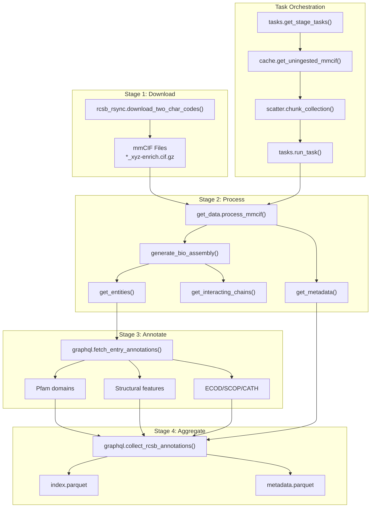
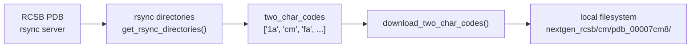
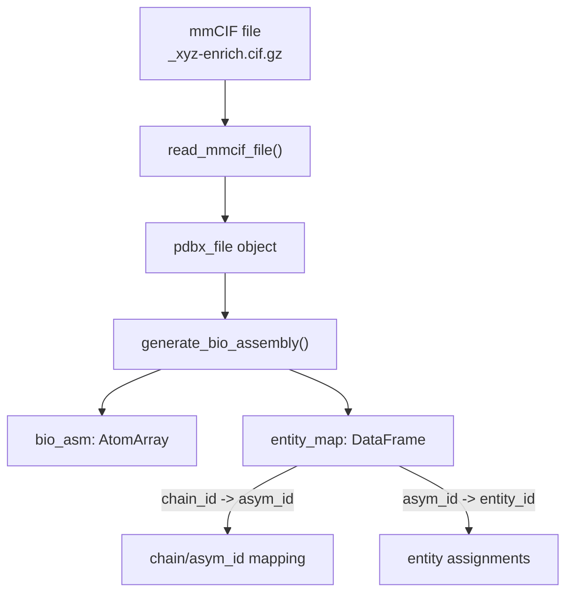
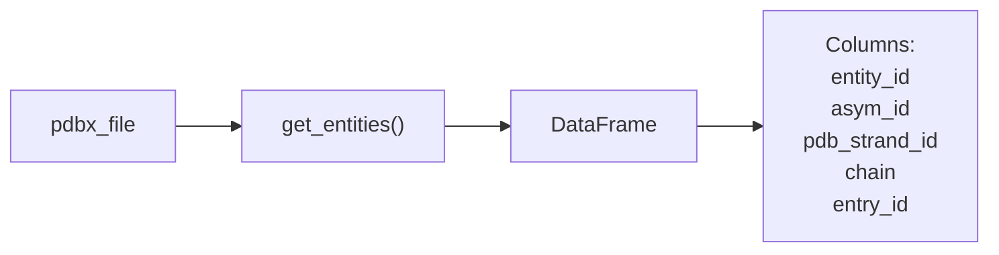
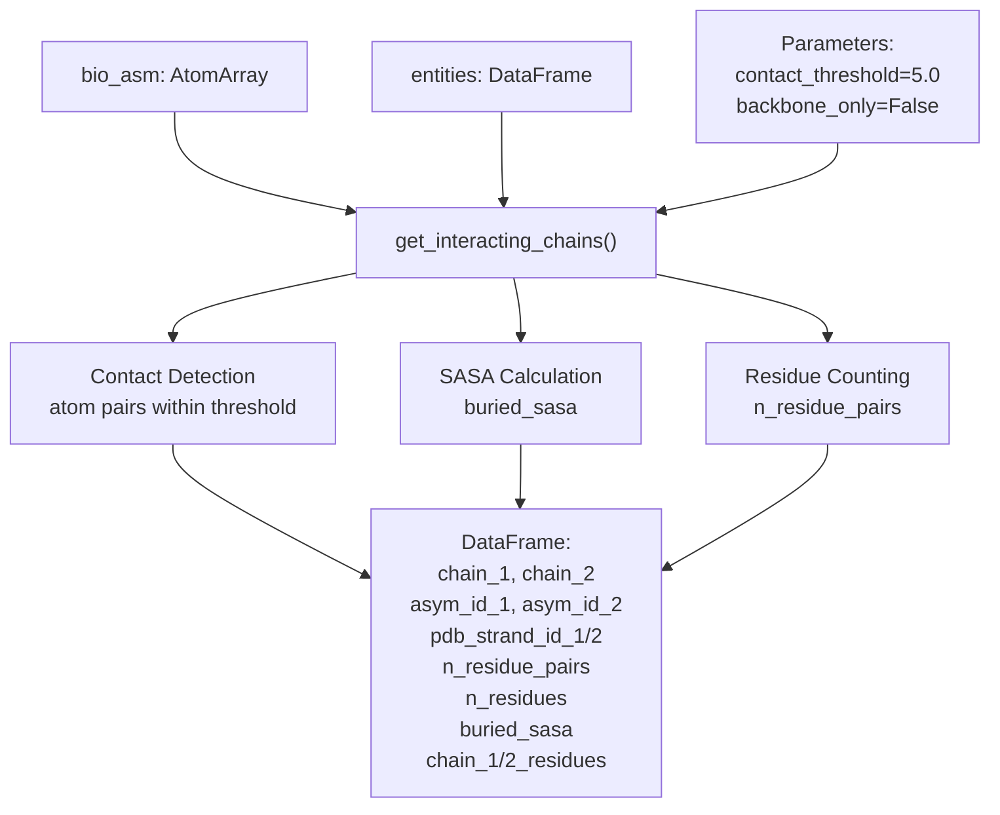
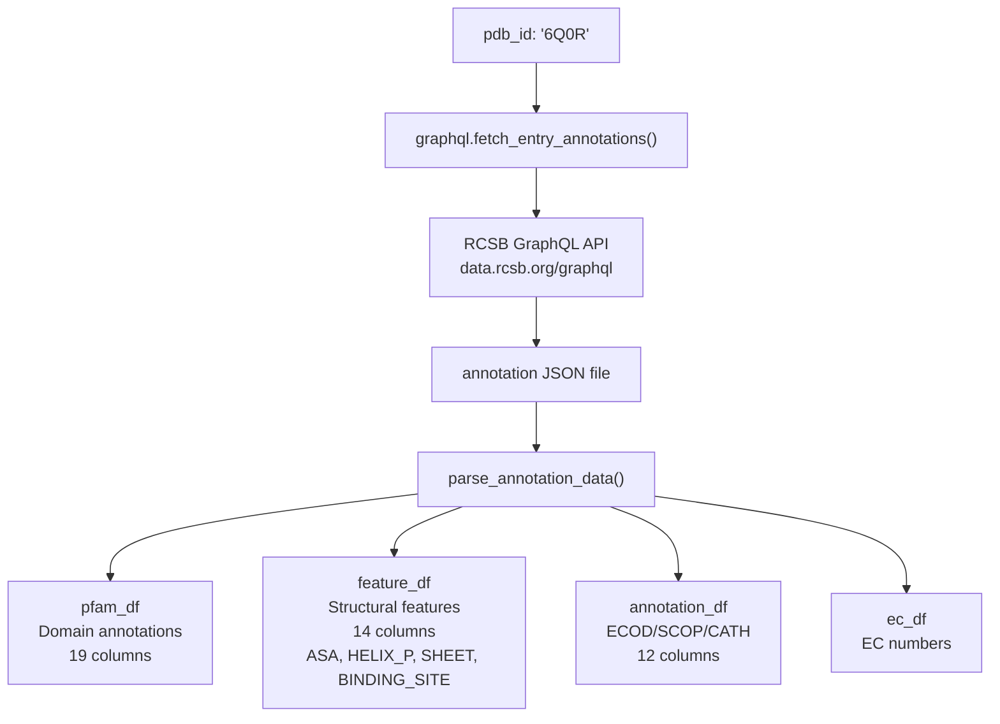
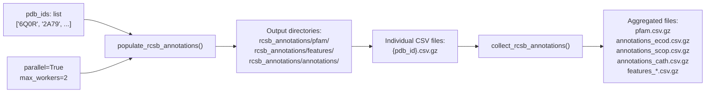
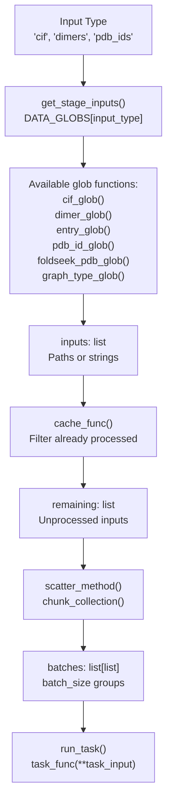
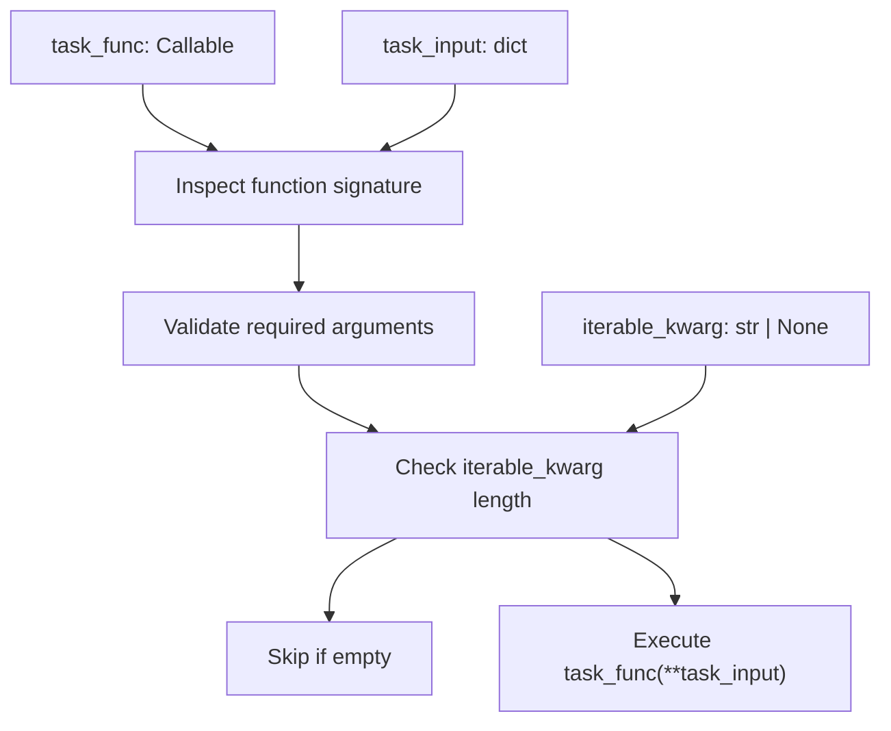
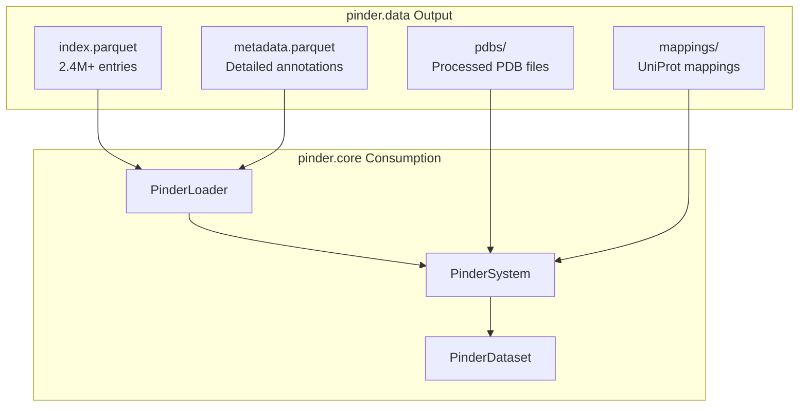

# pinder.data

<details>
<summary>Relevant source files</summary>

The following files were used as context for generating this wiki page:

- [pyproject.toml](pyproject.toml)
- [src/pinder-data/pinder/data/pipeline/tasks.py](src/pinder-data/pinder/data/pipeline/tasks.py)
- [tests/data/test_get_data.py](tests/data/test_get_data.py)
- [tests/data/test_graphql.py](tests/data/test_graphql.py)
- [tests/data/test_tasks.py](tests/data/test_tasks.py)

</details>


The `pinder.data` package is responsible for generating the PINDER dataset from raw RCSB PDB data. It orchestrates the download of mmCIF files, processes biological assemblies, identifies interacting chains, annotates structures with domain and functional information, and produces the curated index and metadata files that power the core PINDER system.

For information about using the generated dataset, see [pinder.core](#9.1). For evaluation tools, see [pinder.eval](#9.4).

## Purpose and Scope

The `pinder.data` pipeline transforms raw PDB structures into a structured dataset suitable for protein-protein docking research. Key responsibilities include:

- **Data acquisition** from RCSB PDB via rsync
- **Biological assembly generation** from mmCIF coordinate files
- **Interacting chain identification** based on spatial proximity and buried surface area
- **Metadata extraction** including resolution, method, oligomeric state
- **Annotation enrichment** with Pfam, ECOD, SCOP, and CATH domain classifications
- **Task orchestration** for parallel processing of thousands of structures
- **Quality control** and dataset curation

This package is typically used by PINDER maintainers to regenerate the dataset rather than by end users who consume the pre-generated data.

Sources: [pyproject.toml:38-47](), [tests/data/test_get_data.py:1-368]()

## Architecture Overview

The pipeline follows a multi-stage architecture where each stage processes inputs from the previous stage and produces outputs consumed by the next.



Sources: [tests/data/test_get_data.py:12-368](), [tests/data/test_graphql.py:1-100]()

## Data Acquisition from RCSB

The pipeline downloads mmCIF files from RCSB PDB using rsync, organizing them by two-character codes derived from PDB IDs.

### Two-Character Code Organization

RCSB organizes structures using the middle two characters of the PDB ID. For example, PDB entry `7cm8` is stored under directory `cm/pdb_00007cm8/`.



### Key Functions

| Function | Purpose | Location |
|----------|---------|----------|
| `get_rsync_directories()` | Lists available two-character codes on RCSB server | [rcsb_rsync module]() |
| `get_rsync_two_char_pdb_entries()` | Lists PDB entries for a specific two-character code | [rcsb_rsync module]() |
| `download_two_char_codes()` | Downloads all mmCIF files for specified codes | [rcsb_rsync module]() |
| `get_two_char_codes_not_downloaded()` | Identifies missing two-character codes | [rcsb_rsync module]() |

Sources: [tests/data/test_get_data.py:12-38](), [src/pinder-data/pinder/data/pipeline/tasks.py:36-41]()

## mmCIF Processing Pipeline

The core processing logic extracts biological assemblies, identifies entities, and detects interacting chains from mmCIF coordinate files.

### Biological Assembly Generation

The `generate_bio_assembly()` function reads the `_pdbx_struct_assembly*` categories from mmCIF files and applies transformation matrices to create the biological assembly.



The `entity_map` DataFrame maps assembly chains to asymmetric unit IDs and entity IDs, which is crucial for tracking chains across transformations.

Sources: [tests/data/test_get_data.py:242-362]()

### Entity Extraction

The `get_entities()` function extracts information about molecular entities from the mmCIF file, including chain assignments, entity types, and sequence information.



Sources: [tests/data/test_get_data.py:107-149]()

### Interacting Chain Detection

The `get_interacting_chains()` function identifies pairs of chains that interact based on spatial proximity and calculates buried surface area (SASA).



The function supports two modes:
- **`backbone_only=False`**: Considers all atoms for contact detection
- **`backbone_only=True`**: Only considers backbone atoms (CA, C, N, O)

Sources: [tests/data/test_get_data.py:40-163]()

### Complete Processing Workflow

The `process_mmcif()` function orchestrates the complete processing of a single mmCIF file.

| Step | Function | Output |
|------|----------|--------|
| 1. Read file | `read_mmcif_file()` | `pdbx_file` object |
| 2. Generate assembly | `generate_bio_assembly()` | `bio_asm` AtomArray, `entity_map` |
| 3. Extract entities | `get_entities()` | Entity DataFrame |
| 4. Map sequences | `sequence_mapping()` | Residue-level mapping |
| 5. Find interactions | `get_interacting_chains()` | Interacting chain pairs |
| 6. Extract metadata | `get_metadata()` | Resolution, method, dates |
| 7. Write outputs | File I/O | `{pdb_id}-metadata.tsv`, `{pdb_id}-assembly.cif` |

Sources: [tests/data/test_get_data.py:217-240](), [tests/data/test_get_data.py:364-368]()

## Annotation Pipeline

The annotation system enriches structures with domain classifications and functional information from RCSB using GraphQL queries.

### GraphQL Data Fetching

The `fetch_entry_annotations()` function queries the RCSB GraphQL API to retrieve comprehensive annotations for a PDB entry.



### Annotation Types

| Annotation Type | Description | Column Count | Example Fields |
|-----------------|-------------|--------------|----------------|
| Pfam | Protein family domains | 19 | `rcsb_id`, `rcsb_pfam_identifier`, `pfam_accession` |
| Features | Structural features | 14 | `type`, `asym_id`, `beg_seq_id`, `end_seq_id` |
| Annotations | Domain classifications | 12 | `annotation_id`, `name`, `type`, `provenance_source` |
| EC | Enzyme classifications | Variable | `ec_number`, `enzyme_name` |

**Feature Types** include:
- `ASA` - Accessible surface area
- `HELIX_P`, `SHEET` - Secondary structure
- `BINDING_SITE` - Ligand binding sites
- `SCOP`, `SCOP2B_SUPERFAMILY`, `CATH`, `ECOD` - Domain classifications
- `UNOBSERVED_RESIDUE_XYZ`, `UNOBSERVED_ATOM_XYZ` - Missing coordinates
- `CIS-PEPTIDE` - Unusual peptide bonds

Sources: [tests/data/test_graphql.py:13-64]()

### Batch Annotation Processing

The `populate_rcsb_annotations()` function processes multiple PDB entries in parallel.



Sources: [tests/data/test_graphql.py:66-100]()

## Task Orchestration System

The task orchestration system manages the parallel processing of thousands of structures through a batching and caching mechanism.

### Task Flow



### Stage Task Generation

The `get_stage_tasks()` function orchestrates the creation of task batches for a pipeline stage.

| Parameter | Type | Purpose |
|-----------|------|---------|
| `data_dir` | `Path` | Root directory for data files |
| `input_type` | `str` | Type of input: 'cif', 'dimers', 'pdb_ids', etc. |
| `batch_size` | `int` | Number of inputs per batch |
| `cache_func` | `Callable` | Function to filter processed inputs |
| `cache_kwargs` | `dict` | Arguments for cache function |
| `scatter_method` | `Callable` | Function to split into batches (default: `chunk_collection`) |
| `scatter_kwargs` | `dict` | Arguments for scatter function |

Sources: [src/pinder-data/pinder/data/pipeline/tasks.py:117-138]()

### Task Execution

The `run_task()` function validates and executes a task function with proper error handling.



The function performs signature validation to ensure all required parameters are provided before execution.

Sources: [src/pinder-data/pinder/data/pipeline/tasks.py:141-182](), [tests/data/test_tasks.py:95-104]()

### Available Input Types

The `DATA_GLOBS` dictionary maps input type names to glob functions:

```python
DATA_GLOBS = {
    "cif": cif_glob,                    # mmCIF files: */*/*enrich.cif.gz
    "dimers": dimer_glob,               # Dimer PDB files: */*/*__*--*__*.pdb
    "entries": entry_glob,              # Entry directories
    "two_char_codes": two_char_code_rsync,  # RCSB two-char codes to download
    "pdb_ids": pdb_id_glob,            # PDB IDs from entry directories
    "foldseek": foldseek_pdb_glob,     # Foldseek input PDBs: *.pdb
    "graph_types": graph_type_glob,    # Alignment graph types
    "putative_apo_pairings": putative_apo_pairings,  # Apo/holo pairings
}
```

Sources: [src/pinder-data/pinder/data/pipeline/tasks.py:87-96]()

### Caching Mechanism

Cache functions filter out already-processed inputs to avoid redundant work. Example cache functions:

| Cache Function | Purpose | Module |
|----------------|---------|--------|
| `get_uningested_mmcif()` | Find mmCIF files not yet processed | `cache` module |
| `get_pisa_unannotated()` | Find structures missing PISA annotations | `cache` module |
| `get_rcsb_unannotated()` | Find structures missing RCSB annotations | `cache` module |

Sources: [tests/data/test_tasks.py:22-93]()

## Command-Line Interface

The `pinder.data` package provides several CLI commands for pipeline execution and data management.

### Main Pipeline Command

The `pinder_data` command is the entry point for running the complete data generation pipeline.

```bash
pinder_data --help
```

Entry point: [pyproject.toml:39]()

### Related Commands

| Command | Purpose | Entry Point |
|---------|---------|-------------|
| `pinder_qc` | Quality control and validation | [pyproject.toml:46]() |
| `pinder_plot` | Visualization and plotting | [pyproject.toml:47]() |

## Module Reference

The `pinder.data` package contains several sub-modules organized by functionality:

| Module | Primary Purpose | Key Components |
|--------|-----------------|----------------|
| `rcsb_rsync` | Download data from RCSB PDB | `download_two_char_codes()`, `get_rsync_directories()` |
| `get_data` | Process mmCIF files | `process_mmcif()`, `generate_bio_assembly()`, `get_interacting_chains()` |
| `annotation.graphql` | Fetch RCSB annotations | `fetch_entry_annotations()`, `populate_rcsb_annotations()` |
| `pipeline.tasks` | Task orchestration | `get_stage_tasks()`, `run_task()` |
| `pipeline.cache` | Caching processed results | Cache validation functions |
| `pipeline.scatter` | Batch distribution | `chunk_collection()` |
| `foldseek_utils` | FoldSeek clustering utilities | `create_fasta_from_systems()` |
| `get_apo` | Apo structure identification | `get_putative_pairings()` |
| `get_dimers` | Dimer processing | Entry directory utilities |
| `qc` | Quality control | Validation and statistics |
| `plot` | Visualization | Plotting utilities |

### Dependencies

The `pinder.data` package requires additional dependencies beyond the core package:

```python
# From pyproject.toml [project.optional-dependencies.data]
data = [
    "fire",                      # CLI framework
    "gemmi",                     # mmCIF parsing
    "networkx",                  # Graph algorithms
    "scikit-learn <= 1.2.2",    # Clustering (PRODIGY-cryst)
    "python-graphql-client",     # GraphQL queries
    "mpire",                     # Parallel processing
    "matplotlib",                # Plotting
    "seaborn",                   # Statistical visualization
    "colormath",                 # Color manipulation
]
```

Sources: [pyproject.toml:96-106]()

## Integration with Core Dataset

The outputs of `pinder.data` are consumed by `pinder.core` to provide the user-facing dataset interface.



For details on how to use the generated dataset, see [pinder.core](#9.1) and [Data Loading System](#4).

Sources: [pyproject.toml:138-147]()

---